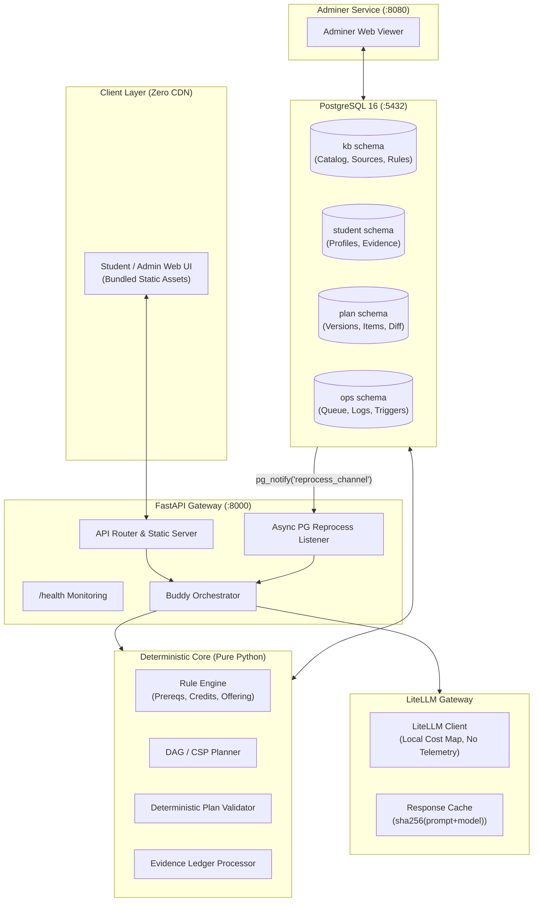

# Architectural Overview — Personalised Learning Buddy

**Purpose:** Comprehensive guide to the system topology, multi-schema database architecture, deterministic vs probabilistic boundaries, and operational event flows.  
**Last Updated:** Phase 1 (Foundation & Data Model)

---

## 1. System Topology

---

## 2. PostgreSQL 4-Schema Separation

To ensure clean isolation, maintainability, and ease of inspection via Adminer, the database is partitioned into four distinct schemas:

1. **`kb` (Knowledge Base):**
   - Canonical representation of curriculum documents, official syllabus catalogs, machine-readable academic ordinances, learning playlists, and research projects.
   - **Immutable during normal student usage**: Updated solely by curriculum administrators or through verified seed ingestion scripts.
   - Every entity carries an explicit `source_id` foreign key referencing `kb.source`.

2. **`student` (Profiles, Evidence Ledger, Constraints):**
   - Student state storage.
   - `student.skill_evidence` operates as an **append-only evidence ledger**, preserving complete auditability for all diagnostic quizzes, assignment submissions, course grades, and self-declared interests.
   - `student.skill_state` is strictly **derived** from the ledger and never hand-edited.

3. **`plan` (Outputs, Audits, Versioning):**
   - Stores versioned student roadmaps (`plan.plan`, `plan.plan_item`).
   - Every plan is accompanied by a deterministic `validation_report` documenting compliance with credit caps, prerequisites, and semester offerings.
   - Any adaptation produces a `plan_diff` describing structural additions, removals, and pace shifts.

4. **`ops` (System Operations & Event Queue):**
   - Stores multi-turn chat sessions (`conversation`, `message`).
   - Manages asynchronous re-planning events triggered by direct SQL edits via `ops.reprocess_queue`.
   - Records token usage, latency, and cache hits in `ops.llm_call_log`.

---

## 3. Reactive Database Re-processing Mechanism

A core requirement is that any direct modification in Adminer, the Admin UI, or the REST API triggers immediate plan re-evaluation:

1. **Native PostgreSQL Triggers:**
   - Attached to editable tables (`student.completed_course`, `student.skill_evidence`, `student.goal`, `student.constraint`, `kb.course`, `kb.academic_rule`).
   - Executes `AFTER INSERT OR UPDATE OR DELETE` on each row.
2. **Notification & Enqueue:**
   - Inserts an audit event into `ops.reprocess_queue` with status `'pending'`.
   - Fires `pg_notify('reprocess_channel', ...)` with JSON metadata containing table, action, and affected student ID.
3. **Background Async Worker:**
   - A persistent async worker in FastAPI listens on `reprocess_channel`.
   - Upon receipt, it re-calculates `student.skill_state`, executes the planner and validator, and generates a new plan version tagged with `trigger = 'admin_edit'`.

---

## 4. LiteLLM & Air-gap Enforcement

- All LLM and embedding interactions route exclusively through LiteLLM.
- Model selection and authentication are governed entirely by environment variables (`LLM_MODEL`, `LLM_API_KEY`, `LLM_API_BASE`, `EMBEDDING_MODEL`).
- Outbound network traffic is strictly quarantined:
  - `LITELLM_LOCAL_MODEL_COST_MAP=True` prevents remote pricing requests.
  - `LITELLM_TELEMETRY=False` disables telemetry calls to third-party servers.
  - Frontend static assets are pre-bundled at Docker build time (zero runtime CDN fetches).

