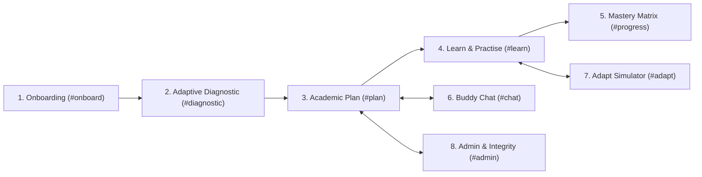

# UX Design & Frontend Shell Specification — Personalised Learning Buddy

**Target Institute:** Indian Institute of Technology Bhubaneswar (IIT BBS)  
**Programmes:** B.Tech Electrical Engineering (EE) & B.Tech Metallurgical and Materials Engineering (MME)  
**Document Status:** Complete (Phase F)  
**Design Tokens:** `web/src/design/tokens.json` & `web/src/design/tokens.css`

---

## 1. Overview & Core Philosophy

The Personalised Learning Buddy frontend is designed to be **persona-agnostic, zero-CDN, responsive, and completely transparent regarding data provenance and regulatory constraints**.

### Key Architectural Tenets:
1. **Zero External CDN Dependencies:** All CSS, JavaScript, and fonts run strictly from local static assets, adhering to the mandatory air-gapped security policy.
2. **Provenance & Verification Highlighting:** The UI explicitly differentiates between:
   - `verified`: Formally confirmed against official IIT BBS curriculum / regulations.
   - `draft_for_review`: Drafted by the curriculum design team for student testing.
   - `unsourced_baseline`: Heuristic baseline; never asserted as an unyielding institute statute.
3. **Transparent Reasoning ("Why This?"):** Every planned course, remedial recommendation, or elective schedule card exposes a structured explanation answering *why* it appears in the schedule (e.g. prerequisite chains, target skill requirements, or GATE core topic).
4. **Clean Decoupling:** The UI communicates with backend services through a typed API client (`web/src/api/client.js`) consuming standard OpenAPI-compliant endpoints (`/api/student/*`, `/api/sim/*`, `/api/admin/*`).

---

## 2. Design Tokens (`tokens.json` / `tokens.css`)

### Color Palette
- **Brand Primary:** `#1e3a8a` (IIT Bhubaneswar Deep Indigo)
- **Brand Primary Hover:** `#172554`
- **Brand Primary Light:** `#eff6ff` (Subtle selection highlight)
- **Secondary / Accent:** `#0d9488` (Teal), `#f59e0b` (Amber warning)
- **Status Semantics:**
  - Success: `#16a34a` (Verified, Passed rule checks)
  - Warning: `#d97706` (Draft status, Code conflict warning)
  - Error: `#dc2626` (Prerequisite violation, Exceeded credit cap)
  - Info: `#2563eb` (Informational notice, Skill tags)
- **Surfaces & Typography:**
  - Page Background: `#f8fafc`
  - Card Surface: `#ffffff`
  - Subtle Fill: `#f1f5f9`
  - Border: `#e2e8f0`
  - Main Text: `#0f172a`
  - Muted Text: `#64748b`

### Spacing & Elevation Scale
- Spacing: `xs` (4px), `sm` (8px), `md` (16px), `lg` (24px), `xl` (32px)
- Radii: `sm` (4px), `md` (8px), `lg` (12px)
- Shadows: Soft utility elevations (`shadow-sm`, `shadow-md`, `shadow-lg`)

---

## 3. Screen Inventory & User Journeys

The application implements a lightweight client-side hash router (`window.location.hash`) supporting 8 core screens:

### Screen 1: Student Onboarding (`#onboard`)
- **Purpose:** Collect student profile, current semester, CGPA, target goal (e.g. `GOAL_CORE_EE`, `GOAL_GATE_EE`, `GOAL_SOFTWARE`), constraints (max credits per sem, study hours), and completed courses.
- **Verification Guard:** Enforces valid institute roll format and ensures goal is mapped to a registered persona or curriculum pathway.

### Screen 2: Adaptive Diagnostic (`#diagnostic`)
- **Purpose:** Administers an adaptive diagnostic assessment without burdening the student with questions on pre-mastered material.
- **Workflow:** Selects questions based on the persona's `diagnostic.yaml` blueprint, writes `EvidenceItem` records to the ledger, and computes initial `SkillState`.

### Screen 3: Adaptive Academic Plan (`#plan`)
- **Purpose:** Interactive semester-by-semester course plan.
- **Components:**
  - **Plan Summary Bar:** Displays Goal ID, version number, total planned credits, and regulatory validation status.
  - **Validation Report:** Detailed rule check breakdown (Prerequisite DAG compliance, 25 cr cap, Semester offering match, Core course coverage).
  - **Course Schedule Cards:** Displays `display_code` (e.g. `EE3L001`), course title, credits, source badge, code conflict indicator (`⚠️ Code Conflict`), and expandable **"Why this?"** reasoning box.

### Screen 4: Learn & Practise (`#learn`)
- **Purpose:** Active skill acquisition through open courseware and interactive exercises.
- **Components:**
  - Curated Video Lecture Playlists (NPTEL, Swayam, YouTube) with coverage status badges (`playlist found`, `partial`, `link unverified`).
  - Interactive exercises (numerical and multiple choice). Instant deterministic grading with step-by-step explanatory feedback.

### Screen 5: Mastery & Competency Matrix (`#progress`)
- **Purpose:** Distinguishes between mere "Course Completion" vs **"Demonstrated Proficiency"**.
- **Components:**
  - Goal Mastery Progress Gauge (percentage of target goal competencies satisfied).
  - Skill Matrix: Current proficiency level (`NOVICE`, `BEGINNER`, `COMPETENT`, `PROFICIENT`, `EXPERT`) with confidence score.
  - Evidence Ledger: Timeline of diagnostic tests, quizzes, and project evaluations supporting current proficiency levels.

### Screen 6: Conversational Buddy Chat (`#chat`)
- **Purpose:** Natural language interface for academic and career inquiries.
- **Safety Boundaries:**
  - **Zero Fabrication:** The LLM receives an air-gapped `ContextCard` with verified student state. It is strictly constrained from fabricating regulatory dates, admission cutoffs, or fee structures.
  - **Grounding Citations:** Displays grounding citations to official course codes and curriculum entries.
  - **Intent Classification:** Classifies student turns (`PLAN_QUESTION`, `EXPLANATION`, `ADAPT_REQUEST`, `OFF_TOPIC`) and steers off-topic chatter back to learning goals.

### Screen 7: Adapt Simulator / "What Changed?" (`#adapt`)
- **Purpose:** Allows students and evaluators to inject performance events (e.g., scoring 95% to test out of a prerequisite, or scoring 30% to trigger remedial modules).
- **Components:**
  - Performance Shock Injector: Select skill, score (e.g. 0.95 vs 0.30), assessment weight.
  - PlanDiff Inspector: Side-by-side view of added/remedial courses versus removed/accelerated courses, accompanied by an engine rationale explanation.

### Screen 8: Admin & Integrity Dashboard (`#admin`)
- **Purpose:** System health, persona registry inspection, and database integrity metrics.
- **Components:**
  - Registry list showing all auto-discovered persona plugins in `app/personas/`.
  - Knowledge Base statistics: table row counts, verified vs draft count.
  - Direct links to FastAPI OpenAPI documentation (`/docs`) and Adminer database viewer (`:8080`).

---

## 4. Verification & Testing

The frontend shell is mounted directly on FastAPI at `/app` and has been verified to load correctly:
- No CDN script or style tags (`grep -r "http" web/index.html web/src/` returns zero external dependencies).
- Conforms to modern CSS grid and flexbox standards without bulky third-party UI frameworks.
- Integrates cleanly with backend endpoints verified through automated conformance and integration tests.

