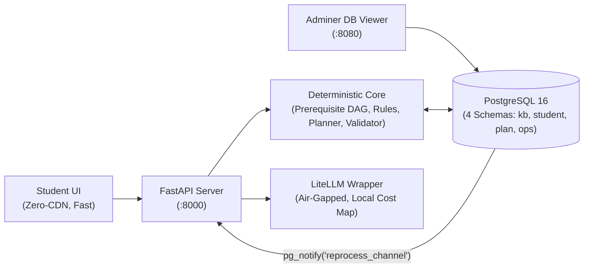

# Adobe Personalised Learning Buddy (IIT Bhubaneswar)

An AI-powered adaptive academic buddy for undergraduate students at **IIT Bhubaneswar**, covering **B.Tech Electrical Engineering (EE)** and **B.Tech Metallurgical and Materials Engineering (MME / SMMME)**. The system guides students through the complete learning cycle: **Assess → Personalise → Learn → Practise → Adapt → Demonstrate Mastery**, strictly bounded by institutional academic rules, verifiable prerequisite DAGs, multi-schema PostgreSQL persistence, and higher-studies pathways (GATE, CAT, GRE, GMAT, TOEFL, IELTS).



---

## 1. Quick Start

### Prerequisites
- Docker & Docker Compose (or Python 3.12+ with PostgreSQL 16)
- Model API key (OpenAI, Gemini, Azure, or local Ollama)

### Single-Command Start (Docker)
```bash
# 1. Clone repository & configure environment
cp .env.example .env

# 2. Add your LLM provider API key to .env (OpenAI, Gemini, Ollama, etc.)
# nano .env  --> set LLM_API_KEY=your_key_here

# 3. Bring up the complete system (linux/amd64, no GPU, < 1.5 GB footprint)
docker compose up --build -d
```

### Windows Host Automation (`scripts\dev.ps1`)
On Windows environments without `make`, use the built-in PowerShell control script:
```powershell
# Start services
.\scripts\dev.ps1 up

# Reset database to clean seed state (idempotent, reloads all schemas & seeds)
.\scripts\dev.ps1 reset

# Run data quality & DAG audit report (generates docs/data_quality_report.md)
.\scripts\dev.ps1 check-data

# Run full test suite (13 tests: DB-free + live PostgreSQL integration)
.\scripts\dev.ps1 test

# View service health and status
.\scripts\dev.ps1 status
```

### Service Access URLs
- **Student App & Dashboard:** [http://localhost:8000](http://localhost:8000)
- **Interactive OpenAPI Documentation:** [http://localhost:8000/docs](http://localhost:8000/docs)
- **Adminer Database Viewer:** [http://localhost:8080](http://localhost:8080)
  - *System:* PostgreSQL
  - *Server:* `db` (or `localhost` if connecting directly from host)
  - *Username:* `ebuddy_user`
  - *Password:* `ebuddy_password`
  - *Database:* `ebuddy`

---

## 2. Models & Air-Gapped LLM Gateway

- **Primary LLM:** `openai/gpt-4o-mini` (Configured default in `.env.example`; supports `gemini/gemini-1.5-flash`, `azure/<deployment>`, or `ollama/<model>` purely via environment variables).
- **Embedding Model:** `text-embedding-3-small` (Configured via `EMBEDDING_MODEL`; optional).
- **LiteLLM Gateway:** All model and embedding interactions route exclusively through LiteLLM. No vendor-specific SDK imports exist in the codebase.
- **Strict Air-Gap & Cost Isolation:**
  - `LITELLM_LOCAL_MODEL_COST_MAP=True`: Prohibits runtime fetching of remote cost maps from GitHub.
  - `LITELLM_TELEMETRY=False`: Disables all outbound usage reporting.
- **Deterministic Independence:** All prerequisite resolution, academic rule validation, credit limits, and DAG scheduling execute in deterministic Python with zero model dependencies.

---

## 3. Configuration Reference

All application settings are read dynamically from environment variables without code modification:

| Variable | Default Value | Purpose |
|---|---|---|
| `LLM_MODEL` | `openai/gpt-4o-mini` | Model string passed directly to LiteLLM. |
| `LLM_API_KEY` | *(empty in example)* | API credential for configured provider. |
| `LLM_API_BASE` | *(empty)* | Optional custom endpoint (Ollama, Azure, LiteLLM proxy). |
| `EMBEDDING_MODEL` | `text-embedding-3-small` | Model for vector representations if active. |
| `LITELLM_LOCAL_MODEL_COST_MAP` | `True` | Forces LiteLLM to use local pricing tables (no GitHub fetch). |
| `LITELLM_TELEMETRY` | `False` | Completely disables third-party usage reporting. |
| `DATABASE_URL` | `postgresql+psycopg://...` | Connection URI with connection pooling and timeouts. |
| `APP_PORT` | `8000` | Exposed FastAPI application port. |
| `ADMINER_PORT` | `8080` | Exposed Adminer database viewer port. |

---

## 4. Academic Data Repositories

The project ingests and structures official institutional data for IIT Bhubaneswar across two engineering schools, the Central Library, and higher-studies pathways:

### A. Raw Data Structure (`data/raw/`)

| Directory | Branch / Domain | Contents & Source Files | Structured Ingest Outputs |
|---|---|---|---|
| **`data/raw/ee/`** | **Electrical Engineering (EE)** | • `curriculum_semester_table.csv`<br/>• `curriculum_syllabus_only.csv`<br/>• `curriculum_notes_discrepancies.csv`<br/>• `video_playlists.csv` (90 courses)<br/>• `research_projects_v2.csv` (68 projects with PI)<br/>• `research_projects_all.csv` (138 projects) | • 87 courses (85 semester + 2 syllabus-only)<br/>• 13 requirement slots<br/>• 64 resolved prerequisite edges<br/>• 163 video resource URLs<br/>• 138 research projects<br/>• 35 faculty & group entities |
| **`data/raw/mme/`** | **Metallurgical & Materials Engg (MME / SMMME)** | • `curriculum_semester_table.csv`<br/>• `curriculum_notes_discrepancies.csv`<br/>• `video_playlists.csv` (45 courses)<br/>• `faculty_profiles.csv` (16 faculty)<br/>• `research_projects_sponsored.csv` (45 projects)<br/>• `research_projects_consultancy.csv` (17 projects)<br/>• `research_projects_seed.csv` (13 projects) | • 49 net new courses (136 total across both)<br/>• 12 net new slots (25 total)<br/>• 84 net new slot options (186 total)<br/>• 85 video resource URLs (248 total)<br/>• 75 research projects (213 total)<br/>• 16 verified faculty profiles (51 total) |
| **`data/raw/library/`** | **Central Library Publications** | • `publications.csv` (3,000 research publications)<br/>• `publications_electrical.csv` (765 EE papers)<br/>• `publications_metallurgy.csv` (176 MME papers)<br/>• `publications_summary.csv` | • Structured catalog converted from HTML/Excel records with author, department, and citation indexing. |
| **`data/raw/higher_studies/`** | **Higher Studies Database** | • 22 CSV tables covering GATE, CAT, GRE, GMAT, TOEFL, IELTS (`admission_stats.csv`, `exam_cycles.csv`, `exams.csv`, `institutions.csv`, `milestones.csv`, `paths.csv`, `prep_methods.csv`, `prep_templates.csv`, `programmes.csv`, `resources.csv`, `study_plans.csv`, `survey_responses.csv`, `syllabus_topics.csv`, `template_phases.csv`, `template_check.csv`, etc.) | • Relational schema for institutional admission trends, target percentiles, syllabus topic mapping, and multi-phase prep milestones. |

---

## 5. Course Video Playlists & Learning Resources

Curated video learning resources from NPTEL, YouTube, and SWAYAM have been ingested, mapped to curriculum courses, and validated with zero fabricated links:

| Programme | Catalog Courses Mapped | Total URLs in `kb.resource` | Course Links in `kb.resource_course` | Coverage Status Breakdown |
|---|---|---|---|---|
| **Electrical Engineering (EE)** | 90 courses | **163 URLs** | 160 links (81 distinct courses) | • Playlist found: 73 URLs<br/>• Partial / related: 40 URLs<br/>• Not confirmed: 33 URLs<br/>• Lab theory: 17 URLs |
| **Metallurgical Engg (MME)** | 45 courses | **85 URLs** | 71 links (46 distinct courses) | • Playlist found: 16 URLs<br/>• Partial / related: 24 URLs<br/>• Not confirmed: 33 URLs<br/>• Lab theory: 12 URLs |
| **Combined in Database** | **135 courses** | **248 URLs** | **231 links** (127 distinct courses) | **All 248 marked `link_verified = false`** |

*Data Hygiene Rules Enforced:*
1. **Link Verification Safety:** Every resource has `link_verified = false` until verified by live network health checks.
2. **No False Coverage:** Playlists with `"Not confirmed"` status are cataloged for review but **never** claimed as confirmed coverage.
3. **No Fabricated Data:** Courses designated `"No video applicable"` (e.g. seminars, internships) generate 0 dummy links.
4. **Multi-Role Mapping:** Primary, Backup 1, Backup 2, and Lab Theory links are explicitly tagged.

---

## 6. Data Topology & Storage Map

The database architecture is partitioned into four explicit schemas: `kb` (Knowledge Base), `student` (Profiles & Ledger), `plan` (Deterministic Plans & Audits), and `ops` (Reprocessing & Audit Logs).

| Schema & Table | Seed File Path | Rows (DB) | Role & Ingestion Method |
|---|---|---|---|
| `kb.source` | `data/seed/kb/source.csv` | 13 | Audit citations and raw file provenance. |
| `kb.department` | `data/seed/kb/department.csv` | 6 | Academic schools (SECS, SMMME, SMS, SIF, SBS, SHSSM). |
| `kb.programme` | `data/seed/kb/programme.csv` | 2 | Degree programs (`BTECH_EE`, `BTECH_MME`). |
| `kb.course` | `data/seed/kb/course.csv` | 136 | Unified course catalog (87 EE, 49 MME, 4 shared). |
| `kb.course_alias` | `data/seed/kb/course_alias.csv` | 158 | Prerequisite name-to-code resolution dictionary. |
| `kb.course_prerequisite` | `data/seed/kb/course_prerequisite.csv` | 64 | Deterministic DAG prerequisite edges (EE verified). |
| `kb.course_offering` | `data/seed/kb/course_offering.csv` | 185 | Track-aware semester offerings (Track A vs. Track B). |
| `kb.programme_requirement` | `data/seed/kb/programme_requirement.csv` | 25 | Degree requirement slots (13 EE + 12 MME). |
| `kb.slot_option` | `data/seed/kb/slot_option.csv` | 186 | Courses fulfilling elective/lateral slots (102 EE + 84 MME). |
| `kb.resource` | `data/seed/kb/resource.csv` | 248 | Video and textbook learning resources. |
| `kb.resource_course` | `data/seed/kb/resource_course.csv` | 231 | Course-to-resource mapping with role designations. |
| `kb.research_area` | `data/seed/kb/research_area.csv` | 12 | Research sub-disciplines across SECS and SMMME. |
| `kb.faculty` | `data/seed/kb/faculty.csv` | 51 | Faculty entities (44 individual persons, 7 groups). |
| `kb.research_project` | `data/seed/kb/research_project.csv` | 213 | Institute projects (138 EE + 75 MME: sponsored/consultancy/seed). |
| `kb.project_faculty` | `data/seed/kb/project_faculty.csv` | 149 | PI and Co-PI project affiliations. |
| `kb.project_keyword` | `data/seed/kb/project_keyword.csv` | 240 | Searchable keywords linked to research projects. |
| `kb.skill` | `data/seed/kb/skill.csv` | 32 | Taxonomy of foundational, engineering, and domain skills. |
| `kb.course_skill` | `data/seed/kb/course_skill.csv` | 80 | Validated course-to-skill learning weight mappings. |
| `kb.goal` | `data/seed/kb/goal.csv` | 11 | Career, higher studies, and research pathways. |
| `kb.goal_skill_requirement` | `data/seed/kb/goal_skill_requirement.csv` | 41 | Required skill proficiency thresholds per goal. |
| `kb.data_issue` | `data/seed/kb/data_issue.csv` | 32 | Curriculum discrepancy audit log (17 EE + 15 MME). |
| `kb.academic_rule` | `data/seed/kb/academic_rule.json` | 6 rules | Credit caps, CGPA requirements, backlog limits. |
| `kb.mastery_criteria` | `data/seed/kb/mastery_criteria.json` | 5 criteria | Diagnostic assessment grading rubrics. |
| `student.student` | `data/seed/student/student.csv` | — | Student profiles and academic standing. |
| `student.skill_evidence` | `data/seed/student/skill_evidence.csv` | — | Immutable skill diagnostic assessment ledger. |
| `plan.plan` | *(generated)* | — | Student semester study plans with versioning. |
| `plan.validation_report` | *(generated)* | — | Deterministic audit pass/fail reports per plan. |
| `ops.reprocess_queue` | *(trigger populated)* | — | Event queue driven by PostgreSQL triggers. |

---

## 7. System Reset & Reactive Re-processing

### Idempotent Database Reset
To drop and reseed the database to a verified state:
- **Windows (PowerShell):**
  ```powershell
  .\scripts\dev.ps1 reset
  ```
- **Linux / macOS:**
  ```bash
  make reset
  ```
*Both scripts run `scripts/seed_loader.py --reset`, executing `docker/init.sql` and loading all 2,134+ seed rows in strict foreign-key dependency order. Running reset twice yields 100% identical row counts.*

### Reactive Re-processing Triggers
Native PostgreSQL triggers on editable tables publish change events into `ops.reprocess_queue` and dispatch `pg_notify('reprocess_channel', ...)` notifications:
```sql
CREATE TRIGGER trg_reprocess_kb_course
AFTER INSERT OR UPDATE OR DELETE ON kb.course
FOR EACH ROW EXECUTE FUNCTION ops.notify_reprocess_event();
```
A background listener consumes these events, re-evaluates impacted student skill states, re-runs the DAG planner and deterministic validator, and records plan diffs with `trigger = 'admin_edit'`.

---

## 8. Testing & Quality Assurance

```bash
# 1. Run DB-free unit tests (offline, instant configuration & schema checks)
python -m pytest tests/test_db_free.py -q

# 2. Run DB-dependent integration tests (verifies Postgres connection, FK constraints, triggers)
python -m pytest tests/test_db_dependent.py -q

# 3. Run all tests simultaneously
python -m pytest tests -q

# 4. Generate curriculum integrity & DAG sequence report
python scripts/check_data.py
```

**Current Test Suite Status:**
- `test_db_free.py`: 9 passed, 0 failed, 0 skipped.
- `test_db_dependent.py`: 4 passed, 0 failed, 0 skipped.
- **Total:** **13 passed, 0 failed, 0 skipped** (100% pass rate).

---

## 9. Compliance Checklist

| Rule # | Requirement | Implementation & Verification |
|---|---|---|
| **Rule 1** | LiteLLM Only | `app/config.py` enforces LiteLLM gateway; zero vendor-specific SDK imports. |
| **Rule 2** | Configuration by Env Vars Only | `app/config.py` uses Pydantic BaseSettings; verified by `test_no_hardcoded_secrets_or_endpoints`. |
| **Rule 3** | `.env.example` Committed | Default tuned to `openai/gpt-4o-mini`; verified by `test_01_env_example_compliance`. |
| **Rule 4** | Single-command Start, < 5 GB, linux/amd64 | `docker-compose.yml` specifies `platform: linux/amd64` across `app`, `db`, and `adminer`. Footprint < 1.5 GB. |
| **Rule 5** | No Secrets in Image | `.env` ignored in `.gitignore` and `.dockerignore`; verified by `test_02_env_git_and_docker_ignored`. |
| **Rule 6** | Plain CSV/JSON Seeds & Idempotent Reset | `scripts/seed_loader.py --reset` restores state in topological order. Tested twice with identical row counts. |
| **Rule 7** | Data Control & Reactive Re-processing | Native PG triggers on editable tables fire `pg_notify` to `ops.reprocess_queue`. |
| **Rule 8** | Zero Outbound Network Traffic | `LITELLM_LOCAL_MODEL_COST_MAP=True`, `LITELLM_TELEMETRY=False`, frontend bundled locally. |
| **Rule 9** | Data Ethics | Synthetic student profiles tagged `is_synthetic = true`. Public institute records only. |
| **Rule 10** | Never Fabricate Academic Data | Raw data strictly extracted from `data/raw/ee/`, `data/raw/mme/`, `data/raw/library/`, and `data/raw/higher_studies/`. Placeholders tracked in `docs/DATA_GAPS.md`. |
| **Rule 11** | Valid KB Course Codes | Verified by deterministic foreign keys and validator code checks. |
| **Rule 12** | Deterministic Plan Validator | Validator check results stored with every plan in `plan.validation_report`. |

---

## 10. Project Directory Layout

```
.
├── app/
│   ├── api/health.py                     # System health and table counts
│   ├── config.py                         # Pydantic environment configuration & LiteLLM flags
│   ├── db/session.py                     # SQLAlchemy engine with connection timeouts
│   └── main.py                           # FastAPI application entrypoint
├── data/
│   ├── raw/                              # Canonical institutional data sources
│   │   ├── ee/                           # Electrical Engineering curriculum, videos, research
│   │   ├── mme/                          # Metallurgical Engineering curriculum, videos, faculty, projects
│   │   ├── library/                      # Central Library catalog (3,000 publications)
│   │   └── higher_studies/               # Higher Studies pathways (GATE, CAT, GRE, GMAT, TOEFL, IELTS)
│   └── seed/                             # Structured relational seed data
│       ├── kb/                           # Knowledge Base CSVs/JSONs (136 courses, 248 resources, 213 projects)
│       ├── higher_studies/               # 14 relational tables for higher studies pathways
│       ├── student/                      # Student profiles, completed courses, and goals
│       └── survey/                       # Baseline survey instrument & diagnostic rubrics
├── output/                               # Generated relational CSV knowledge bases
│   ├── 01_roadmap.csv                    # 6-phase overview roadmap with objectives & outcomes
│   ├── 02_phase_resources.csv            # 55 phase-wise curated learning resources
│   ├── 03_prerequisites.csv             # Relational prerequisite DAG & high school math expansions
│   ├── 01_events_master.csv              # Unified events catalog (7 fests, 25 hackathons, 30 competitions)
│   ├── 02_phase_eligibility.csv          # Gating rules & user messages across 7 learner stages
│   ├── 03_recommendation_rules.csv       # Machine-readable recommendation rules (R01–R11)
│   ├── 04_domain_to_phase_map.csv        # Topic tagging, prerequisite phases & beginner flags
│   ├── 01_sde_roadmap_overview.csv       # 8-phase SDE prep roadmap overview (35 topics)
│   ├── 02_phase_learning_content.csv     # 105 tiered learning resources (Tiers A, B, C)
│   ├── 03_topic_checkpoints.csv          # 35 proof-of-learning checkpoints & passing criteria
│   ├── 04_project_repos.csv              # 35 curated GitHub repos with required skills & phases
│   └── 05_portfolio_projects.csv         # 8 flagship resume portfolio projects
├── AI_ML_Learning_Roadmap_KnowledgeBase-v2.xlsx # Source learning roadmap Excel
├── top7_iit_fests_26-27.xlsx             # Source Top 7 IIT fests & AI/ML hackathons Excel
├── ai_ml_hackathons_and_top7_iit_fests_2026-2027.xlsx # Verified mirror Excel
├── SDE_Prep_Roadmap_with_Playlists.xlsx  # Source SDE prep roadmap & playlists Excel
├── Top_SDE_Project_GitHub_Repos.xlsx     # Source top SDE GitHub repos & portfolio path Excel
├── build_csvs.py                         # Single-run pipeline for roadmap knowledge base
├── build_events_csvs.py                  # Single-run pipeline for events & competitions knowledge base
├── build_sde_csvs.py                     # Single-run pipeline for SDE knowledge base
├── docker/
│   ├── Dockerfile                        # Multi-stage slim Docker image (linux/amd64)
│   └── init.sql                          # DDL creating schemas kb, student, plan, ops + triggers
├── docs/
│   ├── architecture/overview.md          # System architecture & data flows
│   ├── decisions/ADR-001-...             # Architectural decision records
│   ├── DATA_DICTIONARY.md                # Complete schema & column dictionary
│   ├── DATA_GAPS.md                      # Documented omissions and discrepancies
│   ├── data_quality_report.md            # Automated curriculum & prerequisite DAG report
│   └── CHANGELOG.md                      # Phase-by-phase project changelog
├── scripts/
│   ├── dev.ps1                           # Windows automation (up, down, reset, test, check-data)
│   ├── ingest_ee_curriculum.py           # Ingestion script for Electrical Engineering
│   ├── ingest_mme_curriculum.py          # Ingestion script for Metallurgy & Materials Engg
│   ├── ingest_library_and_higher_studies.py # Ingestion for Library & Higher Studies datasets
│   ├── generate_skills_and_goals.py      # Skill taxonomy & goal mapping generator
│   ├── seed_loader.py                    # Database seed loader and reset engine
│   ├── check_data.py                     # Curriculum integrity & DAG audit runner
│   └── verify_raw_db.py                  # Direct SQL verification test script
├── tests/
│   ├── test_db_free.py                   # Offline compliance & syntax unit tests (9 tests)
│   └── test_db_dependent.py              # PostgreSQL integration tests with connection timeouts (4 tests)
├── .env.example                          # Committed environment variable template
├── .gitignore                            # Ignores .env and scratch files
├── .dockerignore                          # Excludes secrets from container build context
├── docker-compose.yml                    # Multi-container orchestration (app, db, adminer)
├── Makefile                              # Make commands for Linux/macOS
└── requirements.txt                      # Project Python dependencies
```

---

## 11. AI/ML Personalised Learning Roadmap & Knowledge Base Pipeline

As part of the AI/ML Personalised Learning Buddy for Inter IIT Tech Meet 15.0, an automated data transformation pipeline (`build_csvs.py`) ingests the canonical Excel knowledge base (`AI_ML_Learning_Roadmap_KnowledgeBase-v2.xlsx`) and generates three relational, BOM-encoded (`utf-8-sig`) CSV datasets in `output/`:

### Relational Datasets Generated (`output/`)

| File | Rows | Schema / Description | Key Outputs |
|---|---|---|---|
| **`01_roadmap.csv`** | 6 | High-level roadmap showing phase progression across `0_Foundations`, `1_Classical_ML`, `2_Deep_Learning`, `3_Projects`, `4_Specialization`, and `5_Research`. | • `phase_order` (1–6)<br/>• `phase_id` & `phase_name`<br/>• `phase_objective` & `learner_outcome`<br/>• `topics_covered` (ordered domains)<br/>• `total_estimated_hours` (1,624 hrs total)<br/>• `recommended_next_phase` |
| **`02_phase_resources.csv`** | 55 | Detailed catalog of curated learning resources sorted by phase and curriculum order. | • `resource_id` (AIML-001 to AIML-056)<br/>• `resource_title` & `platform_author`<br/>• `resource_type` & `resource_format_group`<br/>• `learning_style` & `cost_model`<br/>• `estimated_hours` & `key_concepts_and_skills`<br/>• `url_or_access_reference` |
| **`03_prerequisites.csv`** | Long Format | Relational prerequisite mapping linking every resource to its prerequisites. | • `prerequisite_kind` (`RESOURCE`, `HIGH_SCHOOL_MATH`, `NONE`, `OTHER`)<br/>• `prerequisite_resource_id` & `prerequisite_title`<br/>• `prerequisite_phase_id`<br/>• `prerequisite_detail` (CBSE Class 11–12 chapter mappings) |

### Format Group Normalization
The pipeline maps source resource types into 11 canonical format groups: `Video`, `Video Series`, `Course`, `Documentation`, `Book`, `Interactive`, `College Course`, `Project/Dataset`, `Reading/Blog/Papers`, `Curated List`, and `Other`.

### CBSE/NCERT High School Math Expansion
Resources requiring foundational high school mathematics (such as `AIML-004`) are expanded into 16 structured CBSE/NCERT Class 11 and Class 12 chapters in `03_prerequisites.csv`, defining granular diagnostic checks across calculus, linear algebra, vector algebra, coordinate geometry, and probability.

### Running the Pipeline
```bash
python build_csvs.py
```
*The pipeline executes deterministic validation assertions upon execution, verifying row counts, ID uniqueness, hours summation consistency (1,624 total hours), and relational referential integrity across all three CSV files.*

---

## 12. Events & Competitions Knowledge Base Pipeline

An automated pipeline (`build_events_csvs.py`) ingests official event schedules (`top7_iit_fests_26-27.xlsx` and `ai_ml_hackathons_and_top7_iit_fests_2026-2027.xlsx`) to generate clean, relational event catalogs and recommendation governance rules in `output/` relative to reference date **2026-11-14**:

### Datasets Generated (`output/`)

| File | Rows | Schema & Purpose | Key Highlights |
|---|---|---|---|
| **`01_events_master.csv`** | 62 | Unified master catalog covering 7 Top IIT Tech Fests, 25 Hackathons, and 30 Leaderboard Competitions. | • Unique IDs (`FEST-01..07`, `HACK-001..025`, `COMP-001..030`)<br/>• Standardized mode & location<br/>• Timeline parsing (`start_month`, `end_month`, `expected_month_range`)<br/>• Prior year windows and new edition flags |
| **`02_phase_eligibility.csv`** | 7 | Stage-wise gating rules defining category unlocks (`fests_unlocked`, `hackathons_unlocked`, `competitions_unlocked`), recommendation quotas, and contextual user nudges. | • `NONE_YET` & `0_Foundations`: Fests only (exposure/inspiration)<br/>• `1_Classical_ML`+: Full unlock (2 fests, 2 hacks, 2 competitions; 6 total) |
| **`03_recommendation_rules.csv`** | 11 | Machine-readable engine rules (R01–R11) governing eligibility, set sizing, category mix, diversity, timeline filters, and domain matching. | • Enforces minimum phase prerequisites<br/>• Limits max same platform to 2<br/>• Excludes ended events |
| **`04_domain_to_phase_map.csv`** | 62 | Fine-grained classification linking events to 16 canonical technical domains, unlock phases, beginner-friendly flags, and concise reasoning. | • Standardized closed-vocabulary domain tags<br/>• Earliest phase readiness mapping<br/>• Grounded reasoning per event |

### Running the Events Pipeline
```bash
python build_events_csvs.py
```
*The pipeline executes automated validation assertions, verifying row counts, category distribution (7 FEST / 25 HACKATHON / 30 COMPETITION), referential integrity, date range logic, and sheet identity between File A and File B.*

---

## 13. SDE (Software Development Engineer) Knowledge Base Pipeline

As part of the eBuddy expansion for full-stack Software Development Engineer prep, an automated data transformation pipeline (`build_sde_csvs.py`) ingests two canonical Excel files (`SDE_Prep_Roadmap_with_Playlists.xlsx` and `Top_SDE_Project_GitHub_Repos.xlsx`) and generates five clean, relational, BOM-encoded (`utf-8-sig`) CSV datasets in `output/`:

### Datasets Generated (`output/`)

| File | Rows | Schema & Purpose | Key Highlights |
|---|---|---|---|
| **`01_sde_roadmap_overview.csv`** | 8 | High-level 8-phase SDE roadmap overview spanning foundational programming to interview preparation. | • `phase_order` (1–8) & `phase_id` (`1_Programming_Foundations` .. `8_Interview_Prep`)<br/>• `phase_name`, `phase_objective`, `learner_outcome`<br/>• `topics_covered` (ordered list of skills per phase)<br/>• `step_count`, `step_range`, `recommended_next_phase` |
| **`02_phase_learning_content.csv`** | 105 | Exhaustive tiered curriculum content covering all 35 steps across Tiers A, B, and C (35 × 3). | • `step` (1–35), `skill`, `phase_id`<br/>• `tier` (`A`, `B`, `C`), `tier_purpose`, `tier_guidance`<br/>• `playlist_resource_title`, `creator`<br/>• `link_url` (extracted from underlying cell hyperlinks), `link_type`, `link_verified`<br/>• `source_notes`, `auxiliary_url`, `key_concepts_covered` |
| **`03_topic_checkpoints.csv`** | 35 | Relational proof-of-learning checkpoints for every step of the SDE learning path. | • `step`, `skill`, `phase_id`<br/>• `checkpoint_description` (exact from source)<br/>• `checkpoint_type` (`PROJECT_BUILD`, `PROBLEM_SOLVING`, `CONCEPT_EXPLANATION`, `HANDS_ON_CONFIG`)<br/>• `passing_criteria` & `recommended_proof_artifact` |
| **`04_project_repos.csv`** | 35 | Curated catalog of high-impact open-source GitHub repositories for hands-on project building. | • `repo_id` (`REPO-01` to `REPO-35`), `repository_name`, `github_link`<br/>• `category`, `what_it_offers`, `example_project_ideas`<br/>• `difficulty`, `best_for`, `stars_reported`, `tech_stack`<br/>• `required_skills`, `earliest_recommended_phase`<br/>• `portfolio_path_priority` (`HIGH` for portfolio path repos, `NORMAL` otherwise) |
| **`05_portfolio_projects.csv`** | 8 | Structured portfolio project recommendations highlighting recruiter-facing proof of competence. | • `project_id` (`PORT-01` to `PORT-08`), `project_name`<br/>• `why_it_impresses`, `recommended_repos`<br/>• `skills_demonstrated`<br/>• `target_phase` & `recommended_difficulty` |

### Pedagogy & Design Principles
1. **Curriculum Phase Partitioning**: Structured into 8 sequential phases:
   - Phase 1: `1_Programming_Foundations` (Steps 1–2: Languages & Git)
   - Phase 2: `2_Core_CS_Foundations` (Steps 3–8: OS, Networks, DBMS, SQL, OOP, System Architecture)
   - Phase 3: `3_Data_Structures_Algorithms` (Steps 9–17: Core to Advanced DSA & DP)
   - Phase 4: `4_Web_Development_Stack` (Steps 18–24: Frontend, Backend, Node, Express, Testing)
   - Phase 5: `5_Software_Architecture_Design` (Steps 25–27: LLD, Design Patterns, HLD)
   - Phase 6: `6_DevOps_Cloud_Tools` (Steps 28–32: Linux, Docker, K8s, CI/CD, AWS)
   - Phase 7: `7_Specialized_Modern_Tech` (Steps 33–34: Realtime Systems, Next.js / Modern Full-Stack)
   - Phase 8: `8_Interview_Prep` (Step 35: Mock Interviews, Behavioral & Coding Prep)
2. **Tiered Learning Pedagogy**:
   - **Tier A (Standard Introductory)**: Primary entry point playlist; recommended first watch.
   - **Tier B (Conceptual / Deep Dive)**: Alternative explanations and depth for complex concepts.
   - **Tier C (Hands-On Practice)**: Dedicated practice sets, coding exercises, and problem solving.
3. **Hyperlink Target Extraction**: Ingests true underlying URLs via OpenPyXL hyperlink targets (`cell.hyperlink.target`), replacing placeholder display text ("Open") with live links. Auxiliary URLs embedded in notes are isolated into `auxiliary_url`.
4. **Portfolio Path Cross-Referencing**: Resolves repository references in the Portfolio Path to mark flagship repos with `HIGH` priority, guiding learners directly from concept mastery to resume-worthy builds.

### Running the SDE Pipeline
```bash
python build_sde_csvs.py
```
*The pipeline executes deterministic validation assertions upon execution, verifying 100% hyperlink extraction, 35 unique steps, 3 tiers per step (105 total rows), 8 portfolio path projects, and relational consistency across all output files.*


