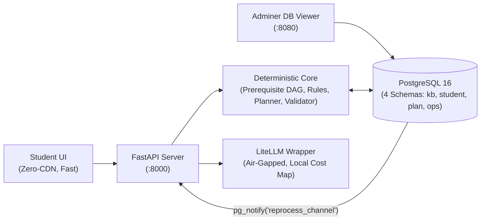
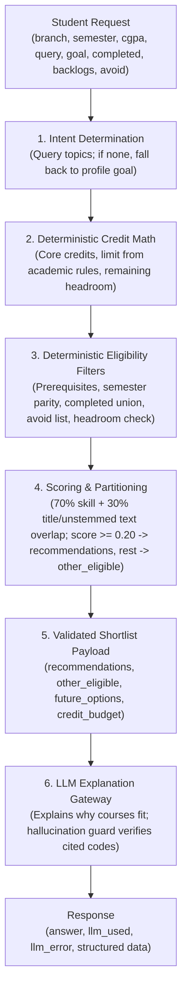

# Adobe Personalised Learning Buddy (IIT Bhubaneswar)

An AI-powered adaptive academic buddy for undergraduate students at **IIT Bhubaneswar**, covering **B.Tech Electrical Engineering (EE)** and **B.Tech Metallurgical and Materials Engineering (MME / SMMME)**. The system guides students through the complete learning cycle: **Assess → Personalise → Learn → Practise → Adapt → Demonstrate Mastery**, strictly bounded by institutional academic rules, verifiable prerequisite DAGs, multi-schema PostgreSQL persistence, and higher-studies pathways (GATE, CAT, GRE, GMAT, TOEFL, IELTS).



---

## 1. Quick Start

### Prerequisites
- Docker & Docker Compose (or Python 3.12+ with PostgreSQL 16)
- Model API key (OpenAI, Gemini, Azure, or local Ollama)

### Single-Command Start (Docker)
```bash
# 1. Clone repository & configure environment
cp .env.example .env

# 2. Add your LLM provider API key to .env (OpenAI, Gemini, Ollama, etc.)
# nano .env  --> set LLM_API_KEY=your_key_here

# 3. Bring up the complete system (linux/amd64, no GPU, < 1.5 GB footprint)
docker compose up --build -d
```

### Windows Host Automation (`scripts\dev.ps1`)
On Windows environments without `make`, use the built-in PowerShell control script:
```powershell
# Start services
.\scripts\dev.ps1 up

# Reset database to clean seed state (idempotent, reloads all schemas & seeds)
.\scripts\dev.ps1 reset

# Run data quality & DAG audit report (generates docs/data_quality_report.md)
.\scripts\dev.ps1 check-data

# Run full test suite (13 tests: DB-free + live PostgreSQL integration)
.\scripts\dev.ps1 test

# View service health and status
.\scripts\dev.ps1 status
```

### Service Access URLs
- **Student App & Dashboard:** [http://localhost:8000](http://localhost:8000)
- **Interactive OpenAPI Documentation:** [http://localhost:8000/docs](http://localhost:8000/docs)
- **Adminer Database Viewer:** [http://localhost:8080](http://localhost:8080)
  - *System:* PostgreSQL
  - *Server:* `db` (or `localhost` if connecting directly from host)
  - *Username:* `ebuddy_user`
  - *Password:* `ebuddy_password`
  - *Database:* `ebuddy`

---

## 2. Models & Air-Gapped LLM Gateway

- **Primary LLM:** `openai/gpt-4o-mini` (Configured default in `.env.example`; supports `gemini/gemini-1.5-flash`, `azure/<deployment>`, or `ollama/<model>` purely via environment variables).
- **Embedding Model:** `text-embedding-3-small` (Configured via `EMBEDDING_MODEL`; optional).
- **LiteLLM Gateway:** All model and embedding interactions route exclusively through LiteLLM. No vendor-specific SDK imports exist in the codebase.
- **Strict Air-Gap & Cost Isolation:**
  - `LITELLM_LOCAL_MODEL_COST_MAP=True`: Prohibits runtime fetching of remote cost maps from GitHub.
  - `LITELLM_TELEMETRY=False`: Disables all outbound usage reporting.
- **Deterministic Independence:** All prerequisite resolution, academic rule validation, credit limits, and DAG scheduling execute in deterministic Python with zero model dependencies.

---

## 3. Configuration Reference

All application settings are read dynamically from environment variables without code modification:

| Variable | Default Value | Purpose |
|---|---|---|
| `LLM_MODEL` | `openai/gpt-4o-mini` | Model string passed directly to LiteLLM. |
| `LLM_API_KEY` | *(empty in example)* | API credential for configured provider. |
| `LLM_API_BASE` | *(empty)* | Optional custom endpoint (Ollama, Azure, LiteLLM proxy). |
| `EMBEDDING_MODEL` | `text-embedding-3-small` | Model for vector representations if active. |
| `LITELLM_LOCAL_MODEL_COST_MAP` | `True` | Forces LiteLLM to use local pricing tables (no GitHub fetch). |
| `LITELLM_TELEMETRY` | `False` | Completely disables third-party usage reporting. |
| `DATABASE_URL` | `postgresql+psycopg://...` | Connection URI with connection pooling and timeouts. |
| `APP_PORT` | `8000` | Exposed FastAPI application port. |
| `ADMINER_PORT` | `8080` | Exposed Adminer database viewer port. |

---

## 4. Academic Data Repositories

The project ingests and structures official institutional data for IIT Bhubaneswar across two engineering schools, the Central Library, and higher-studies pathways:

### A. Raw Data Structure (`data/raw/`)

| Directory | Branch / Domain | Contents & Source Files | Structured Ingest Outputs |
|---|---|---|---|
| **`data/raw/ee/`** | **Electrical Engineering (EE)** | • `curriculum_semester_table.csv`<br/>• `curriculum_syllabus_only.csv`<br/>• `curriculum_notes_discrepancies.csv`<br/>• `video_playlists.csv` (90 courses)<br/>• `research_projects_v2.csv` (68 projects with PI)<br/>• `research_projects_all.csv` (138 projects) | • 87 courses (85 semester + 2 syllabus-only)<br/>• 13 requirement slots<br/>• 64 resolved prerequisite edges<br/>• 163 video resource URLs<br/>• 138 research projects<br/>• 35 faculty & group entities |
| **`data/raw/mme/`** | **Metallurgical & Materials Engg (MME / SMMME)** | • `curriculum_semester_table.csv`<br/>• `curriculum_notes_discrepancies.csv`<br/>• `video_playlists.csv` (45 courses)<br/>• `faculty_profiles.csv` (16 faculty)<br/>• `research_projects_sponsored.csv` (45 projects)<br/>• `research_projects_consultancy.csv` (17 projects)<br/>• `research_projects_seed.csv` (13 projects) | • 49 net new courses (136 total across both)<br/>• 12 net new slots (25 total)<br/>• 84 net new slot options (186 total)<br/>• 85 video resource URLs (248 total)<br/>• 75 research projects (213 total)<br/>• 16 verified faculty profiles (51 total) |
| **`data/raw/library/`** | **Central Library Publications** | • `publications.csv` (3,000 research publications)<br/>• `publications_electrical.csv` (765 EE papers)<br/>• `publications_metallurgy.csv` (176 MME papers)<br/>• `publications_summary.csv` | • Structured catalog converted from HTML/Excel records with author, department, and citation indexing. |
| **`data/raw/higher_studies/`** | **Higher Studies Database** | • 22 CSV tables covering GATE, CAT, GRE, GMAT, TOEFL, IELTS (`admission_stats.csv`, `exam_cycles.csv`, `exams.csv`, `institutions.csv`, `milestones.csv`, `paths.csv`, `prep_methods.csv`, `prep_templates.csv`, `programmes.csv`, `resources.csv`, `study_plans.csv`, `survey_responses.csv`, `syllabus_topics.csv`, `template_phases.csv`, `template_check.csv`, etc.) | • Relational schema for institutional admission trends, target percentiles, syllabus topic mapping, and multi-phase prep milestones. |

---

## 5. Course Video Playlists & Learning Resources

Curated video learning resources from NPTEL, YouTube, and SWAYAM have been ingested, mapped to curriculum courses, and validated with zero fabricated links:

| Programme | Catalog Courses Mapped | Total URLs in `kb.resource` | Course Links in `kb.resource_course` | Coverage Status Breakdown |
|---|---|---|---|---|
| **Electrical Engineering (EE)** | 90 courses | **163 URLs** | 160 links (81 distinct courses) | • Playlist found: 73 URLs<br/>• Partial / related: 40 URLs<br/>• Not confirmed: 33 URLs<br/>• Lab theory: 17 URLs |
| **Metallurgical Engg (MME)** | 45 courses | **85 URLs** | 71 links (46 distinct courses) | • Playlist found: 16 URLs<br/>• Partial / related: 24 URLs<br/>• Not confirmed: 33 URLs<br/>• Lab theory: 12 URLs |
| **Combined in Database** | **135 courses** | **248 URLs** | **231 links** (127 distinct courses) | **All 248 marked `link_verified = false`** |

*Data Hygiene Rules Enforced:*
1. **Link Verification Safety:** Every resource has `link_verified = false` until verified by live network health checks.
2. **No False Coverage:** Playlists with `"Not confirmed"` status are cataloged for review but **never** claimed as confirmed coverage.
3. **No Fabricated Data:** Courses designated `"No video applicable"` (e.g. seminars, internships) generate 0 dummy links.
4. **Multi-Role Mapping:** Primary, Backup 1, Backup 2, and Lab Theory links are explicitly tagged.

---

## 6. Data Topology & Storage Map

The database architecture is partitioned into four explicit schemas: `kb` (Knowledge Base), `student` (Profiles & Ledger), `plan` (Deterministic Plans & Audits), and `ops` (Reprocessing & Audit Logs).

| Schema & Table | Seed File Path | Rows (DB) | Role & Ingestion Method |
|---|---|---|---|
| `kb.source` | `data/seed/kb/source.csv` | 13 | Audit citations and raw file provenance. |
| `kb.department` | `data/seed/kb/department.csv` | 6 | Academic schools (SECS, SMMME, SMS, SIF, SBS, SHSSM). |
| `kb.programme` | `data/seed/kb/programme.csv` | 2 | Degree programs (`BTECH_EE`, `BTECH_MME`). |
| `kb.course` | `data/seed/kb/course.csv` | 136 | Unified course catalog (87 EE, 49 MME, 4 shared). |
| `kb.course_alias` | `data/seed/kb/course_alias.csv` | 158 | Prerequisite name-to-code resolution dictionary. |
| `kb.course_prerequisite` | `data/seed/kb/course_prerequisite.csv` | 64 | Deterministic DAG prerequisite edges (EE verified). |
| `kb.course_offering` | `data/seed/kb/course_offering.csv` | 185 | Track-aware semester offerings (Track A vs. Track B). |
| `kb.programme_requirement` | `data/seed/kb/programme_requirement.csv` | 25 | Degree requirement slots (13 EE + 12 MME). |
| `kb.slot_option` | `data/seed/kb/slot_option.csv` | 186 | Courses fulfilling elective/lateral slots (102 EE + 84 MME). |
| `kb.resource` | `data/seed/kb/resource.csv` | 248 | Video and textbook learning resources. |
| `kb.resource_course` | `data/seed/kb/resource_course.csv` | 231 | Course-to-resource mapping with role designations. |
| `kb.research_area` | `data/seed/kb/research_area.csv` | 12 | Research sub-disciplines across SECS and SMMME. |
| `kb.faculty` | `data/seed/kb/faculty.csv` | 51 | Faculty entities (44 individual persons, 7 groups). |
| `kb.research_project` | `data/seed/kb/research_project.csv` | 213 | Institute projects (138 EE + 75 MME: sponsored/consultancy/seed). |
| `kb.project_faculty` | `data/seed/kb/project_faculty.csv` | 149 | PI and Co-PI project affiliations. |
| `kb.project_keyword` | `data/seed/kb/project_keyword.csv` | 240 | Searchable keywords linked to research projects. |
| `kb.skill` | `data/seed/kb/skill.csv` | 32 | Taxonomy of foundational, engineering, and domain skills. |
| `kb.course_skill` | `data/seed/kb/course_skill.csv` | 80 | Validated course-to-skill learning weight mappings. |
| `kb.goal` | `data/seed/kb/goal.csv` | 11 | Career, higher studies, and research pathways. |
| `kb.goal_skill_requirement` | `data/seed/kb/goal_skill_requirement.csv` | 41 | Required skill proficiency thresholds per goal. |
| `kb.data_issue` | `data/seed/kb/data_issue.csv` | 32 | Curriculum discrepancy audit log (17 EE + 15 MME). |
| `kb.academic_rule` | `data/seed/kb/academic_rule.json` | 6 rules | Credit caps, CGPA requirements, backlog limits. |
| `kb.mastery_criteria` | `data/seed/kb/mastery_criteria.json` | 5 criteria | Diagnostic assessment grading rubrics. |
| `student.student` | `data/seed/student/student.csv` | — | Student profiles and academic standing. |
| `student.skill_evidence` | `data/seed/student/skill_evidence.csv` | — | Immutable skill diagnostic assessment ledger. |
| `plan.plan` | *(generated)* | — | Student semester study plans with versioning. |
| `plan.validation_report` | *(generated)* | — | Deterministic audit pass/fail reports per plan. |
| `ops.reprocess_queue` | *(trigger populated)* | — | Event queue driven by PostgreSQL triggers. |

---

## 7. System Reset & Reactive Re-processing

### Idempotent Database Reset
To drop and reseed the database to a verified state:
- **Windows (PowerShell):**
  ```powershell
  .\scripts\dev.ps1 reset
  ```
- **Linux / macOS:**
  ```bash
  make reset
  ```
*Both scripts run `scripts/seed_loader.py --reset`, executing `docker/init.sql` and loading all 2,134+ seed rows in strict foreign-key dependency order. Running reset twice yields 100% identical row counts.*

### Reactive Re-processing Triggers
Native PostgreSQL triggers on editable tables publish change events into `ops.reprocess_queue` and dispatch `pg_notify('reprocess_channel', ...)` notifications:
```sql
CREATE TRIGGER trg_reprocess_kb_course
AFTER INSERT OR UPDATE OR DELETE ON kb.course
FOR EACH ROW EXECUTE FUNCTION ops.notify_reprocess_event();
```
A background listener consumes these events, re-evaluates impacted student skill states, re-runs the DAG planner and deterministic validator, and records plan diffs with `trigger = 'admin_edit'`.

---

## 8. Testing & Quality Assurance

```bash
# 1. Run DB-free unit tests (offline, instant configuration & schema checks)
python -m pytest tests/test_db_free.py -q

# 2. Run DB-dependent integration tests (verifies Postgres connection, FK constraints, triggers)
python -m pytest tests/test_db_dependent.py -q

# 3. Run all tests simultaneously
python -m pytest tests -q

# 4. Generate curriculum integrity & DAG sequence report
python scripts/check_data.py
```

**Current Test Suite Status:**
- `test_db_free.py`: 9 passed, 0 failed, 0 skipped.
- `test_db_dependent.py`: 4 passed, 0 failed, 0 skipped.
- **Total:** **13 passed, 0 failed, 0 skipped** (100% pass rate).

---

## 9. Compliance Checklist

| Rule # | Requirement | Implementation & Verification |
|---|---|---|
| **Rule 1** | LiteLLM Only | `app/config.py` enforces LiteLLM gateway; zero vendor-specific SDK imports. |
| **Rule 2** | Configuration by Env Vars Only | `app/config.py` uses Pydantic BaseSettings; verified by `test_no_hardcoded_secrets_or_endpoints`. |
| **Rule 3** | `.env.example` Committed | Default tuned to `openai/gpt-4o-mini`; verified by `test_01_env_example_compliance`. |
| **Rule 4** | Single-command Start, < 5 GB, linux/amd64 | `docker-compose.yml` specifies `platform: linux/amd64` across `app`, `db`, and `adminer`. Footprint < 1.5 GB. |
| **Rule 5** | No Secrets in Image | `.env` ignored in `.gitignore` and `.dockerignore`; verified by `test_02_env_git_and_docker_ignored`. |
| **Rule 6** | Plain CSV/JSON Seeds & Idempotent Reset | `scripts/seed_loader.py --reset` restores state in topological order. Tested twice with identical row counts. |
| **Rule 7** | Data Control & Reactive Re-processing | Native PG triggers on editable tables fire `pg_notify` to `ops.reprocess_queue`. |
| **Rule 8** | Zero Outbound Network Traffic | `LITELLM_LOCAL_MODEL_COST_MAP=True`, `LITELLM_TELEMETRY=False`, frontend bundled locally. |
| **Rule 9** | Data Ethics | Synthetic student profiles tagged `is_synthetic = true`. Public institute records only. |
| **Rule 10** | Never Fabricate Academic Data | Raw data strictly extracted from `data/raw/ee/`, `data/raw/mme/`, `data/raw/library/`, and `data/raw/higher_studies/`. Placeholders tracked in `docs/DATA_GAPS.md`. |
| **Rule 11** | Valid KB Course Codes | Verified by deterministic foreign keys and validator code checks. |
| **Rule 12** | Deterministic Plan Validator | Validator check results stored with every plan in `plan.validation_report`. |

---

## 10. Project Directory Layout

```
.
├── app/
│   ├── api/health.py                     # System health and table counts
│   ├── config.py                         # Pydantic environment configuration & LiteLLM flags
│   ├── db/session.py                     # SQLAlchemy engine with connection timeouts
│   └── main.py                           # FastAPI application entrypoint
├── data/
│   ├── raw/                              # Canonical institutional data sources
│   │   ├── ee/                           # Electrical Engineering curriculum, videos, research
│   │   ├── mme/                          # Metallurgical Engineering curriculum, videos, faculty, projects
│   │   ├── library/                      # Central Library catalog (3,000 publications)
│   │   └── higher_studies/               # Higher Studies pathways (GATE, CAT, GRE, GMAT, TOEFL, IELTS)
│   └── seed/                             # Structured relational seed data
│       ├── kb/                           # Knowledge Base CSVs/JSONs (136 courses, 248 resources, 213 projects)
│       ├── higher_studies/               # 14 relational tables for higher studies pathways
│       ├── student/                      # Student profiles, completed courses, and goals
│       └── survey/                       # Baseline survey instrument & diagnostic rubrics
├── docker/
│   ├── Dockerfile                        # Multi-stage slim Docker image (linux/amd64)
│   └── init.sql                          # DDL creating schemas kb, student, plan, ops + triggers
├── docs/
│   ├── architecture/overview.md          # System architecture & data flows
│   ├── decisions/ADR-001-...             # Architectural decision records
│   ├── DATA_DICTIONARY.md                # Complete schema & column dictionary
│   ├── DATA_GAPS.md                      # Documented omissions and discrepancies
│   ├── data_quality_report.md            # Automated curriculum & prerequisite DAG report
│   └── CHANGELOG.md                      # Phase-by-phase project changelog
├── scripts/
│   ├── dev.ps1                           # Windows automation (up, down, reset, test, check-data)
│   ├── ingest_ee_curriculum.py           # Ingestion script for Electrical Engineering
│   ├── ingest_mme_curriculum.py          # Ingestion script for Metallurgy & Materials Engg
│   ├── ingest_library_and_higher_studies.py # Ingestion for Library & Higher Studies datasets
│   ├── generate_skills_and_goals.py      # Skill taxonomy & goal mapping generator
│   ├── seed_loader.py                    # Database seed loader and reset engine
│   ├── check_data.py                     # Curriculum integrity & DAG audit runner
│   └── verify_raw_db.py                  # Direct SQL verification test script
├── tests/
│   ├── test_db_free.py                   # Offline compliance & syntax unit tests (9 tests)
│   └── test_db_dependent.py              # PostgreSQL integration tests with connection timeouts (4 tests)
├── .env.example                          # Committed environment variable template
├── .gitignore                            # Ignores .env and scratch files
├── .dockerignore                          # Excludes secrets from container build context
├── docker-compose.yml                    # Multi-container orchestration (app, db, adminer)
├── Makefile                              # Make commands for Linux/macOS
└── requirements.txt                      # Project Python dependencies
```

---

## 11. Course Recommendation Engine

The Course Recommendation Engine is an academic advisory module tailored for IIT Bhubaneswar B.Tech students in Electrical Engineering (EE) and Metallurgical and Materials Engineering (MME).

### A. Recommendation Flow & Architectural Boundary



#### Deterministic Code vs. LLM Split
- **Deterministic Python Core (100% code)**: Intent topic extraction, credit limit calculation (regular 26, overload 30, probation 18), core course deduction, slot headroom calculation, prerequisite verification DAG, semester parity offering checks, completed course inference minus backlogs, avoid filtering, relevance scoring, and partition between `recommendations` and `other_eligible`. The LLM has zero authority over course eligibility or credit limits.
- **LLM Explanation Gateway**: The LLM receives **only** the validated shortlist. It writes the natural-language explanation and explains why each recommended course fits the student's goal. It must never invent courses, credits, or prerequisites.
- **Hallucination Guard**: A regex parser verifies all course codes cited in the LLM response against the allowed identifiers (`recommendations`, `other_eligible`, `future_options`, `rejected`). If any uncited or hallucinated code appears, the system immediately discards the reply and falls back to a clean deterministic template.

### B. Module Files (`app/recommender/`)

| File | Description |
|---|---|
| `app/recommender/__init__.py` | Module package initialization for the course recommendation system. |
| `app/recommender/api.py` | FastAPI router exposing `POST /recommend` with Pydantic request/response validation. |
| `app/recommender/credits.py` | Deterministic credit limits, core course parsing, and open slot headroom budgeting. |
| `app/recommender/engine.py` | Core recommendation orchestrator for intent fallback, candidate filtering, scoring, partitioning, and future options. |
| `app/recommender/explain.py` | Explanation generation via LiteLLM with deterministic template fallback and strict hallucination guard. |
| `app/recommender/kb.py` | Cached loaders and accessors for courses, prerequisites, offerings, skills, and slot mappings. |
| `app/recommender/retrieval.py` | Rule-based tokenizer, stoplist filter, goal expansion, unstemmer, and hybrid course scoring. |

### C. API Contract: `POST /recommend`

#### Request Payload (`RecommendRequest`)
```json
{
  "branch": "EE",
  "semester": 7,
  "cgpa": 8.0,
  "goal": "Software engineering role",
  "query": "what course should I take this semester",
  "completed": ["EE1L001"],
  "avoid": [],
  "backlogs": [],
  "overload_approved": false
}
```

- `branch` *(str, required)*: Academic branch (`"EE"` or `"MME"`).
- `semester` *(int, required)*: Current semester number (`1` to `8`).
- `cgpa` *(float, required)*: Cumulative Grade Point Average (`0.0` to `10.0`).
- `goal` *(str, optional)*: Long-term career or academic goal from student profile.
- `query` *(str, optional)*: User prompt query; if omitted or generic, falls back to `goal`.
- `completed` *(list[str], optional)*: Explicit list of completed courses.
- `avoid` *(list[str], optional)*: Courses the student prefers to avoid.
- `backlogs` *(list[str], optional)*: Uncleared core courses excluded from inferred completion.
- `overload_approved` *(bool, optional)*: Whether Faculty Advisor overload approval is granted.

#### Response Payload (`RecommendResponse`)
- `answer` *(str)*: Natural language explanation formatted with course codes, titles, credits, reasons, and resources.
- `llm_used` *(bool)*: `true` if generated by an LLM; `false` if generated by the deterministic template.
- `llm_error` *(str, optional)*: Short description if template fallback was used (e.g. `"LLM_MODEL not configured"`).
- `data` *(dict)*: Full structured payload containing `intent`, `credit_budget`, `recommendations`, `other_eligible`, `future_options`, and `rejected`.

### D. Data Repositories & Locations

| Entity | File Path | Records / Notes |
|---|---|---|
| Course Catalog | `data/seed/kb/course.csv` | 136 courses across EE, MME, Basic Sciences, and HSS. |
| Course Offerings | `data/seed/kb/course_offering.csv` | Semester numbers and odd/even semester offering parity. |
| Prerequisites | `data/seed/kb/course_prerequisite.csv` | Required and prerequisite relations between courses. |
| Course-Skill Mappings | `data/seed/kb/course_skill.csv` | Course-to-skill mappings with proficiency weights. |
| Skill Taxonomy | `data/seed/kb/skill.csv` | Canonical skill definitions, domains, and descriptions. |
| Slot Options | `data/seed/kb/slot_option.csv` | Curriculum elective slot option mappings. |
| Learning Resources | `data/seed/kb/resource.csv` | Curated NPTEL and video lecture resources. |
| Course-Resource Links | `data/seed/kb/resource_course.csv` | Primary resource associations per course. |
| Academic Rules | `data/seed/kb/academic_rule.json` | Baseline credit limits, probation, overload, and minor caps. |
| Data Discrepancy Log | `data/seed/kb/data_issue.csv` | Audit tracking of verified and resolved data issues. |
| Raw EE Curriculum | `data/raw/ee/curriculum_semester_table.csv` | Official B.Tech Electrical Engineering semester table. |
| Raw MME Curriculum | `data/raw/mme/curriculum_semester_table.csv` | Official B.Tech Metallurgical & Materials Engg semester table. |

### E. Academic Rules & Baseline Status

All academic rules in `data/seed/kb/academic_rule.json` are designated with `status: "unsourced_baseline"` (`source_id: "UNSOURCED_BASELINE"`).

- **Regular Credit Cap (`RULE_SEM_CREDIT_CAP_REGULAR`)**: Standard maximum of 26.0 credits (minimum 16.0 credits). Students with CGPA >= 8.50 may register for up to 30.0 credits with Faculty Advisor approval (`overload_approved=true`).
- **Probation Credit Cap (`RULE_SEM_CREDIT_CAP_PROBATION`)**: Students on academic probation or with CGPA < 6.00 are restricted to a reduced cap of 18.0 credits.
- **Minor Eligibility (`RULE_MINOR_ELIGIBILITY`)**: CGPA >= 8.00 at end of Sem IV enables 18-credit Minor enrollment across Sem V–VIII.
- **Online Transfer Cap (`RULE_ONLINE_CREDIT_NPTEL`)**: Maximum 12.0 credits transferred from approved 8/12-week NPTEL/SWAYAM courses.

### F. Assumptions & Known Data Quirks

1. **MME Slot-to-Semester Mapping**: MME slot IDs in `slot_option.csv` (`MM_LATERAL_1`..`3`, `MM_ELECTIVE_1`..`5`) do not encode semester numbers. The engine establishes an explicit mapping in `app/recommender/kb.py` (`MME_SLOT_SEMESTER_MAP`):
   - `MM_LATERAL_1` -> Semester 4
   - `MM_LATERAL_2` -> Semester 5
   - `MM_LATERAL_3` -> Semester 6
   - `MM_ELECTIVE_1`, `MM_ELECTIVE_2` -> Semester 7
   - `MM_ELECTIVE_3`, `MM_ELECTIVE_4`, `MM_ELECTIVE_5` -> Semester 8
2. **Duplicate Course Codes in MME**: `ML4L001`, `ML4L002`, and `ML4L003` appear twice in seed data (as both core courses in Semester VII and slot options). Handled by resolving IDs with `_CORE` and `_ELEC` suffixes while presenting clean base codes to students.
3. **Skill-Mapping Coverage & Corrections**: Seed data initially omitted skill rows for 34 slot-candidate courses and contained 10 mapping anomalies (e.g. *Soft Computing* mapped to *Power Electronics*). Approved mappings were added and anomalies were corrected and logged in `data_issue.csv` (see [docs/course_skill_corrections.md](file:///c:/Users/sasya/Downloads/EBuddy/docs/course_skill_corrections.md)).
4. **Title-Based Matching (No Syllabus Text)**: In the seed dataset, `syllabus_text` and `learning_objectives` are empty for slot electives; retrieval relies on course titles, unstemmed tokens, and curated skill mappings.

### G. How We Checked Data Quality

Data quality and algorithmic correctness were verified through automated test suites and strict audit gates:
1. **45 Pytest Suites**: Full regression test suite passing 100% green (`tests/test_recommender.py`, `tests/unit/test_import_boundaries.py`, `tests/test_db_free.py`, `tests/conformance/test_persona_conformance.py`, `tests/integration/test_walking_skeleton.py`).
2. **Deterministic Verification**: Tested identical input runs producing strictly identical JSON responses and rankings.
3. **Credit Arithmetic Bounds**: Verified `core_credits + headroom == limit` across Semesters 3 through 8 for both EE and MME.
4. **Prerequisite DAG Integrity**: Tested that missing core prerequisites or active backlogs strictly reject candidate electives.
5. **Skill Mapping Consistency**: Verified that all added skill IDs strictly exist in `skill.csv`, with before/after corrections tracked in `data/seed/kb/data_issue.csv`.
6. **Air-Gap Egress Verification**: Confirmed zero outbound HTTP/network requests during test execution via `LITELLM_LOCAL_MODEL_COST_MAP=True` and test fixtures.

### H. PowerShell Setup & Execution Guide

#### 1. Setup Virtual Environment
```powershell
python -m venv .venv
.\.venv\Scripts\Activate.ps1
pip install -r requirements.txt
```

#### 2. Configure Environment Variables (`.env`)
```ini
# LLM Model Configuration
# Replace <MODEL_USED> with your target model (e.g. openai/gpt-4o-mini, gemini/gemini-1.5-flash)
LLM_MODEL=<MODEL_USED>
LLM_API_KEY=your_api_key_here
LLM_API_BASE=

# Air-gap safety flags
LITELLM_LOCAL_MODEL_COST_MAP=True
LITELLM_TELEMETRY=False
```

#### 3. Run Test Suite
```powershell
python -m pytest tests/test_recommender.py tests/unit/test_import_boundaries.py -v
```

#### 4. Start Local Backend
```powershell
uvicorn app.main:app --reload --port 8000
```

#### 5. Sample PowerShell API Request
```powershell
$body = @{
    branch = "EE"
    semester = 7
    cgpa = 8.0
    goal = "Software engineering role"
    query = "what course should I take this semester"
    completed = @("EE1L001")
    avoid = @()
    backlogs = @()
    overload_approved = $false
} | ConvertTo-Json

$response = Invoke-RestMethod -Uri "http://127.0.0.1:8000/recommend" -Method Post -ContentType "application/json" -Body $body
$response | ConvertTo-Json -Depth 5
```

