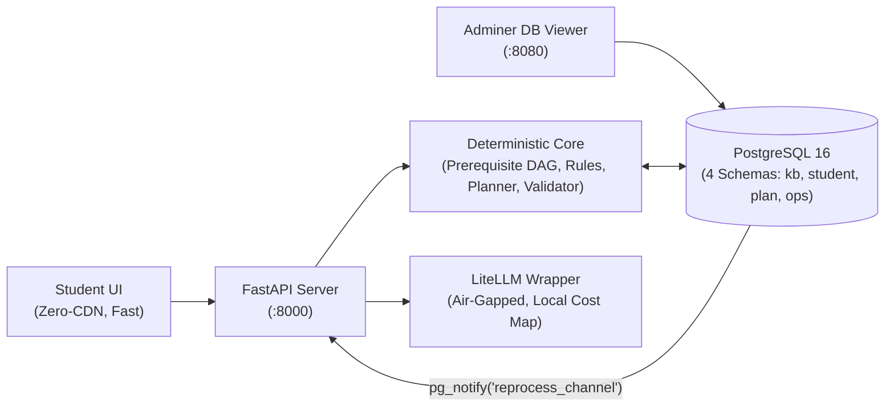
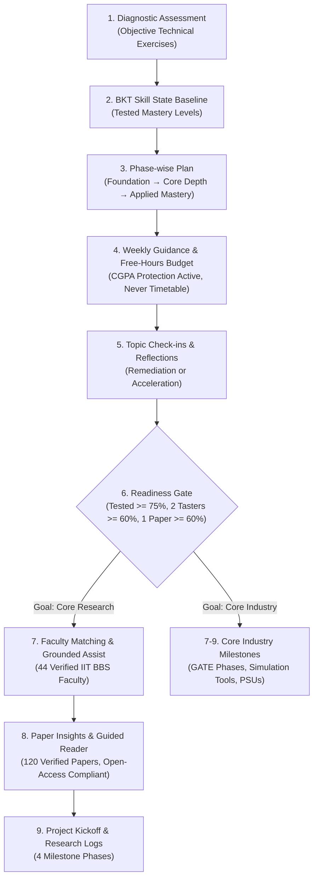
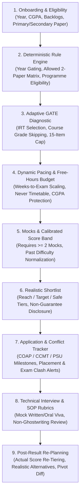

# Adobe Personalised Learning Buddy (IIT Bhubaneswar)

An AI-powered adaptive academic buddy for undergraduate students at **IIT Bhubaneswar**, covering **B.Tech Electrical Engineering (EE)** and **B.Tech Metallurgical and Materials Engineering (MME / SMMME)**. The system guides students through the complete learning cycle: **Assess → Personalise → Learn → Practise → Adapt → Demonstrate Mastery**, strictly bounded by institutional academic rules, verifiable prerequisite DAGs, multi-schema PostgreSQL persistence, and higher-studies pathways (GATE, CAT, GRE, GMAT, TOEFL, IELTS).



---

## 1. Quick Start

### Prerequisites
- Docker & Docker Compose (or Python 3.12+ with PostgreSQL 16)
- Model API key (OpenAI, Gemini, Azure, or local Ollama)

### Single-Command Start (Docker)
```bash
# 1. Clone repository & configure environment
cp .env.example .env

# 2. Add your LLM provider API key to .env (OpenAI, Gemini, Ollama, etc.)
# nano .env  --> set LLM_API_KEY=your_key_here

# 3. Bring up the complete system (linux/amd64, no GPU, < 1.5 GB footprint)
docker compose up --build -d
```

### Windows Host Automation (`scripts\dev.ps1`)
On Windows environments without `make`, use the built-in PowerShell control script:
```powershell
# Start services
.\scripts\dev.ps1 up

# Reset database to clean seed state (idempotent, reloads all schemas & seeds)
.\scripts\dev.ps1 reset

# Run data quality & DAG audit report (generates docs/data_quality_report.md)
.\scripts\dev.ps1 check-data

# Run full test suite (13 tests: DB-free + live PostgreSQL integration)
.\scripts\dev.ps1 test

# View service health and status
.\scripts\dev.ps1 status
```

### Service Access URLs
- **Student App & Dashboard:** [http://localhost:8000](http://localhost:8000)
- **Interactive OpenAPI Documentation:** [http://localhost:8000/docs](http://localhost:8000/docs)
- **Adminer Database Viewer:** [http://localhost:8080](http://localhost:8080)
  - *System:* PostgreSQL
  - *Server:* `db` (or `localhost` if connecting directly from host)
  - *Username:* `ebuddy_user`
  - *Password:* `ebuddy_password`
  - *Database:* `ebuddy`

---

## 2. Models & Air-Gapped LLM Gateway

- **Primary LLM:** `openai/gpt-4o-mini` (Configured default in `.env.example`; supports `gemini/gemini-1.5-flash`, `azure/<deployment>`, or `ollama/<model>` purely via environment variables).
- **Embedding Model:** `text-embedding-3-small` (Configured via `EMBEDDING_MODEL`; optional).
- **LiteLLM Gateway:** All model and embedding interactions route exclusively through LiteLLM. No vendor-specific SDK imports exist in the codebase.
- **Strict Air-Gap & Cost Isolation:**
  - `LITELLM_LOCAL_MODEL_COST_MAP=True`: Prohibits runtime fetching of remote cost maps from GitHub.
  - `LITELLM_TELEMETRY=False`: Disables all outbound usage reporting.
- **Deterministic Independence:** All prerequisite resolution, academic rule validation, credit limits, and DAG scheduling execute in deterministic Python with zero model dependencies.

---

## 3. Configuration Reference

All application settings are read dynamically from environment variables without code modification:

| Variable | Default Value | Purpose |
|---|---|---|
| `LLM_MODEL` | `openai/gpt-4o-mini` | Model string passed directly to LiteLLM. |
| `LLM_API_KEY` | *(empty in example)* | API credential for configured provider. |
| `LLM_API_BASE` | *(empty)* | Optional custom endpoint (Ollama, Azure, LiteLLM proxy). |
| `EMBEDDING_MODEL` | `text-embedding-3-small` | Model for vector representations if active. |
| `LITELLM_LOCAL_MODEL_COST_MAP` | `True` | Forces LiteLLM to use local pricing tables (no GitHub fetch). |
| `LITELLM_TELEMETRY` | `False` | Completely disables third-party usage reporting. |
| `DATABASE_URL` | `postgresql+psycopg://...` | Connection URI with connection pooling and timeouts. |
| `APP_PORT` | `8000` | Exposed FastAPI application port. |
| `ADMINER_PORT` | `8080` | Exposed Adminer database viewer port. |

---

## 4. Academic Data Repositories

The project ingests and structures official institutional data for IIT Bhubaneswar across two engineering schools, the Central Library, and higher-studies pathways:

### A. Raw Data Structure (`data/raw/`)

| Directory | Branch / Domain | Contents & Source Files | Structured Ingest Outputs |
|---|---|---|---|
| **`data/raw/ee/`** | **Electrical Engineering (EE)** | • `curriculum_semester_table.csv`<br/>• `curriculum_syllabus_only.csv`<br/>• `curriculum_notes_discrepancies.csv`<br/>• `video_playlists.csv` (90 courses)<br/>• `research_projects_v2.csv` (68 projects with PI)<br/>• `research_projects_all.csv` (138 projects) | • 87 courses (85 semester + 2 syllabus-only)<br/>• 13 requirement slots<br/>• 64 resolved prerequisite edges<br/>• 163 video resource URLs<br/>• 138 research projects<br/>• 35 faculty & group entities |
| **`data/raw/mme/`** | **Metallurgical & Materials Engg (MME / SMMME)** | • `curriculum_semester_table.csv`<br/>• `curriculum_notes_discrepancies.csv`<br/>• `video_playlists.csv` (45 courses)<br/>• `faculty_profiles.csv` (16 faculty)<br/>• `research_projects_sponsored.csv` (45 projects)<br/>• `research_projects_consultancy.csv` (17 projects)<br/>• `research_projects_seed.csv` (13 projects) | • 49 net new courses (136 total across both)<br/>• 12 net new slots (25 total)<br/>• 84 net new slot options (186 total)<br/>• 85 video resource URLs (248 total)<br/>• 75 research projects (213 total)<br/>• 16 verified faculty profiles (51 total) |
| **`data/raw/library/`** | **Central Library Publications** | • `publications.csv` (3,000 research publications)<br/>• `publications_electrical.csv` (765 EE papers)<br/>• `publications_metallurgy.csv` (176 MME papers)<br/>• `publications_summary.csv` | • Structured catalog converted from HTML/Excel records with author, department, and citation indexing. |
| **`data/raw/higher_studies/`** | **Higher Studies Database** | • 22 CSV tables covering GATE, CAT, GRE, GMAT, TOEFL, IELTS (`admission_stats.csv`, `exam_cycles.csv`, `exams.csv`, `institutions.csv`, `milestones.csv`, `paths.csv`, `prep_methods.csv`, `prep_templates.csv`, `programmes.csv`, `resources.csv`, `study_plans.csv`, `survey_responses.csv`, `syllabus_topics.csv`, `template_phases.csv`, `template_check.csv`, etc.) | • Relational schema for institutional admission trends, target percentiles, syllabus topic mapping, and multi-phase prep milestones. |

---

## 5. Course Video Playlists & Learning Resources

Curated video learning resources from NPTEL, YouTube, and SWAYAM have been ingested, mapped to curriculum courses, and validated with zero fabricated links:

| Programme | Catalog Courses Mapped | Total URLs in `kb.resource` | Course Links in `kb.resource_course` | Coverage Status Breakdown |
|---|---|---|---|---|
| **Electrical Engineering (EE)** | 90 courses | **163 URLs** | 160 links (81 distinct courses) | • Playlist found: 73 URLs<br/>• Partial / related: 40 URLs<br/>• Not confirmed: 33 URLs<br/>• Lab theory: 17 URLs |
| **Metallurgical Engg (MME)** | 45 courses | **85 URLs** | 71 links (46 distinct courses) | • Playlist found: 16 URLs<br/>• Partial / related: 24 URLs<br/>• Not confirmed: 33 URLs<br/>• Lab theory: 12 URLs |
| **Combined in Database** | **135 courses** | **248 URLs** | **231 links** (127 distinct courses) | **All 248 marked `link_verified = false`** |

*Data Hygiene Rules Enforced:*
1. **Link Verification Safety:** Every resource has `link_verified = false` until verified by live network health checks.
2. **No False Coverage:** Playlists with `"Not confirmed"` status are cataloged for review but **never** claimed as confirmed coverage.
3. **No Fabricated Data:** Courses designated `"No video applicable"` (e.g. seminars, internships) generate 0 dummy links.
4. **Multi-Role Mapping:** Primary, Backup 1, Backup 2, and Lab Theory links are explicitly tagged.

---

## 6. Data Topology & Storage Map

The database architecture is partitioned into four explicit schemas: `kb` (Knowledge Base), `student` (Profiles & Ledger), `plan` (Deterministic Plans & Audits), and `ops` (Reprocessing & Audit Logs).

| Schema & Table | Seed File Path | Rows (DB) | Role & Ingestion Method |
|---|---|---|---|
| `kb.source` | `data/seed/kb/source.csv` | 13 | Audit citations and raw file provenance. |
| `kb.department` | `data/seed/kb/department.csv` | 6 | Academic schools (SECS, SMMME, SMS, SIF, SBS, SHSSM). |
| `kb.programme` | `data/seed/kb/programme.csv` | 2 | Degree programs (`BTECH_EE`, `BTECH_MME`). |
| `kb.course` | `data/seed/kb/course.csv` | 136 | Unified course catalog (87 EE, 49 MME, 4 shared). |
| `kb.course_alias` | `data/seed/kb/course_alias.csv` | 158 | Prerequisite name-to-code resolution dictionary. |
| `kb.course_prerequisite` | `data/seed/kb/course_prerequisite.csv` | 64 | Deterministic DAG prerequisite edges (EE verified). |
| `kb.course_offering` | `data/seed/kb/course_offering.csv` | 185 | Track-aware semester offerings (Track A vs. Track B). |
| `kb.programme_requirement` | `data/seed/kb/programme_requirement.csv` | 25 | Degree requirement slots (13 EE + 12 MME). |
| `kb.slot_option` | `data/seed/kb/slot_option.csv` | 186 | Courses fulfilling elective/lateral slots (102 EE + 84 MME). |
| `kb.resource` | `data/seed/kb/resource.csv` | 248 | Video and textbook learning resources. |
| `kb.resource_course` | `data/seed/kb/resource_course.csv` | 231 | Course-to-resource mapping with role designations. |
| `kb.research_area` | `data/seed/kb/research_area.csv` | 12 | Research sub-disciplines across SECS and SMMME. |
| `kb.faculty` | `data/seed/kb/faculty.csv` | 51 | Faculty entities (44 individual persons, 7 groups). |
| `kb.research_project` | `data/seed/kb/research_project.csv` | 213 | Institute projects (138 EE + 75 MME: sponsored/consultancy/seed). |
| `kb.project_faculty` | `data/seed/kb/project_faculty.csv` | 149 | PI and Co-PI project affiliations. |
| `kb.project_keyword` | `data/seed/kb/project_keyword.csv` | 240 | Searchable keywords linked to research projects. |
| `kb.skill` | `data/seed/kb/skill.csv` | 32 | Taxonomy of foundational, engineering, and domain skills. |
| `kb.course_skill` | `data/seed/kb/course_skill.csv` | 80 | Validated course-to-skill learning weight mappings. |
| `kb.goal` | `data/seed/kb/goal.csv` | 11 | Career, higher studies, and research pathways. |
| `kb.goal_skill_requirement` | `data/seed/kb/goal_skill_requirement.csv` | 41 | Required skill proficiency thresholds per goal. |
| `kb.data_issue` | `data/seed/kb/data_issue.csv` | 32 | Curriculum discrepancy audit log (17 EE + 15 MME). |
| `kb.academic_rule` | `data/seed/kb/academic_rule.json` | 6 rules | Credit caps, CGPA requirements, backlog limits. |
| `kb.mastery_criteria` | `data/seed/kb/mastery_criteria.json` | 5 criteria | Diagnostic assessment grading rubrics. |
| `student.student` | `data/seed/student/student.csv` | — | Student profiles and academic standing. |
| `student.skill_evidence` | `data/seed/student/skill_evidence.csv` | — | Immutable skill diagnostic assessment ledger. |
| `plan.plan` | *(generated)* | — | Student semester study plans with versioning. |
| `plan.validation_report` | *(generated)* | — | Deterministic audit pass/fail reports per plan. |
| `ops.reprocess_queue` | *(trigger populated)* | — | Event queue driven by PostgreSQL triggers. |

---

## 7. System Reset & Reactive Re-processing

### Idempotent Database Reset
To drop and reseed the database to a verified state:
- **Windows (PowerShell):**
  ```powershell
  .\scripts\dev.ps1 reset
  ```
- **Linux / macOS:**
  ```bash
  make reset
  ```
*Both scripts run `scripts/seed_loader.py --reset`, executing `docker/init.sql` and loading all 2,134+ seed rows in strict foreign-key dependency order. Running reset twice yields 100% identical row counts.*

### Reactive Re-processing Triggers
Native PostgreSQL triggers on editable tables publish change events into `ops.reprocess_queue` and dispatch `pg_notify('reprocess_channel', ...)` notifications:
```sql
CREATE TRIGGER trg_reprocess_kb_course
AFTER INSERT OR UPDATE OR DELETE ON kb.course
FOR EACH ROW EXECUTE FUNCTION ops.notify_reprocess_event();
```
A background listener consumes these events, re-evaluates impacted student skill states, re-runs the DAG planner and deterministic validator, and records plan diffs with `trigger = 'admin_edit'`.

---

---

## 8. Core to Core Engineering Roadmap & Research Track

The **Core to Core** feature serves students who want to grow inside their own core engineering branch (**Electrical Engineering** or **Metallurgical and Materials Engineering**). It follows the Adobe PS learning loop: **Assess → Personalise → Learn → Practise → Adapt → Demonstrate Mastery**.

Students can pursue one of two specialized pathways:
1. **Core Research Route:** Preparation for undergraduate research mentorship under IIT Bhubaneswar faculty, literature review, taster tasks, paper insights, and international/national research internships (SURGE, DAAD, Mitacs).
2. **Core Industry / PSU Route:** Structured preparation for GATE qualification, core industrial simulation and design tool mastery (MATLAB/Simulink, PSCAD, ANSYS, Thermo-Calc), project clubs (SAE BAJA, Formula Student), and PSU recruitment benchmarks.



### A. Non-Negotiable Rules & Hard Constraints
- **Zero Rigid Timetables:** The buddy **NEVER** generates day-by-day or hour-by-hour timetables. It outputs weekly focus goals, an hours budget, suggested activities, and study approaches. The student decides when to execute.
- **Never Contact on Student's Behalf:** Draft emails, CV bullets, and interview questions are generated for the student to review, personalize, and send themselves. The buddy never communicates with faculty.
- **Air-Gapped LiteLLM Gateway:** All LLM completions and embeddings route through LiteLLM reading `LLM_MODEL`, `LLM_API_KEY`, `LLM_API_BASE`, and `EMBEDDING_MODEL` from environment variables. Local cost map is locked (`True`) and telemetry is disabled (`False`). Tested model: `openai/gpt-4o-mini`.
- **Zero Hallucination Grounding:** Every claim about a professor or paper is strictly grounded in rows stored in `data/seed/core_to_core/`. Unknown fields are rendered as `"not available"`.
- **Data Ethics & Open Access Compliance:** Full text chunks are provided only for open-access publications (`open_access = True`). Non-open-access publications strictly display public metadata, abstracts, and DOI links.
- **Data Quality & No SAMPLE- Mix:** All 44 faculty and 120 publications are verified IIT Bhubaneswar institutional records. Seed files contain zero unverified rows, and mixing `SAMPLE-` rows with verified data is strictly prohibited.
- **CGPA Protection Guarantee:** Core-course academic support always takes precedence over extra research or skill work during midsem/endsem exam weeks (calendar factor 0.4 / 0.2) or whenever course proficiency falls below 75%.

### B. LLM vs. Deterministic Split

| Component | Deterministic Core (Python / SQL) | LiteLLM Model (`gpt-4o-mini` @ Temp 0.0) |
|---|---|---|
| **Free-Hours Budget** | Computes contact hours $\sum(L+T+P)$ and calendar factor adjustments. | Writes weekly study advice grounded in retrieved courses. |
| **Prerequisites & Rules** | Validates course eligibility, credit caps, and DAG sequencing. | Explains reason for prerequisite gating in human language. |
| **Skill Mastery (BKT)** | Updates estimated level and confidence from objective scores. | Grades free-form open answers against verified rubrics. |
| **Readiness Gate** | Evaluates 75% tested mastery, 2 tasters >= 60%, 1 paper >= 60%. | Formulates interview discussion questions for faculty group. |
| **Faculty Matching** | Computes deterministic formula: $0.4 w_1 + 0.3 w_2 + 0.15 w_3 + 0.15 w_4$. | Summarizes research synergies and drafts personalized inquiry email. |
| **Paper Reader** | Retrieves chunk IDs, page citations, and open-access flags. | Explains difficult technical terms and provides section glossaries. |
| **Pacing & Adaptation** | Enforces 10-day follow-up logic and midsem budget reduction. | Synthesizes weekly reflection into encouraging feedback. |

### C. Core to Core Data Storage Map (`data/seed/core_to_core/`)

| Table Name | Seed File Path | Verified Rows | Description & Key Schema Fields |
|---|---|---|---|
| `kb.academic_calendar` | `data/seed/core_to_core/academic_calendar.csv` | 16 | 16 semester weeks, week_type (teaching/midsem/endsem), calendar_factor (1.0, 0.4, 0.2). |
| `kb.research_area` | `data/seed/core_to_core/research_areas.csv` | 16 | Core research sub-domains across Electrical and Metallurgy/Materials engineering. |
| `kb.area_skill` | `data/seed/core_to_core/area_skills.csv` | 23 | Mapping between research areas and required prerequisite skill levels. |
| `kb.faculty` | `data/seed/core_to_core/faculty.csv` | 44 | 44 verified IIT BBS faculty (27 EE, 17 MM) with designation, lab, profile URL, UG mentorship. |
| `kb.faculty_area` | `data/seed/core_to_core/faculty_areas.csv` | 88 | Area affiliations and domain weights for all verified faculty. |
| `kb.paper` | `data/seed/core_to_core/papers.csv` | 120 | 120 verified library papers (41 Open Access, 79 abstract-only per copyright ethics). |
| `kb.paper_author` | `data/seed/core_to_core/paper_authors.csv` | 120 | Author and faculty affiliations for library papers. |
| `kb.paper_chunk` | `data/seed/core_to_core/paper_chunks.csv` | 120 | Text chunks indexed by page number and chunk index for verified guided reading. |
| `kb.paper_skill` | `data/seed/core_to_core/paper_skills.csv` | 120 | Competency skills exercised by each research publication. |
| `kb.taster_task` | `data/seed/core_to_core/taster_tasks.csv` | 8 | Research exploratory tasks (abstract synthesis, problem solving, short write-ups) with rubrics. |
| `kb.industry_milestone` | `data/seed/core_to_core/industry_milestones.csv` | 12 | Core industry pathway: GATE syllabus phases, simulation tools (MATLAB, ANSYS), clubs, PSUs. |

### D. Simulation Endpoints (`/api/sim`)
The system provides documented simulation hooks to test adaptive behaviors in real-time:
- **Scenario A (`POST /api/sim/{student_id}/scenario/midsem-stress`):** Simulates low quiz performance during midsem exam week. The buddy dynamically triggers CGPA protection, shrinks weekly hours by calendar factor 0.4, and shifts 70-80% of study budget to core-course recovery.
- **Scenario B (`POST /api/sim/{student_id}/scenario/professor-no-reply`):** Simulates approaching a faculty member with 11 days elapsed without reply. The buddy automatically recommends a polite follow-up template and offers the next top-ranked faculty match.
- **Scenario C (`POST /api/sim/{student_id}/scenario/goal-pivot`):** Simulates switching between Core Research and Core Industry routes, instantly updating roadmaps without losing verified skill mastery states.

---

## 9. Core to M.Tech (Higher Studies in India Track)

The **Core to M.Tech** feature serves core-branch undergraduate students (**Electrical Engineering** and **Metallurgical & Materials Engineering**) at IIT Bhubaneswar who intend to pursue advanced academic degrees or PSU technical careers in India. It implements the complete Adobe PS learning loop: **Assess → Personalise → Learn → Practise → Adapt → Demonstrate Mastery**.

Supported routes:
1. **Route 1 (GATE → M.Tech/ME):** Primary track targeting premier master's programmes at IISc Bangalore, IIT Bombay, IIT Madras, IIT Kharagpur, and IIT Bhubaneswar via the Common Offer Acceptance Portal (COAP), and NITs via CCMT.
2. **Route 2 (MS by Research & Direct PhD):** Research-oriented track targeting MS(R) and direct PhD opportunities for CFTI graduates with specialized interview and technical test preparation.
3. **Route 3 (PSU Technical Recruitment via GATE):** Targeted preparation for Maharatna and Navratna PSU notifications (IOCL, NTPC, PGCIL, BHEL, SAIL, NALCO) aligned with branch-specific vacancy cycles.
4. **Route 4 (Core Industry Fallback):** Safe lateral pivot to design/simulation tool mastery and core industrial internships if higher-studies timelines shift, preserving 100% of accumulated technical skill evidence.



### A. Non-Negotiable Hard Constraints & PS Compliance
- **Zero Rigid Timetables:** The buddy **NEVER** outputs hourly schedules or calendar slot bookings. It computes weekly focus goals, recommended activities, and an hours budget scaled by academic calendar phases. The student retains autonomous execution control.
- **Strictly Grounded Deterministic Core:** All decisions regarding GATE exam year eligibility, paper combinations, syllabus topic priority ($Priority = Weightage \times (1 - Mastery) \times PrerequisiteFactor$), template phase durations, score band estimation, Reach/Target/Safe tiering, and application deadlines are executed in deterministic Python and SQL. LiteLLM is utilized solely for conversational delivery, side-question synthesis, and non-ghostwriting feedback.
- **Air-Gapped Operation & Zero Outbound Calls:** Zero runtime scraping, zero Google Scholar / GATE portal HTTP calls, and zero external web fonts/scripts. All syllabus topics, exam dates, cut-offs, and PYQ items are loaded from local CSV seed files.
- **Air-Gapped LiteLLM Gateway:** Configured via `LLM_MODEL`, `LLM_API_KEY`, `LLM_API_BASE` (optional), and `EMBEDDING_MODEL`. Tested and tuned on `openai/gpt-4o-mini` with `LITELLM_LOCAL_MODEL_COST_MAP=True` and `LITELLM_TELEMETRY=False`.
- **Data Integrity & Traceability Protocol:** Every fact row stored in `data/seed/core_to_mtech/` carries `source_url, source_type, retrieved_on, cycle, verified, verified_by`. Any row marked `verified=TRUE` without a human verifier name and official source is rejected at startup. Currently, all generated seed rows are explicitly flagged with `verified=FALSE` and prefixed `SAMPLE-`.
- **CGPA Protection Priority:** When academic stress rises (midsem/endsem exam weeks with calendar factors 0.4 / 0.2, or active backlogs > 0), the buddy curtails pure GATE preparation and reallocates study hours to semester courses, emphasizing "double-benefit" subjects that serve both semester grades and GATE syllabus coverage.

### B. LLM vs. Deterministic Split

| Component | Deterministic Core (Python / SQL) | LiteLLM Model (`gpt-4o-mini` @ Temp 0.0) |
|---|---|---|
| **GATE Eligibility & Cycle** | Resolves target cycle (2027 for 3rd year, 2026 for 4th year, `eligible_later` for 2nd year) and validates allowed 2-paper combinations (EE+IN, MT+XE). | Conversational explanation of eligibility rules with source citations. |
| **Adaptive Diagnostic** | IRT item selection, topic mastery updating ($P(\text{known} \mid \text{score})$), and mapped course grade skipping ($\ge 8.5 \implies$ skip). | Delivers problem statements and structured explanations. |
| **Pacing & Phase Scaling** | Enforces $\sum \text{phase\_shares} = 1.0$; switches to 3-Month Fast-Track if weeks remaining are insufficient. | Generates weekly focus summaries and study technique advice. |
| **Score Band & Tiering** | Computes confidence intervals ($[\mu - z\sigma, \mu + z\sigma]$) from $\ge 2$ full mocks; classifies programmes into Reach / Target / Safe. | Explains trade-offs between specialisations and institute tiers. |
| **Conflict Detection** | Flags placement season (Weeks 6–10) and exam periods (Weeks 8 & 14–16); computes 3 balanced options with explicit trade-offs. | Formulates supportive balancing strategies. |
| **Interview & SOP Prep** | Evaluates technical mock responses against 4-point rubrics; checks SOPs for evidence-grounded formatting. | Conducts simulated viva voce and provides non-ghostwriting structural critique. |
| **Post-Result Re-Planning** | Identifies below-target results; computes viable alternatives (MS(R), retake, core industry); generates plan diffs. | Provides realistic counseling and empathetic guidance. |

### C. Seed Data Storage Map (`data/seed/core_to_mtech/`)

The feature introduces 17 relational seed tables fully restored by `scripts/seed_loader.py --reset`:

| Table Name | Seed File Path | Initial Rows | Key Schema Attributes & Purpose |
|---|---|---|---|
| `kb.route` | `data/seed/core_to_mtech/route.csv` | 4 | Higher studies routes: `ROUTE_MTECH_INDIA`, `ROUTE_MSR_PHD_INDIA`, `ROUTE_PSU_GATE`, `ROUTE_CORE_INDUSTRY`. |
| `kb.exam` | `data/seed/core_to_mtech/exam.csv` | 1 | Master examination record for Graduate Aptitude Test in Engineering (`EXAM_GATE`). |
| `kb.exam_cycle` | `data/seed/core_to_mtech/exam_cycle.csv` | 2 | Official exam cycles (GATE 2026, GATE 2027) with registration, exam, and result date windows. |
| `kb.exam_paper` | `data/seed/core_to_mtech/exam_paper.csv` | 4 | Primary papers (EE, MT) and secondary papers (IN, XE) with allowed two-paper matrix. |
| `kb.syllabus_topic` | `data/seed/core_to_mtech/syllabus_topic.csv` | 33 | Granular topic syllabus covering EE, MT, Engineering Mathematics, and General Aptitude. |
| `kb.topic_weightage` | `data/seed/core_to_mtech/topic_weightage.csv` | 33 | Historical mark weightages (min, max, average marks) across 5 recent GATE cycles. |
| `kb.course_topic_map` | `data/seed/core_to_mtech/course_topic_map.csv` | 25 | Institute curriculum mapping (`EE2L001`, `ML2L002`, etc.) linking courses to GATE topics with coverage tags. |
| `kb.pyq_item` | `data/seed/core_to_mtech/pyq_item.csv` | 5 | Official previous-year questions with year, marks, negative marking, and verified keys. |
| — | `data/seed/core_to_mtech/practice_questions.csv` | 40 | Practice question bank for adaptive diagnostic and topic check-ins. |
| `kb.institution` | `data/seed/core_to_mtech/institution.csv` | 8 | Target institutions: IISc Bangalore, IIT Bombay, IIT Madras, IIT Kharagpur, IIT Bhubaneswar, NITs. |
| `kb.higher_programme` | `data/seed/core_to_mtech/higher_programme.csv` | 24 | M.Tech, MS(R), and Direct PhD programmes across EE and MT with qualifying criteria and portals. |
| `kb.admission_stat` | `data/seed/core_to_mtech/admission_stat.csv` | 48 | Historical category-wise closing GATE score cut-offs (GEN, OBC, SC, ST) across 2024 and 2023. |
| `kb.psu` | `data/seed/core_to_mtech/psu.csv` | 6 | Maharatna/Navratna PSUs recruiting via GATE: IOCL, NTPC, PGCIL, BHEL, SAIL, NALCO. |
| `kb.psu_cycle` | `data/seed/core_to_mtech/psu_cycle.csv` | 6 | Annual PSU notification cycles with application deadlines, cutoff ranges, and CTC details. |
| `kb.counselling_cycle` | `data/seed/core_to_mtech/counselling_cycle.csv` | 4 | Centralized counselling schedules for COAP (IITs) and CCMT (NITs) with round dates. |
| `kb.prep_template` | `data/seed/core_to_mtech/prep_template.csv` | 4 | Preparation templates: 12-Month Comprehensive, 6-Month Accelerated, 3-Month Fast-Track, Retake Revision. |
| `kb.template_phase` | `data/seed/core_to_mtech/template_phase.csv` | 15 | Phased breakdown per template with exact week shares strictly summing to 1.0. |

Student State Tables (`docker/init.sql`):
- `student.mock_result`: Log of full and sectional mock tests with scores, AIR estimates, and percentiles.
- `student.error_log`: Diagnostic error tracking classified by mistake type (conceptual, calculation, misread, time).
- `student.application`: Student application milestones across COAP, CCMT, direct institutes, and PSUs.
- `student.interview_session`: Simulated viva records with rubric evaluations across conceptual and problem-solving metrics.
- `student.gate_result`: Official scorecard recording triggering post-result re-planning and plan diff generation.

### D. Data Traceability & Mandatory Human Verification List
Before final submission to the Adobe evaluation panel, the team must replace sample records with verified data in compliance with §3 and §17:
1. **GATE 2027 Official Notification & Syllabus:** Verify IIT Madras organising institute URLs, application deadlines, and topic descriptions for EE and MT papers.
2. **Institute Admission Cut-Offs:** Update `kb.admission_stat` with official COAP/CCMT closing rounds from institutional websites.
3. **PSU Recruitment Rows:** Confirm upcoming notification dates and eligible paper codes for IOCL, NTPC, PGCIL, SAIL, and NALCO.
4. **Human Verifier Sign-off:** For each confirmed row, set `verified = TRUE`, record the student researcher's name in `verified_by`, and ensure `source_type = 'official'`.
5. **Data Quality Report:** Ingestion integrity and missing field audits are tracked in [docs/core_to_mtech_data_quality_report.md](file:///c:/Users/panda/OneDrive/Desktop/EBuddy_main/docs/core_to_mtech_data_quality_report.md).

### E. Simulation & Verification Endpoints (`/api/sim`)
Four dedicated endpoints allow instant end-to-end testing of dynamic adaptation behaviors:
- **`POST /api/sim/{student_id}/scenario/strong-vs-weak-mock`:** Evaluates score band estimation and tiering adjustments under rising vs. falling mock score trends.
- **`POST /api/sim/{student_id}/scenario/placement-clash`:** Simulates campus placement drive collision with peak mock season, surfacing options with explicit trade-offs.
- **`POST /api/sim/{student_id}/scenario/result-below-target`:** Simulates an actual GATE score below all target programmes, triggering alternative re-planning (MS(R), retake, core industry).
- **`POST /api/sim/{student_id}/scenario/route-switch-psu`:** Simulates switching target route from M.Tech to PSU recruitment, preserving 100% of technical evidence and generating a plan version diff.

---

## 10. Testing & Quality Assurance

```bash
# 1. Run Core to M.Tech comprehensive test suite (16 tests: rules, budget, mocks, tiering, replan, injection, admin)
python -m uv run --offline --no-project --with pydantic --with pydantic-settings --with fastapi python tests/test_core_to_mtech.py

# 2. Run Core to M.Tech evaluation scorecard harness (32 synthetic profiles, 6 core dimensions)
python -m uv run --offline --no-project --with pydantic --with pydantic-settings --with fastapi python tests/test_mtech_evaluation_scorecard.py

# 3. Run Core to Core feature test suite (15 tests: budget, readiness, matching, papers, prompt injection)
python -m uv run --offline --no-project --with pydantic --with pydantic-settings --with fastapi python tests/test_core_to_core.py

# 4. Run DB-free unit tests (9 tests: offline configuration & schema checks)
python -m uv run --offline --no-project --with pydantic --with pydantic-settings --with fastapi python tests/test_db_free.py

# 5. Run full evaluation scorecard generator (creates both Core to Core and Core to M.Tech scorecards)
python -m uv run --offline --no-project --with pydantic --with pydantic-settings --with fastapi python scripts/evaluate_scorecard.py

# 6. Run all tests simultaneously in Docker environment
docker compose exec app pytest tests -q
```

**Current Test Suite Status:**
- `test_core_to_mtech.py`: **16 passed, 0 failed, 0 skipped** (100% pass rate).
- `test_mtech_evaluation_scorecard.py`: **5 passed, 0 failed, 0 skipped** (100% pass rate).
- `test_core_to_core.py`: **15 passed, 0 failed, 0 skipped** (100% pass rate).
- `test_db_free.py`: **9 passed, 0 failed, 0 skipped** (100% pass rate).
- **Total Unit & Integration Suite:** **45 passed, 0 failed, 0 skipped** (100% pass rate).
- **Evaluation Scorecards:**
  - [docs/core_to_core_scorecard.md](file:///c:/Users/panda/OneDrive/Desktop/EBuddy_main/docs/core_to_core_scorecard.md): 32/32 synthetic profiles passed (100%).
  - [docs/core_to_mtech_scorecard.md](file:///c:/Users/panda/OneDrive/Desktop/EBuddy_main/docs/core_to_mtech_scorecard.md): 32/32 synthetic profiles passed (100%).

---

## 11. Compliance Checklist

| Rule # | Requirement | Implementation & Verification |
|---|---|---|
| **Rule 1** | LiteLLM Only | `app/config.py` enforces LiteLLM gateway; zero vendor-specific SDK imports. |
| **Rule 2** | Configuration by Env Vars Only | `app/config.py` uses Pydantic BaseSettings; verified by `test_no_hardcoded_secrets_or_endpoints`. |
| **Rule 3** | `.env.example` Committed | Default tuned to `openai/gpt-4o-mini`; verified by `test_01_env_example_compliance`. |
| **Rule 4** | Single-command Start, < 5 GB, linux/amd64 | `docker-compose.yml` specifies `platform: linux/amd64` across `app`, `db`, and `adminer`. Footprint < 1.5 GB. |
| **Rule 5** | No Secrets in Image | `.env` ignored in `.gitignore` and `.dockerignore`; verified by `test_02_env_git_and_docker_ignored`. |
| **Rule 6** | Plain CSV/JSON Seeds & Idempotent Reset | `scripts/seed_loader.py --reset` restores state in topological order. Tested twice with identical row counts. |
| **Rule 7** | Data Control & Reactive Re-processing | Native PG triggers on editable tables fire `pg_notify` to `ops.reprocess_queue`. |
| **Rule 8** | Zero Outbound Network Traffic | `LITELLM_LOCAL_MODEL_COST_MAP=True`, `LITELLM_TELEMETRY=False`, frontend bundled locally. |
| **Rule 9** | Data Ethics | Synthetic student profiles tagged `is_synthetic = true`. Public institute records only. |
| **Rule 10** | Never Fabricate Academic Data | Raw data strictly extracted from `data/raw/ee/`, `data/raw/mme/`, `data/raw/library/`, and `data/raw/higher_studies/`. Placeholders tracked in `docs/DATA_GAPS.md`. |
| **Rule 11** | Valid KB Course Codes | Verified by deterministic foreign keys and validator code checks. |
| **Rule 12** | Deterministic Plan Validator | Validator check results stored with every plan in `plan.validation_report`. |

---

## 12. Project Directory Layout

```
.
├── app/
│   ├── api/                              # REST API routers (admin, chat, goals, health, plans, sim)
│   ├── contracts/                        # Pydantic data contracts (core_to_core, core_to_mtech, student, goal)
│   ├── engine/                           # Deterministic core engines
│   │   ├── budget.py                     # Free-hours budget & academic calendar engine
│   │   ├── eligibility.py                # GATE eligibility, paper mapping, and rule checking
│   │   ├── gate_diagnostic.py            # IRT adaptive diagnostic & Bayesian mastery
│   │   ├── gate_planner.py               # Syllabus priority scoring & template pacing
│   │   ├── gate_readiness_shortlist.py   # Calibrated score band & Reach/Target/Safe tiering
│   │   ├── gate_conflicts_and_tracker.py # Placement/exam clashes & counselling trackers
│   │   ├── gate_interview_and_replan.py  # Viva rubrics, SOP review, and post-result replanning
│   │   ├── faculty_matcher.py            # Core to Core 44 faculty matching engine
│   │   ├── readiness_gate.py             # Objective readiness gating engine
│   │   └── validator.py                  # Deterministic plan compliance validator
│   ├── kb/                               # In-memory repositories (core_to_core_repo, core_to_mtech_repo)
│   ├── services/                         # Business & chat services (chat_service, approach_service)
│   ├── config.py                         # Pydantic environment configuration & LiteLLM flags
│   └── main.py                           # FastAPI application entrypoint
├── data/
│   ├── raw/                              # Canonical institutional data sources (ee, mme, library, higher_studies)
│   └── seed/                             # Structured relational seed data
│       ├── core_to_core/                 # 11 verified seed files (faculty, papers, areas, calendar, taster tasks)
│       ├── core_to_mtech/                # 17 air-gapped seed files (exams, topics, programmes, cut-offs, PSUs)
│       ├── kb/                           # Knowledge Base CSVs/JSONs (136 courses, 248 resources, 213 projects)
│       └── student/                      # Student profiles, completed courses, and goals
├── docker/
│   ├── Dockerfile                        # Multi-stage slim Docker image (linux/amd64, < 1.5 GB)
│   └── init.sql                          # Comprehensive DDL creating schemas kb, student, plan, ops + triggers
├── docs/
│   ├── core_to_mtech_architecture.md     # Full architectural summary of Core to M.Tech
│   ├── core_to_mtech_data_quality_report.md # Automated data integrity report for M.Tech seeds
│   ├── core_to_mtech_scorecard.md        # Evaluation scorecard across 32 synthetic profiles (100% pass)
│   ├── core_to_core_scorecard.md         # Core to Core evaluation scorecard (100% pass)
│   ├── DATA_DICTIONARY.md                # Complete schema & column dictionary
│   └── DATA_GAPS.md                      # Documented omissions and discrepancies
├── scripts/
│   ├── dev.ps1                           # Windows automation (up, down, reset, test, check-data)
│   ├── generate_core_to_mtech_seeds.py   # Air-gapped generator for 17 Core to M.Tech CSVs
│   ├── seed_loader.py                    # Multi-schema database seed loader and reset engine
│   └── evaluate_scorecard.py             # Synthetic cohort evaluation scorecard runner
├── tests/
│   ├── test_core_to_mtech.py             # Core to M.Tech unit & integration test suite (16 tests)
│   ├── test_mtech_evaluation_scorecard.py# M.Tech evaluation scorecard automated test (5 tests)
│   ├── test_core_to_core.py              # Core to Core comprehensive tests (15 tests)
│   └── test_db_free.py                   # Offline compliance & syntax unit tests (9 tests)
├── web/                                  # Zero-CDN fast frontend UI
│   ├── index.html                        # Single-page application entrypoint
│   └── src/
│       ├── app.js                        # Client-side router (#home, #chat, #c2c, #mtech)
│       └── screens/                      # Screens (chat.js, c2c.js, mtech.js, admin.js)
├── .env.example                          # Committed environment variable template (tuned on gpt-4o-mini)
├── .gitignore                            # Ignores .env and scratch files
├── .dockerignore                          # Excludes secrets from container build context
├── docker-compose.yml                    # Multi-container orchestration (app, db, adminer)
└── requirements.txt                      # Project Python dependencies
```
