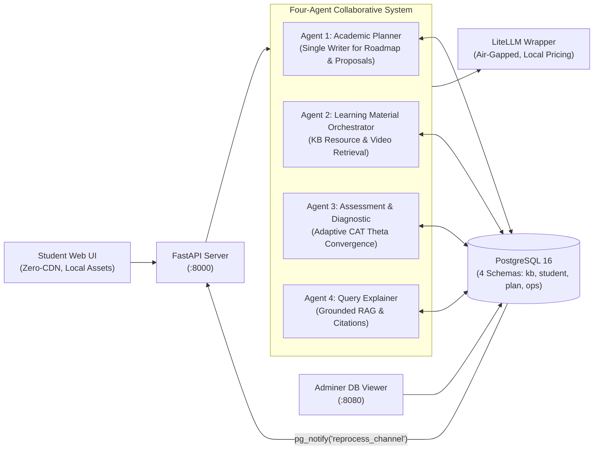

# Adobe Personalised Learning Buddy (IIT Bhubaneswar)

An AI-powered adaptive academic buddy for undergraduate students at **IIT Bhubaneswar**, covering **B.Tech Electrical Engineering (EE)** and **B.Tech Metallurgical and Materials Engineering (MME / SMMME)**. The system guides students through the complete learning cycle: **Assess → Personalise → Learn → Practise → Adapt → Demonstrate Mastery**, strictly bounded by institutional academic rules, verifiable prerequisite DAGs, multi-schema PostgreSQL persistence, higher-studies pathways (GATE, CAT, GRE, GMAT, TOEFL, IELTS), and a four-agent collaborative architecture.



---

## 1. Quick Start

### Run the Complete Stack in 3 Commands

```bash
# 1. Copy environment template
cp .env.example .env

# 2. Set your LLM provider key in .env (or leave blank to run in offline deterministic mode)
# Edit .env: set LLM_API_KEY=your_key_here, LLM_MODEL=openai/gpt-4o-mini

# 3. Start the entire containerized stack (PostgreSQL 16, Adminer, FastAPI Web UI)
docker compose up --build
```

On first boot, the application automatically verifies database connectivity, applies migrations/DDL, seeds PostgreSQL if empty with all 2,399+ verified rows, and exposes:
- **Learning Buddy Web UI:** [http://localhost:8000](http://localhost:8000)
- **Interactive OpenAPI Documentation:** [http://localhost:8000/docs](http://localhost:8000/docs)
- **Adminer DB Viewer:** [http://localhost:8080](http://localhost:8080)
  - *System:* PostgreSQL
  - *Server:* `db` (or `localhost` if connecting from host)
  - *Username:* `ebuddy_user`
  - *Password:* `ebuddy_password`
  - *Database:* `ebuddy`

---

## 2. Web UI Pages & Capabilities

The user interface is an air-gapped, zero-CDN web shell (vanilla HTML5, CSS3, ES6 JavaScript) served directly by FastAPI with zero external network requests:

| Page Route | Title | Core Features |
|---|---|---|
| **`/`** | **Home / Profile Selector** | Switch between synthetic persona profiles (`CONF_STU_EE_POWER_01`, `CONF_STU_MME_PROCESS_01`, etc.), displaying branch, semester, CGPA, and completed courses with synthetic data disclaimers. |
| **`/goals`** | **Goal Selection** | Browse available institutional goals filtered by branch plus cross-branch pathways (Power Systems, VLSI, SDE & Data, Core Metallurgy, UPSC Prep, etc.) with skill requirement badges. |
| **`/roadmap`** | **Academic Roadmap** | Visual semester roadmap highlighting fixed institutional core courses, ranked electives (skill-overlap driven), minor pathways, and unachievable student overload proposals. Traceable KB codes and provenance tags. |
| **`/diagnostic`** | **Adaptive Diagnostic** | Real-time Computerized Adaptive Testing (CAT) based on 1PL Item Response Theory. Questions dynamically selected based on student ability estimate ($\theta$), stopping on convergence spread ($\le 4.0$) or question cap. Shuffled answer options. |
| **`/chat`** | **Academic Tutor Chat** | Grounded question answering and course advice. Queries route deterministically or via LLM with strict KB citations. Course recommendations outside the student's branch produce non-blocking warnings. |
| **`/approvals`** | **Change Proposals** | Review student-driven and system-generated roadmap changes (overload credits, schedule changes, elective swaps). Formal Accept / Reject workflow preserving audit ledger. |
| **`/admin`** | **System Admin & DB Viewer** | System health status, database connection metrics, live row counts across all 4 schemas, and safe read-only preview of knowledge base tables with offline CSV fallbacks. |

---

## 3. Four-Agent Architecture

The core logic is orchestrated by four specialized agents operating under strict dependency boundaries:


1. **Agent 1: Academic Planner (`app/agents/agent_1_planner.py`)**
   - **Exclusive Single-Writer Authority:** Agent 1 is the sole agent permitted to create, mutate, or version records in `plan.plan` and `plan.change_proposal`.
   - **Hard Student Constraints vs. Warning Baselines:** Student constraints (credit cap, weekly hours, headroom, avoid-course, not-together) are **hard** boundaries and never breached. Unsourced institutional baselines emit labelled non-blocking warnings.
   - **Deterministic DAG Scheduling:** Topological sort resolves prerequisite dependencies before dependent semesters.
2. **Agent 2: Learning Material Orchestrator (`app/agents/agent_2_learning.py`)**
   - Retrieves curated NPTEL, SWAYAM, and YouTube resources from `kb.resource` and practice items from `kb.exercise`.
   - Cannot directly edit the student plan; issues structured `ChangeProposal` records to Agent 1.
3. **Agent 3: Assessment & Diagnostic (`app/agents/agent_3_assessment.py`)**
   - Implements Computerized Adaptive Testing (CAT) with continuous ability updates ($\theta$).
   - Dynamically selects exercises at current ability, stopping when $n \ge 5$ and the range of the last 3 thetas $\le 4.0$, or $n \ge 8$.
   - Shuffles options at serve-time; scores deterministically against verified keys.
4. **Agent 4: Query Explainer (`app/agents/agent_4_query.py`)**
   - Answers student curriculum questions using grounded retrieval from KB repositories.
   - Never calls LiteLLM directly; delegates to `app/llm/client.py` with full call logging in `ops.llm_call_log`.

---

## 4. Models & Air-Gapped LLM Gateway

- **Primary LLM:** `openai/gpt-4o-mini` (Configured default in `.env.example`; supports `gemini/gemini-1.5-flash`, `azure/<deployment>`, or `ollama/<model>` purely via environment variables).
- **LiteLLM Gateway:** All model interactions route exclusively through `app/llm/client.py`. No agent or engine imports `litellm` directly, enforcing strict architectural layering.
- **Strict Air-Gap & Cost Isolation:**
  - `LITELLM_LOCAL_MODEL_COST_MAP=True`: Prohibits runtime fetching of remote cost maps from GitHub.
  - `LITELLM_TELEMETRY=False`: Disables all outbound usage reporting.
- **Deterministic Independence:** All prerequisite resolution, academic rule validation, credit limits, CAT item selection, and DAG scheduling execute in deterministic Python with zero model dependencies.

---

## 5. Configuration Reference

All application settings are read dynamically from environment variables without code modification:

| Variable | Default Value | Purpose |
|---|---|---|
| `LLM_MODEL` | `openai/gpt-4o-mini` | Model string passed directly to LiteLLM wrapper. |
| `LLM_API_KEY` | *(empty in example)* | API credential for configured provider. |
| `LLM_API_BASE` | *(empty)* | Optional custom endpoint (Ollama, Azure, LiteLLM proxy). |
| `EMBEDDING_MODEL` | `text-embedding-3-small` | Model for vector representations if active. |
| `LITELLM_LOCAL_MODEL_COST_MAP` | `True` | Forces LiteLLM to use local pricing tables (no GitHub fetch). |
| `LITELLM_TELEMETRY` | `False` | Completely disables third-party usage reporting. |
| `DATABASE_URL` | `postgresql+psycopg://...` | Connection URI with connection pooling and timeouts. |
| `APP_PORT` | `8000` | Exposed FastAPI application port. |
| `ADMINER_PORT` | `8080` | Exposed Adminer database viewer port. |

---

## 6. Academic Data Repositories

The database architecture is partitioned into four explicit schemas: `kb` (Knowledge Base), `student` (Profiles & Ledger), `plan` (Deterministic Plans & Proposals), and `ops` (Reprocessing & LLM Audit Logs).

| Schema & Table | Seed File Path | Rows (DB) | Role & Provenance Status |
|---|---|---|---|
| `kb.source` | `data/seed/kb/source.csv` | 14 | Audit citations, institutional sources, and `AI_DRAFT` provenance tag. |
| `kb.department` | `data/seed/kb/department.csv` | 6 | Academic schools (SECS, SMMME, SMS, SIF, SBS, SHSSM). |
| `kb.programme` | `data/seed/kb/programme.csv` | 2 | Degree programs (`BTECH_EE`, `BTECH_MME`). |
| `kb.course` | `data/seed/kb/course.csv` | 136 | Unified course catalog (87 EE, 49 MME, 4 shared). Audited against raw tables. |
| `kb.course_alias` | `data/seed/kb/course_alias.csv` | 158 | Prerequisite name-to-code resolution dictionary. |
| `kb.course_prerequisite` | `data/seed/kb/course_prerequisite.csv` | 64 | Deterministic DAG prerequisite edges (EE verified). |
| `kb.course_offering` | `data/seed/kb/course_offering.csv` | 185 | Track-aware semester offerings (Track A vs. Track B). |
| `kb.programme_requirement` | `data/seed/kb/programme_requirement.csv` | 141 | Degree requirement slots derived directly from raw semester tables. |
| `kb.slot_option` | `data/seed/kb/slot_option.csv` | 186 | Courses fulfilling elective/lateral slots (102 EE + 84 MME). |
| `kb.resource` | `data/seed/kb/resource.csv` | 252 | Video, textbook, and public reference learning resources. |
| `kb.resource_course` | `data/seed/kb/resource_course.csv` | 231 | Course-to-resource mapping with role designations. |
| `kb.resource_skill` | `data/seed/kb/resource_skill.csv` | 5 | Resource-to-skill coverage for skills lacking institute courses (e.g., DB/SQL, OS). |
| `kb.minor_course` | `data/seed/kb/minor_course.csv` | 5 | Dynamic minor course options for CSE and AI minors (`draft_for_review`). |
| `kb.exercise` | `data/seed/kb/exercise.csv` | 61 | Calibrated practice items with difficulties, topics, and shuffled options. |
| `kb.skill` | `data/seed/kb/skill.csv` | 37 | Reconciled skill taxonomy (`SKILL_*`), mapped to courses and resources. |
| `kb.course_skill` | `data/seed/kb/course_skill.csv` | 80 | Validated course-to-skill mappings with PK `(course_code, skill_id)`. |
| `kb.goal` | `data/seed/kb/goal.csv` | 11 | Career, higher studies, and research pathways. |
| `kb.goal_skill_requirement` | `data/seed/kb/goal_skill_requirement.csv` | 41 | Required skill proficiency thresholds per goal. |
| `kb.relevance_tags` | `data/seed/kb/relevance_tags.csv` | 1,496 | Skill-first elective relevance matrix (`AI_DRAFT`, `draft_for_review`). |
| `kb.faculty` | `data/seed/kb/faculty.csv` | 51 | Faculty entities (44 individual persons, 7 groups). |
| `kb.research_project` | `data/seed/kb/research_project.csv` | 213 | Institute projects (138 EE + 75 MME: sponsored/consultancy/seed). |
| `kb.project_faculty` | `data/seed/kb/project_faculty.csv` | 149 | PI and Co-PI project affiliations. |
| `kb.project_keyword` | `data/seed/kb/project_keyword.csv` | 240 | Searchable keywords linked to research projects. |
| `student.student` | `data/seed/personas/*/students.csv` | 8 | Synthetic student profiles with distinct academic standings and constraints. |
| `plan.plan` | *(generated)* | — | Student study plans with versioning and validation reports. |
| `plan.change_proposal` | *(generated)* | — | Human-in-the-loop proposals for elective swaps and overload requests. |
| `ops.llm_call_log` | *(generated)* | — | Complete audit trail of prompt, context, token usage, and latency. |
| `ops.reprocess_queue` | *(trigger populated)* | — | Reactive event queue driven by PostgreSQL triggers. |

---

## 7. Testing & Quality Assurance

The repository includes a comprehensive 6-stage CI verification pipeline:

```bash
# 1. Run the complete automated test suite (58 tests, 49 subtests)
python -m pytest tests -q

# 2. Run the full CI pipeline (Windows PowerShell)
.\scripts\ci.ps1

# 2b. Run the full CI pipeline (Linux / macOS Bash)
./scripts/ci.sh

# 3. Run the live Web UI smoke test against running container
powershell -ExecutionPolicy Bypass -File .\scripts\ui_smoke.ps1
```

### CI Pipeline Verification Stages (`scripts/ci.ps1`):
1. **Import Boundary Validation:** Asserts that `litellm` is never imported inside `app/agents/` or `app/engine/`. All LLM calls pass through `app/llm/client.py`.
2. **Automated Test Suites:** Runs all unit, integration, and UI endpoint tests (58 passed in < 9s).
3. **Persona Conformance Matrix:** Evaluates 7 synthetic student profiles against 9 academic invariants (100% GREEN).
4. **Knowledge-Base Integrity Audit:** Audits course codes, prerequisite DAGs, and provenance labels.
5. **Secret & Model Name Scan:** Ensures no API keys or hard-coded vendor model names are committed.
6. **Zero-Outbound Air-Gap Scan:** Scans templates, static assets, and backend code to guarantee zero external CDNs, fonts, or network requests.

---

## 8. Compliance Checklist

| Rule # | Requirement | Implementation & Verification |
|---|---|---|
| **Rule 1** | LiteLLM Only via Client | Gateway in `app/llm/client.py`; verified by `test_import_boundaries.py`. |
| **Rule 2** | Configuration by Env Vars Only | `app/config.py` uses Pydantic BaseSettings; verified by secret & model scans. |
| **Rule 3** | `.env.example` Committed | Default tuned to `openai/gpt-4o-mini`; verified by automated tests. |
| **Rule 4** | Single-command Start, < 5 GB, linux/amd64 | `docker compose up --build` starts `app`, `db`, and `adminer` seamlessly. |
| **Rule 5** | No Secrets in Image | `.env` ignored in `.gitignore` and `.dockerignore`. |
| **Rule 6** | Plain CSV/JSON Seeds & Idempotent Reset | `scripts/seed_loader.py --reset` loads 2,399+ rows idempotently in topological order. |
| **Rule 7** | Data Control & Reactive Re-processing | Native PG triggers on editable tables fire `pg_notify` to `ops.reprocess_queue`. |
| **Rule 8** | Zero Outbound Network Traffic | Zero CDNs, zero Google Fonts, local static assets; verified by `test_no_external_references.py`. |
| **Rule 9** | Data Ethics & Provenance | Synthetic profiles tagged `is_synthetic = true`. AI-drafted content tagged `source_id = AI_DRAFT`, `status = draft_for_review`. |
| **Rule 10** | Never Fabricate Academic Data | Raw data strictly derived from `data/raw/`. Mismatches marked `unsourced`. |
| **Rule 11** | Valid KB Course Codes | Verified by deterministic foreign keys and topological DAG resolution. |
| **Rule 12** | Deterministic Plan Validator | Student constraints are strictly hard-blocked; unsourced baselines emit non-blocking warnings. |

---

## 9. Project Directory Layout

```
.
├── app/
│   ├── agents/                           # Four-agent collaborative system
│   │   ├── agent_1_planner.py            # Exclusive writer for roadmaps & proposals
│   │   ├── agent_2_learning.py           # Resource & practice orchestrator
│   │   ├── agent_3_assessment.py         # Adaptive CAT diagnostic assessor
│   │   └── agent_4_query.py              # Grounded curriculum query explainer
│   ├── api/                              # REST API endpoints
│   │   ├── health.py                     # Health & database probe
│   │   ├── student.py                    # Student profile & onboarding
│   │   └── ui_routes.py                  # Web UI JSON APIs (roadmap, chat, diagnostic, admin)
│   ├── contracts/                        # Strict Pydantic contracts & schemas
│   ├── engine/                           # Deterministic algorithmic core
│   │   ├── planner.py                    # Topological prerequisite DAG planner
│   │   ├── diagnostic.py                 # 1PL IRT adaptive testing engine
│   │   ├── relevance.py                  # Skill-first elective relevance scorer
│   │   ├── validator.py                  # Hard vs warning constraint validator
│   │   └── gaps.py                       # Skill gap analyzer
│   ├── kb/repositories.py                # Relational in-memory & DB query repositories
│   ├── llm/client.py                     # Air-gapped LiteLLM client with ops logging
│   ├── static/                           # Air-gapped static assets (CSS, JS; zero CDNs)
│   │   ├── css/style.css                 # Clean, responsive stylesheet
│   │   └── js/app.js                     # Vanilla JavaScript SPA controller
│   ├── templates/                        # Jinja2 HTML templates for all 7 UI pages
│   │   ├── base.html                     # Base layout with synthetic disclaimer banner
│   │   ├── index.html                    # Student profile selector
│   │   ├── goals.html                    # Goal browser
│   │   ├── roadmap.html                  # Academic roadmap viewer
│   │   ├── diagnostic.html               # Adaptive diagnostic test interface
│   │   ├── chat.html                     # Academic tutor chat
│   │   ├── approvals.html                # Change proposal review & decision
│   │   └── admin.html                    # System admin & table inspector
│   └── main.py                           # FastAPI application entrypoint
├── data/
│   ├── raw/                              # Canonical institutional data sources
│   │   ├── ee/                           # Electrical Engineering curriculum, videos, research
│   │   ├── mme/                          # Metallurgical Engineering curriculum, videos, faculty
│   │   ├── library/                      # Central Library catalog (3,000 publications)
│   │   └── higher_studies/               # Higher Studies pathways (GATE, CAT, GRE, GMAT, TOEFL, IELTS)
│   └── seed/                             # Structured relational seed data
│       ├── kb/                           # Knowledge Base CSVs/JSONs (136 courses, 248 resources, 213 projects)
│       ├── higher_studies/               # 14 relational tables for higher studies pathways
│       ├── student/                      # Student profiles, completed courses, and goals
│       └── survey/                       # Baseline survey instrument & diagnostic rubrics
├── sde/                                  # Software Development Engineer (SDE) domain package
│   ├── data/                             # Raw SDE Excel knowledge base sources
│   │   ├── SDE_Prep_Roadmap_with_Playlists.xlsx
│   │   ├── Top_SDE_Project_GitHub_Repos.xlsx
│   │   └── SDE_Competitions_Hackathons_2026-27.xlsx
│   ├── scripts/                          # SDE transformation pipelines
│   │   ├── build_sde_csvs.py             # SDE roadmap, playlists, checkpoints, repos & portfolio builder
│   │   └── build_sde_events_csvs.py      # SDE hackathons & competitions knowledge base builder
│   ├── output/                           # Generated SDE relational CSV datasets
│   │   ├── 01_sde_roadmap_overview.csv
│   │   ├── 02_phase_learning_content.csv
│   │   ├── 03_topic_checkpoints.csv
│   │   ├── 04_project_repos.csv
│   │   ├── 05_portfolio_projects.csv
│   │   ├── 01_events_master.csv
│   │   ├── 02_phase_eligibility.csv
│   │   └── 03_recommendation_rules.csv
│   └── README.md                         # SDE domain catalog & execution guide
├── aiml/                                 # AI & Machine Learning (AI/ML) domain package
│   ├── data/                             # Raw AI/ML Excel knowledge base sources
│   │   ├── AI_ML_Learning_Roadmap_KnowledgeBase-v2.xlsx
│   │   ├── top7_iit_fests_26-27.xlsx
│   │   └── ai_ml_hackathons_and_top7_iit_fests_2026-2027.xlsx
│   ├── scripts/                          # AI/ML transformation pipelines
│   │   ├── build_csvs.py                 # AI/ML curriculum, resources & prerequisite DAG builder
│   │   └── build_events_csvs.py          # AI/ML hackathons, fests & recommendation rules builder
│   ├── output/                           # Generated AI/ML relational CSV datasets
│   │   ├── 01_roadmap.csv
│   │   ├── 02_phase_resources.csv
│   │   ├── 03_prerequisites.csv
│   │   ├── 01_events_master.csv
│   │   ├── 02_phase_eligibility.csv
│   │   ├── 03_recommendation_rules.csv
│   │   └── 04_domain_to_phase_map.csv
│   └── README.md                         # AI/ML domain catalog & execution guide
├── data_analyst/                         # Data Analyst (DA) domain package
│   ├── data/                             # Raw DA Excel knowledge base sources
│   │   ├── Data_Analyst_Roadmap.xlsx     # 9 relational sheets
│   │   └── Data_Analytics_Hackathons.xlsx # 35 curated Indian data hackathons & competitions
│   ├── scripts/                          # DA transformation pipelines
│   │   ├── build_da_csvs.py              # DA curriculum, skills, checkpoints, projects & rubrics builder
│   │   └── build_da_events_csvs.py       # DA hackathons, competitions & recommendation rules builder
│   ├── output/                           # Generated DA relational CSV datasets (UTF-8 with BOM)
│   │   ├── 01_da_roadmap_overview.csv
│   │   ├── 02_phase_modules_resources.csv
│   │   ├── 03_skills_catalog.csv
│   │   ├── 04_phase_summary_readiness_checkpoints.csv
│   │   ├── 05_projects.csv
│   │   ├── 06_project_rubric_items.csv
│   │   ├── 07_pacing_templates.csv
│   │   ├── 08_milestones.csv
│   │   ├── 09_learning_methods.csv
│   │   ├── 01_events_master.csv
│   │   ├── 02_phase_eligibility.csv
│   │   └── 03_recommendation_rules.csv
│   └── README.md                         # DA domain catalog & execution guide
├── da/                                   # Shorthand alias package for Data Analyst
│   ├── data/                             # Raw DA Excel knowledge base sources
│   ├── scripts/                          # DA transformation pipelines
│   ├── output/                           # Mirrored DA relational CSV datasets
│   └── README.md                         # DA package documentation
├── output/                               # Unified legacy output directory (synchronized mirrors)
├── build_csvs.py                         # Root forwarder -> aiml/scripts/build_csvs.py
├── build_events_csvs.py                  # Root forwarder -> aiml/scripts/build_events_csvs.py
├── build_sde_csvs.py                     # Root forwarder -> sde/scripts/build_sde_csvs.py
├── build_sde_events_csvs.py              # Root forwarder -> sde/scripts/build_sde_events_csvs.py
├── build_data_analyst_csvs.py            # Root forwarder -> data_analyst/scripts/build_da_csvs.py
├── build_da_csvs.py                      # Root forwarder -> data_analyst/scripts/build_da_csvs.py
├── build_data_analyst_events_csvs.py     # Root forwarder -> data_analyst/scripts/build_da_events_csvs.py
├── build_da_events_csvs.py               # Root forwarder -> data_analyst/scripts/build_da_events_csvs.py
│   └── seed/                             # Structured relational seed data (2,399+ rows)
│       ├── kb/                           # Knowledge Base CSVs/JSONs (courses, skills, goals, resources)
│       └── personas/                     # Synthetic test personas & calibrated exercise banks
├── docker/
│   ├── Dockerfile                        # Multi-stage slim Docker image (linux/amd64)
│   ├── entrypoint.sh                     # Container initialization & seed loader check
│   └── init.sql                          # DDL creating schemas kb, student, plan, ops + triggers
├── docs/
│   ├── technical/                        # Architecture, contracts, and schema documentation
│   ├── evaluation/conformance_report.md  # Persona conformance test results matrix
│   ├── DATA_GAPS.md                      # Documented omissions and discrepancies
│   ├── data_quality_report.md            # Automated curriculum & prerequisite DAG report
│   ├── UI.md                             # Web UI design & airgap compliance documentation
│   └── CHANGELOG.md                      # Detailed changelog across all phases
├── scripts/
│   ├── ci.ps1 / ci.sh                    # Automated 6-stage CI verification runner
│   ├── dev.ps1                           # Windows automation (up, down, reset, test, check-data)
│   ├── seed_loader.py                    # Database seed loader and reset engine
│   ├── run_conformance.py                # Persona conformance test runner
│   ├── audit_course_catalogue.py         # Course catalog audit script
│   ├── ui_smoke.ps1                      # Live Web UI smoke test script
│   └── regenerate_relevance.py           # Skill-first relevance matrix generator
├── tests/
│   ├── api/test_ui_endpoints.py          # UI REST endpoint & HTML page rendering tests
│   ├── conformance/                      # Persona conformance test suite
│   ├── integration/                      # Multi-agent & curriculum integration tests
│   ├── unit/                             # Agent features, import boundary, & zero-external checks
│   ├── test_db_free.py                   # Offline compliance & syntax unit tests
│   └── test_db_dependent.py              # PostgreSQL integration tests
├── .env.example                          # Committed environment variable template
├── docker-compose.yml                    # Multi-container orchestration (app, db, adminer)
└── requirements.txt                      # Project Python dependencies
```

---

## 11. AI/ML Personalised Learning Roadmap & Knowledge Base Pipeline

As part of the AI/ML Personalised Learning Buddy for Inter IIT Tech Meet 15.0, an automated data transformation pipeline (`build_csvs.py`) ingests the canonical Excel knowledge base (`AI_ML_Learning_Roadmap_KnowledgeBase-v2.xlsx`) and generates three relational, BOM-encoded (`utf-8-sig`) CSV datasets in `output/`:

### Relational Datasets Generated (`output/`)

| File | Rows | Schema / Description | Key Outputs |
|---|---|---|---|
| **`01_roadmap.csv`** | 6 | High-level roadmap showing phase progression across `0_Foundations`, `1_Classical_ML`, `2_Deep_Learning`, `3_Projects`, `4_Specialization`, and `5_Research`. | • `phase_order` (1–6)<br/>• `phase_id` & `phase_name`<br/>• `phase_objective` & `learner_outcome`<br/>• `topics_covered` (ordered domains)<br/>• `total_estimated_hours` (1,624 hrs total)<br/>• `recommended_next_phase` |
| **`02_phase_resources.csv`** | 55 | Detailed catalog of curated learning resources sorted by phase and curriculum order. | • `resource_id` (AIML-001 to AIML-056)<br/>• `resource_title` & `platform_author`<br/>• `resource_type` & `resource_format_group`<br/>• `learning_style` & `cost_model`<br/>• `estimated_hours` & `key_concepts_and_skills`<br/>• `url_or_access_reference` |
| **`03_prerequisites.csv`** | Long Format | Relational prerequisite mapping linking every resource to its prerequisites. | • `prerequisite_kind` (`RESOURCE`, `HIGH_SCHOOL_MATH`, `NONE`, `OTHER`)<br/>• `prerequisite_resource_id` & `prerequisite_title`<br/>• `prerequisite_phase_id`<br/>• `prerequisite_detail` (CBSE Class 11–12 chapter mappings) |

### Format Group Normalization
The pipeline maps source resource types into 11 canonical format groups: `Video`, `Video Series`, `Course`, `Documentation`, `Book`, `Interactive`, `College Course`, `Project/Dataset`, `Reading/Blog/Papers`, `Curated List`, and `Other`.

### CBSE/NCERT High School Math Expansion
Resources requiring foundational high school mathematics (such as `AIML-004`) are expanded into 16 structured CBSE/NCERT Class 11 and Class 12 chapters in `03_prerequisites.csv`, defining granular diagnostic checks across calculus, linear algebra, vector algebra, coordinate geometry, and probability.

### Running the Pipeline
```bash
python build_csvs.py
```
*The pipeline executes deterministic validation assertions upon execution, verifying row counts, ID uniqueness, hours summation consistency (1,624 total hours), and relational referential integrity across all three CSV files.*

---

## 12. Events & Competitions Knowledge Base Pipeline

An automated pipeline (`build_events_csvs.py`) ingests official event schedules (`top7_iit_fests_26-27.xlsx` and `ai_ml_hackathons_and_top7_iit_fests_2026-2027.xlsx`) to generate clean, relational event catalogs and recommendation governance rules in `output/` relative to reference date **2026-11-14**:

### Datasets Generated (`output/`)

| File | Rows | Schema & Purpose | Key Highlights |
|---|---|---|---|
| **`01_events_master.csv`** | 62 | Unified master catalog covering 7 Top IIT Tech Fests, 25 Hackathons, and 30 Leaderboard Competitions. | • Unique IDs (`FEST-01..07`, `HACK-001..025`, `COMP-001..030`)<br/>• Standardized mode & location<br/>• Timeline parsing (`start_month`, `end_month`, `expected_month_range`)<br/>• Prior year windows and new edition flags |
| **`02_phase_eligibility.csv`** | 7 | Stage-wise gating rules defining category unlocks (`fests_unlocked`, `hackathons_unlocked`, `competitions_unlocked`), recommendation quotas, and contextual user nudges. | • `NONE_YET` & `0_Foundations`: Fests only (exposure/inspiration)<br/>• `1_Classical_ML`+: Full unlock (2 fests, 2 hacks, 2 competitions; 6 total) |
| **`03_recommendation_rules.csv`** | 11 | Machine-readable engine rules (R01–R11) governing eligibility, set sizing, category mix, diversity, timeline filters, and domain matching. | • Enforces minimum phase prerequisites<br/>• Limits max same platform to 2<br/>• Excludes ended events |
| **`04_domain_to_phase_map.csv`** | 62 | Fine-grained classification linking events to 16 canonical technical domains, unlock phases, beginner-friendly flags, and concise reasoning. | • Standardized closed-vocabulary domain tags<br/>• Earliest phase readiness mapping<br/>• Grounded reasoning per event |

### Running the Events Pipeline
```bash
python build_events_csvs.py
```
*The pipeline executes automated validation assertions, verifying row counts, category distribution (7 FEST / 25 HACKATHON / 30 COMPETITION), referential integrity, date range logic, and sheet identity between File A and File B.*

---

## 13. SDE (Software Development Engineer) Knowledge Base Pipeline

As part of the eBuddy expansion for full-stack Software Development Engineer prep, an automated data transformation pipeline (`build_sde_csvs.py`) ingests two canonical Excel files (`SDE_Prep_Roadmap_with_Playlists.xlsx` and `Top_SDE_Project_GitHub_Repos.xlsx`) and generates five clean, relational, BOM-encoded (`utf-8-sig`) CSV datasets in `output/`:

### Datasets Generated (`output/`)

| File | Rows | Schema & Purpose | Key Highlights |
|---|---|---|---|
| **`01_sde_roadmap_overview.csv`** | 8 | High-level 8-phase SDE roadmap overview spanning foundational programming to interview preparation. | • `phase_order` (1–8) & `phase_id` (`1_Programming_Foundations` .. `8_Interview_Prep`)<br/>• `phase_name`, `phase_objective`, `learner_outcome`<br/>• `topics_covered` (ordered list of skills per phase)<br/>• `step_count`, `step_range`, `recommended_next_phase` |
| **`02_phase_learning_content.csv`** | 105 | Exhaustive tiered curriculum content covering all 35 steps across Tiers A, B, and C (35 × 3). | • `step` (1–35), `skill`, `phase_id`<br/>• `tier` (`A`, `B`, `C`), `tier_purpose`, `tier_guidance`<br/>• `playlist_resource_title`, `creator`<br/>• `link_url` (extracted from underlying cell hyperlinks), `link_type`, `link_verified`<br/>• `source_notes`, `auxiliary_url`, `key_concepts_covered` |
| **`03_topic_checkpoints.csv`** | 35 | Relational proof-of-learning checkpoints for every step of the SDE learning path. | • `step`, `skill`, `phase_id`<br/>• `checkpoint_description` (exact from source)<br/>• `checkpoint_type` (`PROJECT_BUILD`, `PROBLEM_SOLVING`, `CONCEPT_EXPLANATION`, `HANDS_ON_CONFIG`)<br/>• `passing_criteria` & `recommended_proof_artifact` |
| **`04_project_repos.csv`** | 35 | Curated catalog of high-impact open-source GitHub repositories for hands-on project building. | • `repo_id` (`REPO-01` to `REPO-35`), `repository_name`, `github_link`<br/>• `category`, `what_it_offers`, `example_project_ideas`<br/>• `difficulty`, `best_for`, `stars_reported`, `tech_stack`<br/>• `required_skills`, `earliest_recommended_phase`<br/>• `portfolio_path_priority` (`HIGH` for portfolio path repos, `NORMAL` otherwise) |
| **`05_portfolio_projects.csv`** | 8 | Structured portfolio project recommendations highlighting recruiter-facing proof of competence. | • `project_id` (`PORT-01` to `PORT-08`), `project_name`<br/>• `why_it_impresses`, `recommended_repos`<br/>• `skills_demonstrated`<br/>• `target_phase` & `recommended_difficulty` |

### Pedagogy & Design Principles
1. **Curriculum Phase Partitioning**: Structured into 8 sequential phases:
   - Phase 1: `1_Programming_Foundations` (Steps 1–2: Languages & Git)
   - Phase 2: `2_Core_CS_Foundations` (Steps 3–8: OS, Networks, DBMS, SQL, OOP, System Architecture)
   - Phase 3: `3_Data_Structures_Algorithms` (Steps 9–17: Core to Advanced DSA & DP)
   - Phase 4: `4_Web_Development_Stack` (Steps 18–24: Frontend, Backend, Node, Express, Testing)
   - Phase 5: `5_Software_Architecture_Design` (Steps 25–27: LLD, Design Patterns, HLD)
   - Phase 6: `6_DevOps_Cloud_Tools` (Steps 28–32: Linux, Docker, K8s, CI/CD, AWS)
   - Phase 7: `7_Specialized_Modern_Tech` (Steps 33–34: Realtime Systems, Next.js / Modern Full-Stack)
   - Phase 8: `8_Interview_Prep` (Step 35: Mock Interviews, Behavioral & Coding Prep)
2. **Tiered Learning Pedagogy**:
   - **Tier A (Standard Introductory)**: Primary entry point playlist; recommended first watch.
   - **Tier B (Conceptual / Deep Dive)**: Alternative explanations and depth for complex concepts.
   - **Tier C (Hands-On Practice)**: Dedicated practice sets, coding exercises, and problem solving.
3. **Hyperlink Target Extraction**: Ingests true underlying URLs via OpenPyXL hyperlink targets (`cell.hyperlink.target`), replacing placeholder display text ("Open") with live links. Auxiliary URLs embedded in notes are isolated into `auxiliary_url`.
4. **Portfolio Path Cross-Referencing**: Resolves repository references in the Portfolio Path to mark flagship repos with `HIGH` priority, guiding learners directly from concept mastery to resume-worthy builds.

### Running the SDE Pipeline
```bash
python build_sde_csvs.py
```
*The pipeline executes deterministic validation assertions upon execution, verifying 100% hyperlink extraction, 35 unique steps, 3 tiers per step (105 total rows), 8 portfolio path projects, and relational consistency across all output files.*

---

## 14. SDE Events, Hackathons & Competitions Knowledge Base Pipeline

An automated data engineering pipeline (`build_sde_events_csvs.py`) ingests official event schedules (`SDE_Competitions_Hackathons_2026-27.xlsx`) to build an SDE events and recommendation knowledge base in `output/` relative to reference date **2026-11-15**:

### Datasets Generated (`output/`)

| File | Rows | Schema & Purpose | Key Highlights |
|---|---|---|---|
| **`01_events_master.csv`**<br/>*(alias: `01_sde_events_master.csv`)* | 41 | Complete catalog of SDE tech fests, hackathons, and programming competitions. | • Unique IDs: `FEST-01..02`, `HACK-01..26`, `COMP-01..13`<br/>• Category mapping (2 FEST, 26 HACKATHON, 13 COMPETITION)<br/>• Timeline parsing (`start_month`, `end_month`, `expected_month_range`, `timeline_type`)<br/>• Registration status vs 2026-11-15 (`CLOSED`, `CLOSING_SOON`, `OPEN_OR_UNKNOWN`)<br/>• Date confidence (`HIGH`, `MEDIUM`, `LOW`) and wording (`CONFIRMED`, `EXPECTED`)<br/>• Closed-list focus areas (12 technical domains)<br/>• Hiring pathway tracking (`can_get_hired`: YES, POSSIBLE, EXPOSURE_ONLY, NO)<br/>• Minimum roadmap phase gating |
| **`02_phase_eligibility.csv`**<br/>*(alias: `02_sde_phase_eligibility.csv`)* | 9 | Stage-wise gating rules defining category unlocks (`fests_unlocked`, `hackathons_unlocked`, `competitions_unlocked`), quota caps, and contextual user nudges. | • `NONE_YET`: Fests unlocked (2 fests max; inspiration); hackathons and competitions locked<br/>• `P1_Programming_and_Dev_Basics`+: Full unlock (2 fests, 2 hackathons, 2 competitions; 6 total) |
| **`03_recommendation_rules.csv`**<br/>*(alias: `03_sde_recommendation_rules.csv`)* | 14 | Machine-readable engine rules (R01–R14) governing eligibility, set sizing, category mix, diversity, timeline filters, and hiring preferences. | • Minimum phase prerequisites (R01, R02, R03)<br/>• Balanced set composition (R04, R05)<br/>• Lifecycle & registration filtering (R06, R07)<br/>• Ranking heuristics for upcoming events, hiring paths, and confidence (R08, R09, R10)<br/>• Eligibility enforcement and mandatory display metadata (R11, R12, R13)<br/>• Diversity quota capping same organizer at 2 (R14) |

### Running the SDE Events Pipeline
```bash
python build_sde_events_csvs.py
```
*The pipeline executes automated validation assertions, verifying row counts (41 events, 9 stages, 14 rules), category distribution (2 FEST / 26 HACKATHON / 13 COMPETITION), period partition (27 Nov–Mar / 14 Apr–Nov), ISO month format compliance, and exact cell preservation against raw source data.*

---

## 15. Domain-Oriented Directory Architecture (SDE, AI/ML & DA)

The repository organizes data assets, transformation pipelines, and generated knowledge bases into three dedicated domain packages:

1. **`sde/` Package**:
   - `sde/data/`: Official Excel workbooks (`SDE_Prep_Roadmap_with_Playlists.xlsx`, `Top_SDE_Project_GitHub_Repos.xlsx`, `SDE_Competitions_Hackathons_2026-27.xlsx`).
   - `sde/scripts/`: Standalone Python transformation scripts (`build_sde_csvs.py`, `build_sde_events_csvs.py`).
   - `sde/output/`: Relational CSV outputs for curriculum overview, tiered learning resources, topic checkpoints, project repos, portfolio projects, events master, phase eligibility, and engine rules.
   - `sde/README.md`: Detailed documentation and data dictionaries for the SDE track.

2. **`aiml/` Package**:
   - `aiml/data/`: Official Excel workbooks (`AI_ML_Learning_Roadmap_KnowledgeBase-v2.xlsx`, `top7_iit_fests_26-27.xlsx`, `ai_ml_hackathons_and_top7_iit_fests_2026-2027.xlsx`).
   - `aiml/scripts/`: Standalone Python transformation scripts (`build_csvs.py`, `build_events_csvs.py`).
   - `aiml/output/`: Relational CSV outputs for 6-phase roadmap, 55 curated resources, prerequisite DAG, events master, eligibility rules, recommendation rules, and domain taxonomy.
   - `aiml/README.md`: Detailed documentation and data dictionaries for the AI/ML track.

3. **`data_analyst/` Package** *(alias: `da/`)*:
   - `data_analyst/data/`: Official Excel workbooks (`Data_Analyst_Roadmap.xlsx`, `Data_Analytics_Hackathons.xlsx`).
   - `data_analyst/scripts/`: Standalone Python transformation scripts (`build_da_csvs.py`, `build_da_events_csvs.py`).
   - `data_analyst/output/`: Relational CSV outputs for curriculum overview, module-resource pairings, skills catalog, readiness checkpoints, projects, rubrics, pacing templates, milestones, learning methods, events master, phase eligibility, and engine rules.
   - `data_analyst/README.md`: Detailed documentation and data dictionaries for the Data Analyst track.

### Execution Flexibility
All transformation pipelines include intelligent path resolution and can be invoked either from the root or directly within their package directories:
```bash
# SDE Pipelines
python sde/scripts/build_sde_csvs.py
python sde/scripts/build_sde_events_csvs.py

# AI/ML Pipelines
python aiml/scripts/build_csvs.py
python aiml/scripts/build_events_csvs.py

# Data Analyst Pipelines
python data_analyst/scripts/build_da_csvs.py
python data_analyst/scripts/build_da_events_csvs.py
# or shorthand
python da/scripts/build_da_csvs.py
python da/scripts/build_da_events_csvs.py
```
*Root-level forwarders (`build_csvs.py`, `build_events_csvs.py`, `build_sde_csvs.py`, `build_sde_events_csvs.py`, `build_data_analyst_csvs.py`, `build_da_csvs.py`, `build_data_analyst_events_csvs.py`, `build_da_events_csvs.py`) and legacy `output/` directories are maintained for seamless backward compatibility.*

---

## 16. Data Analyst (DA) Knowledge Base Pipeline

An automated data engineering pipeline (`build_da_csvs.py` / `build_data_analyst_csvs.py`) ingests the complete 9-sheet Data Analyst workbook (`Data_Analyst_Roadmap.xlsx`) to construct a relational learning knowledge base in `data_analyst/output/`, `da/output/`, and `output/`:

### Datasets Generated (`data_analyst/output/`, `da/output/`, and `output/`)

| File | Rows | Schema & Purpose | Key Highlights |
|---|---|---|---|
| **`01_da_roadmap_overview.csv`** | 5 | High-level roadmap overview for eBuddy onboarding. | • 5 Canonical Phases: `DA-PH1` (Foundations), `DA-PH2` (Core SQL and Python), `DA-PH3` (Cleaning, EDA and visualisation), `DA-PH4` (BI, advanced SQL and statistics), `DA-PH5` (Storytelling, portfolio and interview prep)<br/>• Skills in learning order (pipe-separated)<br/>• Derived phase objectives & measurable learner outcomes<br/>• Sequential phase progression pointer (`next_phase_id`) |
| **`02_phase_modules_resources.csv`** | 78 | Granular curriculum modules joined with learning resources. | • All 44 modules mapped across 20 skills<br/>• Exact 78-row join ($M \times R$ resource mapping)<br/>• 4 derived key concepts & skills covered per module<br/>• Resource metadata (title, URL, provider, type, is_free, resource_role)<br/>• Quality flag: tracks 4 skills with no source resources (`resource_id = NO_RESOURCE_IN_SOURCE`) |
| **`03_skills_catalog.csv`** | 20 | Complete catalog of 20 distinct skills. | • Canonical categories: Tools (2), SQL (3), Python (3), Business (3), Visualisation (2), Statistics (3), etc.<br/>• Levels: foundation (6), core (8), advanced (6)<br/>• Verified DAG prerequisite chains (`prerequisite_skill_ids`) with zero forward dependencies<br/>• Canonical phase mapping & skill order within phase |
| **`04_phase_summary_readiness_checkpoints.csv`** | 5 | Phase completion summaries & readiness checkpoints. | • Machine-readable checkpoint types: `QUIZ`, `TIMED_TEST_PLUS_EXERCISE`, `PROJECT_RUBRIC`, `PROJECT_PLUS_QUIZ`, `PROJECT_PLUS_MOCK_INTERVIEW`<br/>• Derived conversational summary text celebrating phase completion and introducing next phase<br/>• Overall roadmap readiness rule text |
| **`05_projects.csv`** | 3 | End-to-end portfolio projects (`DA-P01`, `DA-P02`, `DA-P03`). | • Real-world datasets: UCI Online Retail, NYC TLC Trip Records, World Bank Open Data<br/>• Complete dataset licensing metadata and source links<br/>• Difficulty tiering (beginner, intermediate, advanced) & estimated hours<br/>• Deliverable definitions & prerequisite skill sets |
| **`06_project_rubric_items.csv`** | 12 | Granular evaluation criteria for portfolio projects. | • Relational unbundling of multi-criteria rubrics (4 criteria per project = 12 total criteria)<br/>• Sequenced criterion numbers and evaluation guidelines<br/>• Recommended phase completion unlock (`recommended_after_phase_id`) |
| **`07_pacing_templates.csv`** | 15 | Cross-product of 3 pacing templates across 5 phases. | • Pacing profiles: `DA-12` (12 months @ 6 hrs/wk), `DA-6` (6 months @ 12 hrs/wk), `DA-3` (3 months @ 24 hrs/wk)<br/>• Phase weekly duration breakdown (`share_of_weeks`, `approx_weeks_derived`, `approx_hours_derived`)<br/>• Phase identity verified across all templates |
| **`08_milestones.csv`** | 6 | Sequential learning milestones (`DA-MS1` to `DA-MS6`). | • Timing placement (`END_OF_PHASE`, `PREPARATION`, `APPLICATION`)<br/>• Strict milestone dependency graph (`depends_on`)<br/>• Phase mapping from foundations to first job application |
| **`09_learning_methods.csv`** | 6 | Evidence-based pedagogical study techniques. | • Methods: Learn by querying, Error log, Spaced review, Think out loud, Timeboxed problem solving, Feynman technique<br/>• Contextual guidance (`when_to_use`) and actionable execution rules (`how`) |

### Key Findings & Data Quality Highlights
1. **Curriculum Hours Consistency**: Total module estimated hours (254 hours) plus portfolio projects (60 hours) equals **314 hours**, precisely aligning with the role timeline specification (*"3, 6 or 12 months depending on weekly hours; about 312 hours in total"*).
2. **Resource Coverage**: Exactly 4 of the 20 skills have no external learning resources provided in the source sheet (`DA-S01` Spreadsheet fundamentals, `DA-S11` Data visualisation principles, `DA-S19` Spreadsheet analysis, and `DA-S20` Analytics case interviews). These modules are explicitly annotated with `resource_id = "NO_RESOURCE_IN_SOURCE"` and flagged for supplementary resource authoring.
3. **Dataset Linking**: All three project dataset URLs directly correspond to source dataset resources (`DA-P01` -> `DA-R13`, `DA-P02` -> `DA-R14`, `DA-P03` -> `DA-R15`).
4. **Prerequisite Integrity**: Prerequisite DAG audit verified that all skill prerequisites belong to earlier phases or earlier positions within the same phase, ensuring zero forward dependency violations.

### Running the Data Analyst Curriculum Pipeline
```bash
python build_da_csvs.py
```
*The pipeline executes comprehensive validation assertions on run, verifying 100% exact cell preservation against the source Excel workbook, row count constraints, template phase identity, and relational foreign keys.*

---

## 17. Data Analyst (DA) Events, Hackathons & Competitions Knowledge Base Pipeline

An automated data engineering pipeline (`build_da_events_csvs.py` / `build_data_analyst_events_csvs.py`) ingests official data analytics hackathon and competition schedules (`Data_Analytics_Hackathons.xlsx`) to construct an events recommendation knowledge base in `data_analyst/output/`, `da/output/`, and `output/` relative to reference date **2026-11-15**:

### Datasets Generated (`data_analyst/output/`, `da/output/`, and `output/`)

| File | Rows | Schema & Purpose | Key Highlights |
|---|---|---|---|
| **`01_events_master.csv`**<br/>*(alias: `01_da_events_master.csv`)* | 35 | Master catalog of 35 curated Indian data hackathons and competitions. | • Event type classification: 12 HACKATHON (`HACK-01..12`) and 23 COMPETITION (`COMP-01..23`)<br/>• Organiser categorization (IIT, NIT, BITS/IIM/B-School, Corporate, Government/Ministry, Community platform)<br/>• Home campus tagging (`is_home_campus_event = TRUE` for IIT Bhubaneswar events)<br/>• Mode & offline finale venues (e.g., IIT Bombay Powai, IIT Kharagpur, Gurugram / Virtual)<br/>• Timeline parsing (`expected_month_range`, `start_month`, `end_month`, `next_cycle_note`, `date_wording`)<br/>• Normalised last held edition tracking and multiple year detection<br/>• Structured eligibility classification, restriction flags, and team size phrases<br/>• Granular skill set splitting and DA roadmap skill mapping with soft readiness phase hint |
| **`02_phase_eligibility.csv`**<br/>*(alias: `02_da_phase_eligibility.csv`)* | 6 | Stage-wise gating rules defining category unlocks, quotas, and contextual user nudges. | • `NONE_YET`: Hackathons and competitions locked (set size 0); prompts learner to complete DA-PH1 Foundations<br/>• `DA-PH1`: Full unlock (2 hackathons, 2 competitions; set size 4)<br/>• `DA-PH2` to `DA-PH5`: Full unlock (3 hackathons, 3 competitions; set size 6) with stage-specific encouraging nudges |
| **`03_recommendation_rules.csv`**<br/>*(alias: `03_da_recommendation_rules.csv`)* | 12 | Machine-readable engine rules (R01–R12) governing recommendation behavior. | • Minimum phase prerequisites (R01, R02: DA-PH1)<br/>• Set sizing and category mix enforcement (R03, R04)<br/>• Reference date filtering vs 2026-11-15 (R05, R06)<br/>• Home campus boost for IIT Bhubaneswar learners (R07)<br/>• Skill readiness soft matching (R08)<br/>• Mandatory display fields & date wording caveats (R09, R10)<br/>• Diversity quota capping same organizer at 2 (R11)<br/>• Eligibility profile compliance (R12) |

### Running the Data Analyst Events Pipeline
```bash
python build_da_events_csvs.py
```
*The pipeline executes deterministic validation assertions upon execution, verifying 100% exact cell preservation against raw source data, row count constraints, ISO month formats, and eligibility gating rules.*


---

## 18. SDE Quiz Assessment Knowledge Base Pipeline (LeetCode Practice Bank & Topic Mapping)

An automated data engineering pipeline (`build_sde_quiz_csvs.py` located in root and `sde/scripts/build_sde_quiz_csvs.py`) transforms 3 curated LeetCode DSA practice bank workbooks (`LeetCode_DSA_Easy.xlsx`, `LeetCode_DSA_Medium.xlsx`, `LeetCode_DSA_Hard.xlsx`) into relational CSV datasets for eBuddy's diagnostic onboarding quiz, per-step topic assessments, and spaced repetition engine.

### Datasets Generated (`sde/output/` and mirrored in `output/`)

| File | Rows | Schema & Purpose | Key Highlights |
|---|---|---|---|
| **`01_problem_bank_raw.csv`**<br/>*(alias: `01_sde_problem_bank_raw.csv`)* | 1,519 | Complete raw problem bank combining Easy (259), Medium (684), and Hard (576) workbooks. | • Primary bank IDs: `EASY-0001..0259`, `MED-0001..0684`, `HARD-0001..0576`<br/>• 100% hyperlink resolution via OpenPyXL `cell.hyperlink.target`<br/>• Exact source preservation of problem titles, raw topic names, and original file row indices<br/>• Harmonised `topic_canonical` (15 canonical topics) and `topic_subgroup` tracking for Math vs Bit Manipulation<br/>• Standardized difficulty level numbers (`1` = Easy, `2` = Medium, `3` = Hard)<br/>• Integrity caveat: `link_verified = FALSE` carried forward |
| **`02_problems_unique.csv`**<br/>*(alias: `02_sde_problems_unique.csv`)* | 1,193 | Deduplicated LeetCode problem master catalog with conflict detection and eligibility flags. | • Primary key: `leetcode_number` (1,193 unique problems)<br/>• Appearance count and source file tracking (`appearance_count`, `source_files_seen`)<br/>• Difficulty conflict detection: 320 cross-file conflicts resolved to `difficulty_for_quiz = AMBIGUOUS` and `quiz_eligible_calibrated = FALSE`<br/>• 873 clean problems safe for calibrated assessment (`quiz_eligible_calibrated = TRUE`)<br/>• Topic conflict detection: 66 problems tagged under multiple canonical topics across files<br/>• Primary topic resolution prioritizing highest-difficulty source file<br/>• Direct linkage to primary SDE roadmap step IDs (`roadmap_step_ids`) and phase (`roadmap_phase_id`)<br/>• Universal topic practice eligibility (`quiz_eligible_topic_only = TRUE`) |
| **`03_topics_roadmap_map.csv`**<br/>*(alias: `03_sde_topics_roadmap_map.csv`)* | 15 | Canonical 15-topic taxonomy mapped to SDE roadmap steps (Steps 4 to 26; Phases P2 to P5). | • 15 canonical topics (`T01` to `T15`) covering linear, hierarchical, dynamic programming, and mathematical paradigms<br/>• SDE roadmap step linkages (`roadmap_step_ids`, `roadmap_step_names`, `roadmap_phase_ids`, `latest_phase_id`)<br/>• Mapping strength: 13 `FULL` roadmap steps, 2 `PARTIAL` sub-topic mappings (`Matrix` under Arrays Step 4, `Math & Bit Manipulation` under Bit Manipulation Step 16)<br/>• Prerequisite topic dependency graph (`prerequisite_topics`)<br/>• Granular problem inventory breakdown (raw counts, unique problems, calibrated counts by difficulty, ambiguous counts)<br/>• Automated quiz readiness evaluation (`READY`, `LIMITED`, `INSUFFICIENT` against 15 calibrated medium pool threshold) |

### Canonical Topics & Quiz Engine Readiness Summary

| Topic ID | Canonical Topic | SDE Steps | SDE Phase | Unique Problems | Calibrated Easy | Calibrated Medium | Calibrated Hard | Ambiguous (Conflicts) | Quiz Readiness |
|---|---|---|---|---|---|---|---|---|---|
| **T01** | Arrays & Hashing | 4 \| 6 | P2_DSA_Foundations | 200 | 54 | 76 | 63 | 7 | **READY** |
| **T02** | Strings | 5 | P2_DSA_Foundations | 169 | 52 | 51 | 48 | 18 | **READY** |
| **T03** | Two Pointers & Sliding Window | 9 \| 10 | P3_DSA_Core_Techniques | 60 | 11 | 29 | 9 | 11 | **READY** |
| **T04** | Binary Search & Sorting | 7 \| 8 | P2_DSA_Foundations | 58 | 8 | 16 | 6 | 28 | **READY** |
| **T05** | Linked List | 11 | P3_DSA_Core_Techniques | 27 | 9 | 6 | 5 | 7 | **LIMITED** |
| **T06** | Stack & Queue | 12 \| 13 | P3_DSA_Core_Techniques | 46 | 6 | 9 | 11 | 20 | **LIMITED** |
| **T07** | Trees & BST | 18 \| 19 | P4_Trees_and_Graphs | 92 | 28 | 37 | 14 | 13 | **READY** |
| **T08** | Heap & Priority Queue | 20 | P4_Trees_and_Graphs | 25 | 1 | 3 | 2 | 19 | **INSUFFICIENT** |
| **T09** | Dynamic Programming | 25 \| 26 | P5_Dynamic_Programming_and_Practice | 149 | 11 | 34 | 55 | 49 | **READY** |
| **T10** | Graphs | 22 \| 23 \| 24 | P4_Trees_and_Graphs | 101 | 2 | 22 | 42 | 35 | **READY** |
| **T11** | Greedy & Intervals | 17 | P3_DSA_Core_Techniques | 75 | 4 | 8 | 17 | 46 | **LIMITED** |
| **T12** | Backtracking | 14 \| 15 | P3_DSA_Core_Techniques | 43 | 0 | 17 | 4 | 22 | **READY** |
| **T13** | Trie | 21 | P4_Trees_and_Graphs | 15 | 1 | 4 | 2 | 8 | **INSUFFICIENT** |
| **T14** | Matrix | 4 | P2_DSA_Foundations | 18 | 2 | 13 | 0 | 3 | **LIMITED** |
| **T15** | Math & Bit Manipulation | 16 | P3_DSA_Core_Techniques | 115 | 29 | 39 | 13 | 34 | **READY** |
| **Total** | *15 Canonical Topics* | *Steps 4–26* | *Phases P2–P5* | **1,193** | **218** | **374** | **281** | **320** | **9 READY / 4 LIMITED / 2 INSUFFICIENT** |

### Key Data Architecture & Quality Highlights
1. **Source Topic Sheet Invariant Verification**: All three source workbooks strictly satisfy the invariant that individual topic sheet row counts sum up exactly to the primary `Question Index` sheet row count (Easy: 259 rows across 15 topic sheets; Medium: 684 rows across 16 topic sheets; Hard: 576 rows across 14 topic sheets).
2. **Deterministic Conflict Resolution**: Cross-file overlaps (320 problems appearing in multiple workbooks) are detected in code. Because each source workbook possesses a single difficulty, any multi-file appearance represents a difficulty discrepancy (e.g., LeetCode #268 labelled Easy in one file and Medium in another). Rather than discarding these valuable practice questions, eBuddy cleanly partitions problems into:
   - *Calibrated Assessment Pool (`quiz_eligible_calibrated = TRUE`)*: 873 unambiguous problems safely used for difficulty-calibrated scoring.
   - *Topic Practice Pool (`quiz_eligible_topic_only = TRUE`)*: All 1,193 problems safely eligible for qualitative topic practice, homework, and mock exercises.
3. **Canonical Topic Hierarchy**: The 16 raw topic strings found across workbooks are harmonized into 15 canonical topics, merging raw "Math" and "Bit Manipulation" while recording the precise subgroup in `topic_subgroup`.
4. **Roadmap Step & Phase Alignment**: Every canonical topic directly maps to the corresponding SDE roadmap phase (`P2_DSA_Foundations`, `P3_DSA_Core_Techniques`, `P4_Trees_and_Graphs`, or `P5_Dynamic_Programming_and_Practice`) and step numbers (Steps 4 through 26), ensuring topic quizzes are automatically unlocked as the learner progresses through the roadmap.

### Running the SDE Quiz Assessment Pipeline
```bash
python build_sde_quiz_csvs.py
```
*The pipeline executes end-to-end data extraction, hyperlink resolution, cross-file conflict classification, roadmap mapping, and validation assertions upon execution.*


---

## 19. Data Analyst (DA) Quiz Assessment Knowledge Base Pipeline

An automated data engineering pipeline (`build_da_quiz_csvs.py` located in root and `data_analyst/scripts/build_da_quiz_csvs.py`) transforms the curated Data Analyst question bank workbook (`Data_Analyst_Questions.xlsx`) into a relational assessment knowledge base in `data_analyst/output/`, `da/output/`, and `output/`:

### Datasets Generated (`data_analyst/output/`, `da/output/`, and `output/`)

| File | Rows | Schema & Purpose | Key Highlights |
|---|---|---|---|
| **`01_question_bank.csv`**<br/>*(alias: `01_da_question_bank.csv`)* | 47 | Master question bank covering 32 MCQs, 10 Numeric, and 5 SQL problems. | • Exact source preservation of stems, options, answers, and explanations<br/>• Grading method derivation: `MCQ_EXACT_OPTION_TEXT` (32), `NUMERIC_TOLERANCE` (10), `SQL_RESULT_COMPARE` (5)<br/>• Standardized difficulty level numbers (`1` = Easy [26], `2` = Medium [18], `3` = Hard [3])<br/>• Numeric answer parsing and automatic `percent` unit hint extraction for rate, churn, and lift calculations<br/>• SQL schema definition extraction via regex (`Table name(...)`) for dynamic sandbox database initialization<br/>• MCQ answer-position bias tracking: 26 of 32 correct answers are option `b` (81.25%), and 21 of 32 correct options are the strictly longest text (65.6%) |
| **`02_skills_phase_map.csv`**<br/>*(alias: `02_da_skills_phase_map.csv`)* | 20 | Complete 20-skill taxonomy mapped across Phases 1 to 5 with question coverage metrics. | • Skill taxonomy: 5 Tools, 3 SQL, 2 Python, 4 Analysis, 3 Visualisation, 3 Statistics<br/>• Phase allocation: DA-PH1 (12 questions), DA-PH2 (12), DA-PH3 (8), DA-PH4 (11), DA-PH5 (4)<br/>• Pool status classification: 3 `OK` ($\ge 4$), 12 `THIN` (2–3), 5 `VERY_THIN` (1 question), 0 `EMPTY`<br/>• Shortfall tracking relative to design target of 3 questions per skill (total shortfall: 16 questions)<br/>• Prerequisite DAG verification confirming zero forward-dependency violations |
| **`03_related_skills.csv`**<br/>*(alias: `03_da_related_skills.csv`)* | 62 | Directional inter-skill dependency graph powering related-topic questions in diagnostic quizzes. | • 22 `PREREQUISITE` links (STRONG strength)<br/>• 22 `DEPENDENT` links (STRONG strength)<br/>• 18 `SAME_CATEGORY` domain links (MODERATE strength)<br/>• Concise pedagogical rationales ($\le 12$ words) grounded solely in domain competencies<br/>• Zero self-relations and zero duplicate pairs verified |
| **`04_skill_difficulty_pool.csv`**<br/>*(alias: `04_da_skill_difficulty_pool.csv`)* | 60 | Exhaustive grid of 20 skills $\times$ 3 difficulty levels (Easy, Medium, Hard). | • Inventory breakdown: 4 `OK`, 24 `THIN`, 32 `EMPTY` slots<br/>• Nearest fallback difficulty resolution preferring lower difficulty when tied (e.g., DA-S01 d2/d3 fallback to d1; DA-S06 d1 fallback to d2)<br/>• Explicit generation trigger flags (`needs_generated_questions = TRUE` for 56 THIN/EMPTY slots) |
| **`05_quiz_checkpoints.csv`**<br/>*(alias: `05_da_quiz_checkpoints.csv`)* | 17 | Comprehensive checkpoint registry defining when and how eBuddy quizzes scratch learners. | • 12 Skill Cluster Checks (`CP-1A` through `CP-5B`) after learning milestones<br/>• 4 Phase-End Barrier Quizzes (`CP-1E`, `CP-2E`, `CP-3E`, `CP-4E`, `CP-5E`) verifying phase readiness<br/>• 1 Final Cumulative Quiz (`CP-FIN`) across all 20 skills<br/>• Parameterized targets (10–15 questions), difficulty distributions, and new vs. review balance (70/30)<br/>• Standardized 70% passing bar aligned with official roadmap checkpoint criteria<br/>• Pool adequacy analysis: 13 checkpoints meet target length natively; 4 cluster checks (`CP-1A`, `CP-1B`, `CP-2A`, `CP-4C`) flagged for verified synthetic question generation |
| **`06_quiz_rules.csv`**<br/>*(alias: `06_da_quiz_rules.csv`)* | 29 | Machine-readable operational rules governing quiz presentation, scoring, and adaptive planning. | • `ITEM_AND_GRADING` (G01–G05): MCQ option shuffling, numeric error tolerance ($\le \max(0.01, 1\%)$), SQL result-set diffing, explanation displays<br/>• `DECLARED_KNOWLEDGE` (D01–D08): Dynamic onboarding quiz length (10–15), 75/25 declared-to-related ratio, difficulty mix by claim, confirmation verdicts (70% threshold)<br/>• `SCRATCH_LEARNER` (S01–S04): Cluster triggers, proceed/review/repeat rules, 2-failure prerequisite retake limits, roadmap checkpoint alignment<br/>• `SCORING` (C01–C04): Difficulty-weighted accuracy, strong/ok/weak thresholds, category-level rollups for sparse skills<br/>• `PLANNING` (P01–P04): Weak-first scheduling, prerequisite-first dependency resolution, 7-day spaced repetition, Phase 5 refresher quiz<br/>• `POOL_AND_GENERATION` (L01–L04): Intra-quiz deduplication, fallback difficulty chains, verified synthetic question generation, provenance auditing |

### Key Assessment Engine Insights
1. **Source Answer-Position Bias Mitigation**: In the raw question bank, 26 of 32 MCQs (81.25%) have option `b` as the correct answer, and 21 of 32 correct options (65.6%) are strictly the longest string. To prevent learners from gaming assessments through position or length heuristics, Rule `G02` enforces dynamic option shuffling at quiz presentation time and grades strictly by `correct_option_text`.
2. **Deterministic Grading Mechanisms**:
   - *MCQs*: Graded by exact option text matching.
   - *Numeric*: Graded via absolute tolerance rule $\le \max(0.01, 0.01 \times \text{correct})$, stripping commas, trailing `%`, and whitespace.
   - *SQL*: Graded by comparing result sets from in-memory sample tables extracted from `sql_tables_in_stem_derived`, ignoring column alias variations and unordered rows.
3. **Adaptive Diagnostic Calibration**: When learners claim prior data analytics knowledge, eBuddy allocates 75% questions to declared competencies and 25% to undeclared related skills (`03_related_skills.csv`) at claimed difficulty minus one level. A 70% weighted accuracy threshold confirms mastery, allowing learners to bypass foundational topics while automatically scheduling weak prerequisites.

### Running the Data Analyst Quiz Assessment Pipeline
```bash
python build_da_quiz_csvs.py
```
*The pipeline executes deterministic schema validation, OpenPyXL cell extraction, prerequisite DAG audits, 100% exact cell fidelity verification, and CSV generation across all target folders.*
