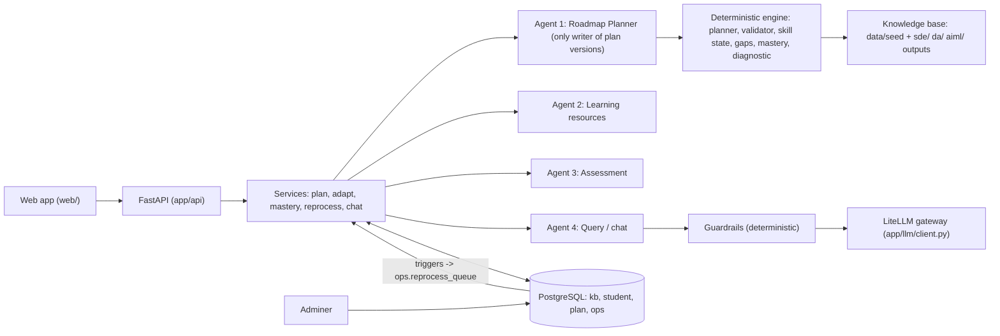
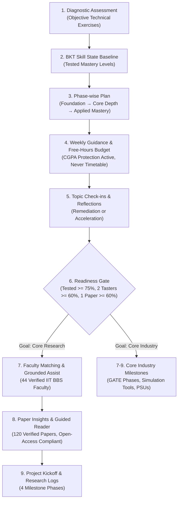
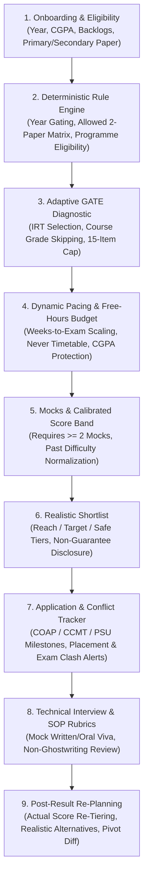

# Adobe Personalised Learning Buddy (IIT Bhubaneswar)

An adaptive academic buddy for IIT Bhubaneswar undergraduates in **B.Tech Electrical Engineering (EE)** and **B.Tech Metallurgical and Materials Engineering (MME)**. It covers the loop **Assess → Personalise → Learn → Practise → Adapt → Demonstrate Mastery** for core, SDE, Data Analyst, AI/ML, higher studies, MBA, UPSC and startup goals.

A deterministic engine (Python) decides every course, credit load, schedule and mastery verdict. The LLM, reached only through LiteLLM, explains and converses; it never chooses courses. With no API key the app runs fully in an offline deterministic mode.

Submission overview: [`docs/INTER_IIT_MASTER_SUBMISSION.md`](docs/INTER_IIT_MASTER_SUBMISSION.md). Change history of the latest upgrade: [`docs/CHANGELOG_CLAUDE_RUN.md`](docs/CHANGELOG_CLAUDE_RUN.md).

---

## 1. Quick start

```bash
docker compose up
```

| What | Where |
|---|---|
| Web app | http://localhost:8000/app/ |
| API docs | http://localhost:8000/docs |
| Health | http://localhost:8000/health |
| Adminer | http://localhost:8080, reachable from this machine only (system PostgreSQL, server `db`, user `ebuddy_user`, password `ebuddy_password`, database `ebuddy`) |
| Older server-rendered pages | http://localhost:8000/ |

The first start builds the app image (`linux/amd64`, CPU only, 759 MB when built in the development sandbox), waits for PostgreSQL and seeds it. No `.env` file is required. To use a live model, copy `.env.example` to `.env` and set `LLM_MODEL` and `LLM_API_KEY` (and `LLM_API_BASE` for a custom endpoint).

Reset to the original seed state, either way:

```bash
make reset
```

or the **Reset everything to the original seed** button on the Admin screen (`POST /api/admin/reset`).

### Without Docker

```bash
pip install -r requirements.txt -c constraints.txt
```

`constraints.txt` pins every package to the versions the Docker image was tested with (Python 3.12).
```bash
python scripts/seed_loader.py --reset
```
```bash
python -m uvicorn app.main:app --port 8000
```

A local PostgreSQL 16 with the user and database from `.env.example` is needed for the second command. Without a database the app still runs from the seed files; plans are then held in memory only.

---

## 2. Web app screens (`web/`, served at `/app/`)

| Screen | What it does |
|---|---|
| Profiles & Goals | Pick one of 75 synthetic profiles (filters for branch, year, goal, edge case), switch goal, or onboard a new student |
| Diagnostic | Adaptive test, one question at a time; starting difficulty comes from assessed evidence, self-ratings carry no weight |
| Roadmap | Every remaining semester: courses with the reason for each, validator checks, career-track phases, evidence the plan relies on, version history |
| Learn & Practise | Resource cards for this semester's courses and the current track phase, checkpoints, projects, graded quick checks, unlocked hackathons; milestones and institute pointers for UPSC and startup |
| Adapt Simulator | One-click presets: strong quiz, weak quiz with remedial prerequisite, course rejection, goal switch. Shows the plan diff and why each change happened |
| Mastery | Course completion and demonstrated proficiency in two separate ledgers |
| Buddy Chat | Grounded answers ("why is EE3L004 on my roadmap"), change proposals, deterministic refusal of injection and off-topic prompts |
| Core to MBA, Core to M.Tech | Dedicated modules from earlier work (section 9) |
| Admin & Data | Edit profiles, scores, course data and rules with immediate re-processing; reset; re-processing log; link to Adminer |

The UI uses no CDN, web font or external script.

---

## 3. Architecture



- Agents 2, 3 and 4 can only raise change proposals; Agent 1 commits a proposal only after the validator passes. A re-plan triggered by an input change (edit, evidence, goal switch) is always stored, because the previous version is stale; if it fails validation, its explanation starts with a "did not pass validation" notice listing the failed checks.
- `app/engine` and `app/kb` never import `app/llm` or `app/api`; `litellm` is imported only in `app/llm/client.py` (enforced by `tests/unit/test_import_boundaries.py`).
- Student-stated limits (credit cap, weekly hours, rejected courses) are hard. Institute credit rules in the seed are unsourced baselines and produce labelled warnings.

---

## 4. Configuration

All settings come from environment variables; see [`.env.example`](.env.example) for the full list with comments.

| Variable | Default | Purpose |
|---|---|---|
| `LLM_MODEL` | `fake` | Model string for LiteLLM; `fake` means offline deterministic mode |
| `LLM_API_KEY` | empty | Provider key |
| `LLM_API_BASE` | empty | Optional custom endpoint |
| `EMBEDDING_MODEL` | empty | Embedding model for LiteLLM |
| `LLM_TIMEOUT_SECONDS`, `LLM_MAX_RETRIES` | 12, 2 | Per-call timeout and retries before the deterministic fallback |
| `LLM_BREAKER_THRESHOLD`, `LLM_BREAKER_COOLDOWN_SECONDS` | 3, 60 | Circuit breaker |
| `POSTGRES_DB`, `POSTGRES_USER`, `POSTGRES_PASSWORD`, `POSTGRES_HOST_PORT` | see file | Database container |
| `DATABASE_URL`, `LOCAL_DATABASE_URL` | see file | Connection strings outside Compose |
| `EBUDDY_DB_SYNC` | `auto` | `off` keeps everything in memory (tests) |
| `REPROCESS_POLL_SECONDS` | 2 | Poll interval for direct database edits |
| `APP_PORT`, `ADMINER_PORT` | 8000, 8080 | Host ports (Adminer is bound to 127.0.0.1 only) |
| `ADMIN_TOKEN` | empty | When set, state-changing `/api/admin/*` requests (edits, reset) need it in the `X-Admin-Token` header; the web app asks for it once. Empty leaves admin open for the local demo |
| `MAX_REQUEST_BYTES` | 1048576 | Largest accepted request body; bigger requests get 413 |

There is no user login: anyone who can reach port 8000 can read every synthetic profile and use the student endpoints. Set `ADMIN_TOKEN` and keep the stack on a trusted network before sharing it.

Behaviour API clients should know:

- An unknown `student_id` returns 404 on every route; profiles are never invented. Create one with `POST /api/v2/students` or `POST /api/student/onboard` (both return 409 for an existing id).
- Diagnostic answers are graded only for items the server served to that student, once each (409 otherwise). The answer key always comes from the server's item bank and is never sent to the browser; fields such as `correct_answer` or `skill_id` in an answer request are ignored.
- Free-text micro-tasks are recorded as weak, ungraded evidence; free-text answers are not marked correct unless a configured LLM grades them.
- The app container runs as an unprivileged user (uid 10001).

---

## 5. Data

| Location | Content |
|---|---|
| `data/raw/` | Source material: EE and MME curricula, playlists, research projects, library publications, higher-studies, UPSC and startup tables |
| `data/seed/kb/` | Knowledge base seeds: 136 courses, 64 prerequisite edges, 319 resources, 60 exercises, 66 skills, 17 goals, 2,312 relevance tags, 38 logged data issues |
| `data/seed/student/` | 75 synthetic profiles: transcript with grades, goals, declared interests, evidence with reliability tier, constraints |
| `data/seed/personas/<id>/students.csv` | Per-persona rosters used by the conformance tests |
| `data/seed/core_to_core`, `mba`, `core_to_mba`, `core_to_mtech` | Feature-module seeds from earlier work |
| `sde/`, `da/`, `aiml/` | Career tracks: `data/` (source workbooks), `scripts/` (pipelines), `output/{curriculum,events,quiz}/` (generated CSVs read by the app) |

Career tracks as loaded by `app/kb/track_repo.py`:

| Track | Phases | Resources | Events | Assessment material |
|---|---|---|---|---|
| SDE | 8 | 105 | 41 | 1,193 unique practice problems (links) |
| Data Analyst | 5 | 23 | 35 | 47-question bank |
| AI/ML | 6 | 55 | 62 | none yet |

Regenerate the track CSVs from their workbooks, or the profiles:

```bash
make tracks
```
```bash
make profiles
```

Known data limits are listed in `docs/DATA_GAPS.md` and in section 10 of `docs/CHANGELOG_CLAUDE_RUN.md`.

---

## 6. Personas and profiles

Nine persona packages in `app/personas/`: `ee_power_core`, `mme_materials_core`, `sde_career`, `da_career`, `aiml_career`, `core_higher_studies`, `core_to_mba`, `btech_upsc`, `student_startup`. Each holds `persona.yaml`, `requirements.yaml`, `mastery.yaml`, `milestones.yaml`, `diagnostic.yaml` and `policy.py`.

The 75 profiles (41 EE, 34 MME, years 1 to 4) are written by `scripts/generate_75_student_profiles.py` and include tagged edge cases: active backlog (8), CGPA on the minor cutoff (7), CGPA on the 8.50 overload cutoff (4), interest versus evidence clash (8), mid-degree goal switch (9), tight weekly hours (8), tight credit cap (6). All profiles are synthetic.

---

## 7. Re-processing and reset

- An edit through the Admin screen or API re-runs skill state, gaps, planner and validator at once and returns the new version with its diff and reason.
- An edit made directly in the database (Adminer) fires a trigger into `ops.reprocess_queue`; a background worker picks it up within about 2 seconds and re-plans the affected students that are loaded.
- `make reset` or the Admin button restore the seed.

---

## 8. Tests and verification

```bash
python -m pytest tests -q
```
```bash
python scripts/verify_all_75_profiles.py
```
```bash
python scripts/run_conformance.py
```
```bash
python scripts/check_data.py
```
```bash
python scripts/check_placeholders.py
```
```bash
python scripts/evaluate_scorecard.py
```

Last recorded results are in section 7 of `docs/CHANGELOG_CLAUDE_RUN.md` and in `docs/evaluation/verify_75_profiles_report.md`. `scripts/ci.sh` chains the boundary tests, the suite, conformance, the data check and two source scans.

---

## 9. Feature modules documented before the latest upgrade

The three sections below were written for earlier work on the Core to Core, Core to MBA and Core to M.Tech modules. Their code was not changed in the latest upgrade apart from shared engine and seed-loader fixes, and the figures in them were **not re-verified**. In particular, rows described as "verified" in these seeds have no confirmable verifier (see the changelog).

### A. Core to Core engineering and research track

The **Core to Core** feature serves students who want to grow inside their own core engineering branch (**Electrical Engineering** or **Metallurgical and Materials Engineering**). It follows the Adobe PS learning loop: **Assess → Personalise → Learn → Practise → Adapt → Demonstrate Mastery**.

Students can pursue one of two specialized pathways:
1. **Core Research Route:** Preparation for undergraduate research mentorship under IIT Bhubaneswar faculty, literature review, taster tasks, paper insights, and international/national research internships (SURGE, DAAD, Mitacs).
2. **Core Industry / PSU Route:** Structured preparation for GATE qualification, core industrial simulation and design tool mastery (MATLAB/Simulink, PSCAD, ANSYS, Thermo-Calc), project clubs (SAE BAJA, Formula Student), and PSU recruitment benchmarks.



#### A. Non-Negotiable Rules & Hard Constraints
- **Zero Rigid Timetables:** The buddy **NEVER** generates day-by-day or hour-by-hour timetables. It outputs weekly focus goals, an hours budget, suggested activities, and study approaches. The student decides when to execute.
- **Never Contact on Student's Behalf:** Draft emails, CV bullets, and interview questions are generated for the student to review, personalize, and send themselves. The buddy never communicates with faculty.
- **Air-Gapped LiteLLM Gateway:** All LLM completions and embeddings route through LiteLLM reading `LLM_MODEL`, `LLM_API_KEY`, `LLM_API_BASE`, and `EMBEDDING_MODEL` from environment variables. Local cost map is locked (`True`) and telemetry is disabled (`False`). Tested model: `openai/gpt-4o-mini`.
- **Zero Hallucination Grounding:** Every claim about a professor or paper is strictly grounded in rows stored in `data/seed/core_to_core/`. Unknown fields are rendered as `"not available"`.
- **Data Ethics & Open Access Compliance:** Full text chunks are provided only for open-access publications (`open_access = True`). Non-open-access publications strictly display public metadata, abstracts, and DOI links.
- **Data Quality & No SAMPLE- Mix:** The 44 faculty and 120 publications were taken from IIT Bhubaneswar institutional pages in earlier work. Their `verified` flags were set then and have not been re-checked (see the note at the top of this section), so treat them as sourced but unconfirmed. Mixing `SAMPLE-` rows with these rows is not allowed.
- **CGPA Protection Guarantee:** Core-course academic support always takes precedence over extra research or skill work during midsem/endsem exam weeks (calendar factor 0.4 / 0.2) or whenever course proficiency falls below 75%.

#### B. LLM vs. Deterministic Split

| Component | Deterministic Core (Python / SQL) | LiteLLM Model (`gpt-4o-mini` @ Temp 0.0) |
|---|---|---|
| **Free-Hours Budget** | Computes contact hours $\sum(L+T+P)$ and calendar factor adjustments. | Writes weekly study advice grounded in retrieved courses. |
| **Prerequisites & Rules** | Validates course eligibility, credit caps, and DAG sequencing. | Explains reason for prerequisite gating in human language. |
| **Skill Mastery (BKT)** | Updates estimated level and confidence from objective scores. | Grades free-form open answers against verified rubrics. |
| **Readiness Gate** | Evaluates 75% tested mastery, 2 tasters >= 60%, 1 paper >= 60%. | Formulates interview discussion questions for faculty group. |
| **Faculty Matching** | Computes deterministic formula: $0.4 w_1 + 0.3 w_2 + 0.15 w_3 + 0.15 w_4$. | Summarizes research synergies and drafts personalized inquiry email. |
| **Paper Reader** | Retrieves chunk IDs, page citations, and open-access flags. | Explains difficult technical terms and provides section glossaries. |
| **Pacing & Adaptation** | Enforces 10-day follow-up logic and midsem budget reduction. | Synthesizes weekly reflection into encouraging feedback. |

#### C. Core to Core Data Storage Map (`data/seed/core_to_core/`)

| Table Name | Seed File Path | Rows (flagged verified in earlier work, not re-checked) | Description & Key Schema Fields |
|---|---|---|---|
| `kb.academic_calendar` | `data/seed/core_to_core/academic_calendar.csv` | 16 | 16 semester weeks, week_type (teaching/midsem/endsem), calendar_factor (1.0, 0.4, 0.2). |
| `kb.research_area` | `data/seed/core_to_core/research_areas.csv` | 16 | Core research sub-domains across Electrical and Metallurgy/Materials engineering. |
| `kb.area_skill` | `data/seed/core_to_core/area_skills.csv` | 23 | Mapping between research areas and required prerequisite skill levels. |
| `kb.faculty` | `data/seed/core_to_core/faculty.csv` | 44 | 44 verified IIT BBS faculty (27 EE, 17 MM) with designation, lab, profile URL, UG mentorship. |
| `kb.faculty_area` | `data/seed/core_to_core/faculty_areas.csv` | 88 | Area affiliations and domain weights for all verified faculty. |
| `kb.paper` | `data/seed/core_to_core/papers.csv` | 120 | 120 verified library papers (41 Open Access, 79 abstract-only per copyright ethics). |
| `kb.paper_author` | `data/seed/core_to_core/paper_authors.csv` | 120 | Author and faculty affiliations for library papers. |
| `kb.paper_chunk` | `data/seed/core_to_core/paper_chunks.csv` | 120 | Text chunks indexed by page number and chunk index for verified guided reading. |
| `kb.paper_skill` | `data/seed/core_to_core/paper_skills.csv` | 120 | Competency skills exercised by each research publication. |
| `kb.taster_task` | `data/seed/core_to_core/taster_tasks.csv` | 8 | Research exploratory tasks (abstract synthesis, problem solving, short write-ups) with rubrics. |
| `kb.industry_milestone` | `data/seed/core_to_core/industry_milestones.csv` | 12 | Core industry pathway: GATE syllabus phases, simulation tools (MATLAB, ANSYS), clubs, PSUs. |

#### D. Simulation Endpoints (`/api/sim`)
The system provides documented simulation hooks to test adaptive behaviors in real-time:
- **Scenario A (`POST /api/sim/{student_id}/scenario/midsem-stress`):** Simulates low quiz performance during midsem exam week. The buddy dynamically triggers CGPA protection, shrinks weekly hours by calendar factor 0.4, and shifts 70-80% of study budget to core-course recovery.
- **Scenario B (`POST /api/sim/{student_id}/scenario/professor-no-reply`):** Simulates approaching a faculty member with 11 days elapsed without reply. The buddy automatically recommends a polite follow-up template and offers the next top-ranked faculty match.
- **Scenario C (`POST /api/sim/{student_id}/scenario/goal-pivot`):** Simulates switching between Core Research and Core Industry routes, instantly updating roadmaps without losing verified skill mastery states.

---

### B. Core to MBA pathway

The **Core to MBA** feature guides core engineering students (**B.Tech EE & B.Tech MM**) who are considering management careers. It builds around their engineering foundations and follows the Adobe PS learning loop: **Assess → Personalise → Learn → Practise → Adapt → Demonstrate Mastery**.

#### A. Key Architectural Modules
1. **Decision View (`app/engine/mba_decision.py`):** Neutral side-by-side comparative timelines and requirements for 5 routes: Stay Core Research, Stay Core Industry, Core Higher Studies (GATE), MBA Now (CAT Fresher), and MBA After 2-3 Years Core Work Experience.
2. **Career Map (`app/engine/mba_career_map.py`):** Verified management pathways leveraging engineering skills (EE: power and energy management, semiconductor product management; MM: metals supply chain, materials sourcing, green steel consulting). Zero unverified salary or placement claims.
3. **Adaptive Diagnostic & Profile Audit (`app/engine/mba_diagnostic.py`, `app/engine/mba_profile_audit.py`):** Short adaptive test across QA, DILR, VARC (max 15 items) and 6-criterion profile audit against 4-level descriptive benchmarks.
4. **Weekly Guidance & CGPA Protection (`app/engine/mba_planner.py`):** Weekly focus goals and hours budgets (never rigid timetables). Automatically throttles MBA prep to <= 2h during mid-sems (weeks 7-8) and end-sems (weeks 14-16) to protect academic GPA.
5. **Verbal-Gap Remediation:** Allocates 45% of MBA hours to daily reading (MBA-L1) and RC practice for students weak in VARC, treating quant as a confidence builder.
6. **Story Builder (`app/engine/mba_story.py`):** Rigorous coaching on "Why MBA", "Why not core", and project STAR narratives. Strictly NO ghostwriting; provides 5-criterion rubric scoring and probing questions.
7. **Mock Calibration & Shortlist Tiering (`app/engine/mba_mocks_shortlist.py`):** Requires >= 2 full mocks for calibrated score bands. Tiers into Reach, Target, and Safe against verified institutional cutoffs with a strict Zero-Leak Guarantee.
8. **Interview Prep (`app/engine/mba_interview.py`):** Technical viva on branch fundamentals (circuits, power, metallurgy, heat treatment), general PI, and WAT essays evaluated on official rubrics.
9. **Re-Plan & Core Pivot (`app/engine/mba_replan.py`):** Post-result alternatives when below target, and seamless lateral switch-back to Core Engineering (Industry or Research) preserving 100% of diagnostic evidence with version diffs.

#### B. Seed Data Locations
- General MBA Tables (17 CSVs): `/data/seed/mba/mba_*.csv`
- Core to MBA Specialized Tables (7 CSVs): `/data/seed/core_to_mba/*.csv`

#### C. Deterministic Split & Tested Models
- **Deterministic Split:** All hours budgets, IRT skill estimations, rubric benchmarks, percentile bands, shortlist tiers, clashes, and version diffs are computed by 100% deterministic Python/SQL engines.
- **Tested Models:** Tuned and validated on `openai/gpt-4o-mini` (default), fully compatible with `gemini/gemini-1.5-flash`, `azure/...`, or local `ollama/...` via LiteLLM.

#### D. Verification & Scorecard
- **Comprehensive Test Suite:** `tests/test_core_to_mba.py` (15/15 tests passing).
- **Evaluation Scorecard:** `scripts/evaluate_mba_scorecard.py` evaluated across 32 synthetic student profiles (16 EE, 16 MM) with 100% pass rates across all verification gates. Report available at `docs/core_to_mba_scorecard.md`.

---

---

### C. Core to M.Tech higher studies pathway

The **Core to M.Tech** feature serves core-branch undergraduate students (**Electrical Engineering** and **Metallurgical & Materials Engineering**) at IIT Bhubaneswar who intend to pursue advanced academic degrees or PSU technical careers in India. It implements the complete Adobe PS learning loop: **Assess → Personalise → Learn → Practise → Adapt → Demonstrate Mastery**.

Supported routes:
1. **Route 1 (GATE → M.Tech/ME):** Primary track targeting premier master's programmes at IISc Bangalore, IIT Bombay, IIT Madras, IIT Kharagpur, and IIT Bhubaneswar via the Common Offer Acceptance Portal (COAP), and NITs via CCMT.
2. **Route 2 (MS by Research & Direct PhD):** Research-oriented track targeting MS(R) and direct PhD opportunities for CFTI graduates with specialized interview and technical test preparation.
3. **Route 3 (PSU Technical Recruitment via GATE):** Targeted preparation for Maharatna and Navratna PSU notifications (IOCL, NTPC, PGCIL, BHEL, SAIL, NALCO) aligned with branch-specific vacancy cycles.
4. **Route 4 (Core Industry Fallback):** Safe lateral pivot to design/simulation tool mastery and core industrial internships if higher-studies timelines shift, preserving 100% of accumulated technical skill evidence.



#### A. Non-Negotiable Hard Constraints & PS Compliance
- **Zero Rigid Timetables:** The buddy **NEVER** outputs hourly schedules or calendar slot bookings. It computes weekly focus goals, recommended activities, and an hours budget scaled by academic calendar phases. The student retains autonomous execution control.
- **Strictly Grounded Deterministic Core:** All decisions regarding GATE exam year eligibility, paper combinations, syllabus topic priority ($Priority = Weightage \times (1 - Mastery) \times PrerequisiteFactor$), template phase durations, score band estimation, Reach/Target/Safe tiering, and application deadlines are executed in deterministic Python and SQL. LiteLLM is utilized solely for conversational delivery, side-question synthesis, and non-ghostwriting feedback.
- **Air-Gapped Operation & Zero Outbound Calls:** Zero runtime scraping, zero Google Scholar / GATE portal HTTP calls, and zero external web fonts/scripts. All syllabus topics, exam dates, cut-offs, and PYQ items are loaded from local CSV seed files.
- **Air-Gapped LiteLLM Gateway:** Configured via `LLM_MODEL`, `LLM_API_KEY`, `LLM_API_BASE` (optional), and `EMBEDDING_MODEL`. Tested and tuned on `openai/gpt-4o-mini` with `LITELLM_LOCAL_MODEL_COST_MAP=True` and `LITELLM_TELEMETRY=False`.
- **Data Integrity & Traceability Protocol:** Every fact row stored in `data/seed/core_to_mtech/` carries `source_url, source_type, retrieved_on, cycle, verified, verified_by`. Any row marked `verified=TRUE` without a human verifier name and official source is rejected at startup. Currently, all generated seed rows are explicitly flagged with `verified=FALSE` and prefixed `SAMPLE-`.
- **CGPA Protection Priority:** When academic stress rises (midsem/endsem exam weeks with calendar factors 0.4 / 0.2, or active backlogs > 0), the buddy curtails pure GATE preparation and reallocates study hours to semester courses, emphasizing "double-benefit" subjects that serve both semester grades and GATE syllabus coverage.

#### B. LLM vs. Deterministic Split

| Component | Deterministic Core (Python / SQL) | LiteLLM Model (`gpt-4o-mini` @ Temp 0.0) |
|---|---|---|
| **GATE Eligibility & Cycle** | Resolves target cycle (2027 for 3rd year, 2026 for 4th year, `eligible_later` for 2nd year) and validates allowed 2-paper combinations (EE+IN, MT+XE). | Conversational explanation of eligibility rules with source citations. |
| **Adaptive Diagnostic** | IRT item selection, topic mastery updating ($P(\text{known} \mid \text{score})$), and mapped course grade skipping ($\ge 8.5 \implies$ skip). | Delivers problem statements and structured explanations. |
| **Pacing & Phase Scaling** | Enforces $\sum \text{phase\_shares} = 1.0$; switches to 3-Month Fast-Track if weeks remaining are insufficient. | Generates weekly focus summaries and study technique advice. |
| **Score Band & Tiering** | Computes confidence intervals ($[\mu - z\sigma, \mu + z\sigma]$) from $\ge 2$ full mocks; classifies programmes into Reach / Target / Safe. | Explains trade-offs between specialisations and institute tiers. |
| **Conflict Detection** | Flags placement season (Weeks 6–10) and exam periods (Weeks 8 & 14–16); computes 3 balanced options with explicit trade-offs. | Formulates supportive balancing strategies. |
| **Interview & SOP Prep** | Evaluates technical mock responses against 4-point rubrics; checks SOPs for evidence-grounded formatting. | Conducts simulated viva voce and provides non-ghostwriting structural critique. |
| **Post-Result Re-Planning** | Identifies below-target results; computes viable alternatives (MS(R), retake, core industry); generates plan diffs. | Provides realistic counseling and empathetic guidance. |

#### C. Seed Data Storage Map (`data/seed/core_to_mtech/`)

The feature introduces 17 relational seed tables fully restored by `scripts/seed_loader.py --reset`:

| Table Name | Seed File Path | Initial Rows | Key Schema Attributes & Purpose |
|---|---|---|---|
| `kb.route` | `data/seed/core_to_mtech/route.csv` | 4 | Higher studies routes: `ROUTE_MTECH_INDIA`, `ROUTE_MSR_PHD_INDIA`, `ROUTE_PSU_GATE`, `ROUTE_CORE_INDUSTRY`. |
| `kb.exam` | `data/seed/core_to_mtech/exam.csv` | 1 | Master examination record for Graduate Aptitude Test in Engineering (`EXAM_GATE`). |
| `kb.exam_cycle` | `data/seed/core_to_mtech/exam_cycle.csv` | 2 | Official exam cycles (GATE 2026, GATE 2027) with registration, exam, and result date windows. |
| `kb.exam_paper` | `data/seed/core_to_mtech/exam_paper.csv` | 4 | Primary papers (EE, MT) and secondary papers (IN, XE) with allowed two-paper matrix. |
| `kb.syllabus_topic` | `data/seed/core_to_mtech/syllabus_topic.csv` | 33 | Granular topic syllabus covering EE, MT, Engineering Mathematics, and General Aptitude. |
| `kb.topic_weightage` | `data/seed/core_to_mtech/topic_weightage.csv` | 33 | Historical mark weightages (min, max, average marks) across 5 recent GATE cycles. |
| `kb.course_topic_map` | `data/seed/core_to_mtech/course_topic_map.csv` | 25 | Institute curriculum mapping (`EE2L001`, `ML2L002`, etc.) linking courses to GATE topics with coverage tags. |
| `kb.pyq_item` | `data/seed/core_to_mtech/pyq_item.csv` | 5 | Official previous-year questions with year, marks, negative marking, and verified keys. |
| — | `data/seed/core_to_mtech/practice_questions.csv` | 40 | Practice question bank for adaptive diagnostic and topic check-ins. |
| `kb.institution` | `data/seed/core_to_mtech/institution.csv` | 8 | Target institutions: IISc Bangalore, IIT Bombay, IIT Madras, IIT Kharagpur, IIT Bhubaneswar, NITs. |
| `kb.higher_programme` | `data/seed/core_to_mtech/higher_programme.csv` | 24 | M.Tech, MS(R), and Direct PhD programmes across EE and MT with qualifying criteria and portals. |
| `kb.admission_stat` | `data/seed/core_to_mtech/admission_stat.csv` | 48 | Historical category-wise closing GATE score cut-offs (GEN, OBC, SC, ST) across 2024 and 2023. |
| `kb.psu` | `data/seed/core_to_mtech/psu.csv` | 6 | Maharatna/Navratna PSUs recruiting via GATE: IOCL, NTPC, PGCIL, BHEL, SAIL, NALCO. |
| `kb.psu_cycle` | `data/seed/core_to_mtech/psu_cycle.csv` | 6 | Annual PSU notification cycles with application deadlines, cutoff ranges, and CTC details. |
| `kb.counselling_cycle` | `data/seed/core_to_mtech/counselling_cycle.csv` | 4 | Centralized counselling schedules for COAP (IITs) and CCMT (NITs) with round dates. |
| `kb.prep_template` | `data/seed/core_to_mtech/prep_template.csv` | 4 | Preparation templates: 12-Month Comprehensive, 6-Month Accelerated, 3-Month Fast-Track, Retake Revision. |
| `kb.template_phase` | `data/seed/core_to_mtech/template_phase.csv` | 15 | Phased breakdown per template with exact week shares strictly summing to 1.0. |

Student State Tables (`docker/init.sql`):
- `student.mock_result`: Log of full and sectional mock tests with scores, AIR estimates, and percentiles.
- `student.error_log`: Diagnostic error tracking classified by mistake type (conceptual, calculation, misread, time).
- `student.application`: Student application milestones across COAP, CCMT, direct institutes, and PSUs.
- `student.interview_session`: Simulated viva records with rubric evaluations across conceptual and problem-solving metrics.
- `student.gate_result`: Official scorecard recording triggering post-result re-planning and plan diff generation.

#### D. Data Traceability & Mandatory Human Verification List
Before final submission to the Adobe evaluation panel, the team must replace sample records with verified data in compliance with §3 and §17:
1. **GATE 2027 Official Notification & Syllabus:** Verify IIT Madras organising institute URLs, application deadlines, and topic descriptions for EE and MT papers.
2. **Institute Admission Cut-Offs:** Update `kb.admission_stat` with official COAP/CCMT closing rounds from institutional websites.
3. **PSU Recruitment Rows:** Confirm upcoming notification dates and eligible paper codes for IOCL, NTPC, PGCIL, SAIL, and NALCO.
4. **Human Verifier Sign-off:** For each confirmed row, set `verified = TRUE`, record the student researcher's name in `verified_by`, and ensure `source_type = 'official'`.
5. **Data Quality Report:** Ingestion integrity and missing field audits are tracked in [docs/core_to_mtech_data_quality_report.md](docs/core_to_mtech_data_quality_report.md).

#### E. Simulation & Verification Endpoints (`/api/sim`)
Four dedicated endpoints allow instant end-to-end testing of dynamic adaptation behaviors:
- **`POST /api/sim/{student_id}/scenario/strong-vs-weak-mock`:** Evaluates score band estimation and tiering adjustments under rising vs. falling mock score trends.
- **`POST /api/sim/{student_id}/scenario/placement-clash`:** Simulates campus placement drive collision with peak mock season, surfacing options with explicit trade-offs.
- **`POST /api/sim/{student_id}/scenario/result-below-target`:** Simulates an actual GATE score below all target programmes, triggering alternative re-planning (MS(R), retake, core industry).
- **`POST /api/sim/{student_id}/scenario/route-switch-psu`:** Simulates switching target route from M.Tech to PSU recruitment, preserving 100% of technical evidence and generating a plan version diff.

---

---

---

## 10. Repository layout

```
app/
  api/         FastAPI routers (buddy.py = web app API, simulator.py, admin.py, student.py, ui_routes.py, mba.py)
  agents/      the four agents
  contracts/   Pydantic contracts (version 1.4.0)
  db/          session and best-effort persistence
  engine/      deterministic core: planner, validator, skill_state, gaps, mastery, diagnostic, rules, relevance
  kb/          read-only repositories, including track_repo.py
  llm/         LiteLLM gateway, guardrails, prompts, tasks
  personas/    nine persona packages
  services/    plan, adapt, mastery, reprocess, onboarding, diagnostic, chat, orchestrator
  templates/, static/   older server-rendered pages
web/           web app (vanilla JS modules, no build step)
data/raw/      source material
data/seed/     seeds loaded by scripts/seed_loader.py
sde/ da/ aiml/ career-track workbooks, pipelines and generated CSVs
docker/        Dockerfile, entrypoint.sh, wait_for_db.py, init.sql
scripts/       seed loader, generators, verifiers, ingestion
tests/         unit, integration, conformance, API and upgrade tests
docs/          submission document, changelogs, evaluation reports, decisions
```
