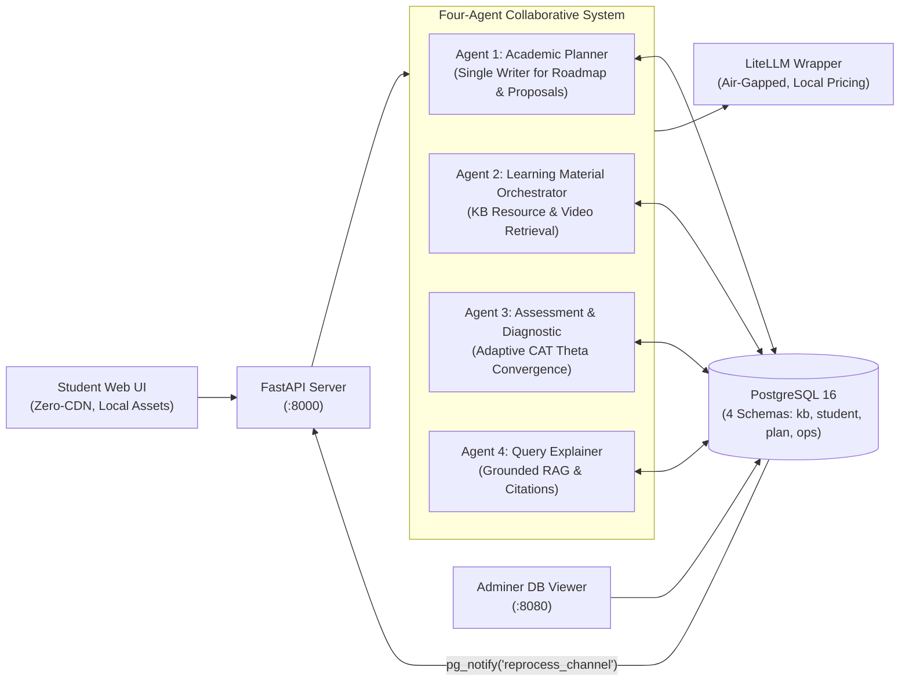
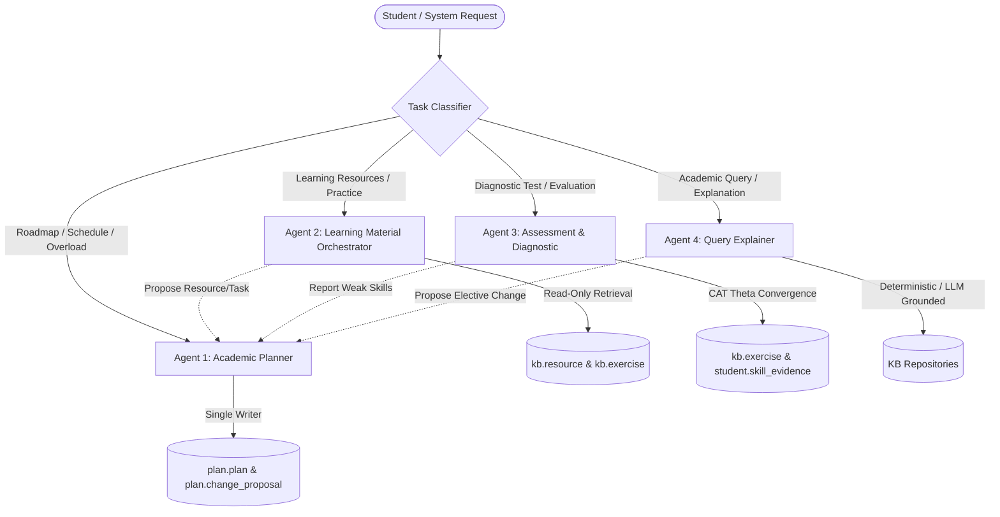

# Adobe Personalised Learning Buddy (IIT Bhubaneswar)

An AI-powered adaptive academic buddy for undergraduate students at **IIT Bhubaneswar**, covering **B.Tech Electrical Engineering (EE)** and **B.Tech Metallurgical and Materials Engineering (MME / SMMME)**. The system guides students through the complete learning cycle: **Assess → Personalise → Learn → Practise → Adapt → Demonstrate Mastery**, strictly bounded by institutional academic rules, verifiable prerequisite DAGs, multi-schema PostgreSQL persistence, higher-studies pathways (GATE, CAT, GRE, GMAT, TOEFL, IELTS), and a four-agent collaborative architecture.



---

## 1. Quick Start

### Run the Complete Stack in 3 Commands

```bash
# 1. Copy environment template
cp .env.example .env

# 2. Set your LLM provider key in .env (or leave blank to run in offline deterministic mode)
# Edit .env: set LLM_API_KEY=your_key_here, LLM_MODEL=openai/gpt-4o-mini

# 3. Start the entire containerized stack (PostgreSQL 16, Adminer, FastAPI Web UI)
docker compose up --build
```

On first boot, the application automatically verifies database connectivity, applies migrations/DDL, seeds PostgreSQL if empty with all 2,399+ verified rows, and exposes:
- **Learning Buddy Web UI:** [http://localhost:8000](http://localhost:8000)
- **Interactive OpenAPI Documentation:** [http://localhost:8000/docs](http://localhost:8000/docs)
- **Adminer DB Viewer:** [http://localhost:8080](http://localhost:8080)
  - *System:* PostgreSQL
  - *Server:* `db` (or `localhost` if connecting from host)
  - *Username:* `ebuddy_user`
  - *Password:* `ebuddy_password`
  - *Database:* `ebuddy`

---

## 2. Web UI Pages & Capabilities

The user interface is an air-gapped, zero-CDN web shell (vanilla HTML5, CSS3, ES6 JavaScript) served directly by FastAPI with zero external network requests:

| Page Route | Title | Core Features |
|---|---|---|
| **`/`** | **Home / Profile Selector** | Switch between synthetic persona profiles (`CONF_STU_EE_POWER_01`, `CONF_STU_MME_PROCESS_01`, etc.), displaying branch, semester, CGPA, and completed courses with synthetic data disclaimers. |
| **`/goals`** | **Goal Selection** | Browse available institutional goals filtered by branch plus cross-branch pathways (Power Systems, VLSI, SDE & Data, Core Metallurgy, UPSC Prep, etc.) with skill requirement badges. |
| **`/roadmap`** | **Academic Roadmap** | Visual semester roadmap highlighting fixed institutional core courses, ranked electives (skill-overlap driven), minor pathways, and unachievable student overload proposals. Traceable KB codes and provenance tags. |
| **`/diagnostic`** | **Adaptive Diagnostic** | Real-time Computerized Adaptive Testing (CAT) based on 1PL Item Response Theory. Questions dynamically selected based on student ability estimate ($\theta$), stopping on convergence spread ($\le 4.0$) or question cap. Shuffled answer options. |
| **`/chat`** | **Academic Tutor Chat** | Grounded question answering and course advice. Queries route deterministically or via LLM with strict KB citations. Course recommendations outside the student's branch produce non-blocking warnings. |
| **`/approvals`** | **Change Proposals** | Review student-driven and system-generated roadmap changes (overload credits, schedule changes, elective swaps). Formal Accept / Reject workflow preserving audit ledger. |
| **`/admin`** | **System Admin & DB Viewer** | System health status, database connection metrics, live row counts across all 4 schemas, and safe read-only preview of knowledge base tables with offline CSV fallbacks. |

---

## 3. Four-Agent Architecture

The core logic is orchestrated by four specialized agents operating under strict dependency boundaries:



1. **Agent 1: Academic Planner (`app/agents/agent_1_planner.py`)**
   - **Exclusive Single-Writer Authority:** Agent 1 is the sole agent permitted to create, mutate, or version records in `plan.plan` and `plan.change_proposal`.
   - **Hard Student Constraints vs. Warning Baselines:** Student constraints (credit cap, weekly hours, headroom, avoid-course, not-together) are **hard** boundaries and never breached. Unsourced institutional baselines emit labelled non-blocking warnings.
   - **Deterministic DAG Scheduling:** Topological sort resolves prerequisite dependencies before dependent semesters.
2. **Agent 2: Learning Material Orchestrator (`app/agents/agent_2_learning.py`)**
   - Retrieves curated NPTEL, SWAYAM, and YouTube resources from `kb.resource` and practice items from `kb.exercise`.
   - Cannot directly edit the student plan; issues structured `ChangeProposal` records to Agent 1.
3. **Agent 3: Assessment & Diagnostic (`app/agents/agent_3_assessment.py`)**
   - Implements Computerized Adaptive Testing (CAT) with continuous ability updates ($\theta$).
   - Dynamically selects exercises at current ability, stopping when $n \ge 5$ and the range of the last 3 thetas $\le 4.0$, or $n \ge 8$.
   - Shuffles options at serve-time; scores deterministically against verified keys.
4. **Agent 4: Query Explainer (`app/agents/agent_4_query.py`)**
   - Answers student curriculum questions using grounded retrieval from KB repositories.
   - Never calls LiteLLM directly; delegates to `app/llm/client.py` with full call logging in `ops.llm_call_log`.

---

## 4. Models & Air-Gapped LLM Gateway

- **Primary LLM:** `openai/gpt-4o-mini` (Configured default in `.env.example`; supports `gemini/gemini-1.5-flash`, `azure/<deployment>`, or `ollama/<model>` purely via environment variables).
- **LiteLLM Gateway:** All model interactions route exclusively through `app/llm/client.py`. No agent or engine imports `litellm` directly, enforcing strict architectural layering.
- **Strict Air-Gap & Cost Isolation:**
  - `LITELLM_LOCAL_MODEL_COST_MAP=True`: Prohibits runtime fetching of remote cost maps from GitHub.
  - `LITELLM_TELEMETRY=False`: Disables all outbound usage reporting.
- **Deterministic Independence:** All prerequisite resolution, academic rule validation, credit limits, CAT item selection, and DAG scheduling execute in deterministic Python with zero model dependencies.

---

## 5. Configuration Reference

All application settings are read dynamically from environment variables without code modification:

| Variable | Default Value | Purpose |
|---|---|---|
| `LLM_MODEL` | `openai/gpt-4o-mini` | Model string passed directly to LiteLLM wrapper. |
| `LLM_API_KEY` | *(empty in example)* | API credential for configured provider. |
| `LLM_API_BASE` | *(empty)* | Optional custom endpoint (Ollama, Azure, LiteLLM proxy). |
| `EMBEDDING_MODEL` | `text-embedding-3-small` | Model for vector representations if active. |
| `LITELLM_LOCAL_MODEL_COST_MAP` | `True` | Forces LiteLLM to use local pricing tables (no GitHub fetch). |
| `LITELLM_TELEMETRY` | `False` | Completely disables third-party usage reporting. |
| `DATABASE_URL` | `postgresql+psycopg://...` | Connection URI with connection pooling and timeouts. |
| `APP_PORT` | `8000` | Exposed FastAPI application port. |
| `ADMINER_PORT` | `8080` | Exposed Adminer database viewer port. |

---

## 6. Academic Data Repositories

The database architecture is partitioned into four explicit schemas: `kb` (Knowledge Base), `student` (Profiles & Ledger), `plan` (Deterministic Plans & Proposals), and `ops` (Reprocessing & LLM Audit Logs).

| Schema & Table | Seed File Path | Rows (DB) | Role & Provenance Status |
|---|---|---|---|
| `kb.source` | `data/seed/kb/source.csv` | 14 | Audit citations, institutional sources, and `AI_DRAFT` provenance tag. |
| `kb.department` | `data/seed/kb/department.csv` | 6 | Academic schools (SECS, SMMME, SMS, SIF, SBS, SHSSM). |
| `kb.programme` | `data/seed/kb/programme.csv` | 2 | Degree programs (`BTECH_EE`, `BTECH_MME`). |
| `kb.course` | `data/seed/kb/course.csv` | 136 | Unified course catalog (87 EE, 49 MME, 4 shared). Audited against raw tables. |
| `kb.course_alias` | `data/seed/kb/course_alias.csv` | 158 | Prerequisite name-to-code resolution dictionary. |
| `kb.course_prerequisite` | `data/seed/kb/course_prerequisite.csv` | 64 | Deterministic DAG prerequisite edges (EE verified). |
| `kb.course_offering` | `data/seed/kb/course_offering.csv` | 185 | Track-aware semester offerings (Track A vs. Track B). |
| `kb.programme_requirement` | `data/seed/kb/programme_requirement.csv` | 141 | Degree requirement slots derived directly from raw semester tables. |
| `kb.slot_option` | `data/seed/kb/slot_option.csv` | 186 | Courses fulfilling elective/lateral slots (102 EE + 84 MME). |
| `kb.resource` | `data/seed/kb/resource.csv` | 252 | Video, textbook, and public reference learning resources. |
| `kb.resource_course` | `data/seed/kb/resource_course.csv` | 231 | Course-to-resource mapping with role designations. |
| `kb.resource_skill` | `data/seed/kb/resource_skill.csv` | 5 | Resource-to-skill coverage for skills lacking institute courses (e.g., DB/SQL, OS). |
| `kb.minor_course` | `data/seed/kb/minor_course.csv` | 5 | Dynamic minor course options for CSE and AI minors (`draft_for_review`). |
| `kb.exercise` | `data/seed/kb/exercise.csv` | 61 | Calibrated practice items with difficulties, topics, and shuffled options. |
| `kb.skill` | `data/seed/kb/skill.csv` | 37 | Reconciled skill taxonomy (`SKILL_*`), mapped to courses and resources. |
| `kb.course_skill` | `data/seed/kb/course_skill.csv` | 80 | Validated course-to-skill mappings with PK `(course_code, skill_id)`. |
| `kb.goal` | `data/seed/kb/goal.csv` | 11 | Career, higher studies, and research pathways. |
| `kb.goal_skill_requirement` | `data/seed/kb/goal_skill_requirement.csv` | 41 | Required skill proficiency thresholds per goal. |
| `kb.relevance_tags` | `data/seed/kb/relevance_tags.csv` | 1,496 | Skill-first elective relevance matrix (`AI_DRAFT`, `draft_for_review`). |
| `kb.faculty` | `data/seed/kb/faculty.csv` | 51 | Faculty entities (44 individual persons, 7 groups). |
| `kb.research_project` | `data/seed/kb/research_project.csv` | 213 | Institute projects (138 EE + 75 MME: sponsored/consultancy/seed). |
| `kb.project_faculty` | `data/seed/kb/project_faculty.csv` | 149 | PI and Co-PI project affiliations. |
| `kb.project_keyword` | `data/seed/kb/project_keyword.csv` | 240 | Searchable keywords linked to research projects. |
| `student.student` | `data/seed/personas/*/students.csv` | 8 | Synthetic student profiles with distinct academic standings and constraints. |
| `plan.plan` | *(generated)* | — | Student study plans with versioning and validation reports. |
| `plan.change_proposal` | *(generated)* | — | Human-in-the-loop proposals for elective swaps and overload requests. |
| `ops.llm_call_log` | *(generated)* | — | Complete audit trail of prompt, context, token usage, and latency. |
| `ops.reprocess_queue` | *(trigger populated)* | — | Reactive event queue driven by PostgreSQL triggers. |

---

## 7. Testing & Quality Assurance

The repository includes a comprehensive 6-stage CI verification pipeline:

```bash
# 1. Run the complete automated test suite (58 tests, 49 subtests)
python -m pytest tests -q

# 2. Run the full CI pipeline (Windows PowerShell)
.\scripts\ci.ps1

# 2b. Run the full CI pipeline (Linux / macOS Bash)
./scripts/ci.sh

# 3. Run the live Web UI smoke test against running container
powershell -ExecutionPolicy Bypass -File .\scripts\ui_smoke.ps1
```

### CI Pipeline Verification Stages (`scripts/ci.ps1`):
1. **Import Boundary Validation:** Asserts that `litellm` is never imported inside `app/agents/` or `app/engine/`. All LLM calls pass through `app/llm/client.py`.
2. **Automated Test Suites:** Runs all unit, integration, and UI endpoint tests (58 passed in < 9s).
3. **Persona Conformance Matrix:** Evaluates 7 synthetic student profiles against 9 academic invariants (100% GREEN).
4. **Knowledge-Base Integrity Audit:** Audits course codes, prerequisite DAGs, and provenance labels.
5. **Secret & Model Name Scan:** Ensures no API keys or hard-coded vendor model names are committed.
6. **Zero-Outbound Air-Gap Scan:** Scans templates, static assets, and backend code to guarantee zero external CDNs, fonts, or network requests.

---

## 8. Compliance Checklist

| Rule # | Requirement | Implementation & Verification |
|---|---|---|
| **Rule 1** | LiteLLM Only via Client | Gateway in `app/llm/client.py`; verified by `test_import_boundaries.py`. |
| **Rule 2** | Configuration by Env Vars Only | `app/config.py` uses Pydantic BaseSettings; verified by secret & model scans. |
| **Rule 3** | `.env.example` Committed | Default tuned to `openai/gpt-4o-mini`; verified by automated tests. |
| **Rule 4** | Single-command Start, < 5 GB, linux/amd64 | `docker compose up --build` starts `app`, `db`, and `adminer` seamlessly. |
| **Rule 5** | No Secrets in Image | `.env` ignored in `.gitignore` and `.dockerignore`. |
| **Rule 6** | Plain CSV/JSON Seeds & Idempotent Reset | `scripts/seed_loader.py --reset` loads 2,399+ rows idempotently in topological order. |
| **Rule 7** | Data Control & Reactive Re-processing | Native PG triggers on editable tables fire `pg_notify` to `ops.reprocess_queue`. |
| **Rule 8** | Zero Outbound Network Traffic | Zero CDNs, zero Google Fonts, local static assets; verified by `test_no_external_references.py`. |
| **Rule 9** | Data Ethics & Provenance | Synthetic profiles tagged `is_synthetic = true`. AI-drafted content tagged `source_id = AI_DRAFT`, `status = draft_for_review`. |
| **Rule 10** | Never Fabricate Academic Data | Raw data strictly derived from `data/raw/`. Mismatches marked `unsourced`. |
| **Rule 11** | Valid KB Course Codes | Verified by deterministic foreign keys and topological DAG resolution. |
| **Rule 12** | Deterministic Plan Validator | Student constraints are strictly hard-blocked; unsourced baselines emit non-blocking warnings. |

---

## 9. Project Directory Layout

```
.
├── app/
│   ├── agents/                           # Four-agent collaborative system
│   │   ├── agent_1_planner.py            # Exclusive writer for roadmaps & proposals
│   │   ├── agent_2_learning.py           # Resource & practice orchestrator
│   │   ├── agent_3_assessment.py         # Adaptive CAT diagnostic assessor
│   │   └── agent_4_query.py              # Grounded curriculum query explainer
│   ├── api/                              # REST API endpoints
│   │   ├── health.py                     # Health & database probe
│   │   ├── student.py                    # Student profile & onboarding
│   │   └── ui_routes.py                  # Web UI JSON APIs (roadmap, chat, diagnostic, admin)
│   ├── contracts/                        # Strict Pydantic contracts & schemas
│   ├── engine/                           # Deterministic algorithmic core
│   │   ├── planner.py                    # Topological prerequisite DAG planner
│   │   ├── diagnostic.py                 # 1PL IRT adaptive testing engine
│   │   ├── relevance.py                  # Skill-first elective relevance scorer
│   │   ├── validator.py                  # Hard vs warning constraint validator
│   │   └── gaps.py                       # Skill gap analyzer
│   ├── kb/repositories.py                # Relational in-memory & DB query repositories
│   ├── llm/client.py                     # Air-gapped LiteLLM client with ops logging
│   ├── static/                           # Air-gapped static assets (CSS, JS; zero CDNs)
│   │   ├── css/style.css                 # Clean, responsive stylesheet
│   │   └── js/app.js                     # Vanilla JavaScript SPA controller
│   ├── templates/                        # Jinja2 HTML templates for all 7 UI pages
│   │   ├── base.html                     # Base layout with synthetic disclaimer banner
│   │   ├── index.html                    # Student profile selector
│   │   ├── goals.html                    # Goal browser
│   │   ├── roadmap.html                  # Academic roadmap viewer
│   │   ├── diagnostic.html               # Adaptive diagnostic test interface
│   │   ├── chat.html                     # Academic tutor chat
│   │   ├── approvals.html                # Change proposal review & decision
│   │   └── admin.html                    # System admin & table inspector
│   └── main.py                           # FastAPI application entrypoint
├── data/
│   ├── raw/                              # Canonical institutional data sources
│   │   ├── ee/                           # Electrical Engineering curriculum, videos, research
│   │   ├── mme/                          # Metallurgical Engineering curriculum, videos, faculty
│   │   ├── library/                      # Central Library catalog (3,000 publications)
│   │   └── higher_studies/               # Higher Studies pathways (GATE, CAT, GRE, GMAT, TOEFL, IELTS)
│   └── seed/                             # Structured relational seed data (2,399+ rows)
│       ├── kb/                           # Knowledge Base CSVs/JSONs (courses, skills, goals, resources)
│       └── personas/                     # Synthetic test personas & calibrated exercise banks
├── docker/
│   ├── Dockerfile                        # Multi-stage slim Docker image (linux/amd64)
│   ├── entrypoint.sh                     # Container initialization & seed loader check
│   └── init.sql                          # DDL creating schemas kb, student, plan, ops + triggers
├── docs/
│   ├── technical/                        # Architecture, contracts, and schema documentation
│   ├── evaluation/conformance_report.md  # Persona conformance test results matrix
│   ├── DATA_GAPS.md                      # Documented omissions and discrepancies
│   ├── data_quality_report.md            # Automated curriculum & prerequisite DAG report
│   ├── UI.md                             # Web UI design & airgap compliance documentation
│   └── CHANGELOG.md                      # Detailed changelog across all phases
├── scripts/
│   ├── ci.ps1 / ci.sh                    # Automated 6-stage CI verification runner
│   ├── dev.ps1                           # Windows automation (up, down, reset, test, check-data)
│   ├── seed_loader.py                    # Database seed loader and reset engine
│   ├── run_conformance.py                # Persona conformance test runner
│   ├── audit_course_catalogue.py         # Course catalog audit script
│   ├── ui_smoke.ps1                      # Live Web UI smoke test script
│   └── regenerate_relevance.py           # Skill-first relevance matrix generator
├── tests/
│   ├── api/test_ui_endpoints.py          # UI REST endpoint & HTML page rendering tests
│   ├── conformance/                      # Persona conformance test suite
│   ├── integration/                      # Multi-agent & curriculum integration tests
│   ├── unit/                             # Agent features, import boundary, & zero-external checks
│   ├── test_db_free.py                   # Offline compliance & syntax unit tests
│   └── test_db_dependent.py              # PostgreSQL integration tests
├── .env.example                          # Committed environment variable template
├── docker-compose.yml                    # Multi-container orchestration (app, db, adminer)
└── requirements.txt                      # Project Python dependencies
```
