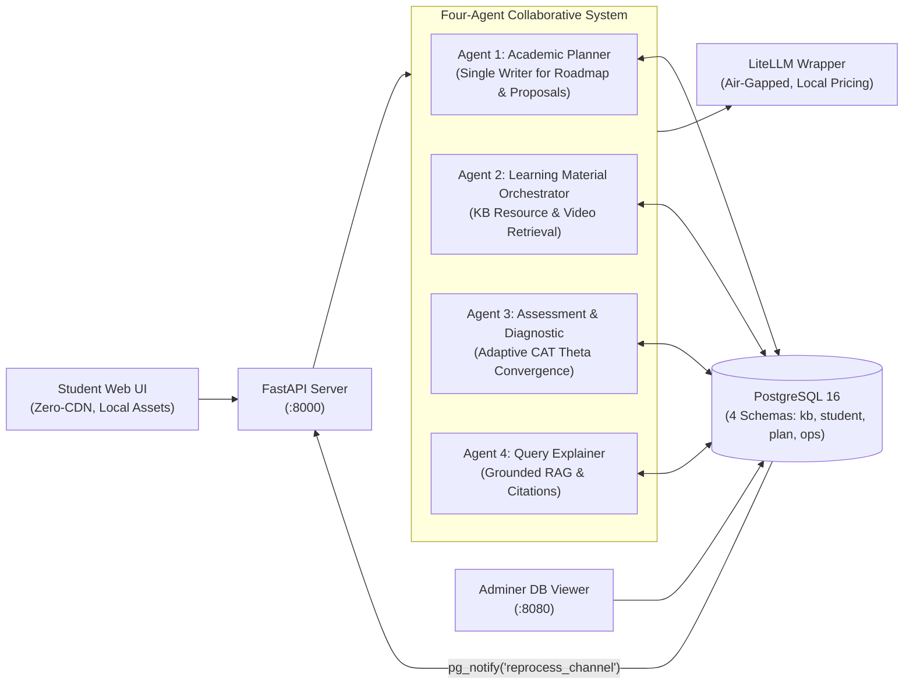
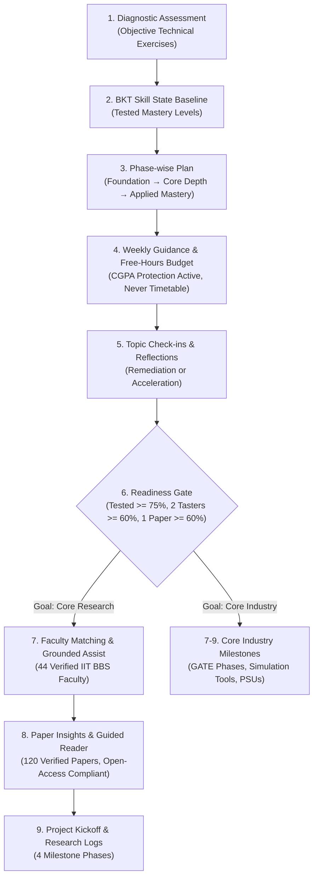
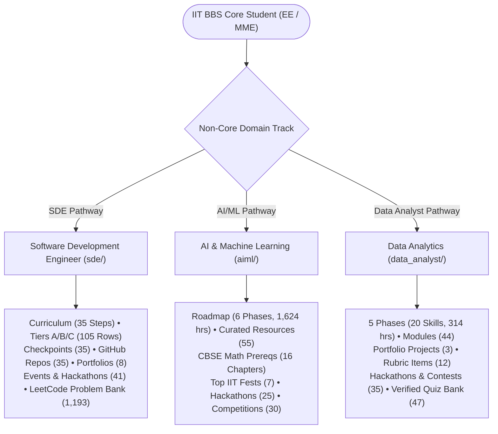
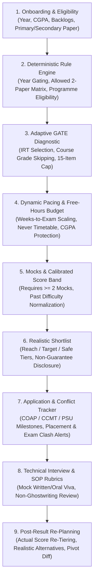
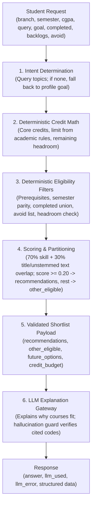

# Adobe Personalised Learning Buddy (IIT Bhubaneswar)

An AI-powered adaptive academic buddy for undergraduate students at **IIT Bhubaneswar**, covering **B.Tech Electrical Engineering (EE)** and **B.Tech Metallurgical and Materials Engineering (MME / SMMME)**, alongside non-core career pathways in **Software Development Engineering (SDE)**, **AI & Machine Learning (AI/ML)**, and **Data Analytics (DA)**.

The system guides students through the complete learning cycle: **Assess → Personalise → Learn → Practise → Adapt → Demonstrate Mastery**, strictly bounded by institutional academic rules, verifiable prerequisite DAGs, multi-schema PostgreSQL persistence, higher-studies pathways (GATE, CAT, GRE, GMAT, TOEFL, IELTS), and a four-agent collaborative architecture.



---

## 1. Quick Start

### Run the Complete Stack in 3 Commands

```bash
# 1. Copy environment template
cp .env.example .env

# 2. Set your LLM provider key in .env (or leave blank to run in offline deterministic mode)
# Edit .env: set LLM_API_KEY=your_key_here, LLM_MODEL=openai/gpt-4o-mini

# 3. Start the entire containerized stack (PostgreSQL 16, Adminer, FastAPI Web UI)
docker compose up --build
```

On first boot, the application automatically verifies database connectivity, applies migrations/DDL, seeds PostgreSQL if empty with all 2,399+ verified rows, and exposes:
- **Learning Buddy Web UI:** [http://localhost:8000](http://localhost:8000)
- **Interactive OpenAPI Documentation:** [http://localhost:8000/docs](http://localhost:8000/docs)
- **Adminer DB Viewer:** [http://localhost:8080](http://localhost:8080)
  - *System:* PostgreSQL
  - *Server:* `db` (or `localhost` if connecting from host)
  - *Username:* `ebuddy_user`
  - *Password:* `ebuddy_password`
  - *Database:* `ebuddy`

### Windows Host Automation (`scripts\dev.ps1`)
On Windows environments without `make`, use the built-in PowerShell control script:
```powershell
# Start services
.\scripts\dev.ps1 up

# Reset database to clean seed state (idempotent, reloads all schemas & seeds)
.\scripts\dev.ps1 reset

# Run data quality & DAG audit report (generates docs/data_quality_report.md)
.\scripts\dev.ps1 check-data

# Run full test suite (58 passed tests + 49 subtests)
.\scripts\dev.ps1 test

# View service health and status
.\scripts\dev.ps1 status
```

---

## 2. Web UI Pages & Capabilities

The user interface is an air-gapped, zero-CDN web shell (vanilla HTML5, CSS3, ES6 JavaScript) served directly by FastAPI with zero external network requests:

| Page Route | Title | Core Features |
|---|---|---|
| **`/`** | **Home / Profile Selector** | Switch between synthetic persona profiles (`CONF_STU_EE_POWER_01`, `CONF_STU_MME_PROCESS_01`, etc.), displaying branch, semester, CGPA, and completed courses with synthetic data disclaimers. |
| **`/goals`** | **Goal Selection** | Browse available institutional goals filtered by branch plus cross-branch pathways (Power Systems, VLSI, SDE & Data, Core Metallurgy, UPSC Prep, etc.) with skill requirement badges. |
| **`/roadmap`** | **Academic Roadmap** | Visual semester roadmap highlighting fixed institutional core courses, ranked electives (skill-overlap driven), minor pathways, and unachievable student overload proposals. Traceable KB codes and provenance tags. |
| **`/diagnostic`** | **Adaptive Diagnostic** | Real-time Computerized Adaptive Testing (CAT) based on 1PL Item Response Theory. Questions dynamically selected based on student ability estimate ($\theta$), stopping on convergence spread ($\le 4.0$) or question cap. Shuffled answer options. |
| **`/chat`** | **Academic Tutor Chat** | Grounded question answering and course advice. Queries route deterministically or via LLM with strict KB citations. Course recommendations outside the student's branch produce non-blocking warnings. |
| **`/approvals`** | **Change Proposals** | Review student-driven and system-generated roadmap changes (overload credits, schedule changes, elective swaps). Formal Accept / Reject workflow preserving audit ledger. |
| **`/admin`** | **System Admin & DB Viewer** | System health status, database connection metrics, live row counts across all 4 schemas, and safe read-only preview of knowledge base tables with offline CSV fallbacks. |

---

## 3. Four-Agent Architecture & Single-Writer Rule

The core logic is orchestrated by four specialized agents operating under strict dependency boundaries:


1. **Agent 1: Academic Planner (`app/agents/agent_1_planner.py`)**
   - **Exclusive Single-Writer Authority:** Agent 1 is the sole agent permitted to create, mutate, or version records in `plan.plan` and `plan.change_proposal`.
   - **Hard Student Constraints vs. Warning Baselines:** Student constraints (credit cap, weekly hours, headroom, avoid-course, not-together) are **hard** boundaries and never breached. Unsourced institutional baselines emit labelled non-blocking warnings.
   - **Deterministic DAG Scheduling:** Topological sort resolves prerequisite dependencies before dependent semesters.
2. **Agent 2: Learning Material Orchestrator (`app/agents/agent_2_learning.py`)**
   - Retrieves curated NPTEL, SWAYAM, and YouTube resources from `kb.resource` and practice items from `kb.exercise`.
   - Cannot directly edit the student plan; issues structured `ChangeProposal` records to Agent 1.
3. **Agent 3: Assessment & Diagnostic (`app/agents/agent_3_assessment.py`)**
   - Implements Computerized Adaptive Testing (CAT) with continuous ability updates ($\theta$).
   - Dynamically selects exercises at current ability, stopping when $n \ge 5$ and the range of the last 3 thetas $\le 4.0$, or $n \ge 8$.
   - Shuffles options at serve-time; scores deterministically against verified keys.
4. **Agent 4: Query Explainer (`app/agents/agent_4_query.py`)**
   - Answers student curriculum questions using grounded retrieval from KB repositories.
   - Never calls LiteLLM directly; delegates to `app/llm/client.py` with full call logging in `ops.llm_call_log`.

---

## 4. Models & Air-Gapped LLM Gateway

- **Primary LLM:** `gemini/gemini-3.5-flash-lite` (Configured default in `.env.example`; supports `openai/gpt-4o-mini`, `gemini/gemini-1.5-flash`, `azure/<deployment>`, or `ollama/<model>` purely via environment variables).
- **Embedding Model:** `text-embedding-3-small` (Configured via `EMBEDDING_MODEL`; optional).
- **LiteLLM Gateway:** All model and embedding interactions route exclusively through `app/llm/client.py` using LiteLLM. No vendor-specific SDK imports exist in the codebase, and no agent or engine imports `litellm` directly, enforcing strict architectural layering.
- **Strict Air-Gap & Cost Isolation:**
  - `LITELLM_LOCAL_MODEL_COST_MAP=True`: Prohibits runtime fetching of remote cost maps from GitHub.
  - `LITELLM_TELEMETRY=False`: Disables all outbound usage reporting.
- **Deterministic Independence:** All prerequisite resolution, academic rule validation, credit limits, CAT item selection, and DAG scheduling execute in deterministic Python with zero model dependencies.

---

## 5. Configuration Reference

All application settings are read dynamically from environment variables without code modification:

| Variable | Default Value | Purpose |
|---|---|---|
| `LLM_MODEL` | `gemini/gemini-3.5-flash-lite` | Model string passed directly to LiteLLM wrapper. |
| `LLM_API_KEY` | *(empty in example)* | API credential for configured provider. |
| `LLM_API_BASE` | *(empty)* | Optional custom endpoint (Ollama, Azure, LiteLLM proxy). |
| `EMBEDDING_MODEL` | `text-embedding-3-small` | Model for vector representations if active. |
| `LITELLM_LOCAL_MODEL_COST_MAP` | `True` | Forces LiteLLM to use local pricing tables (no GitHub fetch). |
| `LITELLM_TELEMETRY` | `False` | Completely disables third-party usage reporting. |
| `DATABASE_URL` | `postgresql+psycopg://...` | Connection URI with connection pooling and timeouts. |
| `APP_PORT` | `8000` | Exposed FastAPI application port. |
| `ADMINER_PORT` | `8080` | Exposed Adminer database viewer port. |

---

## 6. Academic Institutional Data & Raw Sources

The project ingests and structures official institutional data for IIT Bhubaneswar across two engineering schools, the Central Library, and higher-studies pathways:

### Canonical Raw Data Structure (`data/raw/`)

| Directory | Branch / Domain | Contents & Source Files | Structured Ingest Outputs |
|---|---|---|---|
| **`data/raw/ee/`** | **Electrical Engineering (EE)** | • `curriculum_semester_table.csv`<br/>• `curriculum_syllabus_only.csv`<br/>• `curriculum_notes_discrepancies.csv`<br/>• `video_playlists.csv` (90 courses)<br/>• `research_projects_v2.csv` (68 projects with PI)<br/>• `research_projects_all.csv` (138 projects) | • 87 courses (85 semester + 2 syllabus-only)<br/>• 13 requirement slots<br/>• 64 resolved prerequisite edges<br/>• 163 video resource URLs<br/>• 138 research projects<br/>• 35 faculty & group entities |
| **`data/raw/mme/`** | **Metallurgical & Materials Engg (MME / SMMME)** | • `curriculum_semester_table.csv`<br/>• `curriculum_notes_discrepancies.csv`<br/>• `video_playlists.csv` (45 courses)<br/>• `faculty_profiles.csv` (16 faculty)<br/>• `research_projects_sponsored.csv` (45 projects)<br/>• `research_projects_consultancy.csv` (17 projects)<br/>• `research_projects_seed.csv` (13 projects) | • 49 net new courses (136 total across both)<br/>• 12 net new slots (25 total)<br/>• 84 net new slot options (186 total)<br/>• 85 video resource URLs (248 total)<br/>• 75 research projects (213 total)<br/>• 16 verified faculty profiles (51 total) |
| **`data/raw/library/`** | **Central Library Publications** | • `publications.csv` (3,000 research publications)<br/>• `publications_electrical.csv` (765 EE papers)<br/>• `publications_metallurgy.csv` (176 MME papers)<br/>• `publications_summary.csv` | • Structured catalog converted from HTML/Excel records with author, department, and citation indexing. |
| **`data/raw/higher_studies/`** | **Higher Studies Database** | • 22 CSV tables covering GATE, CAT, GRE, GMAT, TOEFL, IELTS (`admission_stats.csv`, `exam_cycles.csv`, `exams.csv`, `institutions.csv`, `milestones.csv`, `paths.csv`, `prep_methods.csv`, `prep_templates.csv`, `programmes.csv`, `resources.csv`, `study_plans.csv`, `survey_responses.csv`, `syllabus_topics.csv`, `template_phases.csv`, `template_check.csv`, etc.) | • Relational schema for institutional admission trends, target percentiles, syllabus topic mapping, and multi-phase prep milestones. |

### Course Video Playlists & Learning Resources
Curated video learning resources from NPTEL, YouTube, and SWAYAM have been ingested, mapped to curriculum courses, and validated with zero fabricated links:

| Programme | Catalog Courses Mapped | Total URLs in `kb.resource` | Course Links in `kb.resource_course` | Coverage Status Breakdown |
|---|---|---|---|---|
| **Electrical Engineering (EE)** | 90 courses | **163 URLs** | 160 links (81 distinct courses) | • Playlist found: 73 URLs<br/>• Partial / related: 40 URLs<br/>• Not confirmed: 33 URLs<br/>• Lab theory: 17 URLs |
| **Metallurgical Engg (MME)** | 45 courses | **85 URLs** | 71 links (46 distinct courses) | • Playlist found: 16 URLs<br/>• Partial / related: 24 URLs<br/>• Not confirmed: 33 URLs<br/>• Lab theory: 12 URLs |
| **Combined in Database** | **135 courses** | **252 URLs** | **231 links** (127 distinct courses) | **All marked `link_verified = false`** |

*Data Hygiene Rules Enforced:*
1. **Link Verification Safety:** Every resource has `link_verified = false` until verified by live network health checks.
2. **No False Coverage:** Playlists with `"Not confirmed"` status are cataloged for review but **never** claimed as confirmed coverage.
3. **No Fabricated Data:** Courses designated `"No video applicable"` (e.g. seminars, internships) generate 0 dummy links.
4. **Multi-Role Mapping:** Primary, Backup 1, Backup 2, and Lab Theory links are explicitly tagged.

---

## 7. Knowledge Base Data Topology & Storage Map

The database architecture is partitioned into four explicit schemas: `kb` (Knowledge Base), `student` (Profiles & Ledger), `plan` (Deterministic Plans & Proposals), and `ops` (Reprocessing & LLM Audit Logs).

| Schema & Table | Seed File Path | Rows (DB) | Role & Provenance Status |
|---|---|---|---|
| `kb.source` | `data/seed/kb/source.csv` | 14 | Audit citations, institutional sources, and `AI_DRAFT` provenance tag. |
| `kb.department` | `data/seed/kb/department.csv` | 6 | Academic schools (SECS, SMMME, SMS, SIF, SBS, SHSSM). |
| `kb.programme` | `data/seed/kb/programme.csv` | 2 | Degree programs (`BTECH_EE`, `BTECH_MME`). |
| `kb.course` | `data/seed/kb/course.csv` | 136 | Unified course catalog (87 EE, 49 MME, 4 shared). Audited against raw tables. |
| `kb.course_alias` | `data/seed/kb/course_alias.csv` | 158 | Prerequisite name-to-code resolution dictionary. |
| `kb.course_prerequisite` | `data/seed/kb/course_prerequisite.csv` | 64 | Deterministic DAG prerequisite edges (EE verified). |
| `kb.course_offering` | `data/seed/kb/course_offering.csv` | 185 | Track-aware semester offerings (Track A vs. Track B). |
| `kb.programme_requirement` | `data/seed/kb/programme_requirement.csv` | 141 | Degree requirement slots derived directly from raw semester tables. |
| `kb.slot_option` | `data/seed/kb/slot_option.csv` | 186 | Courses fulfilling elective/lateral slots (102 EE + 84 MME). |
| `kb.resource` | `data/seed/kb/resource.csv` | 252 | Video, textbook, and public reference learning resources. |
| `kb.resource_course` | `data/seed/kb/resource_course.csv` | 231 | Course-to-resource mapping with role designations. |
| `kb.resource_skill` | `data/seed/kb/resource_skill.csv` | 5 | Resource-to-skill coverage for skills lacking institute courses (e.g., DB/SQL, OS). |
| `kb.minor_course` | `data/seed/kb/minor_course.csv` | 5 | Dynamic minor course options for CSE and AI minors (`draft_for_review`). |
| `kb.exercise` | `data/seed/kb/exercise.csv` | 61 | Calibrated practice items with difficulties, topics, and shuffled options. |
| `kb.skill` | `data/seed/kb/skill.csv` | 37 | Reconciled skill taxonomy (`SKILL_*`), mapped to courses and resources. |
| `kb.course_skill` | `data/seed/kb/course_skill.csv` | 80 | Validated course-to-skill mappings with PK `(course_code, skill_id)`. |
| `kb.goal` | `data/seed/kb/goal.csv` | 11 | Career, higher studies, and research pathways. |
| `kb.goal_skill_requirement` | `data/seed/kb/goal_skill_requirement.csv` | 41 | Required skill proficiency thresholds per goal. |
| `kb.relevance_tags` | `data/seed/kb/relevance_tags.csv` | 1,496 | Skill-first elective relevance matrix (`AI_DRAFT`, `draft_for_review`). |
| `kb.faculty` | `data/seed/kb/faculty.csv` | 51 | Faculty entities (44 individual persons, 7 groups). |
| `kb.research_project` | `data/seed/kb/research_project.csv` | 213 | Institute projects (138 EE + 75 MME: sponsored/consultancy/seed). |
| `kb.project_faculty` | `data/seed/kb/project_faculty.csv` | 149 | PI and Co-PI project affiliations. |
| `kb.project_keyword` | `data/seed/kb/project_keyword.csv` | 240 | Searchable keywords linked to research projects. |
| `student.student` | `data/seed/personas/*/students.csv` | 8 | Synthetic student profiles with distinct academic standings and constraints. |
| `plan.plan` | *(generated)* | — | Student study plans with versioning and validation reports. |
| `plan.change_proposal` | *(generated)* | — | Human-in-the-loop proposals for elective swaps and overload requests. |
| `ops.llm_call_log` | *(generated)* | — | Complete audit trail of prompt, context, token usage, and latency. |
| `ops.reprocess_queue` | *(trigger populated)* | — | Reactive event queue driven by PostgreSQL triggers. |

---

## 8. System Reset & Reactive Re-processing

### Idempotent Database Reset
To drop and reseed the database to a verified state:
- **Windows (PowerShell):**
  ```powershell
  .\scripts\dev.ps1 reset
  ```
- **Linux / macOS:**
  ```bash
  make reset
  ```
*Both scripts run `scripts/seed_loader.py --reset`, executing `docker/init.sql` and loading all 2,399+ seed rows in strict foreign-key dependency order. Running reset twice yields 100% identical row counts.*

### Reactive Re-processing Triggers
Native PostgreSQL triggers on editable tables publish change events into `ops.reprocess_queue` and dispatch `pg_notify('reprocess_channel', ...)` notifications:
```sql
CREATE TRIGGER trg_reprocess_kb_course
AFTER INSERT OR UPDATE OR DELETE ON kb.course
FOR EACH ROW EXECUTE FUNCTION ops.notify_reprocess_event();
```
A background listener consumes these events, re-evaluates impacted student skill states, re-runs the DAG planner and deterministic validator, and records plan diffs with `trigger = 'admin_edit'`.

---

## 8. Core to Core Engineering Roadmap & Research Track

The **Core to Core** feature serves students who want to grow inside their own core engineering branch (**Electrical Engineering** or **Metallurgical and Materials Engineering**). It follows the Adobe PS learning loop: **Assess → Personalise → Learn → Practise → Adapt → Demonstrate Mastery**.

Students can pursue one of two specialized pathways:
1. **Core Research Route:** Preparation for undergraduate research mentorship under IIT Bhubaneswar faculty, literature review, taster tasks, paper insights, and international/national research internships (SURGE, DAAD, Mitacs).
2. **Core Industry / PSU Route:** Structured preparation for GATE qualification, core industrial simulation and design tool mastery (MATLAB/Simulink, PSCAD, ANSYS, Thermo-Calc), project clubs (SAE BAJA, Formula Student), and PSU recruitment benchmarks.



### A. Non-Negotiable Rules & Hard Constraints
- **Zero Rigid Timetables:** The buddy **NEVER** generates day-by-day or hour-by-hour timetables. It outputs weekly focus goals, an hours budget, suggested activities, and study approaches. The student decides when to execute.
- **Never Contact on Student's Behalf:** Draft emails, CV bullets, and interview questions are generated for the student to review, personalize, and send themselves. The buddy never communicates with faculty.
- **Air-Gapped LiteLLM Gateway:** All LLM completions and embeddings route through LiteLLM reading `LLM_MODEL`, `LLM_API_KEY`, `LLM_API_BASE`, and `EMBEDDING_MODEL` from environment variables. Local cost map is locked (`True`) and telemetry is disabled (`False`). Tested model: `openai/gpt-4o-mini`.
- **Zero Hallucination Grounding:** Every claim about a professor or paper is strictly grounded in rows stored in `data/seed/core_to_core/`. Unknown fields are rendered as `"not available"`.
- **Data Ethics & Open Access Compliance:** Full text chunks are provided only for open-access publications (`open_access = True`). Non-open-access publications strictly display public metadata, abstracts, and DOI links.
- **Data Quality & No SAMPLE- Mix:** All 44 faculty and 120 publications are verified IIT Bhubaneswar institutional records. Seed files contain zero unverified rows, and mixing `SAMPLE-` rows with verified data is strictly prohibited.
- **CGPA Protection Guarantee:** Core-course academic support always takes precedence over extra research or skill work during midsem/endsem exam weeks (calendar factor 0.4 / 0.2) or whenever course proficiency falls below 75%.

### B. LLM vs. Deterministic Split

| Component | Deterministic Core (Python / SQL) | LiteLLM Model (`gpt-4o-mini` @ Temp 0.0) |
|---|---|---|
| **Free-Hours Budget** | Computes contact hours $\sum(L+T+P)$ and calendar factor adjustments. | Writes weekly study advice grounded in retrieved courses. |
| **Prerequisites & Rules** | Validates course eligibility, credit caps, and DAG sequencing. | Explains reason for prerequisite gating in human language. |
| **Skill Mastery (BKT)** | Updates estimated level and confidence from objective scores. | Grades free-form open answers against verified rubrics. |
| **Readiness Gate** | Evaluates 75% tested mastery, 2 tasters >= 60%, 1 paper >= 60%. | Formulates interview discussion questions for faculty group. |
| **Faculty Matching** | Computes deterministic formula: $0.4 w_1 + 0.3 w_2 + 0.15 w_3 + 0.15 w_4$. | Summarizes research synergies and drafts personalized inquiry email. |
| **Paper Reader** | Retrieves chunk IDs, page citations, and open-access flags. | Explains difficult technical terms and provides section glossaries. |
| **Pacing & Adaptation** | Enforces 10-day follow-up logic and midsem budget reduction. | Synthesizes weekly reflection into encouraging feedback. |

### C. Core to Core Data Storage Map (`data/seed/core_to_core/`)

| Table Name | Seed File Path | Verified Rows | Description & Key Schema Fields |
|---|---|---|---|
| `kb.academic_calendar` | `data/seed/core_to_core/academic_calendar.csv` | 16 | 16 semester weeks, week_type (teaching/midsem/endsem), calendar_factor (1.0, 0.4, 0.2). |
| `kb.research_area` | `data/seed/core_to_core/research_areas.csv` | 16 | Core research sub-domains across Electrical and Metallurgy/Materials engineering. |
| `kb.area_skill` | `data/seed/core_to_core/area_skills.csv` | 23 | Mapping between research areas and required prerequisite skill levels. |
| `kb.faculty` | `data/seed/core_to_core/faculty.csv` | 44 | 44 verified IIT BBS faculty (27 EE, 17 MM) with designation, lab, profile URL, UG mentorship. |
| `kb.faculty_area` | `data/seed/core_to_core/faculty_areas.csv` | 88 | Area affiliations and domain weights for all verified faculty. |
| `kb.paper` | `data/seed/core_to_core/papers.csv` | 120 | 120 verified library papers (41 Open Access, 79 abstract-only per copyright ethics). |
| `kb.paper_author` | `data/seed/core_to_core/paper_authors.csv` | 120 | Author and faculty affiliations for library papers. |
| `kb.paper_chunk` | `data/seed/core_to_core/paper_chunks.csv` | 120 | Text chunks indexed by page number and chunk index for verified guided reading. |
| `kb.paper_skill` | `data/seed/core_to_core/paper_skills.csv` | 120 | Competency skills exercised by each research publication. |
| `kb.taster_task` | `data/seed/core_to_core/taster_tasks.csv` | 8 | Research exploratory tasks (abstract synthesis, problem solving, short write-ups) with rubrics. |
| `kb.industry_milestone` | `data/seed/core_to_core/industry_milestones.csv` | 12 | Core industry pathway: GATE syllabus phases, simulation tools (MATLAB, ANSYS), clubs, PSUs. |

### D. Simulation Endpoints (`/api/sim`)
The system provides documented simulation hooks to test adaptive behaviors in real-time:
- **Scenario A (`POST /api/sim/{student_id}/scenario/midsem-stress`):** Simulates low quiz performance during midsem exam week. The buddy dynamically triggers CGPA protection, shrinks weekly hours by calendar factor 0.4, and shifts 70-80% of study budget to core-course recovery.
- **Scenario B (`POST /api/sim/{student_id}/scenario/professor-no-reply`):** Simulates approaching a faculty member with 11 days elapsed without reply. The buddy automatically recommends a polite follow-up template and offers the next top-ranked faculty match.
- **Scenario C (`POST /api/sim/{student_id}/scenario/goal-pivot`):** Simulates switching between Core Research and Core Industry routes, instantly updating roadmaps without losing verified skill mastery states.

---

## 9. Non-Core Career Pathways & Domain Packages (SDE, AI/ML & DA)

The repository integrates three specialized, non-core career transformation packages equipping core engineering undergraduates (EE and MME) to transition into high-growth software and data domains:



### A. Software Development Engineer Package (`sde/`)

1. **Curriculum & Tiered Content (`sde/scripts/build_sde_csvs.py`):**
   - **8-Phase Roadmap (`01_sde_roadmap_overview.csv`):** `1_Programming_Foundations` through `8_Interview_Prep`.
   - **Tiered Learning Pedagogy (`02_phase_learning_content.csv`):** 35 steps × 3 tiers (105 total rows).
     - **Tier A (Introductory):** Recommended primary watch playlist.
     - **Tier B (Conceptual Deep Dive):** Mathematical / architectural foundations.
     - **Tier C (Hands-on Practice):** Applied coding problems and implementations.
   - **Proof-of-Learning Checkpoints (`03_topic_checkpoints.csv`):** Actionable criteria for every step.
   - **High-Impact GitHub Repositories (`04_project_repos.csv`):** 35 curated repositories (13 marked `HIGH` priority, e.g. `codecrafters-io/build-your-own-x`, `donnemartin/system-design-primer`).
   - **Flagship Portfolio Projects (`05_portfolio_projects.csv`):** 8 structured projects with target phases.

2. **SDE Competitions & Hackathons (`sde/scripts/build_sde_events_csvs.py`):**
   - **Master Event Catalog (`01_events_master.csv`):** 41 curated events (2 Tech Fests, 26 Hackathons, 13 Programming Competitions, e.g., ICPC India Regionals, TCS CodeVita, Microsoft Imagine Cup).
   - **Stage Eligibility Gating (`02_phase_eligibility.csv`):** Fests unlocked at `NONE_YET`; hackathons and contests unlock at `P1_Programming_and_Dev_Basics`.
   - **Recommendation Rules (`03_recommendation_rules.csv`):** 14 machine-readable rules governing diversity quotas (max 2 per organizer), registration filters, and hiring preferences (`YES` > `POSSIBLE` > `EXPOSURE_ONLY`).

3. **SDE Diagnostic Assessment Bank (`sde/scripts/build_sde_quiz_csvs.py`):**
   - **Raw Extraction (`01_problem_bank_raw.csv`):** 1,519 LeetCode DSA problems across Easy (259), Medium (684), and Hard (576) workbooks with 100% hyperlink resolution.
   - **Conflict Resolution & Deduplication (`02_problems_unique.csv`):** 1,193 unique problems. Cleanly isolates 320 cross-file difficulty conflicts as `AMBIGUOUS` (safe for topic practice), preserving 873 calibrated problems for difficulty-based scoring.
   - **15 Canonical Topics (`03_topics_roadmap_map.csv`):** Mapped to SDE steps 4–26 with automated quiz readiness verdicts: 9 `READY`, 4 `LIMITED`, 2 `INSUFFICIENT`.

---

### B. AI & Machine Learning Package (`aiml/`)

1. **Curriculum & Knowledge Base Pipeline (`aiml/scripts/build_csvs.py`):**
   - **6-Phase Roadmap (`01_roadmap.csv`):** `0_Foundations`, `1_Classical_ML`, `2_Deep_Learning`, `3_Projects`, `4_Specialization`, `5_Research` (1,624 total estimated hours).
   - **Curated Resources (`02_phase_resources.csv`):** 55 high-quality resources spanning Stanford CS229, Fast.ai, DeepLearning.AI, Karpathy’s Zero-to-Hero, and Hugging Face.
   - **CBSE/NCERT High School Math Expansion (`03_prerequisites.csv`):** Maps foundational requirements into 16 structured CBSE Class 11–12 chapters (calculus, linear algebra, vector algebra, coordinate geometry, probability).

2. **Events & Hackathons Pipeline (`aiml/scripts/build_events_csvs.py`):**
   - **Master Event Catalog (`01_events_master.csv`):** 62 events (7 Top IIT Tech Fests: Mood Indigo, Techfest, Shaastra, Kshitij, Techkriti, Wissenaire; 25 Hackathons; 30 Leaderboard Competitions: Kaggle, DrivenData, Zindi).
   - **Stage-Wise Unlocking (`02_phase_eligibility.csv`):** Exposure fests available to novices; hackathons/competitions unlock upon completing `1_Classical_ML`.
   - **Domain Mapping (`04_domain_to_phase_map.csv`):** Closed-vocabulary technical classification across 16 canonical domains.

---

### C. Data Analyst Package (`data_analyst/` / alias `da/`)

1. **Curriculum & Projects Pipeline (`data_analyst/scripts/build_da_csvs.py`):**
   - **5 Canonical Phases (`01_da_roadmap_overview.csv`):** `DA-PH1` (Foundations) through `DA-PH5` (Storytelling, Portfolio, Interviews).
   - **Curriculum Modules & Resources (`02_phase_modules_resources.csv`):** 44 modules across 20 skills with 78 module-resource join rows. Total curriculum duration: 314 hours.
   - **20-Skill Catalog (`03_skills_catalog.csv`):** Tools, SQL, Python, Business, Visualization, Statistics with verified prerequisite DAGs.
   - **Portfolio Projects & Rubrics (`05_projects.csv`, `06_project_rubric_items.csv`):** 3 real-world portfolio projects (UCI Online Retail, NYC TLC Trip Data, World Bank Open Data) with 12 structured rubric criteria.
   - **Flexible Pacing Profiles (`07_pacing_templates.csv`):** 12 months (6 hrs/wk), 6 months (12 hrs/wk), and 3 months (24 hrs/wk).

2. **Data Analyst Events & Hackathons (`data_analyst/scripts/build_da_events_csvs.py`):**
   - **Curated Indian Event Catalog (`01_events_master.csv`):** 35 events (12 Hackathons, 23 Competitions).
   - **Home Campus Boost:** Rule `R07` gives recommendation preference to IIT Bhubaneswar events (Wissenaire, TechZephyr).
   - **Diversity Quota:** Rule `R11` caps recommendations from any single host at 2.

3. **Data Analyst Assessment Engine (`data_analyst/scripts/build_da_quiz_csvs.py`):**
   - **Master Question Bank (`01_question_bank.csv`):** 47 questions (32 MCQs, 10 Numeric, 5 SQL).
   - **Source Position Bias Mitigation:** In the raw source, 81.25% of correct MCQ answers were option `b`. Rule `G02` enforces dynamic option shuffling and grades strictly by option text.
   - **Deterministic Grading:** Numeric tolerance ($\le \max(0.01, 1\%)$) and in-memory SQL result-set diffing.
   - **17 Checkpoints (`05_quiz_checkpoints.csv`):** 12 cluster checks, 4 phase-end barrier tests, and 1 final cumulative quiz.

---

### Executing the Domain Pipelines

All pipelines include intelligent path resolution and can be run from the repository root:

```bash
# 1. AI/ML Transformation Pipelines
python build_csvs.py
python build_events_csvs.py

# 2. SDE Transformation Pipelines
python build_sde_csvs.py
python build_sde_events_csvs.py
python build_sde_quiz_csvs.py

# 3. Data Analyst Transformation Pipelines
python build_da_csvs.py
python build_da_events_csvs.py
python build_da_quiz_csvs.py
```
*Pipelines can also be run directly within their package directories (`python sde/scripts/build_sde_csvs.py`, etc.).*

---

## 10. Core to MBA Pathway (Feature Documentation)

The **Core to MBA** feature guides core engineering students (**B.Tech EE & B.Tech MM**) who are considering management careers. It builds around their engineering foundations and follows the Adobe PS learning loop: **Assess → Personalise → Learn → Practise → Adapt → Demonstrate Mastery**.

### A. Key Architectural Modules
1. **Decision View (`app/engine/mba_decision.py`):** Neutral side-by-side comparative timelines and requirements for 5 routes: Stay Core Research, Stay Core Industry, Core Higher Studies (GATE), MBA Now (CAT Fresher), and MBA After 2-3 Years Core Work Experience.
2. **Career Map (`app/engine/mba_career_map.py`):** Verified management pathways leveraging engineering skills (EE: power and energy management, semiconductor product management; MM: metals supply chain, materials sourcing, green steel consulting). Zero unverified salary or placement claims.
3. **Adaptive Diagnostic & Profile Audit (`app/engine/mba_diagnostic.py`, `app/engine/mba_profile_audit.py`):** Short adaptive test across QA, DILR, VARC (max 15 items) and 6-criterion profile audit against 4-level descriptive benchmarks.
4. **Weekly Guidance & CGPA Protection (`app/engine/mba_planner.py`):** Weekly focus goals and hours budgets (never rigid timetables). Automatically throttles MBA prep to <= 2h during mid-sems (weeks 7-8) and end-sems (weeks 14-16) to protect academic GPA.
5. **Verbal-Gap Remediation:** Allocates 45% of MBA hours to daily reading (MBA-L1) and RC practice for students weak in VARC, treating quant as a confidence builder.
6. **Story Builder (`app/engine/mba_story.py`):** Rigorous coaching on "Why MBA", "Why not core", and project STAR narratives. Strictly NO ghostwriting; provides 5-criterion rubric scoring and probing questions.
7. **Mock Calibration & Shortlist Tiering (`app/engine/mba_mocks_shortlist.py`):** Requires >= 2 full mocks for calibrated score bands. Tiers into Reach, Target, and Safe against verified institutional cutoffs with a strict Zero-Leak Guarantee.
8. **Interview Prep (`app/engine/mba_interview.py`):** Technical viva on branch fundamentals (circuits, power, metallurgy, heat treatment), general PI, and WAT essays evaluated on official rubrics.
9. **Re-Plan & Core Pivot (`app/engine/mba_replan.py`):** Post-result alternatives when below target, and seamless lateral switch-back to Core Engineering (Industry or Research) preserving 100% of diagnostic evidence with version diffs.

### B. Seed Data Locations
- General MBA Tables (17 CSVs): `/data/seed/mba/mba_*.csv`
- Core to MBA Specialized Tables (7 CSVs): `/data/seed/core_to_mba/*.csv`

### C. Deterministic Split & Tested Models
- **Deterministic Split:** All hours budgets, IRT skill estimations, rubric benchmarks, percentile bands, shortlist tiers, clashes, and version diffs are computed by 100% deterministic Python/SQL engines.
- **Tested Models:** Tuned and validated on `openai/gpt-4o-mini` (default), fully compatible with `gemini/gemini-1.5-flash`, `azure/...`, or local `ollama/...` via LiteLLM.

### D. Verification & Scorecard
- **Comprehensive Test Suite:** `tests/test_core_to_mba.py` (15/15 tests passing).
- **Evaluation Scorecard:** `scripts/evaluate_mba_scorecard.py` evaluated across 32 synthetic student profiles (16 EE, 16 MM) with 100% pass rates across all verification gates. Report available at `docs/core_to_mba_scorecard.md`.

---

---

## 11. Core to M.Tech Higher Studies Pathway (Feature Documentation)

The **Core to M.Tech** feature serves core-branch undergraduate students (**Electrical Engineering** and **Metallurgical & Materials Engineering**) at IIT Bhubaneswar who intend to pursue advanced academic degrees or PSU technical careers in India. It implements the complete Adobe PS learning loop: **Assess → Personalise → Learn → Practise → Adapt → Demonstrate Mastery**.

Supported routes:
1. **Route 1 (GATE → M.Tech/ME):** Primary track targeting premier master's programmes at IISc Bangalore, IIT Bombay, IIT Madras, IIT Kharagpur, and IIT Bhubaneswar via the Common Offer Acceptance Portal (COAP), and NITs via CCMT.
2. **Route 2 (MS by Research & Direct PhD):** Research-oriented track targeting MS(R) and direct PhD opportunities for CFTI graduates with specialized interview and technical test preparation.
3. **Route 3 (PSU Technical Recruitment via GATE):** Targeted preparation for Maharatna and Navratna PSU notifications (IOCL, NTPC, PGCIL, BHEL, SAIL, NALCO) aligned with branch-specific vacancy cycles.
4. **Route 4 (Core Industry Fallback):** Safe lateral pivot to design/simulation tool mastery and core industrial internships if higher-studies timelines shift, preserving 100% of accumulated technical skill evidence.



### A. Non-Negotiable Hard Constraints & PS Compliance
- **Zero Rigid Timetables:** The buddy **NEVER** outputs hourly schedules or calendar slot bookings. It computes weekly focus goals, recommended activities, and an hours budget scaled by academic calendar phases. The student retains autonomous execution control.
- **Strictly Grounded Deterministic Core:** All decisions regarding GATE exam year eligibility, paper combinations, syllabus topic priority ($Priority = Weightage \times (1 - Mastery) \times PrerequisiteFactor$), template phase durations, score band estimation, Reach/Target/Safe tiering, and application deadlines are executed in deterministic Python and SQL. LiteLLM is utilized solely for conversational delivery, side-question synthesis, and non-ghostwriting feedback.
- **Air-Gapped Operation & Zero Outbound Calls:** Zero runtime scraping, zero Google Scholar / GATE portal HTTP calls, and zero external web fonts/scripts. All syllabus topics, exam dates, cut-offs, and PYQ items are loaded from local CSV seed files.
- **Air-Gapped LiteLLM Gateway:** Configured via `LLM_MODEL`, `LLM_API_KEY`, `LLM_API_BASE` (optional), and `EMBEDDING_MODEL`. Tested and tuned on `openai/gpt-4o-mini` with `LITELLM_LOCAL_MODEL_COST_MAP=True` and `LITELLM_TELEMETRY=False`.
- **Data Integrity & Traceability Protocol:** Every fact row stored in `data/seed/core_to_mtech/` carries `source_url, source_type, retrieved_on, cycle, verified, verified_by`. Any row marked `verified=TRUE` without a human verifier name and official source is rejected at startup. Currently, all generated seed rows are explicitly flagged with `verified=FALSE` and prefixed `SAMPLE-`.
- **CGPA Protection Priority:** When academic stress rises (midsem/endsem exam weeks with calendar factors 0.4 / 0.2, or active backlogs > 0), the buddy curtails pure GATE preparation and reallocates study hours to semester courses, emphasizing "double-benefit" subjects that serve both semester grades and GATE syllabus coverage.

### B. LLM vs. Deterministic Split

| Component | Deterministic Core (Python / SQL) | LiteLLM Model (`gpt-4o-mini` @ Temp 0.0) |
|---|---|---|
| **GATE Eligibility & Cycle** | Resolves target cycle (2027 for 3rd year, 2026 for 4th year, `eligible_later` for 2nd year) and validates allowed 2-paper combinations (EE+IN, MT+XE). | Conversational explanation of eligibility rules with source citations. |
| **Adaptive Diagnostic** | IRT item selection, topic mastery updating ($P(\text{known} \mid \text{score})$), and mapped course grade skipping ($\ge 8.5 \implies$ skip). | Delivers problem statements and structured explanations. |
| **Pacing & Phase Scaling** | Enforces $\sum \text{phase\_shares} = 1.0$; switches to 3-Month Fast-Track if weeks remaining are insufficient. | Generates weekly focus summaries and study technique advice. |
| **Score Band & Tiering** | Computes confidence intervals ($[\mu - z\sigma, \mu + z\sigma]$) from $\ge 2$ full mocks; classifies programmes into Reach / Target / Safe. | Explains trade-offs between specialisations and institute tiers. |
| **Conflict Detection** | Flags placement season (Weeks 6–10) and exam periods (Weeks 8 & 14–16); computes 3 balanced options with explicit trade-offs. | Formulates supportive balancing strategies. |
| **Interview & SOP Prep** | Evaluates technical mock responses against 4-point rubrics; checks SOPs for evidence-grounded formatting. | Conducts simulated viva voce and provides non-ghostwriting structural critique. |
| **Post-Result Re-Planning** | Identifies below-target results; computes viable alternatives (MS(R), retake, core industry); generates plan diffs. | Provides realistic counseling and empathetic guidance. |

### C. Seed Data Storage Map (`data/seed/core_to_mtech/`)

The feature introduces 17 relational seed tables fully restored by `scripts/seed_loader.py --reset`:

| Table Name | Seed File Path | Initial Rows | Key Schema Attributes & Purpose |
|---|---|---|---|
| `kb.route` | `data/seed/core_to_mtech/route.csv` | 4 | Higher studies routes: `ROUTE_MTECH_INDIA`, `ROUTE_MSR_PHD_INDIA`, `ROUTE_PSU_GATE`, `ROUTE_CORE_INDUSTRY`. |
| `kb.exam` | `data/seed/core_to_mtech/exam.csv` | 1 | Master examination record for Graduate Aptitude Test in Engineering (`EXAM_GATE`). |
| `kb.exam_cycle` | `data/seed/core_to_mtech/exam_cycle.csv` | 2 | Official exam cycles (GATE 2026, GATE 2027) with registration, exam, and result date windows. |
| `kb.exam_paper` | `data/seed/core_to_mtech/exam_paper.csv` | 4 | Primary papers (EE, MT) and secondary papers (IN, XE) with allowed two-paper matrix. |
| `kb.syllabus_topic` | `data/seed/core_to_mtech/syllabus_topic.csv` | 33 | Granular topic syllabus covering EE, MT, Engineering Mathematics, and General Aptitude. |
| `kb.topic_weightage` | `data/seed/core_to_mtech/topic_weightage.csv` | 33 | Historical mark weightages (min, max, average marks) across 5 recent GATE cycles. |
| `kb.course_topic_map` | `data/seed/core_to_mtech/course_topic_map.csv` | 25 | Institute curriculum mapping (`EE2L001`, `ML2L002`, etc.) linking courses to GATE topics with coverage tags. |
| `kb.pyq_item` | `data/seed/core_to_mtech/pyq_item.csv` | 5 | Official previous-year questions with year, marks, negative marking, and verified keys. |
| — | `data/seed/core_to_mtech/practice_questions.csv` | 40 | Practice question bank for adaptive diagnostic and topic check-ins. |
| `kb.institution` | `data/seed/core_to_mtech/institution.csv` | 8 | Target institutions: IISc Bangalore, IIT Bombay, IIT Madras, IIT Kharagpur, IIT Bhubaneswar, NITs. |
| `kb.higher_programme` | `data/seed/core_to_mtech/higher_programme.csv` | 24 | M.Tech, MS(R), and Direct PhD programmes across EE and MT with qualifying criteria and portals. |
| `kb.admission_stat` | `data/seed/core_to_mtech/admission_stat.csv` | 48 | Historical category-wise closing GATE score cut-offs (GEN, OBC, SC, ST) across 2024 and 2023. |
| `kb.psu` | `data/seed/core_to_mtech/psu.csv` | 6 | Maharatna/Navratna PSUs recruiting via GATE: IOCL, NTPC, PGCIL, BHEL, SAIL, NALCO. |
| `kb.psu_cycle` | `data/seed/core_to_mtech/psu_cycle.csv` | 6 | Annual PSU notification cycles with application deadlines, cutoff ranges, and CTC details. |
| `kb.counselling_cycle` | `data/seed/core_to_mtech/counselling_cycle.csv` | 4 | Centralized counselling schedules for COAP (IITs) and CCMT (NITs) with round dates. |
| `kb.prep_template` | `data/seed/core_to_mtech/prep_template.csv` | 4 | Preparation templates: 12-Month Comprehensive, 6-Month Accelerated, 3-Month Fast-Track, Retake Revision. |
| `kb.template_phase` | `data/seed/core_to_mtech/template_phase.csv` | 15 | Phased breakdown per template with exact week shares strictly summing to 1.0. |

Student State Tables (`docker/init.sql`):
- `student.mock_result`: Log of full and sectional mock tests with scores, AIR estimates, and percentiles.
- `student.error_log`: Diagnostic error tracking classified by mistake type (conceptual, calculation, misread, time).
- `student.application`: Student application milestones across COAP, CCMT, direct institutes, and PSUs.
- `student.interview_session`: Simulated viva records with rubric evaluations across conceptual and problem-solving metrics.
- `student.gate_result`: Official scorecard recording triggering post-result re-planning and plan diff generation.

### D. Data Traceability & Mandatory Human Verification List
Before final submission to the Adobe evaluation panel, the team must replace sample records with verified data in compliance with §3 and §17:
1. **GATE 2027 Official Notification & Syllabus:** Verify IIT Madras organising institute URLs, application deadlines, and topic descriptions for EE and MT papers.
2. **Institute Admission Cut-Offs:** Update `kb.admission_stat` with official COAP/CCMT closing rounds from institutional websites.
3. **PSU Recruitment Rows:** Confirm upcoming notification dates and eligible paper codes for IOCL, NTPC, PGCIL, SAIL, and NALCO.
4. **Human Verifier Sign-off:** For each confirmed row, set `verified = TRUE`, record the student researcher's name in `verified_by`, and ensure `source_type = 'official'`.
5. **Data Quality Report:** Ingestion integrity and missing field audits are tracked in [docs/core_to_mtech_data_quality_report.md](file:///c:/Users/panda/OneDrive/Desktop/EBuddy_main/docs/core_to_mtech_data_quality_report.md).

### E. Simulation & Verification Endpoints (`/api/sim`)
Four dedicated endpoints allow instant end-to-end testing of dynamic adaptation behaviors:
- **`POST /api/sim/{student_id}/scenario/strong-vs-weak-mock`:** Evaluates score band estimation and tiering adjustments under rising vs. falling mock score trends.
- **`POST /api/sim/{student_id}/scenario/placement-clash`:** Simulates campus placement drive collision with peak mock season, surfacing options with explicit trade-offs.
- **`POST /api/sim/{student_id}/scenario/result-below-target`:** Simulates an actual GATE score below all target programmes, triggering alternative re-planning (MS(R), retake, core industry).
- **`POST /api/sim/{student_id}/scenario/route-switch-psu`:** Simulates switching target route from M.Tech to PSU recruitment, preserving 100% of technical evidence and generating a plan version diff.

---

---

## 12. Testing & Quality Assurance

The repository includes a comprehensive 6-stage CI verification pipeline and rigorous test suites:

```bash
# 1. Run the complete automated test suite (58 tests, 49 subtests)
python -m pytest tests -q

# 2. Run Core-to-MBA and Core-to-Core verification suites
python -m pytest tests/test_core_to_mba.py -q
python -m pytest tests/test_core_to_core.py -q

# 3. Run the Evaluation Scorecard across 32 synthetic profiles
python scripts/evaluate_mba_scorecard.py
python scripts/evaluate_scorecard.py

# 4. Run the full CI pipeline (Windows PowerShell)
.\scripts\ci.ps1

# 4b. Run the full CI pipeline (Linux / macOS Bash)
./scripts/ci.sh

# 5. Run the live Web UI smoke test against running container
powershell -ExecutionPolicy Bypass -File .\scripts\ui_smoke.ps1
```

### CI Pipeline Verification Stages (`scripts/ci.ps1`):
1. **Import Boundary Validation:** Asserts that `litellm` is never imported inside `app/agents/` or `app/engine/`. All LLM calls pass through `app/llm/client.py`.
2. **Automated Test Suites:** Runs all unit, integration, and UI endpoint tests (58 passed in < 9s).
3. **Persona Conformance Matrix:** Evaluates 7 synthetic student profiles against 9 academic invariants (100% GREEN).
4. **Knowledge-Base Integrity Audit:** Audits course codes, prerequisite DAGs, and provenance labels.
5. **Secret & Model Name Scan:** Ensures no API keys or hard-coded vendor model names are committed.
6. **Zero-Outbound Air-Gap Scan:** Scans templates, static assets, and backend code to guarantee zero external CDNs, fonts, or network requests.

---

## 12. Compliance Checklist

| Rule # | Requirement | Implementation & Verification |
|---|---|---|
| **Rule 1** | LiteLLM Only via Client | Gateway in `app/llm/client.py`; zero vendor-specific SDK imports; verified by `test_import_boundaries.py`. |
| **Rule 2** | Configuration by Env Vars Only | `app/config.py` uses Pydantic BaseSettings; verified by `test_no_hardcoded_secrets_or_endpoints`. |
| **Rule 3** | `.env.example` Committed | Default tuned to `gemini/gemini-3.5-flash-lite`; verified by `test_01_env_example_compliance`. |
| **Rule 4** | Single-command Start, < 5 GB, linux/amd64 | `docker compose up --build` starts `app`, `db`, and `adminer` seamlessly (`platform: linux/amd64`, footprint < 1.5 GB). |
| **Rule 5** | No Secrets in Image | `.env` ignored in `.gitignore` and `.dockerignore`; verified by `test_02_env_git_and_docker_ignored`. |
| **Rule 6** | Plain CSV/JSON Seeds & Idempotent Reset | `scripts/seed_loader.py --reset` loads rows idempotently in topological order. Tested twice with identical row counts. |
| **Rule 7** | Data Control & Reactive Re-processing | Native PG triggers on editable tables fire `pg_notify` to `ops.reprocess_queue`. |
| **Rule 8** | Zero Outbound Network Traffic | Zero CDNs, zero Google Fonts, local static assets; verified by `test_no_external_references.py`. |
| **Rule 9** | Data Ethics & Provenance | Synthetic profiles tagged `is_synthetic = true`. AI-drafted content tagged `source_id = AI_DRAFT`, `status = draft_for_review`. |
| **Rule 10** | Never Fabricate Academic Data | Raw data strictly derived from `data/raw/`. Mismatches marked `unsourced`. |
| **Rule 11** | Valid KB Course Codes | Verified by deterministic foreign keys and topological DAG resolution. |
| **Rule 12** | Deterministic Plan Validator | Student constraints are strictly hard-blocked; unsourced baselines emit non-blocking warnings. |

---

## 14. Project Directory Layout

```
.
├── app/
│   ├── agents/                           # Four-agent collaborative system
│   │   ├── agent_1_planner.py            # Exclusive writer for roadmaps & proposals
│   │   ├── agent_2_learning.py           # Resource & practice orchestrator
│   │   ├── agent_3_assessment.py         # Adaptive CAT diagnostic assessor
│   │   └── agent_4_query.py              # Grounded curriculum query explainer
│   ├── api/                              # REST API endpoints
│   │   ├── admin.py                      # Admin & schema endpoints (Core, MBA, MTech)
│   │   ├── health.py                     # Health & database probe
│   │   ├── mba.py                        # Core to MBA API routes
│   │   ├── simulator.py                  # Simulation endpoints (/api/sim)
│   │   ├── student.py                    # Student profile, onboarding, and core/MBA routes
│   │   └── ui_routes.py                  # Web UI JSON APIs (roadmap, chat, diagnostic, admin)
│   ├── contracts/                        # Strict Pydantic contracts & schemas
│   │   ├── core_to_core.py               # Core engineering research/industry contracts
│   │   ├── core_to_mba.py                # Core to MBA pathway contracts
│   │   ├── core_to_mtech.py              # Core to M.Tech higher studies contracts
│   │   └── plan.py                       # Plan & PlanItem contracts
│   ├── engine/                           # Deterministic algorithmic core
│   │   ├── planner.py                    # Topological prerequisite DAG planner
│   │   ├── diagnostic.py                 # 1PL IRT adaptive testing engine
│   │   ├── faculty_matcher.py            # Core research faculty ranker (44 faculty)
│   │   ├── budget.py                     # Study budget & CGPA protection
│   │   ├── eligibility.py                # GATE eligibility, paper mapping, and rule checking
│   │   ├── gate_diagnostic.py            # IRT adaptive diagnostic & Bayesian mastery
│   │   ├── gate_planner.py               # Syllabus priority scoring & template pacing
│   │   ├── gate_readiness_shortlist.py   # Calibrated score band & Reach/Target/Safe tiering
│   │   ├── gate_conflicts_and_tracker.py # Placement/exam clashes & counselling trackers
│   │   ├── gate_interview_and_replan.py  # Viva rubrics, SOP review, and post-result replanning
│   │   ├── mba_planner.py                # MBA preparation planner
│   │   ├── mba_diagnostic.py             # MBA CAT adaptive diagnostic engine
│   │   ├── mba_interview.py              # Technical & HR interview evaluation
│   │   ├── mba_profile_audit.py          # Profile audit & scorecard evaluation
│   │   ├── relevance.py                  # Skill-first elective relevance scorer
│   │   └── validator.py                  # Hard vs warning constraint validator
│   ├── kb/                               # Repositories (repositories.py, core_to_mtech_repo.py, core_to_mba_repo.py)
│   ├── llm/client.py                     # Air-gapped LiteLLM client with ops logging
│   ├── static/                           # Air-gapped static assets (CSS, JS; zero CDNs)
│   ├── templates/                        # Jinja2 HTML templates for all 7 UI pages
│   └── main.py                           # FastAPI application entrypoint
├── data/
│   ├── raw/                              # Canonical institutional data sources
│   └── seed/                             # Structured relational seed data
│       ├── core_to_core/                 # Faculty, publications, taster tasks, calendar
│       ├── core_to_mba/                  # Career paths, interview topics, decision options
│       ├── core_to_mtech/                # 17 air-gapped seed files (exams, topics, programmes, cut-offs, PSUs)
│       ├── higher_studies/               # 14 relational tables for higher studies pathways
│       ├── kb/                           # Courses, skills, goals, resources, exercises
│       ├── mba/                          # 17 general MBA seed CSVs (CAT, institutes, syllabi)
│       ├── personas/                     # Synthetic test personas
│       └── student/                      # Student profiles, completed courses, and goals
├── sde/                                  # Software Development Engineer (SDE) domain package
├── aiml/                                 # AI & Machine Learning (AI/ML) domain package
├── data_analyst/                         # Data Analyst (DA) domain package
├── docker/
│   ├── Dockerfile                        # Multi-stage slim Docker image (linux/amd64)
│   ├── entrypoint.sh                     # Container initialization & seed loader check
│   └── init.sql                          # DDL creating schemas kb, student, plan, ops + triggers
├── docs/
│   ├── core_to_core_scorecard.md         # Core-to-core evaluation results
│   ├── core_to_mba_architecture.md       # Core-to-MBA architecture overview
│   ├── core_to_mba_scorecard.md          # 32-profile MBA evaluation scorecard
│   ├── core_to_mtech_architecture.md     # Full architectural summary of Core to M.Tech
│   ├── core_to_mtech_data_quality_report.md # Automated data integrity report for M.Tech seeds
│   ├── core_to_mtech_scorecard.md        # Evaluation scorecard across 32 synthetic profiles
│   ├── technical/                        # Architecture, contracts, and schema documentation
│   ├── UI.md                             # Web UI design & airgap compliance documentation
│   └── CHANGELOG.md                      # Detailed changelog across all phases
├── scripts/
│   ├── ci.ps1 / ci.sh                    # Automated 6-stage CI verification runner
│   ├── dev.ps1                           # Windows automation (up, down, reset, test, check-data)
│   ├── evaluate_mba_scorecard.py         # MBA evaluation scorecard evaluator
│   ├── evaluate_scorecard.py             # Core-to-core & M.Tech scorecard evaluator
│   ├── generate_core_to_mtech_seeds.py   # Air-gapped generator for 17 Core to M.Tech CSVs
│   ├── seed_loader.py                    # Multi-schema database seed loader and reset engine
│   └── ui_smoke.ps1                      # Live Web UI smoke test script
├── tests/
│   ├── api/test_ui_endpoints.py          # UI REST endpoint & HTML page rendering tests
│   ├── conformance/                      # Persona conformance test suite
│   ├── integration/                      # Multi-agent & curriculum integration tests
│   ├── unit/                             # Agent features, import boundary, & zero-external checks
│   ├── test_core_to_core.py              # Core-to-Core verification tests (15 tests)
│   ├── test_core_to_mba.py               # Core-to-MBA verification tests (15 tests)
│   ├── test_core_to_mtech.py             # Core to M.Tech unit & integration test suite (16 tests)
│   ├── test_evaluation_scorecard.py      # Core-to-core scorecard test
│   ├── test_mba_evaluation_scorecard.py  # MBA scorecard test
│   ├── test_mtech_evaluation_scorecard.py# M.Tech evaluation scorecard automated test (5 tests)
│   ├── test_db_free.py                   # Offline compliance & syntax unit tests
│   └── test_db_dependent.py              # PostgreSQL integration tests
├── web/                                  # Zero-CDN fast frontend UI
│   ├── index.html                        # Single-page application entrypoint
│   └── src/
│       ├── app.js                        # Client-side router (#home, #chat, #c2c, #mba, #mtech)
│       └── screens/                      # Screens (chat.js, c2c.js, mba.js, mtech.js, admin.js)
├── .env.example                          # Committed environment variable template
├── docker-compose.yml                    # Multi-container orchestration (app, db, adminer)
└── requirements.txt                      # Project Python dependencies
```

---

## 11. Course Recommendation Engine

The Course Recommendation Engine is an academic advisory module tailored for IIT Bhubaneswar B.Tech students in Electrical Engineering (EE) and Metallurgical and Materials Engineering (MME).

### A. Recommendation Flow & Architectural Boundary



#### Deterministic Code vs. LLM Split
- **Deterministic Python Core (100% code)**: Intent topic extraction, credit limit calculation (regular 26, overload 30, probation 18), core course deduction, slot headroom calculation, prerequisite verification DAG, semester parity offering checks, completed course inference minus backlogs, avoid filtering, relevance scoring, and partition between `recommendations` and `other_eligible`. The LLM has zero authority over course eligibility or credit limits.
- **LLM Explanation Gateway**: The LLM receives **only** the validated shortlist. It writes the natural-language explanation and explains why each recommended course fits the student's goal. It must never invent courses, credits, or prerequisites.
- **Hallucination Guard**: A regex parser verifies all course codes cited in the LLM response against the allowed identifiers (`recommendations`, `other_eligible`, `future_options`, `rejected`). If any uncited or hallucinated code appears, the system immediately discards the reply and falls back to a clean deterministic template.

### B. Module Files (`app/recommender/`)

| File | Description |
|---|---|
| `app/recommender/__init__.py` | Module package initialization for the course recommendation system. |
| `app/recommender/api.py` | FastAPI router exposing `POST /recommend` with Pydantic request/response validation. |
| `app/recommender/credits.py` | Deterministic credit limits, core course parsing, and open slot headroom budgeting. |
| `app/recommender/engine.py` | Core recommendation orchestrator for intent fallback, candidate filtering, scoring, partitioning, and future options. |
| `app/recommender/explain.py` | Explanation generation via LiteLLM with deterministic template fallback and strict hallucination guard. |
| `app/recommender/kb.py` | Cached loaders and accessors for courses, prerequisites, offerings, skills, and slot mappings. |
| `app/recommender/retrieval.py` | Rule-based tokenizer, stoplist filter, goal expansion, unstemmer, and hybrid course scoring. |

### C. API Contract: `POST /recommend`

#### Request Payload (`RecommendRequest`)
```json
{
  "branch": "EE",
  "semester": 7,
  "cgpa": 8.0,
  "goal": "Software engineering role",
  "query": "what course should I take this semester",
  "completed": ["EE1L001"],
  "avoid": [],
  "backlogs": [],
  "overload_approved": false
}
```

- `branch` *(str, required)*: Academic branch (`"EE"` or `"MME"`).
- `semester` *(int, required)*: Current semester number (`1` to `8`).
- `cgpa` *(float, required)*: Cumulative Grade Point Average (`0.0` to `10.0`).
- `goal` *(str, optional)*: Long-term career or academic goal from student profile.
- `query` *(str, optional)*: User prompt query; if omitted or generic, falls back to `goal`.
- `completed` *(list[str], optional)*: Explicit list of completed courses.
- `avoid` *(list[str], optional)*: Courses the student prefers to avoid.
- `backlogs` *(list[str], optional)*: Uncleared core courses excluded from inferred completion.
- `overload_approved` *(bool, optional)*: Whether Faculty Advisor overload approval is granted.

#### Response Payload (`RecommendResponse`)
- `answer` *(str)*: Natural language explanation formatted with course codes, titles, credits, reasons, and resources.
- `llm_used` *(bool)*: `true` if generated by an LLM; `false` if generated by the deterministic template.
- `llm_error` *(str, optional)*: Short description if template fallback was used (e.g. `"LLM_MODEL not configured"`).
- `data` *(dict)*: Full structured payload containing `intent`, `credit_budget`, `recommendations`, `other_eligible`, `future_options`, and `rejected`.

### D. Data Repositories & Locations

| Entity | File Path | Records / Notes |
|---|---|---|
| Course Catalog | `data/seed/kb/course.csv` | 136 courses across EE, MME, Basic Sciences, and HSS. |
| Course Offerings | `data/seed/kb/course_offering.csv` | Semester numbers and odd/even semester offering parity. |
| Prerequisites | `data/seed/kb/course_prerequisite.csv` | Required and prerequisite relations between courses. |
| Course-Skill Mappings | `data/seed/kb/course_skill.csv` | Course-to-skill mappings with proficiency weights. |
| Skill Taxonomy | `data/seed/kb/skill.csv` | Canonical skill definitions, domains, and descriptions. |
| Slot Options | `data/seed/kb/slot_option.csv` | Curriculum elective slot option mappings. |
| Learning Resources | `data/seed/kb/resource.csv` | Curated NPTEL and video lecture resources. |
| Course-Resource Links | `data/seed/kb/resource_course.csv` | Primary resource associations per course. |
| Academic Rules | `data/seed/kb/academic_rule.json` | Baseline credit limits, probation, overload, and minor caps. |
| Data Discrepancy Log | `data/seed/kb/data_issue.csv` | Audit tracking of verified and resolved data issues. |
| Raw EE Curriculum | `data/raw/ee/curriculum_semester_table.csv` | Official B.Tech Electrical Engineering semester table. |
| Raw MME Curriculum | `data/raw/mme/curriculum_semester_table.csv` | Official B.Tech Metallurgical & Materials Engg semester table. |

### E. Academic Rules & Baseline Status

All academic rules in `data/seed/kb/academic_rule.json` are designated with `status: "unsourced_baseline"` (`source_id: "UNSOURCED_BASELINE"`).

- **Regular Credit Cap (`RULE_SEM_CREDIT_CAP_REGULAR`)**: Standard maximum of 26.0 credits (minimum 16.0 credits). Students with CGPA >= 8.50 may register for up to 30.0 credits with Faculty Advisor approval (`overload_approved=true`).
- **Probation Credit Cap (`RULE_SEM_CREDIT_CAP_PROBATION`)**: Students on academic probation or with CGPA < 6.00 are restricted to a reduced cap of 18.0 credits.
- **Minor Eligibility (`RULE_MINOR_ELIGIBILITY`)**: CGPA >= 8.00 at end of Sem IV enables 18-credit Minor enrollment across Sem V–VIII.
- **Online Transfer Cap (`RULE_ONLINE_CREDIT_NPTEL`)**: Maximum 12.0 credits transferred from approved 8/12-week NPTEL/SWAYAM courses.

### F. Assumptions & Known Data Quirks

1. **MME Slot-to-Semester Mapping**: MME slot IDs in `slot_option.csv` (`MM_LATERAL_1`..`3`, `MM_ELECTIVE_1`..`5`) do not encode semester numbers. The engine establishes an explicit mapping in `app/recommender/kb.py` (`MME_SLOT_SEMESTER_MAP`):
   - `MM_LATERAL_1` -> Semester 4
   - `MM_LATERAL_2` -> Semester 5
   - `MM_LATERAL_3` -> Semester 6
   - `MM_ELECTIVE_1`, `MM_ELECTIVE_2` -> Semester 7
   - `MM_ELECTIVE_3`, `MM_ELECTIVE_4`, `MM_ELECTIVE_5` -> Semester 8
2. **Duplicate Course Codes in MME**: `ML4L001`, `ML4L002`, and `ML4L003` appear twice in seed data (as both core courses in Semester VII and slot options). Handled by resolving IDs with `_CORE` and `_ELEC` suffixes while presenting clean base codes to students.
3. **Skill-Mapping Coverage & Corrections**: Seed data initially omitted skill rows for 34 slot-candidate courses and contained 10 mapping anomalies (e.g. *Soft Computing* mapped to *Power Electronics*). Approved mappings were added and anomalies were corrected and logged in `data_issue.csv` (see [docs/course_skill_corrections.md](file:///c:/Users/sasya/Downloads/EBuddy/docs/course_skill_corrections.md)).
4. **Title-Based Matching (No Syllabus Text)**: In the seed dataset, `syllabus_text` and `learning_objectives` are empty for slot electives; retrieval relies on course titles, unstemmed tokens, and curated skill mappings.

### G. How We Checked Data Quality

Data quality and algorithmic correctness were verified through automated test suites and strict audit gates:
1. **45 Pytest Suites**: Full regression test suite passing 100% green (`tests/test_recommender.py`, `tests/unit/test_import_boundaries.py`, `tests/test_db_free.py`, `tests/conformance/test_persona_conformance.py`, `tests/integration/test_walking_skeleton.py`).
2. **Deterministic Verification**: Tested identical input runs producing strictly identical JSON responses and rankings.
3. **Credit Arithmetic Bounds**: Verified `core_credits + headroom == limit` across Semesters 3 through 8 for both EE and MME.
4. **Prerequisite DAG Integrity**: Tested that missing core prerequisites or active backlogs strictly reject candidate electives.
5. **Skill Mapping Consistency**: Verified that all added skill IDs strictly exist in `skill.csv`, with before/after corrections tracked in `data/seed/kb/data_issue.csv`.
6. **Air-Gap Egress Verification**: Confirmed zero outbound HTTP/network requests during test execution via `LITELLM_LOCAL_MODEL_COST_MAP=True` and test fixtures.

### H. PowerShell Setup & Execution Guide

#### 1. Setup Virtual Environment
```powershell
python -m venv .venv
.\.venv\Scripts\Activate.ps1
pip install -r requirements.txt
```

#### 2. Configure Environment Variables (`.env`)
```ini
# LLM Model Configuration
# Tested model: gemini/gemini-3.5-flash-lite
LLM_MODEL=gemini/gemini-3.5-flash-lite
LLM_API_KEY=your_api_key_here
LLM_API_BASE=

# Air-gap safety flags
LITELLM_LOCAL_MODEL_COST_MAP=True
LITELLM_TELEMETRY=False
```

> **Note**: This is the model the project was tested with (`gemini/gemini-3.5-flash-lite`), and it is configured only through `LLM_MODEL`, `LLM_API_KEY`, `LLM_API_BASE` and `EMBEDDING_MODEL` (no hard-coded models, keys or endpoints).

#### 3. Run Test Suite
```powershell
python -m pytest tests/test_recommender.py tests/unit/test_import_boundaries.py -v
```

#### 4. Start Local Backend
```powershell
uvicorn app.main:app --reload --port 8000
```

#### 5. Sample PowerShell API Request
```powershell
$body = @{
    branch = "EE"
    semester = 7
    cgpa = 8.0
    goal = "Software engineering role"
    query = "what course should I take this semester"
    completed = @("EE1L001")
    avoid = @()
    backlogs = @()
    overload_approved = $false
} | ConvertTo-Json

$response = Invoke-RestMethod -Uri "http://127.0.0.1:8000/recommend" -Method Post -ContentType "application/json" -Body $body
$response | ConvertTo-Json -Depth 5
```

