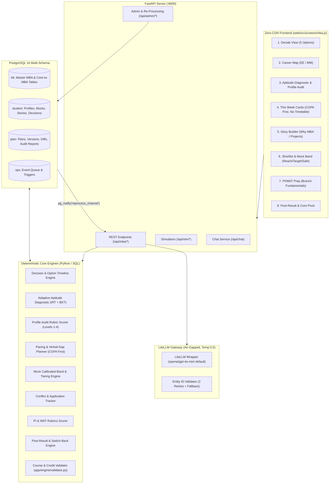

# Core to MBA Architecture & Implementation Plan

> **Branch:** `core_to_mba` (branched from `core_to_core`)  
> **Target Cohort:** IIT Bhubaneswar Core Branch Undergraduates (EE & MM)  
> **Problem Statement:** Adobe Personalised Learning Buddy (Inter IIT Tech Meet 15.0)  
> **Author Identity:** `shirii8 <194623831+shirii8@users.noreply.github.com>` (Zero AI/collaborator entries)

---

## 1. Executive Summary & Goals

The **Core to MBA** feature guides core engineering students (**B.Tech Electrical Engineering** and **B.Tech Metallurgical and Materials Engineering**) who are considering management careers. It builds on their engineering foundation and follows the Adobe PS learning loop: **Assess $\to$ Personalise $\to$ Learn $\to$ Practise $\to$ Adapt $\to$ Demonstrate Mastery**.

Since no prior `mba_track` branch exists in the repository, this feature builds the **shared MBA engines** (exam planning, mock calibration, shortlist tiering, application tracking, and interview/WAT evaluation) as **general reusable modules**, allowing any future standalone MBA Track to directly reuse them without table or engine duplication.

---

## 2. System Architecture & High-Level Topology

---

## 3. Database Schema Design (Multi-Schema Extension)

All new tables are created in `docker/init.sql` and loaded via `scripts/seed_loader.py`:

### A. General MBA Tables (`/data/seed/mba/`)
- `kb.mba_route`: Route master (`MBA-RT1` to `MBA-RT4`).
- `kb.mba_exam`: Entrance exams (CAT, XAT, SNAP, NMAT, CMAT, GMAT).
- `kb.mba_exam_cycle`: Official cycles with registration, admit card, exam, and result dates.
- `kb.mba_exam_section`: Section breakdowns (VARC, DILR, QA) with expected question counts and times.
- `kb.mba_syllabus_topic`: Granular syllabus topics across all sections.
- `kb.mba_institution`: Target B-schools (IIM Ahmedabad, Bangalore, Calcutta, Lucknow, Kozhikode, Indore, ISB, FMS, XLRI, SPJIMR, MDI, JBIMS, DMS IITD).
- `kb.mba_programme`: Degree programmes with duration, eligibility, selection process, and fees.
- `kb.mba_admission_stat`: Category-wise closing percentiles/scores across admission cycles.
- `kb.mba_milestone`: Standard timeline milestones and dependencies.
- `kb.mba_prep_template`: Preparation templates (12M, 6M, 3M, XAT 1M, SNAP 1M, GMAT 3M, PI 2M).
- `kb.mba_template_phase`: Phased breakdowns with exact week shares strictly summing to 1.0.
- `kb.mba_practice_item`: Question bank for adaptive diagnostics and topic drills.
- `kb.mba_interview_question`: Standard B-school interview questions across categories.
- `kb.mba_interview_rubric`: 4-level evaluation rubrics (Structure, Content, Self-awareness, Communication, Handling follow-ups).
- `kb.mba_application_checklist_item`: Required documents and certificates.
- `kb.mba_learning_method`: Curated study methods (daily reading, mock analysis, error log, etc.).
- `kb.mba_resource`: Official websites, score scales, and foundational learning resources.

### B. Core to MBA Specialized Tables (`/data/seed/core_to_mba/`)
- `kb.career_path`: Management career paths leveraging EE/MM background (e.g., Power & Energy Sector Management, Hardware Product Management, Metals Supply Chain & Operations, Materials Sourcing, Manufacturing Consulting).
- `kb.branch_pi_topic`: Core branch technical interview domains (EE: circuits, machines, power systems, control; MM: physical metallurgy, phase diagrams, heat treatment, characterization).
- `kb.branch_pi_question`: Interview-level technical questions testing fundamental engineering concepts.
- `kb.profile_audit_rubric`: Criteria (Academics, Projects, Internships, Leadership/POR, Extracurriculars, Work-ex Plan) with 4-level descriptive benchmarks.
- `kb.profile_action`: Semester-relative high-impact profile enhancements (club lead, industrial business case, economics minor).
- `student.story_draft`: Student essay and interview story drafts with rubric scores, versions, and probing feedback.
- `student.decision_option`: Evaluated decision pathways (Stay Core Research, Stay Core Industry, M.Tech/GATE, MBA Now, MBA after Work) with generated timelines and trade-offs.
- `student.mba_mock_result`: Raw and scaled mock results with percentiles and accuracy metrics.
- `student.mba_error_log`: Error classification log (conceptual, calculation, reading, time).

---

## 4. Reusable Engine Strategy (No Duplication)

| Module File | Reusability | Responsibilities |
|---|---|---|
| `app/engine/mba_decision.py` | Core to MBA | Builds comparative option timelines, clashes, and lacking prerequisites. |
| `app/engine/mba_career_map.py` | Core to MBA | Ranks and retrieves verified branch-aligned management paths. |
| `app/engine/mba_diagnostic.py` | Shared MBA | IRT question selection, candidate topics, Bayesian evidence updates, stop rules. |
| `app/engine/mba_profile_audit.py` | Core to MBA | Scores student profile against 4-level rubric; engineering advantage check. |
| `app/engine/mba_planner.py` | Shared MBA | Pacing, template scaling, CGPA protection first, verbal-gap planning. |
| `app/engine/mba_mocks_shortlist.py`| Shared MBA | Calibrated score band ($\ge 2$ mocks), Reach/Target/Safe tiering, zero leak. |
| `app/engine/mba_conflict_tracker.py`| Shared MBA | CAT vs. end-sems, interviews vs. placements, application checklists. |
| `app/engine/mba_interview.py` | Shared + Core | Technical viva with branch fundamentals, WAT grading, rubric scoring. |
| `app/engine/mba_replan.py` | Shared + Core | Post-result options, lateral pivot back to core route with 100% evidence kept. |

---

## 5. Non-Negotiable Rules Enforced by Code & Tests

1. **Zero Rigid Timetables:** Weekly focus goals and hours budgets only; never hourly schedules.
2. **CGPA First:** Core semester course hours take precedence during exam weeks or for students with backlogs.
3. **Neutral Decision Guidance:** System never prescribes or pushes an MBA; it articulates timelines and trade-offs.
4. **No Unverified Data Leaks:** Zero unverified facts, salaries, or placement figures in student mode.
5. **Data Integrity Guards:** Importer strictly blocks `verified=TRUE` without human `verified_by`.
6. **No Ghostwriting:** System provides probing questions and rubric critiques on student-authored drafts.
7. **Entity Grounding:** All named entities (exams, programmes, courses, questions) are validated against database IDs.
8. **Re-Processing Triggers:** Admin edits to programmes, cut-offs, or questions trigger immediate plan re-computation and diff versioning.
9. **Full Test Suite & Eval Scorecard:** Evaluated across 32+ synthetic student profiles with 0 unverified data leaks.
