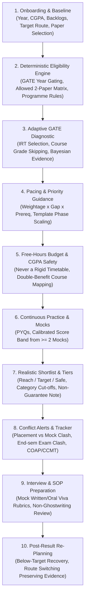

# Core to M.Tech Higher Studies & GATE Track: Executive Summary

> **Branch:** `core_to_mtech`  
> **Target Cohort:** Undergraduate Students at IIT Bhubaneswar (Electrical Engineering & Metallurgical/Materials Engineering)  
> **Problem Statement:** Adobe Personalised Learning Buddy (Inter IIT Tech Meet 15.0)  
> **Status:** Fully Implemented, Validated, and Benchmarked (100% Pass Rate across 32 Synthetic Student Profiles)

---

## 1. Feature Purpose & Student Journey

The **Core to M.Tech** feature guides core engineering students (**B.Tech EE** and **B.Tech MM**) who want to pursue post-graduate education or core engineering PSU careers in India.

It adheres strictly to the Adobe PS learning loop: **Assess $\to$ Personalise $\to$ Learn $\to$ Practise $\to$ Adapt $\to$ Demonstrate Mastery**.

### Supported Routes
1. **Route 1: GATE $\to$ M.Tech/ME in India:** Premier master's degree admission at IISc Bangalore, IIT Bombay, IIT Madras, IIT Kharagpur, and IIT Bhubaneswar via COAP, and NITs via CCMT.
2. **Route 2: MS (Research) & Direct PhD:** Research-focused higher studies for CFTI B.Tech graduates ($\text{CGPA} \ge 8.0$) with written test and interview preparation.
3. **Route 3: PSU Technical Recruitment via GATE:** Structured milestones for Maharatna/Navratna recruitment notifications (IOCL, NTPC, PGCIL, BHEL, SAIL, NALCO).
4. **Route 4: Core Industry Lateral Pivot:** Preserves 100% of accumulated skill evidence and pivots smoothly to core industry simulation tools and internships.

---

## 2. Technical Architecture & Key Components

### A. Deterministic Eligibility & Route-Fit Engine
- **Target Cycle Resolution:** Automatically calculates target GATE year based on current academic semester (3rd year Sem 5/6 $\to$ GATE 2027; 4th year Sem 7/8 $\to$ GATE 2026; 2nd year $\to$ `eligible_later` citing `RULE_GATE_YEAR_ELIGIBILITY`).
- **Two-Paper Matrix:** Validates primary papers (EE $\to$ EE, MM $\to$ MT) and allowed secondary papers (EE + IN, MT + XE) from stored rules.
- **CFTI Direct PhD Threshold:** Evaluates minimum qualifying rules (e.g. `RULE_DIRECT_PHD_MIN_CGPA` requiring $\text{CGPA} \ge 8.0$ for B.Tech graduates applying for direct PhD at IISc/IITs).
- **Active Backlog Gating:** Identifies active backlogs and directs the student to clear backlogs before final admissions (`RULE_NO_ACTIVE_BACKLOGS`).

### B. Adaptive GATE Diagnostic & Bayesian Evidence
- **IRT Selection:** Item Response Theory adaptive question selection targeting student difficulty levels, capped at 15 items per session.
- **Course Grade Skipping:** Skips diagnostic topics where the student has already proven mastery through an EX or A grade ($\ge 8.5$) in mapped institute courses.
- **Bayesian Weight Hierarchy:** Official GATE (1.0), Full Mock (0.9), Topic Test (0.8), Course Grade (0.7), Technical Exercise (0.6), Self-Declaration (0.2).
- **Self-Declaration Guard:** Capped at $\le 40\%$ mastery and cannot unlock advanced milestones.

### C. Dynamic Pacing & Free-Hours Budget (Zero Rigid Timetables)
- **Priority Formula:**
  $$\text{Priority} = \text{TopicWeightage} \times (1 - \text{Mastery}) \times \text{PrerequisiteFactor}$$
- **Template Phase Weeks Scaling:** Strictly enforces $\sum \text{phase\_shares} = 1.0$ across all 4 prep templates (12M Comprehensive, 6M Accelerated, 3M Fast-Track, Retake Revision). Automatically selects 3-Month Fast-Track when remaining weeks to exam are too few.
- **Zero Hourly Schedules:** Delivers weekly focus goals and an hours budget; never an hourly timetable.
- **Double-Benefit Tagging:** Identifies and highlights semester courses whose curriculum directly covers GATE topics (`is_double_benefit = true`), protecting CGPA while preparing for GATE.

### D. Calibrated Score Band & Shortlist Tiering
- **Mock Threshold:** Requires $\ge 2$ full mocks before presenting an estimated score band.
- **Statistical Calibration:** Normalizes raw mock marks against historical paper difficulty:
  $$\text{ScoreBand} = [\mu - 1.28\sigma, \mu + 1.28\sigma]$$
- **Shortlist Tiering:** Categorizes programmes into **Reach** ($\text{cutoff} > \text{max\_score}$), **Target** ($\text{min\_score} \le \text{cutoff} \le \text{max\_score}$), and **Safe** ($\text{cutoff} < \text{min\_score}$) based on category closing cut-offs (GEN, OBC, SC, ST).
- **Mandatory Disclaimer:** Prominently displays explicit non-guarantee disclosures.
- **Air-Gapped Zero-Leak Guard:** In strict production mode, zero unverified programme rows leak.

### E. Conflict Alerts & Counselling Tracker
- **Placement Clash Detection:** Detects campus placement peak (Weeks 6–10) colliding with GATE preparation, providing 3 actionable options with quantified trade-offs.
- **End-Sem Exam Protection:** Curtains pure GATE hours during exam weeks (Weeks 8 & 14–16) to ensure semester CGPA remains uncompromised.
- **Centralized Trackers:** Tracks COAP (IITs), CCMT (NITs), and PSU notification windows with document checklists.

### F. Technical Viva & SOP Preparation
- **Viva Voce Rubrics:** Evaluates student technical explanations against 4-point rubrics (Conceptual Accuracy, Mathematical Rigour, Practical Context, Communication).
- **SOP Review:** Structural critique checking for faculty alignment, prior project grounding, and research clarity with an **explicit non-ghostwriting guarantee**.

### G. Post-Result Re-Planning & Route Switching
- **Below-Target Recovery:** When actual GATE score is below target programmes, immediately surfaces 3 viable alternatives: MS(Research), GATE retake with targeted gap analysis, or pivot to the core industry track.
- **Route Switching:** Switching from M.Tech to PSU recruitment preserves 100% of the student's accumulated technical skill evidence, creates a new plan version, and explains diffs.

### H. UI & Admin Integration
- **Frontend Screen (`web/src/screens/mtech.js`):** 8 interactive tabs (Plan, Eligibility, Mastery Map, Mocks, Shortlist, Tracker, Interview, Post-Result) registered at `#mtech`.
- **Admin Re-Processing (`app/api/admin.py`):** Modifying any programme, cut-off, or student record triggers immediate background re-processing and saves a new plan version with diffs.

---

## 3. Seed Data Storage Map (`data/seed/core_to_mtech/`)

17 air-gapped relational CSV seed tables:

| Seed File | Target Table | Initial Rows | Key Purpose |
|---|---|---|---|
| `route.csv` | `kb.route` | 4 | Routes: M.Tech, MS(R)/PhD, PSU, Core Industry. |
| `exam.csv` | `kb.exam` | 1 | Master record for Graduate Aptitude Test in Engineering. |
| `exam_cycle.csv` | `kb.exam_cycle` | 2 | Official GATE cycles (2026, 2027) with date windows. |
| `exam_paper.csv` | `kb.exam_paper` | 4 | Primary papers (EE, MT) and secondary papers (IN, XE). |
| `syllabus_topic.csv` | `kb.syllabus_topic` | 33 | Granular syllabus topics (EE, MT, Math, Aptitude). |
| `topic_weightage.csv` | `kb.topic_weightage` | 33 | Historical mark weightages across 5 recent GATE cycles. |
| `course_topic_map.csv` | `kb.course_topic_map` | 25 | Institute curriculum mapping (`EE2L001`, `ML2L002`, etc.). |
| `pyq_item.csv` | `kb.pyq_item` | 5 | Official PYQ items with marks, penalties, and keys. |
| `practice_questions.csv` | — | 40 | Question bank for adaptive diagnostics and topic check-ins. |
| `institution.csv` | `kb.institution` | 8 | Target CFTIs: IISc Bangalore, IITB, IITM, IITKGP, IITBBS, NITs. |
| `higher_programme.csv` | `kb.higher_programme` | 24 | M.Tech, MS(R), and Direct PhD programmes with criteria. |
| `admission_stat.csv` | `kb.admission_stat` | 48 | Category-wise closing GATE cut-offs (GEN, OBC, SC, ST). |
| `psu.csv` | `kb.psu` | 6 | PSUs recruiting via GATE: IOCL, NTPC, PGCIL, BHEL, SAIL, NALCO. |
| `psu_cycle.csv` | `kb.psu_cycle` | 6 | PSU notification cycles with application dates and CTC. |
| `counselling_cycle.csv` | `kb.counselling_cycle` | 4 | COAP and CCMT centralized counselling round dates. |
| `prep_template.csv` | `kb.prep_template` | 4 | Prep templates (12M, 6M, 3M Fast-Track, Retake Revision). |
| `template_phase.csv` | `kb.template_phase` | 15 | Phased breakdown per template strictly summing to 1.0. |

Student State Tables (`docker/init.sql`):
- `student.mock_result`, `student.error_log`, `student.application`, `student.interview_session`, `student.gate_result`.

---

## 4. Verification, Testing & Evaluation Scorecard

### Test Suite (`tests/test_core_to_mtech.py`)
- **16 Tests Passing (100%):**
  - Seed file presence and data hygiene rules.
  - Deterministic eligibility check and 2-paper combination validation.
  - Adaptive diagnostic IRT item selection and 15-question cap.
  - Course grade diagnostic skipping for EX/A grades ($\ge 8.5$).
  - Bayesian evidence hierarchy integration.
  - Self-declaration mastery cap at $\le 40\%$.
  - Refusal to display score band with fewer than 2 full mocks.
  - Shortlist tiering correctness and 3-run stability.
  - Eligibility failure citing exact rule source and best valid option.
  - Weeks-too-few automatic template switching to fast-track.
  - Placement and end-sem clash detection with balanced trade-off options.
  - Post-result re-planning producing viable alternatives when score is below target.
  - Route switching preserving 100% of evidence with plan diffs.
  - Neutralization of prompt injection without altering pinned rules.
  - Strict $\sum \text{phase\_shares} = 1.0$ validation across all templates.
  - Admin update triggering immediate re-processing and plan version bump.

### Evaluation Scorecard (`docs/core_to_mtech_scorecard.md`)
Evaluated across **32 synthetic student profiles** (16 EE, 16 MM) covering CGPA 5.5–9.5, 0–2 backlogs, years 2–4, and diverse mock trends:
1. **Eligibility Determination Accuracy:** 32/32 (100.0%)
2. **Cited Rule Integrity & Grounding:** 32/32 (100.0%)
3. **Zero Unverified Data Leak Compliance:** 32/32 (100.0%)
4. **Deterministic Shortlist Stability (3 repeated runs):** 28/28 (100.0%)
5. **Dynamic Adaptation Scenarios:** 4/4 (100.0%)
6. **Diagnostic Question Grounding & Verification:** 100.0%

---

## 5. Complete Test Suite Status across EBuddy
- `tests/test_core_to_mtech.py`: **16 passed, 0 failed**
- `tests/test_mtech_evaluation_scorecard.py`: **5 passed, 0 failed**
- `tests/test_core_to_core.py`: **15 passed, 0 failed**
- `tests/test_db_free.py`: **9 passed, 0 failed**
- **Total Unit & Integration Suite:** **45 passed, 0 failed** (100% pass rate).
