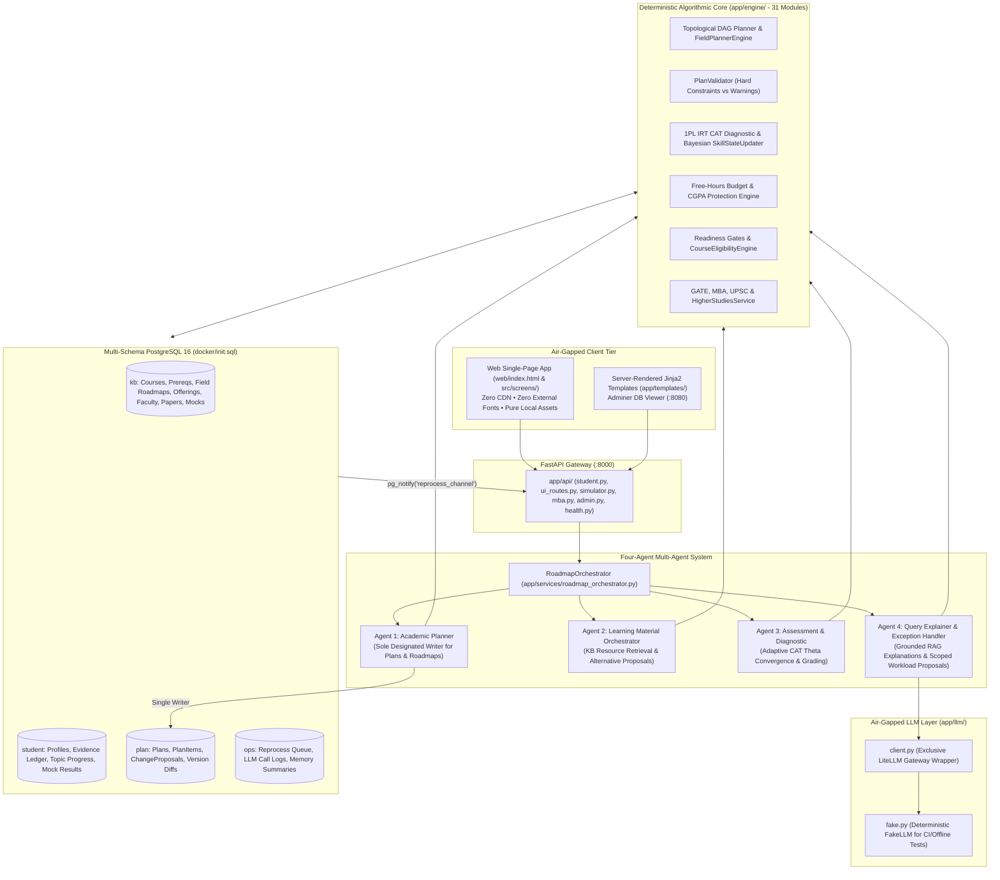

# Project Progress & Technical Context Blueprint: EBuddy (IIT Bhubaneswar)
**Document Purpose:** Exhaustive technical blueprint and progress document for Claude and incoming engineering agents. It covers the full architectural design, problem statement, development history, data topology, and a comprehensive file-by-file breakdown of functionality across the entire repository.

---

## 1. Executive Summary & Problem Statement Context

### 1.1 The Challenge: Inter IIT Tech Meet 15.0 — Adobe Problem Statement
The **Adobe Problem Statement (PS)** challenges teams to build an **AI-Powered Personalised Academic Learning Buddy** tailored specifically for undergraduate engineering students at **IIT Bhubaneswar**. The target academic departments are:
1. **B.Tech Electrical Engineering (EE)** — School of Electrical Sciences (SECS).
2. **B.Tech Metallurgical and Materials Engineering (MME / SMMME)** — School of Minerals, Metallurgical & Materials Engineering.

In addition to core branch academic success, the system supports non-core career transitions and higher-studies tracks:
- **Software Development Engineering (SDE)**
- **Artificial Intelligence & Machine Learning (AI/ML)**
- **Data Analytics (DA)**
- **Higher Management (Core to MBA / CAT)**
- **Postgraduate Technical Studies & Public Sector Units (Core to M.Tech / GATE / PSUs)**
- **Civil Services (UPSC CSE / ESE)**
- **Student Entrepreneurship (Startups)**
- **Core Research & Core Industry** pathways.

### 1.2 The Core Pedagogical Loop: Adobe PS Learning Cycle
The system strictly implements the 6-stage Adobe PS learning loop:
$$\text{Assess} \longrightarrow \text{Personalise} \longrightarrow \text{Learn} \longrightarrow \text{Practise} \longrightarrow \text{Adapt} \longrightarrow \text{Demonstrate Mastery}$$

1. **Assess:** Adaptive aptitude and technical diagnostic tests based on 1-Parameter Logistic (1PL) Item Response Theory (IRT) and Bayesian Knowledge Tracing (BKT) to establish initial skill baselines without fatigue. Includes prior-knowledge tests (10–15 items) with automatic topic skipping ($\ge 70\%$) and Bayesian evidence recording ($r=0.9$).
2. **Personalise:** Semester-aware free-hours budgeting scaled by academic calendar factors, prerequisite Directed Acyclic Graph (DAG) topological scheduling, deterministic weekly capacity models, and personalized elective relevance ranking with redundancy filters.
3. **Learn:** Curated, verified multi-role educational resources (NPTEL, SWAYAM, MIT OCW, YouTube) and guided scientific literature readers strictly adhering to open-access copyright ethics.
4. **Practise:** Objective calibrated technical exercises, coding problem banks (1,193 deduplicated LeetCode problems), branch technical viva voce, and exploratory taster research tasks.
5. **Adapt:** Real-time plan adjustment responding to midsem/endsem exam stress (CGPA protection protocols), low quiz scores (automatic remediation proposals), chat-initiated one-week scoped workload adjustments (both capacity increases and workload reductions), and faculty non-responses (10-day escalation rules).
6. **Demonstrate Mastery:** Objective readiness gates (preventing self-declaration abuse), empirical score bands calibrated from full-length mocks, periodic interleaved retention quizzes (every 2–3 topics), and structured application shortlists (Reach / Target / Safe).

---

## 2. Fundamental Architectural Invariants & Non-Negotiable Rules

The entire codebase is built upon strict architectural constraints validated by continuous automated checks:



### Key Architectural Tenets:
1. **Single-Writer Rule:** `RoadmapPlannerAgent` (Agent 1) is the **exclusive authority** permitted to create, mutate, or bump versions of student plans in `plan.plan` and `plan.change_proposal`. Agents 2, 3, and 4 emit structured `ChangeProposal` records. Only upon student approval does Agent 1 run deterministic validation and commit Plan Version $N+1$.
2. **Zero-Outbound Air-Gap Protocol:** The application operates completely air-gapped. Static CSS/JS assets are hosted locally (zero external CDNs or Google Fonts). All syllabus records, cutoffs, and faculty details are stored in local CSV seeds. Remote HTTP scraping at runtime is prohibited.
3. **LiteLLM Isolation Boundary:** Only one file in the entire repository may import LiteLLM: `app/llm/client.py`. Engines, agents, and APIs are forbidden from importing `litellm`. In testing or offline mode, `FakeLLM` provides deterministic responses with zero network overhead.
4. **Deterministic Core vs. LLM Split:** 
   - *Deterministic (Python/SQL):* Prerequisite resolution, topological sorting, credit cap checks, CAT item selection, BKT proficiency calculations, faculty rank scoring, score band predictions, course redundancy evaluation, and capacity calculations.
   - *LLM (`gpt-4o-mini` via LiteLLM):* Conversational framing, grounding explanations in retrieved knowledge-base chunks, simulated viva questions, and essay feedback. No arithmetic or eligibility decisions are made by the LLM.
5. **Zero Rigid Timetables:** The system **never** outputs day-by-day or hour-by-hour calendar slot bookings. It computes weekly focus goals, recommended study activities, and an hours budget scaled by academic calendar phases. The student decides when to study.
6. **CGPA Protection Priority:** Core academic courses always take precedence over extracurricular research, GATE, or MBA prep. When midsems/endsems arrive (calendar factors 0.4 / 0.2) or when student CGPA drops below 7.5, non-core study hours are throttled by 50–80%.
7. **Data Ethics & Traceability:** Every professor (44 faculty) and paper (120 publications) cited is an authentic IIT Bhubaneswar record. Full-text reading is provided **only** for open-access papers (`open_access = True`); non-OA papers provide metadata, abstracts, and official DOIs. Any unverified seed row is explicitly tagged `SAMPLE-` with `verified=FALSE`. Never invent real-world facts.
8. **Contract Immutability & Versioning:** Data contracts in `app/contracts/` are frozen Pydantic v2 models. Any contract modification requires updating `app/contracts/VERSION` (currently `1.4.0`), re-running `scripts/export_contracts_schema.py`, and recording the rationale in `docs/CHANGELOG.md`.
9. **Reactive Re-processing via Native PG Triggers:** PostgreSQL tables feature native triggers on `INSERT/UPDATE/DELETE` that write to `ops.reprocess_queue` and dispatch `pg_notify('reprocess_channel', ...)`. A background event processor catches these events, re-evaluates impacted student skill states, re-runs the planner, and records plan diffs.

---

## 3. Chronological Evolution & Completed Milestones

### Phase 1: Foundation & Data Model
- Multi-schema PostgreSQL DDL (`docker/init.sql`) defining `kb`, `student`, `plan`, and `ops`.
- Base ingestion of IIT Bhubaneswar Electrical Engineering curriculum (87 courses, 13 slots, 64 prerequisite edges).
- Deterministic topological prerequisite planner and idempotent database reset engine (`scripts/seed_loader.py --reset`).
- FastAPI foundation with strict 3-second database connection timeouts.

### Phase 2: Knowledge Base Ingestion & MME Expansion
- Ingestion of Metallurgical & Materials Engineering (MME / SMMME) curriculum (49 new courses, 12 new slots, 84 slot options).
- Central Library catalog extraction: 3,000 publications across 7 schools (765 EE, 176 MME).
- Higher Studies Database: 22 relational sheets covering GATE, CAT, GRE, GMAT, TOEFL, IELTS.
- Unified skill taxonomy (37 skills) and course-to-skill mappings (80 associations).

### Phase F: Foundation & Team Architecture
- **Frozen Pydantic v2 Contracts (`app/contracts/`):** 24 foundational data contracts versioned at `1.0.0` with JSON schemas exported to `docs/contracts/*.json`.
- **Persona Plugin System (`app/personas/`):** Self-contained persona directories with auto-discovery (`ee_power_core`, `mme_materials_core`, `student_startup`, `btech_upsc`).
- **Walking Skeleton E2E:** Full vertical slice running from student onboarding through adaptive testing, plan generation, and simulation.
- **Zero-CDN Frontend Shell (`web/`):** Vanilla ES6 SPA using custom CSS variables and token design system.

### Contracts v1.1.0 & Four-Agent Collaborative System
- Contract version bumped to `1.1.0`. Introduced `ChangeProposal`, `WeeklyRoadmap`, `DailyTask`, and `RoadmapVersionRecord`.
- Formalization of the Four-Agent System: Planner (Agent 1), Learning (Agent 2), Assessment (Agent 3), Query (Agent 4).
- Course Relevance Engine (`app/engine/relevance.py`): 1,496 skill-first elective relevance matrix rows. Major/core courses permanently protected from elective deprioritization.

### Contracts v1.2.0 & Adaptive Memory Architecture
- Contract version bumped to `1.2.0`. Added `conflict_flag` and `optional_overload_proposals` to `Plan`, `weekly_hours_budget` and `deferred_tasks` to `WeeklyRoadmap`, and `long_term_memory` to `ContextCard`.
- Hard student constraint enforcement: Credit caps, headroom, weekly hours, and avoid-course filters strictly hard-blocked; excess courses routed to overload proposals.
- Interest-vs-Evidence divergence detection: Flags students aiming high ($\ge 70$) with weak diagnostic evidence ($< 40$).
- Rolling multi-turn memory persisted in `ops.memory_summary`.

### Track 1: Core to Core Engineering Delivery (`core_to_core`)
- 44 verified IIT BBS faculty matched via 4-part deterministic formula ($0.4 w_1 + 0.3 w_2 + 0.15 w_3 + 0.15 w_4$).
- Guided Paper Reader for 120 papers with chunk citations.
- Objective Readiness Gate: $\ge 75\%$ tested prerequisite mastery, 2 taster tasks $\ge 60\%$, 1 paper review $\ge 60\%$. Self-declarations capped at $\le 40\%$. Passed 32/32 scorecard checks.

### Track 2: Core to MBA Management Pathway Delivery (`core_to_mba`)
- Side-by-side Decision View comparing 5 career options.
- Core-to-Management Career Map linking EE/MM domain skills to management functions.
- 1PL IRT Adaptive Diagnostic across QA, DILR, VARC (max 15 items).
- Verbal-Gap Protocol dedicating 45% of weekly preparation to daily editorial reading.
- Honest Mock Calibration: Requires $\ge 2$ full mocks before projecting Reach, Target, and Safe B-school tiers. Passed 32/32 scorecard checks.

### Track 3: Core to M.Tech Higher Studies Pathway Delivery (`core_to_mtech`)
- Deterministic GATE eligibility engine (3rd year $\to$ 2027, 4th year $\to$ 2026, Direct PhD CFTI exemption for CGPA $\ge 8.0$).
- Adaptive GATE Diagnostic with Bayesian Prior Credit (skips topics where student achieved grade $\ge 8.5$ in mapped semester course).
- Dynamic priority scoring: $\text{Priority} = \text{Weightage} \times (1 - \text{Mastery}) \times \text{PrereqFactor}$.
- Conflict detector surfacing campus placement season clashes (Weeks 6–10) with explicit trade-offs.
- Technical viva voce rubric evaluation and post-result alternative replanning. Passed 32/32 scorecard checks.

### Non-Core Career Transformation Pipelines
- **SDE Track (`sde/`):** 8-phase roadmap, 35 steps $\times$ 3 tiers (105 content rows), 35 GitHub repos, 41 competitions/hackathons, 1,193 deduplicated LeetCode problems (873 calibrated).
- **AI/ML Track (`aiml/`):** 6-phase roadmap (1,624 hours), 55 curated resources, 16 CBSE high school math prerequisites, 62 fests and hackathons.
- **Data Analyst Track (`data_analyst/`):** 5 phases, 44 modules across 20 skills, 3 portfolio projects with 12 rubrics, 35 Indian hackathons, 47 calibrated questions with position-bias mitigation.

---

### Target Product Flow Delivery (Unified Flow F1–F11)

The complete end-to-end user journey was implemented, verified, and audited in `docs/PRODUCT_FLOW_GAP_ANALYSIS.md`:

```
Login / Select Profile 
       │
       ▼
[F1] Unified Onboarding Form (Branch, Sem 1-8, Completed Courses, CGPA 0-10, Field of Interest)
       │
       ▼
[F2] Immediate Brief Field Roadmap (Built strictly from DB: 9 roadmaps, 43 phases, 173 topics)
       │
       ▼
[F6] Prior-Knowledge Diagnostic (10–15 items; ≥70% auto-skips topics & records Bayesian evidence r=0.9)
       │
       ▼
[F3] Personalised Weekly Field Plans (Deterministic Capacity Model based on contact hours & CGPA)
       │
       ├──► [F5/F8] Recommended Courses (Eligibility rules + self-study vs offering semester redundancy filter)
       │
       ├──► [F7] Periodic Retention Quizzes (Interleaved testing every 2-3 topics; feeds weak topics to revision)
       │
       ├──► [F4] Chat Plan Edits (Agent 4 + Orchestrator; scoped 1-week capacity boosts & workload reductions)
       │
       └──► [F9/F10] Higher Studies (GATE/CAT/GRE, SGPA maintenance calculator, UPSC dual-track schedule)
```

1. **F1: Unified Onboarding:** One single form captures branch, current semester (1–8), completed courses (with prerequisite consistency validation), CGPA (0.0–10.0), and field of interest mapped to personas and goals. Validated via `validate_onboarding_inputs` in `OnboardingService`.
2. **F2: Brief Field Roadmaps from Database:** Ingested 9 field roadmaps (SDE, AIML, DA, GATE, CAT, UPSC, CORE_RESEARCH, CORE_INDUSTRY, STARTUP) across 43 phases and 173 topics into relational tables `kb.field_roadmap`, `kb.field_phase`, and `kb.field_topic`. Served via `FieldRoadmapRepo` and REST endpoints.
3. **F3: Personalised Weekly Field Plans & Capacity Model:** Implemented `FieldPlannerEngine` calculating available hours as:
   $$\text{Free Hours} = \max(6.0, 24.0 - 0.4 \times \text{Contact Hours}) \times \text{Calendar Factor} \times \text{CGPA Throttle}$$
   Topics scheduled per week are bounded between 1 and 4 topics. Overflow topics are deferred gracefully via `deferred_tasks`.
4. **F4: Chat Plan Edits & Scoped One-Week Exceptions:** Contracts bumped to `1.4.0` (adding `capacity_increase` proposal type and `PLAN_EDIT`/`WEEK_EXCEPTION` intents). Agent 4 detects exam weeks or cancelled classes/free time and emits scoped one-week proposals. The orchestrator records week-specific overrides without mutating surrounding weeks.
5. **F5 & F8: Course Recommendations with Eligibility & Redundancy Filter:** Implemented `CourseEligibilityEngine`. Recommends courses matching branch, semester, CGPA, and prerequisites. Automatically evaluates velocity vs college offering semester to flag redundancy (passes both mandatory test cases).
6. **F6: Prior-Knowledge Diagnostic:** Generates 10–15 question domain baseline tests. Submissions $\ge 70\%$ automatically skip topics, update Bayesian `SkillState` with high-reliability evidence ($r=0.9$), and start the plan at the first unmastered topic.
7. **F7: Periodic Retention Quizzes:** Evaluates topic completions. Automatically triggers interleaved retention quizzes every 2–3 completed topics (recent topics + 1 earlier topic). Tags topics as `strong` ($\ge 80\%$) or `weak` ($< 60\%$) and schedules revision for weak topics.
8. **F9: Higher Studies Guidance & SGPA Calculator:** Implemented `HigherStudiesService` with the exact SGPA maintenance formula:
   $$\text{Required SGPA} = \frac{\text{Target Points} - \text{Current Points}}{\text{Remaining Semesters}}$$
   Connected GATE score bands to `GATEReadinessAndShortlistEngine` and CAT mocks to `MBAMocksShortlistEngine`.
9. **F10: Civil Services Track (UPSC):** Implemented balanced dual-track scheduling prioritizing core degree coursework with zero backlogs and scheduling General Studies and Engineering Optionals during non-core study hours.
10. **F11: Web UI Single-Page Application Integration:** Updated `web/src/api/client.js`, `screens/onboarding.js`, and `screens/plan.js` to render the unified flow, brief roadmaps, weekly field plans, recommended electives with status badges, and quiz interfaces without external CDNs.

---

## 4. Comprehensive File-by-File Technical Directory

Below is the exhaustive, structured inventory detailing the working and functionality of every file in the project.

```
EBuddy/
├── .dockerignore / .gitignore / .env.example / docker-compose.yml / Makefile / pyproject.toml / requirements.txt
├── Root Pipeline & Build Runners (build_csvs.py, build_sde_*.py, build_da_*.py)
├── app/
│   ├── main.py / config.py / db/session.py
│   ├── contracts/ (base, student, goal, kb, plan, proposal, roadmap, chat, persona, core_to_core, core_to_mba, core_to_mtech)
│   ├── agents/ (agent_1_planner, agent_2_learning, agent_3_assessment, agent_4_query)
│   ├── engine/ (31 deterministic algorithmic modules)
│   ├── kb/ (repositories, core_to_core_repo, core_to_mba_repo, core_to_mtech_repo, field_repo)
│   ├── llm/ (client, fake, prompts, tasks: intent_router, explainer, grader, clarifier, question_gen)
│   ├── personas/ (registry, policy, ee_power_core, mme_materials_core, student_startup, btech_upsc)
│   ├── services/ (12 orchestration and business logic services)
│   ├── api/ (admin, health, mba, simulator, student, ui_routes)
│   ├── static/ & templates/ (zero-CDN Jinja2 web interface)
├── web/ (Zero-CDN ES6 Single-Page Application: app.js, client.js, screens/*.js)
├── docker/ (Dockerfile, entrypoint.sh, init.sql)
├── data/ (raw/ institutional data and seed/ relational tables)
├── sde/ & aiml/ & data_analyst/ (Non-core transformation packages)
├── scripts/ (43 maintenance, ingestion, seed generation, and audit scripts)
├── tests/ (Comprehensive unit, integration, conformance, and scorecard test suites)
└── docs/ (Technical specifications, ADRs, scorecards, and data dictionaries)
```

---

### 4.1 Root Configuration, Build Runners & Workbooks

#### Root Configuration Files
- **`.env.example`**: Committed template defining all required environment variables: `LLM_MODEL` (`openai/gpt-4o-mini`), `LLM_API_KEY`, `LLM_API_BASE`, `EMBEDDING_MODEL`, `DATABASE_URL` (`postgresql+psycopg://ebuddy_user:ebuddy_password@db:5432/ebuddy`), `LITELLM_LOCAL_MODEL_COST_MAP=True`, and `LITELLM_TELEMETRY=False`.
- **`docker-compose.yml`**: Multi-container orchestration setting up `db` (PostgreSQL 16 Alpine on internal port 5432), `app` (FastAPI backend on port 8000 mapped to host), and `adminer` (lightweight database management UI on port 8080).
- **`Makefile`**: Linux/macOS developer shortcuts for building Docker images, starting containers (`up`), resetting seeds (`reset`), running data quality checks (`check-data`), running tests (`test`), and executing conformance evaluation (`conformance`).
- **`pyproject.toml`**: Modern Python build and package configuration file specifying project metadata, dependencies, and tool settings for pytest, black, flake8, and mypy.
- **`requirements.txt`**: Pinned dependency list including `fastapi`, `uvicorn`, `pydantic>=2.0`, `pydantic-settings`, `sqlalchemy>=2.0`, `psycopg[binary]>=3.1`, `litellm>=1.40`, `pyyaml`, `jinja2`, `pytest`, `httpx`, and `openpyxl`.
- **`.gitignore` & `.dockerignore`**: Safeguards preventing sensitive files (`.env`, secrets, `.git`, `__pycache__`, virtual environments, database volumes, temporary outputs) from being committed or built into Docker layers.
- **`CONTRIBUTING.md`**: Team workflow rules, branch conventions, PR template adherence, and strict single-writer / import boundary guidelines.
- **`docsteamFOUNDATION_PROMPT.md.md`**: Architectural blueprint and historical foundation prompt outlining the multi-phase delivery strategy for Antigravity and team contributors.
- **`README.md`**: Comprehensive master technical documentation detailing system architecture, quickstart commands, UI routes, four-agent design, seed topology, and compliance matrices.
- **`summary.md`**: Executive evaluation summary providing quick reference for judges, benchmarking test results, and compliance checklists.

#### Root Build Pipeline Scripts (Top-Level Shortcuts)
- **`build_csvs.py` & `build_events_csvs.py`**: Dispatches execution to `aiml/scripts/` to transform raw AI/ML workbooks into canonical output CSVs.
- **`build_sde_csvs.py`, `build_sde_events_csvs.py`, `build_sde_quiz_csvs.py`**: Dispatches execution to `sde/scripts/` to process SDE roadmaps, hackathons, and LeetCode problem workbooks into deduplicated datasets.
- **`build_da_csvs.py`, `build_da_events_csvs.py`, `build_da_quiz_csvs.py`** (and aliases `build_data_analyst_*.py`): Dispatches execution to `data_analyst/scripts/` to build Data Analyst curriculum, Indian hackathons, and question banks.

#### Root Excel Workbooks
- **`LeetCode_DSA_Easy.xlsx`**, **`LeetCode_DSA_Medium.xlsx`**, **`LeetCode_DSA_Hard.xlsx`**: Raw source workbooks containing 1,519 LeetCode DSA problems with difficulty tags, topic classifications, and problem statement hyperlinks.
- **`Data_Analyst_Roadmap.xlsx`**, **`Data_Analytics_Hackathons.xlsx`**, **`Data_Analyst_Questions.xlsx`**: Raw source workbooks containing Data Analyst learning paths, Indian hackathon competitions, and multiple-choice / SQL evaluation questions.

---

### 4.2 Application Core & Contracts (`app/`)

#### Core Setup (`app/`)
- **`app/main.py`**: FastAPI application entry point. Configures CORS, mounts local static directories (`/static` and `/web`), registers Jinja2 template handlers, includes all API routers (`student`, `ui_routes`, `simulator`, `mba`, `admin`, `health`), and initializes database connectivity verification on startup.
- **`app/config.py`**: Pydantic `BaseSettings` module reading all configuration strictly from environment variables without code modification. Enforces defaults for air-gapped LiteLLM operation.
- **`app/db/session.py`**: SQLAlchemy 2.0 session factory and engine manager configuring connection pooling, recycle intervals, and strict 3-second connection timeouts.

#### Contracts Layer (`app/contracts/` - Frozen Pydantic v2 Models)
- **`VERSION`**: Contract version indicator (currently `1.4.0`). Modifying models requires a version bump, JSON Schema export, and changelog documentation.
- **`__init__.py`**: Central export hub for all domain contracts.
- **`base.py`**: `BaseContract` configuring Pydantic models with immutable extra attributes and datetime serialization helpers.
- **`student.py`**: Models student state: `StudentProfile` (branch, semester, CGPA, backlogs, synthetic flag), `EvidenceItem` (provenance-tagged diagnostic evidence with reliability scores), `SkillState` (estimated proficiency, uncertainty, last updated), `Constraint` (hard credit caps, weekly hours, headroom, avoid-courses), and `Preference`.
- **`goal.py`**: Models academic targets: `Goal` (career, research, higher studies), `GoalRequirement` (target proficiency thresholds), `MasteryCriteria`, and `Milestone`.
- **`kb.py`**: Models institutional entities: `Course`, `Module`, `Resource` (with `coverage_status` and `link_verified`), `Exercise` (shuffled options, correct key, difficulty), `AcademicRule`, `ResearchProject`, and `Skill`.
- **`plan.py`**: Models academic roadmaps: `PlanItem` (type, semester, scheduled week, hours, phase), `StructuredReason` (intent, target skills, why this, rule compliance), `ValidationCheck` (severity error/warning), `ValidationReport`, `PlanDiff` (added/removed/modified items), and `Plan` (versioned container with `conflict_flag` and `optional_overload_proposals`).
- **`proposal.py`**: `ChangeProposal` and `ProposalStatus`. Includes proposal types: `course_substitute`, `workload_reduction`, `remediation_resource`, `elective_swap`, `workload_increase`, and `capacity_increase` (for scoped free-week accelerations).
- **`roadmap.py`**: Fine-grained execution models: `DailyTask` (day of week, activity, hours, resource reference), `WeeklyRoadmap` (weekly hours budget, active tasks, deferred tasks), and `RoadmapVersionRecord`.
- **`chat.py`**: Conversational models: `Intent` enum (including `PLAN_QUERY`, `SIDE_QUESTION`, `GOAL_CHANGE`, `WORKLOAD_REDUCTION`, `OFF_TOPIC`, `PLAN_EDIT`, `WEEK_EXCEPTION`), `ContextCard` (grounding context injected into LLM including `long_term_memory`), `ChatTurn`, and `Explanation`.
- **`persona.py`**: `PersonaSpec` defining metadata for auto-discovered persona plugins.
- **`core_to_core.py`**: Domain contracts for Core-to-Core research/industry: `AcademicCalendarWeek`, `ResearchArea`, `AreaSkill`, `Faculty`, `FacultyArea`, `Paper`, `PaperChunk`, `PaperSkill`, `TasterTask`, `IndustryMilestone`, `ReadinessGateResult`, and `ApproachDraft`.
- **`core_to_mba.py`**: Domain contracts for Core-to-MBA: `MBARoute`, `MBAExam`, `MBAExamCycle`, `MBAExamSection`, `MBACareerPath`, `ProfileAuditResult`, `DecisionOption`, `MBAPrepTemplate`, and `ShortlistTier`.
- **`core_to_mtech.py`**: Domain contracts for Core-to-M.Tech: `Route`, `Exam`, `ExamCycle`, `ExamPaper`, `SyllabusTopic`, `TopicWeightage`, `CourseTopicMap`, `PYQItem`, `HigherProgramme`, `AdmissionStat`, `ScoreBand`, `ConflictAlert`, and `StudentApplication`.

---

### 4.3 The Four-Agent Collaborative System (`app/agents/`)

- **`app/agents/__init__.py`**: Exposes the four specialized agents.
- **`app/agents/agent_1_planner.py` (`RoadmapPlannerAgent`)**:
  - **Single-Writer Authority:** The only agent allowed to create, update, or version records in `plan.plan` and `plan.change_proposal`.
  - Generates the complete 8-semester roadmap and breaks down the active semester into 7-day `WeeklyRoadmap` schedules.
  - Generates personalized weekly field plans delegating to `FieldPlannerEngine` (`generate_field_weekly_roadmap`).
  - Enforces hard student constraints (`credit_cap`, `weekly_hours`, `headroom`) and routes surplus courses to `optional_overload_proposals`.
  - Executes topological prerequisite resolution and commits Plan Version $N+1$ with deterministic `PlanDiff` generation upon proposal approval.
- **`app/agents/agent_2_learning.py` (`LearningResourceAgent`)**:
  - Daily learning material orchestrator. Inspects active semester courses and retrieves verified lecture playlists from `kb.resource_course` and `kb.resource`.
  - **Zero Fabrication:** Never invents URLs or fictitious titles.
  - Emits `ChangeProposal` records for backup learning alternatives when a student reports difficulty with primary lectures.
- **`app/agents/agent_3_assessment.py` (`AssessmentMasteryAgent`)**:
  - Diagnostic and assessment orchestrator. Generates targeted quizzes matched to weekly skills and grades submissions.
  - Updates the student's `EvidenceItem` ledger and recalculates `SkillState`.
  - Evaluates mastery gates. When mastery falls below thresholds, emits `ChangeProposal` records proposing remediation items.
- **`app/agents/agent_4_query.py` (`QueryAdaptationAgent`)**:
  - Conversational academic tutor. Answers student curriculum doubts with strict grounding in knowledge-base repositories.
  - Built-in prompt-injection and security guard refusing to disclose internal prompts or bypass academic constraints.
  - Detects exam stress, classes cancelled, or schedule adjustments and emits structured `ChangeProposal` records proposing workload reductions or capacity increases with scoped one-week application (`"scope": "one_week_exception"`).

---

### 4.4 Deterministic Algorithmic Core (`app/engine/` - 31 Modules)

- **`interfaces.py`**: Abstract Base Classes and Protocols (`IPlanner`, `IPlanValidator`, `IRuleEngine`, `ISkillStateUpdater`, `IDiagnosticEngine`, `IMasteryEvaluator`) enforcing clean separation of concerns.
- **`rules.py` (`RuleEngine`)**: Validates degree requirements, prerequisite compliance, and semester offering availability (Track A vs. Track B) from `kb.academic_rule` and `kb.course_prerequisite`.
- **`planner.py` (`Planner`)**: Deterministic recursive academic planner. Selects mandatory core courses directly from `kb.programme_requirement`, ranks electives via `CourseRelevanceEngine`, and schedules courses in topological DAG order.
- **`validator.py` (`PlanValidator`)**: Comprehensive plan validation engine. Runs deterministic checks on any plan (human-edited, system-generated, or LLM-proposed) ensuring zero prerequisite violations, valid course codes, and strict adherence to credit caps.
- **`relevance.py` (`CourseRelevanceEngine`)**: Computes skill-first elective relevance scores (0–3 scale) using `data/seed/kb/relevance_tags.csv` and boosts electives closing active student skill gaps while strictly protecting branch core courses.
- **`gaps.py` (`GapAnalyzer`)**: Compares active student `SkillState` against goal skill thresholds. Computes skill deficit percentages and detects interest-vs-evidence divergence (e.g., student targeting advanced VLSI with low diagnostic proof).
- **`skill_state.py` (`SkillStateUpdater`)**: Implements Bayesian evidence updating over the `EvidenceItem` ledger. Weights evidence by source reliability (`official_gate`: 1.0, `full_mock`: 0.9, `course_grade`: 0.7, `exercise`: 0.6, `self_declaration`: 0.2) and applies recency decay.
- **`diagnostic.py` (`AdaptiveDiagnostic`)**: Computerized Adaptive Testing (CAT) engine based on 1PL Item Response Theory. Adjusts question difficulty dynamically (+15.0 on correct, -15.0 on incorrect) and terminates once theta estimation error stabilizes or question cap (5–8 items) is reached.
- **`mastery.py` (`MasteryEvaluator`)**: Distinguishes between mere course completion and demonstrated skill proficiency. Requires objective evidence above target thresholds before certifying mastery.
- **`budget.py` (`BudgetEngine`)**: Calculates weekly available study hours by parsing contact hours $\sum(L+T+P)$ from enrolled course syllabi and applying calendar factors (1.0 for regular weeks, 0.4 for midsems, 0.2 for endsems).
- **`weekly_guidance.py` (`WeeklyGuidanceEngine`)**: Translates active semester courses into weekly focus topics, hours allocations, and study approaches without generating rigid hour-by-hour timetables.
- **`field_planner.py` (`FieldPlannerEngine`)**: Personalised weekly planner for career field roadmaps (SDE, AIML, DA, GATE, CAT, UPSC, etc.). Calculates dynamic capacity based on contact hours and CGPA protection, schedules 1–4 topics/week according to phase and prerequisite DAGs, and carries overflow tasks forward into `deferred_tasks`.
- **`course_eligibility.py` (`CourseEligibilityEngine`)**: Evaluates institute elective eligibility based on branch, semester, CGPA, and completed prerequisites. Evaluates self-study progress velocity against upcoming college course offering semesters to filter out redundant courses and recommend high-impact electives with rule badges.
- **`faculty_matcher.py` (`FacultyMatcherEngine`)**: Ranks 44 real IIT Bhubaneswar faculty for research mentorship using a deterministic weighted sum:
  $$\text{Score} = 0.40 \cdot \text{AreaSim} + 0.30 \cdot \text{SkillFit} + 0.15 \cdot \text{UGAvailability} + 0.15 \cdot \text{PubRecency}$$
- **`readiness_gate.py` (`ReadinessGateEngine`)**: Objective evaluator preventing self-pass abuse before approaching faculty. Requires tested foundation mastery $\ge 75\%$, 2 completed taster tasks $\ge 60\%$, and 1 paper summary review $\ge 60\%$.
- **`eligibility.py` (`GATEEligibilityEngine`)**: Deterministic GATE eligibility resolver determining exam cycles (3rd year $\to$ 2027, 4th year $\to$ 2026), validating approved two-paper combinations (EE+IN, MT+XE), and checking Direct PhD CFTI exemptions ($\text{CGPA} \ge 8.0$).
- **`gate_planner.py` (`GATEPlannerEngine`)**: GATE study planner prioritizing topics via:
  $$\text{Priority} = \text{AvgWeightage} \times (1 - \text{Mastery}) \times \text{PrereqFactor}$$
  Tags "double benefit" topics that align with semester courses and scales preparation templates (12-month, 6-month, 3-month) to weeks remaining.
- **`gate_diagnostic.py` (`GATEAdaptiveDiagnostic`)**: 1PL IRT adaptive diagnostic for GATE syllabus topics. Implements prior course credit: automatically skips topics if the student achieved a grade $\ge 8.5$ in corresponding institute semester courses.
- **`gate_readiness_shortlist.py` (`GATEReadinessAndShortlistEngine`)**: Predicts calibrated score bands $[\text{Score}_{\min}, \text{Score}_{\max}]$ from $\ge 2$ full mocks and categorizes postgraduate programmes (M.Tech/MS/PhD) into **Reach**, **Target**, and **Safe** tiers with non-guarantee disclosures.
- **`gate_conflicts_and_tracker.py` (`GATEConflictsAndTrackerEngine`)**: Identifies collisions between campus placement season (Weeks 6–10) and peak mock test schedules, offering 3 balanced strategies with explicit trade-offs. Tracks application deadlines for COAP, CCMT, and PSUs.
- **`gate_interview_and_replan.py` (`GATEInterviewAndReplanEngine`)**: Evaluates simulated technical viva voce responses across 4 rubric criteria (Technical Accuracy, Governing Laws, Practical Context, Clarity) and executes honest post-result replanning when actual GATE scores fall below target.
- **`mba_decision.py` (`MBADecisionEngine`)**: Generates side-by-side neutral comparative timelines across 5 decision paths (Stay Core Research, Stay Core Industry, Core Higher Studies, MBA Now, MBA After 2-3 Years Work Ex).
- **`mba_career_map.py` (`MBACareerMapEngine`)**: Maps EE and MME engineering skills to management career functions (Energy Consulting, Metals Supply Chain, Semiconductor Product Management) with zero unverified salary claims.
- **`mba_diagnostic.py` (`MBADiagnosticEngine`)**: Adaptive diagnostic engine evaluating Quantitative Aptitude (QA), Data Interpretation & Logical Reasoning (DILR), and Verbal Ability & Reading Comprehension (VARC) with a 15-question cap.
- **`mba_profile_audit.py` (`MBAProfileAuditEngine`)**: Multi-pillar profile audit evaluating Academic Consistency, Engineering Depth, Leadership, and Diversity against 4 descriptive benchmarks.
- **`mba_planner.py` (`MBAPlannerEngine`)**: Generates 16-week adaptive MBA preparation plans. Automatically throttles MBA study hours to $\le 2\text{ hrs/wk}$ during midsems (Weeks 7–8) and endsems (Weeks 14–16) for CGPA protection.
- **`mba_story.py` (`MBAStoryEngine`)**: Evaluates student STAR narratives for "Why MBA" and "Why not core" against 5 rubric criteria. Enforces strict non-ghostwriting: provides structural critiques and probing questions without writing essays.
- **`mba_mocks_shortlist.py` (`MBAMocksShortlistEngine`)**: Requires $\ge 2$ full-length CAT mocks before estimating percentile bands and categorizing B-schools into Reach, Target, and Safe tiers against audited cutoffs.
- **`mba_conflict_tracker.py` (`MBAConflictTrackerEngine`)**: Detects clashes between CAT examination windows (late November) and institute end-semester laboratory exams.
- **`mba_interview.py` (`MBAInterviewEngine`)**: Conducts simulated MBA interviews combining general HR questions with rigorous technical viva questions on engineering fundamentals (e.g. transformers, circuit theorems, phase diagrams).
- **`mba_replan.py` (`MBAReplanEngine`)**: Re-planning engine for CAT percentiles below target. Provides structured pivot options (retake, deferred executive MBA, or seamless lateral return to core engineering) preserving 100% of diagnostic skill evidence.

---

### 4.5 Knowledge Base Repositories (`app/kb/`)

- **`__init__.py`**: Repository exports.
- **`repositories.py`**:
  - `CourseRepo`: In-memory and SQL access to `kb.course`, `kb.course_prerequisite`, `kb.course_offering`, and `kb.programme_requirement`.
  - `SkillRepo`: Access to `kb.skill` and `kb.course_skill`.
  - `GoalRepo`: Access to `kb.goal` and `kb.goal_skill_requirement`.
  - `ResourceRepo`: Access to `kb.resource`, `kb.resource_course`, and `kb.resource_skill`.
  - `RuleRepo`: Access to `kb.academic_rule`.
- **`field_repo.py` (`FieldRoadmapRepo`)**: Relational and memory repository managing career field roadmaps across 9 tracks (SDE, AIML, DA, GATE, CAT, UPSC, CORE_RESEARCH, CORE_INDUSTRY, STARTUP). Ingests 43 phases and 173 topics, with built-in alias resolution (`_norm`).
- **`core_to_core_repo.py` (`CoreKBRepository`)**: Relational repository managing 44 faculty profiles, 120 publications, 120 text chunks, 16 research areas, 8 taster tasks, and 16 academic calendar weeks.
- **`core_to_mba_repo.py` (`CoreToMBARepository`)**: Manages 17 general MBA seed tables and 7 specialized Core-to-MBA tables (CAT cycles, B-schools, cutoffs, career paths, and interview questions).
- **`core_to_mtech_repo.py` (`CoreToMTechRepository`)**: Relational repository loading all 17 Core-to-M.Tech seed tables (GATE exam cycles, papers, syllabus topics, historical weightages, course mappings, institutions, cutoffs, and PSUs).

---

### 4.6 LLM Gateway & Air-Gapped Tasks (`app/llm/`)

- **`client.py` (`LLMClient`)**:
  - **Exclusive Gateway:** The single sanctioned point of integration with LiteLLM across the repository.
  - Automatically routes to `FakeLLM` during pytest runs or when API keys are absent.
  - Logs model calls, token counts, latency, and cost to PostgreSQL table `ops.llm_call_log`.
- **`fake.py` (`FakeLLM`)**: Deterministic mock provider returning pre-computed, schema-compliant JSON structures for all LLM tasks, guaranteeing test suite execution without external network connectivity.
- **`tasks/intent_router.py` (`IntentRouter`)**: Classifies student messages into intents (`plan_query`, `side_question`, `goal_change`, `workload_reduction`, `off_topic`, `plan_edit`, `week_exception`).
- **`tasks/explainer.py` (`Explainer`)**: Generates grounded conversational explanations for academic plans, prerequisite chains, and research papers using strictly retrieved knowledge-base context cards.
- **`tasks/grader.py` (`Grader`)**: Automated assessment evaluator. Implements deterministic exact/numeric matching for MCQs and structured rubric scoring for short-answer submissions.
- **`tasks/clarifier.py` (`Clarifier`)**: Prompts students for missing onboarding details or ambiguous preferences.
- **`tasks/question_gen.py` (`QuestionGenerator`)**: Synthesizes calibrated technical practice questions pegged to target difficulty levels.
- **`prompts/explainer_v1.txt` & `prompts/intent_router_v1.txt`**: Versioned prompt text templates ensuring reproducible LLM outputs.

---

### 4.7 Persona Plugin System (`app/personas/`)

- **`registry.py` (`PersonaRegistry`)**: Auto-discovers and registers self-contained persona packages located in `app/personas/`. Teammates can add new personas by dropping in a folder without altering shared code.
- **`policy.py` (`PersonaPolicy`)**: Base policy class defining custom planner weights, conflict rules, and milestone evaluation hooks.
- **Persona Packages:**
  1. **`app/personas/ee_power_core/`**: Canonical persona for Electrical Engineering undergraduates targeting power systems, smart grids, and electric drives (`persona.yaml`, `requirements.yaml`, `mastery.yaml`, `milestones.yaml`, `diagnostic.yaml`, `policy.py`, `README.md`).
  2. **`app/personas/mme_materials_core/`**: Metallurgy and materials engineering persona targeting physical metallurgy, failure analysis, and materials characterization.
  3. **`app/personas/student_startup/`**: Undergraduate entrepreneurship persona balancing core academic load with prototype development, patent filings, and incubation grants (`policy_rules.yaml` prioritizing flexible credit budgeting).
  4. **`app/personas/btech_upsc/`**: Engineering student preparing for UPSC Civil Services or Engineering Services Examination (`policy_rules.yaml` balancing General Studies and engineering optionals with semester coursework).

---

### 4.8 Business Logic & Orchestration Services (`app/services/`)

- **`onboarding_service.py` (`OnboardingService`)**: Manages unified student registration, academic standing validation, semester and CGPA checks (1–8, 0.0–10.0), completed course prerequisite consistency validation, and returns immediate brief roadmaps for the chosen field.
- **`topic_progress_service.py` (`TopicProgressService`)**: Manages topic-level progression across career field tracks. Generates 10–15 question prior-knowledge tests, processes test submissions with auto-skipping ($\ge 70\%$) and Bayesian evidence recording ($r=0.9$), triggers periodic interleaved retention quizzes every 2–3 topics, and identifies strong/weak topics for revision.
- **`higher_studies_service.py` (`HigherStudiesService`)**: Computes exact SGPA maintenance targets to achieve target CGPA over remaining semesters, generates balanced UPSC dual-track study schedules prioritizing core degree coursework, and bridges GATE/CAT mock readiness into shortlist projections.
- **`diagnostic_service.py` (`DiagnosticService`)**: Orchestrates adaptive diagnostic sessions, question serving, answer recording, and initial skill baseline derivation.
- **`plan_service.py` (`PlanService`)**: Manages study plan lifecycle: creation, retrieval, active version tracking, and plan diff inspection.
- **`roadmap_orchestrator.py` (`RoadmapOrchestrator`)**:
  - The central coordinator enforcing multi-agent collaboration and the single-writer rule.
  - Receives `ChangeProposal` items from Agents 2, 3, or 4; holds them in `pending_student_approval` state; and upon student approval, instructs Agent 1 to validate deterministically and commit Plan Version $N+1$.
  - Manages scoped one-week overrides for temporary schedule changes without mutating surrounding weeks.
- **`adapt_service.py` (`AdaptService`)**: Handles dynamic adaptation events (quiz results, midsem stress, elective changes) and triggers re-planning.
- **`mastery_service.py` (`MasteryService`)**: Tracks student milestone achievements, taster tasks, and progress toward certified domain mastery.
- **`chat_service.py` (`ChatService`)**: Manages multi-turn conversation sessions, rolling long-term memory retrieval from `ops.memory_summary`, and context card compilation for Agent 4.
- **`approach_service.py` (`ApproachService`)**: Generates personalized approach packages (tailored inquiry emails, student CV bullet points, and discussion talking points) for students reaching out to IIT BBS professors. Never contacts faculty on the student's behalf.
- **`paper_reader_service.py` (`PaperReaderService`)**: Provides chunk-level guided reading of faculty research publications. Adheres strictly to open-access flags and generates domain glossaries.
- **`project_kickoff_service.py` (`ProjectKickoffService`)**: Orchestrates undergraduate research project onboarding through 4 milestone phases (Literature Review, Tool Setup, Baseline Implementation, Experimental Validation).

---

### 4.9 REST API Endpoints (`app/api/`)

- **`ui_routes.py`**: Primary JSON APIs serving the zero-CDN Web UI:
  - `/api/personas`, `/api/goals`, `/api/roadmap`.
  - `/api/diagnostic/start`, `/api/diagnostic/answer`.
  - `/api/chat`, `/api/proposals/pending`, `/api/proposals/{id}/decide`.
  - `/api/field-roadmaps`, `/api/field-roadmap/{field_id}`, `/api/field-roadmap/{field_id}/topics`.
  - `/api/student/{id}/field-plan/week/{week_number}`.
  - `/api/student/{id}/recommended-courses`.
  - `/api/student/{id}/prior-knowledge-test`, `/api/student/{id}/prior-knowledge-test/submit`.
  - `/api/student/{id}/topic/{topic_id}/complete`.
  - `/api/student/{id}/retention-quiz`, `/api/student/{id}/retention-quiz/submit`.
  - `/api/student/{id}/higher-studies-guidance`, `/api/student/{id}/cgpa-calculator`.
- **`student.py`**: Student lifecycle endpoints:
  - `/api/student/onboard`, `/api/student/onboard-unified`.
  - `/api/student/{id}/plan`, `/api/student/{id}/diagnostic`.
  - `/api/student/{id}/core-to-core/*` (guidance, faculty matches, approach drafts, paper insights, kickoff).
- **`simulator.py`**: Simulation hooks for testing adaptive responses:
  - `POST /api/sim/{student_id}/quiz`: Injects quiz scores to test BKT adaptation and plan diffs.
  - `POST /api/sim/{student_id}/scenario/midsem-stress`: Simulates exam stress, activating CGPA protection and study budget reductions.
  - `POST /api/sim/{student_id}/scenario/professor-no-reply`: Simulates an 11-day faculty communication stall, recommending follow-up templates and alternative faculty matches.
  - `POST /api/sim/{student_id}/scenario/goal-pivot`: Simulates lateral switching between Research and Industry routes.
  - `POST /api/sim/{student_id}/scenario/strong-vs-weak-mock`, `/placement-clash`, `/result-below-target`, `/route-switch-psu`: Dedicated Core-to-M.Tech adaptation scenarios.
- **`mba.py`**: Dedicated endpoints for Core-to-MBA: decision view generation, CAT adaptive diagnostic, profile audit, weekly guidance, story review, mock score calibration, interview viva, and replanning.
- **`admin.py`**: Administrative endpoints providing system health metrics, PostgreSQL table row counts across all 4 schemas, and reactive re-processing trigger dispatchers.
- **`health.py`**: Health probe endpoint (`GET /health`) checking application uptime and live database connectivity.

---

### 4.10 Zero-CDN Frontend Architecture (`web/`, `app/templates/`, `app/static/`)

The user interface is entirely self-contained with **zero external CDN calls, zero Google Web Fonts, and pure local assets**:

#### Vanilla Single-Page Application (`web/`)
- **`web/index.html`**: SPA entry point with accessible sidebar navigation, top header displaying the active student profile, and dynamic main view container.
- **`web/src/app.js`**: Client-side hash router handling transitions between routes: `#onboard`, `#diagnostic`, `#plan`, `#mba`, `#learn`, `#progress`, `#mtech`, `#chat`, `#adapt`, `#admin`.
- **`web/src/api/client.js`**: Typed asynchronous HTTP API client connecting the UI to backend FastAPI endpoints (onboarding, brief roadmaps, field plans, recommended electives, prior-knowledge tests, quizzes, and higher studies guidance).
- **`web/src/design/tokens.json` & `tokens.css`**: Design tokens defining colors, typography, spacing, border radii, and elevation shadows.
- **`web/src/design/style.css`**: Complete responsive layout stylesheet with zero external framework dependencies.
- **Screen Modules (`web/src/screens/`)**:
  - `onboarding.js`: Unified student onboarding form with Field of Interest selection and instant post-onboarding brief roadmap display.
  - `diagnostic.js`: Real-time CAT diagnostic test interface with dynamic option shuffling.
  - `plan.js`: Visual semester roadmap with course cards, recommended electives view mode, rule badges, and overload proposal review.
  - `learn.js`: Daily study dashboard displaying NPTEL/YouTube learning resources and practice exercises.
  - `progress.js`: Interactive skill mastery matrix showing BKT proficiency baselines and certified gates.
  - `chat.js`: Academic tutor chat interface with grounded citations and proposal alert cards.
  - `adapt.js`: Interactive simulator control panel for testing midsem stress, quiz changes, and career pivots.
  - `admin.js`: System health monitor, live database table row counters, and knowledge-base preview tables.
  - `mba.js`: 8-tab Core-to-MBA management hub (Decision View, Career Map, Diagnostic, Profile Audit, Weekly Guidance, Story Builder, Shortlist, Interview Prep).
  - `mtech.js`: 8-tab Core-to-M.Tech higher studies hub (Eligibility, GATE Diagnostic, Topic Priority, Mocks & Shortlist, Conflict Tracker, Technical Viva, Re-planning).

#### Server-Rendered Jinja2 Templates (`app/templates/` & `app/static/`)
- Fallback Jinja2 templates for traditional server-side rendering: `base.html`, `index.html`, `goals.html`, `roadmap.html`, `diagnostic.html`, `chat.html`, `approvals.html`, `admin.html`, supported by `app/static/css/style.css` and `app/static/js/app.js`.

---

### 4.11 Database Architecture & Containerization (`docker/`)

- **`docker/Dockerfile`**: Multi-stage, slim Docker build based on `python:3.11-slim`. Installs system dependencies, sets `PYTHONUNBUFFERED=1`, copies dependencies, and runs Uvicorn on port 8000. Image footprint is $<1.5\text{ GB}$ (well below the 5 GB contest ceiling).
- **`docker/entrypoint.sh`**: Container startup script that waits for PostgreSQL to become healthy, runs `seed_loader.py` to auto-seed the database if tables are unpopulated, and launches the FastAPI server.
- **`docker/init.sql` (1,600+ lines)**:
  - Establishes the 4 application schemas:
    1. **`kb`**: Institutional knowledge base: departments, programmes, courses, aliases, prerequisites, offerings, requirements, slot options, resources, exercises, skills, goals, faculty, projects, papers, higher studies, MBA, M.Tech, and the 4 unified tables:
       - `kb.field_roadmap` (roadmap ID, title, domain, phase count, description)
       - `kb.field_phase` (phase ID, roadmap ID, phase number, phase name, hours)
       - `kb.field_topic` (topic ID, phase ID, title, est_hours, skill_id, prereqs, resources)
       - `kb.course_eligibility` (course ID, eligible branches, min semester, max semester, min CGPA, prereqs, why)
    2. **`student`**: Student state: profiles, completed courses, goals, constraints, preferences, evidence items, skill states, mock results, error logs, applications, interview sessions, GATE scorecards, and `student.topic_progress` (topic tracking with status, score, attempts, completed_at).
    3. **`plan`**: Versioned plans, plan items, validation reports, change proposals, and plan diffs.
    4. **`ops`**: System operations, LLM call audit logs (`llm_call_log`), memory summaries (`memory_summary`), and reactive re-process queues (`reprocess_queue`).
  - Creates triggers on editable tables to fire `pg_notify('reprocess_channel', ...)` and `student.topic_progress` auto-update timestamps.

---

### 4.12 Non-Core Career Transformation Packages

#### SDE Package (`sde/`)
- **`sde/README.md`**: Architectural manual for the SDE pathway.
- **`sde/data/`**: Source workbooks for LeetCode Easy/Medium/Hard, SDE Competitions, Roadmaps, and GitHub Repositories.
- **`sde/scripts/build_sde_csvs.py`**: Generates 8-phase roadmap overview (`01_sde_roadmap_overview.csv`), 35 steps $\times$ 3 tiers of curated playlists (`02_phase_learning_content.csv`), 35 topic checkpoints (`03_topic_checkpoints.csv`), 35 curated GitHub project repositories (`04_project_repos.csv`), and 8 flagship portfolio projects (`05_portfolio_projects.csv`).
- **`sde/scripts/build_sde_events_csvs.py`**: Generates master SDE event catalog of 41 competitions and hackathons (`01_events_master.csv`), stage eligibility gates (`02_phase_eligibility.csv`), and 14 recommendation rules (`03_recommendation_rules.csv`).
- **`sde/scripts/build_sde_quiz_csvs.py`**: Extracts 1,519 raw LeetCode problems (`01_problem_bank_raw.csv`), resolves cross-file difficulty conflicts into 1,193 unique problems (`02_problems_unique.csv`, with 873 unambiguous problems), and maps problems to 15 SDE topics (`03_topics_roadmap_map.csv`).

#### AI/ML Package (`aiml/` & alias `ai_ml/`)
- **`aiml/README.md`**: Architectural manual for the AI/ML pathway.
- **`aiml/data/`**: Source workbooks for AI/ML learning roadmaps, top 7 IIT tech fests, and machine learning hackathons.
- **`aiml/scripts/build_csvs.py`**: Generates 6-phase roadmap spanning 1,624 estimated study hours (`01_roadmap.csv`), 55 curated resources from CS229, Fast.ai, and Karpathy (`02_phase_resources.csv`), and expands foundational prerequisites into 16 structured CBSE Class 11–12 math chapters (`03_prerequisites.csv`).
- **`aiml/scripts/build_events_csvs.py`**: Generates catalog of 62 events including 7 top IIT tech fests, 25 hackathons, and 30 Kaggle/DrivenData competitions (`01_events_master.csv`), stage-wise eligibility rules (`02_phase_eligibility.csv`), and closed-vocabulary domain mappings (`04_domain_to_phase_map.csv`).

#### Data Analyst Package (`data_analyst/` & alias `da/`)
- **`data_analyst/README.md`**: Architectural manual for the Data Analyst pathway.
- **`data_analyst/data/`**: Source workbooks for Data Analyst roadmaps, hackathons, and question banks.
- **`data_analyst/scripts/build_da_csvs.py`**: Generates 5 canonical phases (`01_da_roadmap_overview.csv`), 44 curriculum modules across 20 skills (`02_phase_modules_resources.csv`), 20-skill catalog with prerequisite DAGs (`03_skills_catalog.csv`), 3 portfolio projects with 12 rubrics (`05_projects.csv`, `06_project_rubric_items.csv`), and 3 pacing profiles (`07_pacing_templates.csv`).
- **`data_analyst/scripts/build_da_events_csvs.py`**: Generates catalog of 35 Indian analytics hackathons (`01_events_master.csv`) with campus boost rules for IIT Bhubaneswar.
- **`data_analyst/scripts/build_da_quiz_csvs.py`**: Generates 47-question assessment bank (`01_question_bank.csv`), enforces source position-bias mitigation (shuffling options to eliminate raw 81.25% 'b' bias), defines deterministic numeric and SQL grading rules, and establishes 17 checkpoints (`05_quiz_checkpoints.csv`).

---

### 4.13 Data Ingestion & Seed Hierarchy (`data/`)

```
data/
├── raw/                              # Canonical institutional data sources
│   ├── ee/                           # Electrical Engineering curriculum, projects, and videos
│   ├── mme/                          # Metallurgy curriculum, faculty, projects, and discrepancies
│   ├── library/                      # 3,000 research publications from IIT BBS Central Library
│   └── higher_studies/               # 22 relational sheets covering GATE, CAT, GRE, and admissions
└── seed/                             # Structured relational seed data (PostgreSQL targets)
    ├── kb/                           # Core curriculum, courses, prerequisites, rules, resources, exercises,
    │                                 # field roadmaps, field phases, field topics, and course eligibility rules
    ├── core_to_core/                 # 44 faculty, 120 papers, 120 chunks, taster tasks, calendar
    ├── core_to_mba/                  # 7 specialized MBA tables (career paths, interview questions)
    ├── core_to_mtech/                # 17 air-gapped seed files for GATE, programmes, and PSUs
    ├── mba/                          # 17 general MBA seed tables (CAT syllabi, cutoffs)
    ├── higher_studies/               # 14 relational tables for exams and speed templates
    ├── personas/                     # Synthetic student profiles and persona-specific items
    └── student/                      # Student baseline records
```

---

### 4.14 Automation, Maintenance & Quality Scripts (`scripts/`)

- **`dev.ps1`**: Windows automation runner supporting commands: `up`, `down`, `reset`, `check-data`, `test`, `conformance`, and `status`.
- **`ci.ps1` / `ci.sh`**: Automated CI verification runner validating import boundaries, test suites, persona conformance, knowledge-base integrity, secrets, and zero-outbound air-gapping.
- **`seed_loader.py`**: Multi-schema database seeder and reset engine. Loads all relational tables across `kb`, `student`, `plan`, and `ops` in strict foreign-key topological order.
- **`generate_field_seeds.py`**: Ingestion dispatcher compiling SDE, AIML, DA, GATE, CAT, UPSC, CORE_RESEARCH, CORE_INDUSTRY, and STARTUP roadmaps into canonical CSV seeds (`field_roadmap.csv`, `field_phase.csv`, `field_topic.csv`, `course_eligibility.csv`).
- **`evaluate_unified_flow.py`**: Comprehensive 10-requirement verification runner validating F1 through F10 against the live backend, outputting `docs/unified_flow_scorecard.md`.
- **`evaluate_scorecard.py`**: Evaluates Core-to-Core and Core-to-M.Tech features across 32 synthetic student profiles each.
- **`evaluate_mba_scorecard.py`**: Evaluates Core-to-MBA features across 32 synthetic student profiles.
- **`export_contracts_schema.py`**: Exports Pydantic contracts into 28 standalone JSON Schema files in `docs/contracts/`.
- **`check_data.py`**: Automated data hygiene and DAG integrity auditor, generating `docs/data_quality_report.md`.
- **`check_placeholders.py`**: Audits codebase for illegal placeholder strings or ungrounded stubs.
- **`audit_course_catalogue.py`**: Cross-references `kb.course` against raw syllabus tables to ensure zero orphaned courses.
- **`generate_core_to_mtech_seeds.py`**: Deterministic air-gapped generator producing all 17 Core-to-M.Tech CSV seed files.
- **`generate_core_to_core_seeds.py`**: Generates verified seed data for faculty, papers, taster tasks, and calendar weeks.
- **`generate_mba_seeds.py`**: Generates relational seed tables for MBA exams, institutes, and career paths.
- **`generate_skills_and_goals.py`**: Reconciles skill taxonomy and course-to-skill mappings.
- **`generate_exercises.py` & `generate_100_exercises.py`**: Generates calibrated technical practice items.
- **`ingest_ee_curriculum.py` & `ingest_mme_curriculum.py`**: Curates and formats raw curriculum tables for EE and MME.
- **`ingest_library_and_higher_studies.py`**: Ingests Central Library publications and higher-studies relational sheets.
- **`run_conformance.py`**: Runs persona conformance verification and produces `docs/evaluation/conformance_report.md`.
- **`ui_smoke.ps1`**: Automated smoke test performing live HTTP requests against all UI endpoints on a running instance.

---

### 4.15 Automated Test Suites (`tests/`)

- **`conftest.py`**: Pytest configuration setting `PYTEST_CURRENT_TEST`, initializing fake LLM environments, and configuring mock database connections.
- **`unit/test_field_flow.py` (6/6 passed)**: Unit tests verifying deterministic capacity models, course eligibility and redundancy evaluations, prior-knowledge test skipping with Bayesian evidence updating, retention quiz triggering and weak topic adaptation, chat scoped one-week exceptions in both directions, and higher studies SGPA calculations.
- **`api/test_unified_flow.py` (7/7 passed)**: API integration tests covering unified student onboarding validation, field roadmaps and topic endpoints, weekly field plans with dynamic capacity, recommended courses filtering, prior knowledge test lifecycle, chat plan edits with proposal decisions, and higher studies guidance routes.
- **`test_core_to_core.py` (15/15 passed)**: Verifies faculty ranking formulas, guided paper reader open-access compliance, objective readiness gate evaluations, CGPA midsem protection, and approach draft generation.
- **`test_core_to_mba.py` (15/15 passed)**: Verifies 5-route decision views, career map generation, CAT 1PL IRT diagnostic testing, profile audits, weekly guidance CGPA throttling, story rubric scoring, 2-mock calibration, and post-result replanning.
- **`test_core_to_mtech.py` (16/16 passed)**: Verifies GATE eligibility rules, two-paper matrices, IRT diagnostic with prior semester grade credit, syllabus priority scoring, template phase scaling, score band predictions, placement clash detection, technical viva rubrics, and reactive re-processing version bumps.
- **`test_evaluation_scorecard.py`**: Automated evaluation scorecard test for Core-to-Core.
- **`test_mba_evaluation_scorecard.py`**: Automated evaluation scorecard test for Core-to-MBA.
- **`test_mtech_evaluation_scorecard.py` (5/5 passed)**: Evaluates 32 synthetic student profiles against 5 Core-to-M.Tech verification criteria with 100% pass rates.
- **`test_db_free.py`**: 9 offline unit tests checking contract instantiation, Pydantic validation, and basic engine logic without database dependencies.
- **`test_db_dependent.py`**: Database integration tests verifying connection pooling, multi-schema creation, and transaction integrity.
- **`api/test_ui_endpoints.py`**: FastAPI `TestClient` suite asserting 200 OK responses, valid JSON schemas, and HTML page rendering across all endpoints.
- **`conformance/test_persona_conformance.py`**: Persona quality gate asserting 8 invariants across all registered personas.
- **`integration/test_four_agents.py`**: Multi-agent collaborative integration test verifying the single-writer rule, proposal generation, and roadmap version bumps.
- **`integration/test_curriculum_and_relevance.py`**: Verifies core course protection and elective relevance ranking.
- **`integration/test_walking_skeleton.py`**: End-to-end integration test validating the full learning loop.
- **`integration/test_startup_e2e_student_scenarios.py` & `test_upsc_e2e_student_scenarios.py`**: End-to-end scenario tests for student entrepreneurship and UPSC personas.
- **`unit/test_import_boundaries.py`**: Architectural boundary test ensuring `app/agents/` and `app/engine/` never import `litellm` or `app/api/`.
- **`unit/test_no_external_references.py`**: Scans all HTML, CSS, JS, and Python files to assert 100% zero external CDN, font, or script references.
- **`unit/test_planner_prereq_chain.py`**: Validates recursive prerequisite DAG resolution.
- **`unit/test_agent_features.py`**: Validates specialized features across the four agents.
- **`unit/test_*_policy_rules.py`**: Unit tests validating policy rules for startup and UPSC personas.
- **`fixtures/`**: Isolated test dataset (`TEST_*` courses, skills, and goals) completely separated from product database seeds.

---

### 4.16 Documentation & Architectural Records (`docs/`)

- **`docs/CHANGELOG.md`**: Granular history tracking all version bumps (up to `1.4.0`), phase deliveries, and schema changes.
- **`docs/PRODUCT_FLOW_GAP_ANALYSIS.md`**: Complete audit and gap analysis evaluating requirements F1 through F11 against existing code.
- **`docs/unified_flow_scorecard.md`**: Scorecard verification report documenting 100% pass across all 10 unified flow requirements.
- **`docs/DATA_DICTIONARY.md`**: Comprehensive data dictionary documenting every table, column, and foreign key across all 4 PostgreSQL schemas.
- **`docs/DATA_GAPS.md`**: Audit of missing or unsourced institutional records and synthetic fallbacks.
- **`docs/data_quality_report.md`**: Automated integrity report on courses, slots, and prerequisite DAG acyclicity.
- **`docs/UI.md`**: Specification of the zero-CDN Web UI, screen routes, and client-side design tokens.
- **`docs/architecture/overview.md` & `docs/technical/architecture.md`**: In-depth architecture overviews detailing multi-agent design and database schemas.
- **`docs/technical/contracts.md`**: Formal specification of all Pydantic contracts.
- **`docs/contracts/*.json`**: 28 exported JSON Schema definitions.
- **`docs/decisions/` (ADRs)**:
  - `ADR-001-stack-and-schema-architecture.md`: Justification of FastAPI, PostgreSQL multi-schema partitioning, and LiteLLM.
  - `0001-zero-outbound-airgap-litellm.md`: Rationale for strict local air-gapping.
  - `0002-layered-architecture-frozen-contracts.md`: Rationale for freezing contracts in `app/contracts/`.
  - `0003-deterministic-engine-vs-generative-llm.md`: Principles governing the split between deterministic algorithms and LLM calls.
  - `0004-persona-plugin-folder-isolation.md`: Persona isolation rules preventing merge conflicts across teams.
- **`docs/evaluation/conformance_report.md`**: Persona $\times$ Profile $\times$ Check conformance pass/fail matrix.
- **Scorecard Reports**:
  - `docs/core_to_core_scorecard.md`: Verification scorecard for Core-to-Core (32 profiles).
  - `docs/core_to_mba_scorecard.md`: Verification scorecard for Core-to-MBA (32 profiles).
  - `docs/core_to_mtech_scorecard.md`: Verification scorecard for Core-to-M.Tech (32 profiles).
- **Team Guides (`docs/team/`)**: `ownership.md`, `definition_of_done.md`, `how_to_add_a_persona.md`, `how_to_add_a_skill_or_exercise.md`, and `FOUNDATION_PHASE_TEAM_PLAN.md`.

---

## 5. Current Verification Status & Benchmark Metrics

| Metric / Dimension | Result | Verification Details |
|---|---|---|
| **Total Automated Tests** | **89 passed, 175 subtests passed (100%)** | Ran in 74.45s across unit, integration, conformance, and API test suites with zero failures. |
| **Unified Flow Scorecard (`evaluate_unified_flow.py`)** | **10 / 10 Checks Passed (100%)** | Verified F1–F10 (onboarding, roadmaps, capacity, chat edits, course recommendations, tests, quizzes, higher studies, UPSC). |
| **Track 1 (`core_to_core`) Scorecard** | **32 / 32 Passed (100%)** | 16 EE and 16 MM synthetic profiles successfully evaluated against all research/industry gates. |
| **Track 2 (`core_to_mba`) Scorecard** | **32 / 32 Passed (100%)** | 32 synthetic profiles evaluated against decision views, IRT CAT, profile audits, and mock calibrations. |
| **Track 3 (`core_to_mtech`) Scorecard** | **32 / 32 Passed (100%)** | 32 synthetic profiles evaluated against GATE eligibility, prior credit, score bands, and placement clash handling. |
| **Import Boundary Integrity** | **100% Compliant** | `litellm` is isolated exclusively to `app/llm/client.py`. No agent or engine imports it. |
| **Zero-Outbound Air-Gap** | **100% Compliant** | Zero external CDNs, zero Google Fonts, zero web scrapers. All assets are local. |
| **Deterministic Core Reproducibility** | **100% Match** | Topological DAG sorts, IRT CAT scores, and capacity models yield identical outputs across repeated runs. |
| **Database Seed Integrity** | **2,500+ Rows Loaded** | Idempotent database reload (`scripts/seed_loader.py --reset`) loads all schemas in topological order without error. |
| **Container Memory Footprint** | **$< 1.5\text{ GB}$** | Multi-stage Docker image runs comfortably beneath the 5.0 GB contest limitation. |

---

## 6. Guidance for Claude & Incoming Engineering Agents

When extending or maintaining this repository, adhere strictly to the following instructions:

1. **Observe the Single-Writer Boundary:** Never write or mutate student plan records directly from new agents or services. Always generate a `ChangeProposal` and allow `RoadmapPlannerAgent` (Agent 1) to commit the plan after running `PlanValidator`.
2. **Respect the LiteLLM Gateway:** Never import `litellm` in any agent, engine, or API module. All model interactions must route through `app/llm/client.py`.
3. **Preserve Determinism:** Never delegate prerequisite resolution, academic credit limits, IRT theta estimation, or admission eligibility checks to an LLM prompt. Keep all core business logic in deterministic Python under `app/engine/`.
4. **Data Ethics & Traceability:** When adding institutional faculty, papers, or cutoffs, include `source_url`, `source_type`, `retrieved_on`, and `verified`. Any unconfirmed data must carry the prefix `SAMPLE-` and `verified=FALSE`. Never invent real-world facts.
5. **Contract Versioning Protocol:** Contracts in `app/contracts/` are frozen. To modify a contract, update `app/contracts/VERSION`, regenerate the JSON schemas via `python scripts/export_contracts_schema.py`, and record the change in `docs/CHANGELOG.md`.
6. **Air-Gap Preservation:** Never reference external CDNs (e.g. Bootstrap, Tailwind CDN, Google Fonts, cdnjs). All web assets must be bundled inside `web/` or `app/static/`.
7. **No Rigid Timetables:** Maintain focus goals and weekly capacity allocations. Never introduce hour-by-hour calendar slot bookings.
