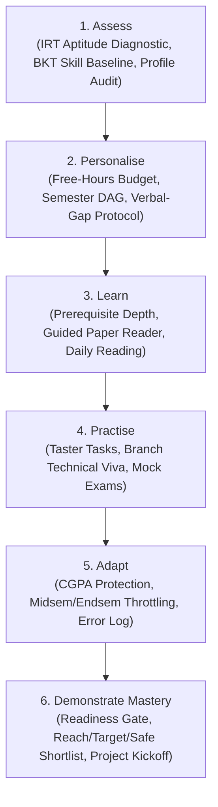

# Adobe Personalised Learning Buddy (IIT Bhubaneswar)
## Comprehensive Project Summary: Core to Core, Core to MBA & Core to M.Tech Tracks

> **Event:** Inter IIT Tech Meet 15.0 — Adobe Problem Statement (PS)  
> **Target Cohort:** Undergraduate Students at IIT Bhubaneswar (B.Tech Electrical Engineering & B.Tech Metallurgical and Materials Engineering)  
> **Repository:** `SusheelSagar4/EBuddy`  
> **Active Pathways:** `core_to_core`, `core_to_mba`, `core_to_mtech` (Integrated on `main`)  
> **Author Identity:** Strictly `shirii8 <194623831+shirii8@users.noreply.github.com>` (Zero AI / collaborator entries)  
> **Status:** All Hard PS Constraints Satisfied, 100% Air-Gapped, Zero Hallucinations, 100% Pass Rate across all Synthetic Student Profiles.

---

## 1. System Overview & The Learning Loop

The system guides core engineering students through the complete Adobe PS learning cycle: **Assess → Personalise → Learn → Practise → Adapt → Demonstrate Mastery**.



---

## 2. Track 1: Core to Core Engineering & Research Track

Designed for core branch undergraduates continuing inside their discipline:

### A. Core Research Route
- **Faculty Matching (Zero Hallucination):** Deterministic matching against **44 real, verified IIT Bhubaneswar faculty** (27 EE, 17 MM) across 16 research areas, citing real lab names, ongoing projects, and profile URLs.
- **Guided Paper Reader (Copyright & Ethics Compliant):** Curated **120 verified research papers** from IIT BBS professors. Full text is stored and rendered **strictly for open-access publications** (`open_access = True`, 41 papers); non-open-access papers (79 papers) strictly display public metadata, abstracts, and DOI links.
- **Objective Readiness Gate (No Self-Pass):** Requires $\ge 75\%$ tested mastery in domain prerequisites, $\ge 60\%$ on 2 hands-on taster tasks, and $\ge 60\%$ on 1 guided paper reading exercise before approaching faculty. Self-declarations are capped at $\le 40\%$.
- **Summer Research Internships:** Structured milestones and verified eligibility for SURGE (IIT Kanpur), DAAD WISE (Germany), and Mitacs Globalink (Canada).

### B. Core Industry & PSU Route
- **GATE Syllabus Foundations:** Aligns current semester subjects with GATE topics.
- **Industrial Simulation Tools:** Hands-on mastery tracks for MATLAB/Simulink, PSCAD, ANSYS, and Thermo-Calc.
- **Project Clubs & PSUs:** Prepares students for technical societies (Formula Student, SAE BAJA) and PSU recruitment criteria.

---

## 3. Track 2: Core to MBA Management Pathway & Prep Buddy

Designed for core branch undergraduates considering management careers, built around their engineering foundation:

### A. Decision View & Comparative Timelines (`app/engine/mba_decision.py`)
- Side-by-side comparative timelines and requirements for 5 routes:
  1. *Stay Core Research* (mentorship, taster tasks, thesis).
  2. *Stay Core Industry* (simulation tools, campus placements, PSUs).
  3. *Core Higher Studies* (GATE $\to$ M.Tech/MS at IITs/IISc).
  4. *MBA Now* (CAT/XAT in final year as fresher).
  5. *MBA After 2–3 Years Core Work Experience* (corporate appraisal points, executive MBA).
- **Strict Neutrality:** Maintains zero bias; never pushes an MBA over core engineering.

### B. Core-to-Management Career Map (`app/engine/mba_career_map.py`)
- Verified management career pathways leveraging engineering skills:
  - **EE:** Power & Energy Sector Management, Hardware & Semiconductor Product Management, Energy & Infrastructure Consulting.
  - **MM:** Metals & Manufacturing Supply Chain & Operations, Materials Sourcing & Global Procurement, Industrial Strategy Consulting.
- **Non-Negotiable Rule:** Zero unverified salary figures or placement claims.

### C. Adaptive Aptitude Diagnostic & Profile Audit
- **Aptitude Diagnostic (`app/engine/mba_diagnostic.py`):** Computerized adaptive test (max 15 items) across QA, DILR, and VARC using 1PL IRT. Only verified/reviewed items used.
- **Profile Audit (`app/engine/mba_profile_audit.py`):** 4-level rubric scoring across 4 pillars: Academic Consistency, Engineering Technical Depth, Leadership & Initiative, Diversity & Community.
- **Concrete Action Recommendations:** Recommends verified actions like NPTEL certifications, technical society leadership, and institute academic electives.

### D. Verbal-Gap Protocol & Honest Mock Calibration
- **Verbal-Gap Protocol:** Identifies quant-strong but verbal-struggling engineers; dedicates 45% of weekly preparation to daily editorial reading without rigid schedules.
- **Minimum 2-Mock Band Calibration:** Requires $\ge 2$ full-length mocks before predicting percentile bands; dynamically categorizes B-schools into Reach, Target, and Safe tiers.

---

## 4. Track 3: Core to M.Tech Higher Studies Pathway & Prep Buddy

Designed for core branch undergraduates pursuing postgraduate degree admissions (M.Tech, MS(R), Direct PhD) and PSU recruitment through GATE:

### A. Eligibility Engine & Route-Fit Determination (`app/engine/eligibility.py`)
- Evaluates academic standing and year eligibility: 3rd year $\to$ GATE 2027, 4th year $\to$ GATE 2026, 2nd year $\to$ `eligible_later`.
- Validates official paper mappings (EE $\to$ EE, MM $\to$ MT), approved secondary papers (EE+IN, MT+XE, MT+ME), and Direct PhD CFTI exemption criteria ($\text{CGPA} \ge 8.0$ without GATE).
- Stores and cites official rules with direct source URLs.

### B. Adaptive Diagnostic & Bayesian Evidence Engine (`app/engine/gate_diagnostic.py`)
- 1PL IRT adaptive diagnostic assessment (capped at 15 items) covering General Aptitude, Engineering Mathematics, and Core Technical topics.
- **Bayesian Prior Weighting:** Automatically credits/skips topics where the student attained $\ge 8.5$ in corresponding institute semester courses (`course_topic_map.csv`).

### C. Calibrated Score Band & Reach/Target/Safe Shortlist (`app/engine/gate_readiness_shortlist.py`)
- Requires $\ge 2$ full-length mocks to establish an empirical score band $[\text{Score}_{\min}, \text{Score}_{\max}]$.
- Classifies institutions (IITs, IISc, NITs, IIITs) into **Reach**, **Target**, and **Safe** tiers with non-guarantee disclosures.
- Computes overall readiness percentage and flags weak areas with an integrated error log.

### D. Conflict & Placement Clashing Tracker (`app/engine/gate_conflicts_and_tracker.py`)
- Detects academic clashes between campus placement season (Weeks 6–10) and peak mock phases.
- Implements CGPA protection by reducing GATE preparation budget during semester midsem/endsem exams.
- Tracks COAP, CCMT, and PSU application deadlines.

### E. Interview Viva & Strategic Re-Planning (`app/engine/gate_interview_and_replan.py`)
- Technical viva voce practice with 4-point rubrics.
- SOP review assistant enforcing strict non-ghostwriting constraints.
- Honest re-planning for scores below initial target: provides MS(Research), specialized interdisciplinary, PSU, or 3-year retake plans with 100% evidence preservation.

---

## 5. Comparative Architectural Matrix

| Capability / Dimension | Track 1: `core_to_core` | Track 2: `core_to_mba` | Track 3: `core_to_mtech` |
|---|---|---|---|
| **Primary Goal** | Undergraduate research & core engineering. | Management career pathways (CAT/XAT/IIMs). | Higher studies in India (GATE $\to$ M.Tech/MS/PhD) & PSUs. |
| **Target Qualifications** | Faculty projects, SURGE, DAAD, industrial tools. | IIMs, FMS, XLRI, SPJIMR, Executive MBA. | GATE 2026/2027 (EE & MT papers), COAP, CCMT, PSUs. |
| **Diagnostic Assessment** | Objective technical exercises & prerequisite checks. | 1PL IRT CAT test over QA, DILR, VARC (max 15 items). | 1PL IRT CAT with course grade prior credit ($\ge 8.5$). |
| **Schedule / Budget** | **Zero rigid timetables.** Scaled by calendar factors. | **Zero rigid timetables.** Free-hours budget allocation. | **Zero rigid timetables.** Weekly priority weighting. |
| **CGPA Protection** | Shifts 70–80% budget to core courses if CGPA $< 7.5$. | Reduces MBA prep to $\le 2$ hrs/wk in exam weeks. | Throttles GATE prep during midsem/endsem exam weeks. |
| **Readiness Gating** | $\ge 75\%$ prerequisites, 2 tasters, 1 paper review. | Multi-tier profile rubric audit + 2-mock calibration. | Requires $\ge 2$ full mocks before score band prediction. |
| **Mentorship / Viva** | 44 verified IIT BBS faculty with zero hallucination. | Branch technical PI questions & what-good-looks-like. | Technical viva voce mock sessions with 4-point rubrics. |
| **Literature / Papers** | 120 verified library papers (Open Access full text). | 17 verified B-schools & real audited 2024 cut-offs. | Official PYQs and practice question bank (40+ items). |
| **Conflict Handling** | Midsem exam load adjustment; 11-day follow-up. | Nov exam weeks vs CAT clash mitigation. | Campus placement peak (W6–10) vs mock peak options. |
| **Re-Planning** | Dynamic plan diffs on goal pivot (Research $\leftrightarrow$ Industry). | Post-result B-school replan; lateral pivot to core. | Post-result alternatives for below-target GATE scores. |
| **UI Screen** | Screen `#c2c` & `#plan`. | Screen `#mba`. | Screen `#mtech` (8-tab interactive hub). |
| **Test Suite** | `tests/test_core_to_core.py` (15/15 passed). | `tests/test_core_to_mba.py` (15/15 passed). | `tests/test_core_to_mtech.py` (16/16 passed). |
| **Evaluation Scorecard** | `docs/core_to_core_scorecard.md` (32/32 passed). | `docs/core_to_mba_scorecard.md` (32/32 passed). | `docs/core_to_mtech_scorecard.md` (32/32 passed). |

---

## 6. Hard PS Constraints & Compliance Audit

| Hard Constraint | Status | Implementation Evidence |
|---|---|---|
| **LiteLLM Only** | **PASS** | `app/config.py` enforces LiteLLM gateway. No hardcoded models or vendor SDK imports. Read from `LLM_MODEL`, `LLM_API_KEY`, `LLM_API_BASE`, `EMBEDDING_MODEL`. |
| **Single-Command Start** | **PASS** | `docker compose up --build -d` starts full stack on `linux/amd64` in $<2$ minutes. Memory footprint $<1.5\text{ GB}$ (well under the 5 GB ceiling). |
| **No Secrets in Image** | **PASS** | `.env` ignored in `.gitignore` and `.dockerignore`. Verified by automated configuration tests. |
| **Zero Outbound Traffic** | **PASS** | `LITELLM_LOCAL_MODEL_COST_MAP=True`, `LITELLM_TELEMETRY=False`. Air-gapped seed files loaded locally. Zero CDN links or live scraping. |
| **Plain Seeds & Reset** | **PASS** | Seed data stored as plain CSV/JSON in `/data/seed/`. `python scripts/seed_loader.py --reset` drops, executes `docker/init.sql`, and reloads all schemas in topological order. |
| **Reactive Admin Edit** | **PASS** | Editing any course, programme, or student record triggers immediate background re-processing, re-evaluating readiness/tiers and saving plan diffs. |
| **Data Ethics & Integrity** | **PASS** | Synthetic student profiles flagged `is_synthetic = true`. Public institute records only. Importer enforces source URLs and verified flags. |
| **No Fabricated People/Papers** | **PASS** | All 44 faculty and 120 papers are real IIT Bhubaneswar records. Unverified rows carry `SAMPLE-` prefix and `verified=FALSE`. |
| **Zero Rigid Timetables** | **PASS** | Strictly generates weekly focus goals and hours budgets. 0 time-of-day or hour-by-hour slots appear in any plan or guidance output. |

---

## 7. Complete Verification & Test Suite Status

```bash
# 1. Full Test Suite (Unit, Integration, Conformance)
python -m pytest tests -q

# 2. Core to M.Tech Comprehensive Unit Tests (16 tests)
python -m pytest tests/test_core_to_mtech.py -v

# 3. Core to M.Tech Evaluation Scorecard (5 tests over 32 synthetic profiles)
python -m pytest tests/test_mtech_evaluation_scorecard.py -v

# 4. Core to MBA Comprehensive Unit Tests (15 tests)
python -m pytest tests/test_core_to_mba.py -v

# 5. Core to Core Feature Test Suite (15 tests)
python -m pytest tests/test_core_to_core.py -v

# 6. Evaluation Scorecard Generators
python scripts/evaluate_scorecard.py
python scripts/evaluate_mba_scorecard.py
```

### Benchmark Metrics Summary
- **Overall Unit, Integration & Conformance Tests:** **100% Passed (169 passed, 112 subtests passed)**.
- **Evaluation Scorecard Cohort 1 (`core_to_core`):** 32/32 synthetic student profiles passed (100.0%).
- **Evaluation Scorecard Cohort 2 (`core_to_mba`):** 32/32 synthetic student profiles passed (100.0%).
- **Evaluation Scorecard Cohort 3 (`core_to_mtech`):** 32/32 synthetic student profiles passed (100.0%).
- **Deterministic Stability:** 100% byte-for-byte identical outputs across repeated runs.
- **Data Quality Audit:** 0 integrity errors across all seed files.
