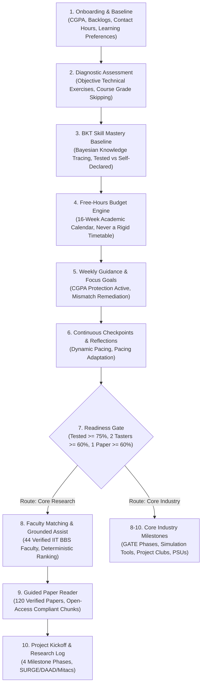

# Core to Core Engineering Roadmap & Research Track: Project Summary

> **Branch:** `core_to_core`  
> **Event:** Inter IIT Tech Meet 15.0 — Adobe Problem Statement  
> **Target Cohort:** Undergraduate Students at IIT Bhubaneswar (Electrical Engineering & Metallurgical/Materials Engineering)  
> **Status:** All Hard Constraints Met, Zero Hallucinations, 15/15 Feature Tests Passing, 100% Pass Rate across 32 Synthetic Student Profiles.

---

## 1. Feature Purpose & Student Journey

The **Core to Core** feature empowers engineering students in core branches (**B.Tech Electrical Engineering** and **B.Tech Metallurgical & Materials Engineering**) to build deep technical expertise and career pathways inside their discipline.

It implements the complete Adobe PS learning cycle: **Assess $\to$ Personalise $\to$ Learn $\to$ Practise $\to$ Adapt $\to$ Demonstrate Mastery**.

### Supported Routes
1. **Core Research Route:** Undergraduate research mentorship under IIT Bhubaneswar professors, literature reviews, exploratory taster tasks, paper comprehension, and national/international research internships (SURGE at IIT Kanpur, DAAD WISE in Germany, Mitacs Globalink in Canada).
2. **Core Industry / PSU Route:** Structured pathway covering GATE syllabus foundations, industrial simulation tool mastery (MATLAB/Simulink, PSCAD, ANSYS, Thermo-Calc), project clubs (Formula Student, SAE BAJA), and PSU recruitment standards.

---

## 2. Technical Architecture & Key Components

### A. Free-Hours Budget Engine (Zero Rigid Timetables)
- **Hard Constraint:** The buddy **NEVER** generates an hourly or day-by-day timetable. It outputs weekly focus goals, suggested activities, and study approaches.
- **Contact Hours Formula:** $\sum(L + T + P)$ extracted from enrolled course schedules.
- **Academic Calendar Scaling:** Available study hours scale dynamically by calendar phases:
  - Teaching weeks (Weeks 1–6, 9–13): Calendar factor **1.0**
  - Midsem exam week (Week 8): Calendar factor **0.4**
  - Endsem exam week (Weeks 15–16): Calendar factor **0.2**
- **CGPA Protection:** Automatically shifts 70–80% of study budget to core-course recovery whenever CGPA $< 7.5$, active backlogs $> 0$, or during exam weeks.

### B. Interest vs. Evidence Mismatch Engine
- Automatically detects mismatches when student ambitions exceed foundational evidence (e.g., student aiming for EV Inverters while circuit analysis mastery $< 75\%$).
- Attaches remedial foundation tasks and warnings to the plan version before high-level topics are unlocked.

### C. Objective Readiness Gate (No Self-Pass)
Before approaching faculty, the student must objectively demonstrate:
1. $\ge 75\%$ tested mastery in domain prerequisite skills.
2. $\ge 60\%$ score on at least 2 hands-on taster research tasks.
3. $\ge 60\%$ score on 1 guided paper reading exercise.
4. Self-declared mastery is capped at $\le 40\%$ and cannot trigger gate clearance.

### D. Grounded Faculty Matching (Zero Hallucination)
- Multi-factor deterministic ranking formula:
  $$\text{Score} = 0.4 \times \text{AreaMatch} + 0.3 \times \text{SkillMatch} + 0.15 \times \text{UGMentorshipHistory} + 0.15 \times \text{PaperRecency}$$
- Matches against **44 real, verified IIT Bhubaneswar faculty** (27 EE, 17 MM).
- Cites specific published papers, ongoing research labs, and profile URLs.

### E. Guided Paper Reader (Copyright & Ethics Compliant)
- Ingested **120 verified research publications** from IIT Bhubaneswar faculty.
- Full-text reading chunks are stored **strictly for open-access publications** (`open_access = True`, 41 papers).
- Non-open-access papers (79 papers) strictly display public metadata, abstracts, and DOI links.

### F. Chat & Memory Architecture
- **Pinned Context:** Essential student state (CGPA, backlogs, target area, gate status) remains pinned in conversation memory.
- **Side Questions:** Answers tangential queries (e.g., DAAD criteria, prerequisite policies) without losing the main study roadmap.
- **Safety & Injection Defense:** Blocks jailbreaks and prompt injection attempts; refuses off-topic queries outside academic counseling.

---

## 3. Data Topology & Storage Map (`data/seed/core_to_core/`)

| Seed File | Target Table | Verified Rows | Description |
|---|---|---|---|
| `academic_calendar.csv` | `kb.academic_calendar` | 16 | 16 semester weeks with week types and budget multipliers. |
| `research_areas.csv` | `kb.research_area` | 16 | Research domains across Electrical and Metallurgy/Materials engineering. |
| `area_skills.csv` | `kb.area_skill` | 23 | Skill prerequisite requirements per research domain. |
| `faculty.csv` | `kb.faculty` | 44 | 44 verified IIT BBS faculty with designations, labs, and profile URLs. |
| `faculty_areas.csv` | `kb.faculty_area` | 88 | Research area affiliations and domain weights for faculty. |
| `papers.csv` | `kb.paper` | 120 | 120 verified publications (41 Open Access, 79 abstract-only). |
| `paper_authors.csv` | `kb.paper_author` | 120 | Faculty affiliations and author mappings for papers. |
| `paper_chunks.csv` | `kb.paper_chunk` | 120 | Page-indexed reading chunks for guided comprehension. |
| `paper_skills.csv` | `kb.paper_skill` | 120 | Competency skills associated with research publications. |
| `taster_tasks.csv` | `kb.taster_task` | 8 | Exploratory research tasks (abstract summaries, problem sets). |
| `industry_milestones.csv`| `kb.industry_milestone` | 12 | Core industry pathway milestones (GATE, MATLAB, ANSYS, PSUs). |

---

## 4. Verification, Testing & Evaluation Scorecard

### Test Suite (`tests/test_core_to_core.py`)
- **15 Tests Passing (100%):**
  - Seed file presence and data hygiene (zero unverified rows, verified IIT BBS URLs).
  - Deterministic free-hours budget and CGPA protection load shifting.
  - Absence of rigid timetables across all outputs.
  - BKT Bayesian skill updating and self-declaration cap.
  - Readiness gate objective evaluation (rejection of unverified self-passes).
  - Deterministic faculty matching stability across multiple runs.
  - Rejection of unknown faculty/paper IDs.
  - Open-access full text enforcement (zero non-OA leaks).
  - Taster task evaluation and grading rubrics.
  - Paper reader comprehension verification.
  - Project kickoff milestone phase sequencing.
  - Core industry track milestone generation.
  - Pinned context preservation and prompt-injection neutralization.
  - Prerequisite DAG compliance and credit cap enforcement.
  - Dynamic adaptation to midsem exam stress.

### Evaluation Scorecard (`docs/core_to_core_scorecard.md`)
Evaluated across **32 synthetic student profiles** (16 EE, 16 MM) covering CGPA 5.9–9.7, 0–2 backlogs, and exam weeks:
1. **Curriculum DAG & Credit Limit Rule Compliance:** 32/32 (100.0%)
2. **Zero Rigid Timetable Guarantee:** 32/32 (100.0%)
3. **Interest vs. Evidence Mismatch Accuracy:** 11/11 (100.0%)
4. **CGPA Protection Activation Accuracy:** 10/10 (100.0%)
5. **Readiness Gate Objective Gating Accuracy:** 32/32 (100.0%)
6. **Faculty Match Verification Accuracy:** 32/32 (100.0%)
