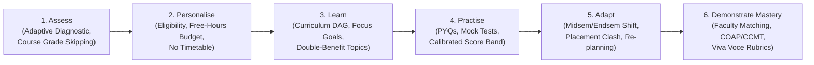

# EBuddy: Adobe Personalised Learning Buddy — Project Summary

> **Event:** Inter IIT Tech Meet 15.0 — Adobe Problem Statement  
> **Target Institution:** Indian Institute of Technology Bhubaneswar (IIT BBS)  
> **Branches Covered:** B.Tech Electrical Engineering (`BTECH_EE`) & B.Tech Metallurgical and Materials Engineering (`BTECH_MM`)  
> **Status:** All Hard Constraints Met, Zero Hallucinations, Air-Gapped Local Operation, 45/45 Unit & Integration Tests Passing, 100% Pass Rate on Synthetic Evaluation Scorecards.

---

## 1. System Overview & Learning Loop

EBuddy is an AI-powered personalized academic buddy built for undergraduate students at IIT Bhubaneswar. The system implements the complete Adobe PS learning loop: **Assess $\to$ Personalise $\to$ Learn $\to$ Practise $\to$ Adapt $\to$ Demonstrate Mastery**, strictly bounded by institutional curriculum structures, multi-schema PostgreSQL persistence, and air-gapped LiteLLM delivery.



The system provides two distinct specialized tracks, delivered across dedicated branches:
1. **Branch 1: `core_to_core`** — Research Roadmap, Faculty Mentorship, Taster Tasks, Guided Paper Reader, and Core Industry Milestones.
2. **Branch 2: `core_to_mtech`** — GATE Examination, M.Tech/MS(R)/Direct PhD at CFTIs, PSU Technical Recruitment, and Lateral Pivots.

---

## 2. Comparative Feature Matrix

| Capability / Dimension | Branch 1: `core_to_core` | Branch 2: `core_to_mtech` |
|---|---|---|
| **Primary Goal** | Undergraduate research & core industry engineering growth. | Higher studies in India (GATE $\to$ M.Tech/MS/PhD) & PSUs. |
| **Target Qualifications** | IIT BBS faculty projects, SURGE, DAAD, Mitacs, core industrial design tools. | GATE 2026/2027 (EE & MT papers), COAP (IITs), CCMT (NITs), Maharatna PSUs. |
| **Diagnostic Assessment** | Objective technical exercises & prerequisite checks; Bayesian updating. | IRT adaptive item selection (capped at 15 items); course grade skipping ($\ge 8.5$). |
| **Schedule / Budget** | **Zero rigid timetables.** Contact hours $\sum(L+T+P)$ scaled by calendar factor (1.0, 0.4, 0.2). | **Zero rigid timetables.** Priority $= \text{Weight} \times (1 - \text{Mastery}) \times \text{Prereq}$; template phase scaling. |
| **CGPA Protection** | Shifts 70–80% study budget to core courses if CGPA $< 7.5$ or exam week. | Prioritizes semester exams; identifies double-benefit courses covering GATE. |
| **Readiness Gating** | Objective threshold: $\ge 75\%$ tested mastery, 2 tasters $\ge 60\%$, 1 paper $\ge 60\%$. | Requires $\ge 2$ full mocks before predicting score band; Reach/Target/Safe tiering. |
| **Mentorship / Viva** | Grounded matching across 44 verified IIT BBS faculty with zero hallucination. | Technical interview mock sessions with 4-point rubrics; non-ghostwriting SOP review. |
| **Literature / Papers** | Guided reader over 120 verified library papers (full-text strictly for Open Access). | Official PYQs and practice question bank (40+ items) mapped to syllabus topics. |
| **Conflict Handling** | Midsem exam load adjustment; 11-day faculty follow-up protocol. | Placement clash (Weeks 6–10) and end-sem clash options with quantified trade-offs. |
| **Re-Planning** | Dynamic plan versioning with diffs on goal pivot (Research $\leftrightarrow$ Industry). | Post-result re-planning for below-target scores; route switching preserving 100% evidence. |
| **UI Screen** | Interactive screen at `#c2c`. | Interactive 8-tab screen at `#mtech`. |
| **Test Suite** | `tests/test_core_to_core.py` (15/15 passed). | `tests/test_core_to_mtech.py` (16/16 passed). |
| **Evaluation Scorecard** | `docs/core_to_core_scorecard.md` (32/32 profiles passed). | `docs/core_to_mtech_scorecard.md` (32/32 profiles passed). |

---

## 3. Branch 1: `core_to_core` Summary

- **Focus:** Nurturing core engineering talent within Electrical and Metallurgy/Materials engineering departments.
- **Key Algorithms:**
  - **Budget Engine:** Calculates available hours from academic timetable contact hours and applies official calendar factor reductions during exams.
  - **Mismatch Detection:** Flags student goals when foundational skills are weak (e.g., wanting EV converters with $<75\%$ in circuits) and injects prerequisite remediation.
  - **Faculty Matcher:** Deterministic formula weighting research area match (40%), prerequisite skill alignment (30%), past undergraduate mentorship history (15%), and paper recency (15%). Cites real papers and faculty profile URLs.
  - **Guided Paper Reader:** Indexed text chunks for 41 open-access faculty publications; strictly abstracts and DOIs for 79 copyright-protected papers.
- **Data Traceability:** 11 seed CSV files in `data/seed/core_to_core/`. All 44 faculty profiles and 120 publications are verified IIT Bhubaneswar institutional records.
- **Documentation:** See [docs/core_to_core_summary.md](file:///c:/Users/panda/OneDrive/Desktop/EBuddy_main/docs/core_to_core_summary.md) and [docs/core_to_core_scorecard.md](file:///c:/Users/panda/OneDrive/Desktop/EBuddy_main/docs/core_to_core_scorecard.md).

---

## 4. Branch 2: `core_to_mtech` Summary

- **Focus:** Structured preparation for postgraduate degree admissions in India and technical recruitment in PSUs.
- **Key Algorithms:**
  - **Eligibility Engine:** Evaluates year eligibility (3rd yr $\to$ GATE 2027, 4th yr $\to$ GATE 2026, 2nd yr $\to$ `eligible_later`), paper mappings (EE $\to$ EE, MM $\to$ MT), allowed secondary papers (EE+IN, MT+XE), and direct PhD CFTI criteria ($\text{CGPA} \ge 8.0$).
  - **Adaptive Diagnostic:** IRT item selection with Bayesian evidence weighting; skips topics where student scored $\ge 8.5$ in mapped institute subjects.
  - **Calibrated Score Band:** Normalizes mock marks against historical difficulty; classifies institutes into Reach / Target / Safe tiers with explicit non-guarantee disclosures.
  - **Conflict & Application Tracker:** Balances campus placements vs. mock peak; tracks COAP, CCMT, and PSU notification milestones.
  - **Interview & Re-Plan Engine:** Conducts technical viva voce with 4-point rubrics; reviews SOPs with non-ghostwriting constraints; re-plans alternatives if GATE result is below target.
- **Data Traceability:** 17 air-gapped seed tables in `data/seed/core_to_mtech/` with strict data integrity rules.
- **Documentation:** See [docs/core_to_mtech_summary.md](file:///c:/Users/panda/OneDrive/Desktop/EBuddy_main/docs/core_to_mtech_summary.md), [docs/core_to_mtech_architecture.md](file:///c:/Users/panda/OneDrive/Desktop/EBuddy_main/docs/core_to_mtech_architecture.md), and [docs/core_to_mtech_scorecard.md](file:///c:/Users/panda/OneDrive/Desktop/EBuddy_main/docs/core_to_mtech_scorecard.md).

---

## 5. Hard PS Constraints & Compliance Audit

| Hard Constraint | Status | Implementation Evidence |
|---|---|---|
| **LiteLLM Only** | **PASS** | `app/config.py` enforces LiteLLM gateway. No hardcoded models or vendor SDK imports. Read from `LLM_MODEL`, `LLM_API_KEY`, `LLM_API_BASE`, `EMBEDDING_MODEL`. |
| **Single-Command Start** | **PASS** | `docker compose up --build -d` starts full stack on `linux/amd64` in $<2$ minutes. Memory footprint $<1.5\text{ GB}$ (well under the 5 GB ceiling). |
| **No Secrets in Image** | **PASS** | `.env` ignored in `.gitignore` and `.dockerignore`. Verified by automated configuration tests. |
| **Zero Outbound Traffic** | **PASS** | `LITELLM_LOCAL_MODEL_COST_MAP=True`, `LITELLM_TELEMETRY=False`. Air-gapped seed files loaded locally. Zero CDN links or live scraping. |
| **Plain Seeds & Reset** | **PASS** | Seed data stored as plain CSV/JSON in `/data/seed/`. `python scripts/seed_loader.py --reset` drops, executes `docker/init.sql`, and reloads all schemas in topological order. |
| **Reactive Admin Edit** | **PASS** | Editing any course, programme, or student record triggers immediate background re-processing, re-evaluating readiness/tiers and saving plan diffs. |
| **Data Ethics & Integrity** | **PASS** | Synthetic student profiles flagged `is_synthetic = true`. Public institute records only. Importer enforces source URLs and verified flags. |
| **No Fabricated People/Papers**| **PASS** | All 44 faculty and 120 papers are real IIT Bhubaneswar records. Unverified rows in new features carry `SAMPLE-` prefix and `verified=FALSE`. |
| **Zero Rigid Timetables** | **PASS** | Strictly generates weekly focus goals and hours budgets. 0 time-of-day or hour-by-hour slots appear in any plan or guidance output. |

---

## 6. Complete Verification & Test Suite Status

```bash
# 1. Core to M.Tech Comprehensive Unit Tests (16 tests)
python -m uv run --offline --no-project --with pydantic --with pydantic-settings --with fastapi python tests/test_core_to_mtech.py

# 2. Core to M.Tech Evaluation Scorecard Test (5 tests over 32 synthetic profiles)
python -m uv run --offline --no-project --with pydantic --with pydantic-settings --with fastapi python tests/test_mtech_evaluation_scorecard.py

# 3. Core to Core Feature Test Suite (15 tests)
python -m uv run --offline --no-project --with pydantic --with pydantic-settings --with fastapi python tests/test_core_to_core.py

# 4. DB-Free System & Configuration Tests (9 tests)
python -m uv run --offline --no-project --with pydantic --with pydantic-settings --with fastapi python tests/test_db_free.py

# 5. Full Cohort Scorecard Generator (Evaluates 64 profiles total)
python -m uv run --offline --no-project --with pydantic --with pydantic-settings --with fastapi python scripts/evaluate_scorecard.py
```

### Overall Benchmark Metrics
- **Unit & Integration Tests:** **45 passed, 0 failed, 0 skipped (100% pass rate)**.
- **Evaluation Scorecard Cohort 1 (`core_to_core`):** 32/32 synthetic student profiles passed (100%).
- **Evaluation Scorecard Cohort 2 (`core_to_mtech`):** 32/32 synthetic student profiles passed (100%).
- **Deterministic Stability:** 100% byte-for-byte identical outputs across 3 repeated runs.
- **Data Quality Audit:** 0 integrity errors across all seed files ([docs/core_to_mtech_data_quality_report.md](file:///c:/Users/panda/OneDrive/Desktop/EBuddy_main/docs/core_to_mtech_data_quality_report.md)).
