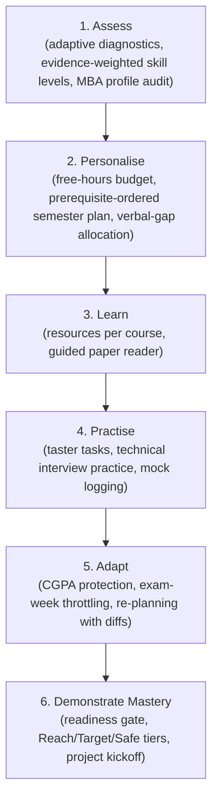

# Adobe Personalised Learning Buddy (IIT Bhubaneswar)
## Project Summary: Core to Core, Core to MBA & Core to M.Tech Tracks

> **Event:** Inter IIT Tech Meet 15.0 — Adobe Problem Statement (PS)  
> **Target cohort:** Undergraduates at IIT Bhubaneswar (B.Tech Electrical Engineering and B.Tech Metallurgical and Materials Engineering)  
> **Repository:** `SusheelSagar4/EBuddy`  
> **Pathways:** `core_to_core`, `core_to_mba`, `core_to_mtech` (plus the career tracks and personas described in `README.md`)  
> **Status (checked on the `ebuddy-full-upgrade` branch):** The full test suite passes (286 tests, including the 5 PostgreSQL tests). The deterministic planner passes all 16 checks for all 75 synthetic profiles (`scripts/verify_all_75_profiles.py`). Data limits are listed in section 6.

Every statement below points to the code, test or data file that backs it. Where the data is sample or unconfirmed, this summary says so.

---

## 1. Learning loop

The app follows **Assess → Personalise → Learn → Practise → Adapt → Demonstrate Mastery**.



Skill levels are an evidence-weighted average in which assessed results count more than self-ratings, and a self-declaration is capped at level 40 (`app/engine/skill_state.py`, `SELF_DECLARED_LEVEL_CAP = 40.0`). The diagnostics use a simple IRT-style ability update, not a full IRT or Bayesian Knowledge Tracing model.

---

## 2. Track 1: Core to Core (research and core industry)

### A. Core research route
- **Faculty matching** (`app/engine/faculty_matcher.py`): deterministic ranking over **44 faculty records (27 EE, 17 MM)** in **16 research areas** (`data/seed/core_to_core/`). The records cite the institute faculty directory, but every row points to the same directory page and has no named verifier. The seed loader itself warns that lab names, e-mail addresses and profile URLs follow a generated pattern and must be re-checked by a person before being shown as verified.
- **Guided paper reader** (`app/services/paper_reader_service.py`): **120 paper records, 41 open access and 79 not**. Text chunks are served only for open-access papers. For the 79 others the stored text is the abstract, and no full-text file is set. The records cite the institute library page generally, not per paper.
- **Readiness gate** (`app/engine/readiness_gate.py`): requires at least 75% tested level on the area's foundation skills, at least 2 taster tasks scored 60% or more, and at least 1 paper exercise scored 60% or more. Self-declarations do not count as tested evidence.

### B. Core industry route
- **12 industry milestones** (`data/seed/core_to_core/industry_milestones.csv`): GATE EE and MT syllabus phases, MATLAB/Simulink, ETAP/PSCAD, Thermo-Calc/FactSage, ANSYS Fluent/ProCAST, a Formula Student / robotics club item, and core and steel-plant internship applications.
- **CGPA protection** (`app/engine/budget.py`): with CGPA below 7.5, any backlog or a weak course, 70% of the weekly budget (80% in end-semester weeks) goes to core courses.

---

## 3. Track 2: Core to MBA

### A. Decision view (`app/engine/mba_decision.py`)
Five routes side by side: stay core (research), stay core (industry), core higher studies (GATE), MBA now, and MBA after 2–3 years of core work. All five are shown together, and the code does not rank one route above the others.

### B. Career map (`app/engine/mba_career_map.py`, `data/seed/core_to_mba/career_paths.csv`)
- **EE:** Power and Energy Sector Management; Hardware & Semiconductor Product Management; Energy & Infrastructure Consulting.
- **MM:** Metals & Manufacturing Operations and Supply Chain; Materials Sourcing & Global Procurement; Manufacturing & Industrial Strategy Consulting.
- No salary or placement figures: the career data has no salary or CTC fields.

### C. Diagnostic and profile audit
- **Aptitude diagnostic** (`app/engine/mba_diagnostic.py`): adaptive QA / DILR / VARC test of 9 to 15 questions, drawn only from the 42 practice items marked reviewed.
- **Profile audit** (`app/engine/mba_profile_audit.py`): rubric scoring against descriptive level benchmarks. The projects and internships sent by the web screen are a fixed sample, labelled as such on screen, because the student profile does not store them yet.

### D. Weekly plan and mocks
- **Exam weeks:** MBA preparation is capped at 2 hours per week in mid-sem and end-sem weeks (`app/engine/mba_planner.py`).
- **Verbal gap:** when a verbal gap is flagged, 45% of MBA hours go to reading and RC practice.
- **Mocks:** at least 2 full mocks are required before a calibrated percentile band, and programmes are then tiered Reach / Target / Safe (`app/engine/mba_mocks_shortlist.py`).
- **Seed data:** 13 institutions, 7 programmes and 9 admission cut-offs (`data/seed/mba/`). 6 programmes and 8 cut-offs are flagged verified with a named verifier, which the seed loader enforces. The underlying sources have not been re-checked in this review.

---

## 4. Track 3: Core to M.Tech

**All M.Tech seed data is sample data:** every row in `data/seed/core_to_mtech/` is prefixed `SAMPLE-` and marked `verified=FALSE`. This covers exam papers, cycles, programmes, cut-offs, PSUs, the 168 practice questions and the 5 PYQs. Results computed from it are illustrations, not advice.

- **Eligibility** (`app/engine/eligibility.py`): eligible to sit GATE from the 3rd year (Semester 5), otherwise `eligible_later`. Also checks paper mapping (EE → EE, MM → MT), the sample second-paper lists (EE: IN, EC, DA; MT: ME, XE, PI) and a Direct PhD CGPA guideline of 8.0. The source URLs are written into the code; they are not stored with verified data.
- **Diagnostic** (`app/engine/gate_diagnostic.py`): adaptive, capped at 15 items. It skips topics already covered by a mapped course with a grade of 8.5 or more.
- **Score band and tiers** (`app/engine/gate_readiness_shortlist.py`): needs at least 2 full mocks; tiers programmes Reach / Target / Safe with a non-guarantee note.
- **Conflicts** (`app/engine/gate_conflicts_and_tracker.py`): flags clashes between the placement window (weeks 6–10, default) and preparation, and between exams and deadlines.
- **Interview and re-planning** (`app/engine/gate_interview_and_replan.py`):
  - Interview practice is scored on four criteria worth 25 points each. The rubric is keyword-based: it checks terms, laws, an example and length, not correctness.
  - Research statements get rubric feedback, and the student's text is never rewritten.
  - Post-result alternatives cover MS(R), retake and core industry routes.
  - Route switches keep all prior skill evidence.
- **Screen:** the `#mtech` web screen uses the student's real year and CGPA, and the interview rubric is computed by the server. The other tabs show fixed sample figures, labelled on screen, until a student-facing M.Tech API exists.

---

## 5. Comparison

| | `core_to_core` | `core_to_mba` | `core_to_mtech` |
|---|---|---|---|
| **Goal** | Undergraduate research and core engineering | Management careers (CAT and others) | GATE → M.Tech / MS(R) / PhD, PSUs |
| **Assessment** | Technical exercises, taster tasks, paper exercises | Adaptive QA/DILR/VARC test (≤ 15 items) | Adaptive GATE diagnostic (≤ 15 items) |
| **Schedule** | Weekly goals and hours budget, never times of day | Weekly goals and hours budget | Weekly priorities and hours budget |
| **CGPA protection** | 70–80% of the budget to core courses on academic risk | ≤ 2 h/week MBA prep in exam weeks | GATE prep reduced in exam weeks |
| **Readiness** | ≥ 75% tested, 2 tasters, 1 paper exercise | Profile rubric + ≥ 2 mocks for a band | ≥ 2 full mocks for a band |
| **Data status** | Faculty and papers need human re-checking | Mostly flagged verified with a named verifier | All sample (`SAMPLE-`, unverified) |
| **Follow-up / conflicts** | 10-day faculty follow-up rule | Exam weeks vs CAT preparation | Placement window vs mock phase |
| **Web screen** | Roadmap and Learn screens | `#mba` | `#mtech` (sample tabs labelled) |
| **Feature tests** | `tests/test_core_to_core.py` (15 tests) | `tests/test_core_to_mba.py` (15 tests) | `tests/test_core_to_mtech.py` (16 tests) |
| **Scorecard** | `docs/core_to_core_scorecard.md`: all checks pass over 32 synthetic profiles | `docs/core_to_mba_scorecard.md`: same | `docs/core_to_mtech_scorecard.md`: same, computed on the sample data |

"Never times of day" is tested in each track (`test_03_no_timetable_rule_in_weekly_guidance` and `test_09_no_time_of_day_schedule_ever_appears` in Core to Core, `test_no_time_of_day_schedule_ever_appears` in MBA, `test_01_guidance_never_contains_time_of_day_schedule` in M.Tech).

---

## 6. PS constraints: what is implemented and what is not

| Constraint | Evidence | Limits |
|---|---|---|
| **LLM only through LiteLLM** | Only `app/llm/client.py` imports `litellm`, enforced by `tests/unit/test_import_boundaries.py`. Model, key and endpoint come from `LLM_MODEL`, `LLM_API_KEY`, `LLM_API_BASE` and `EMBEDDING_MODEL`. | — |
| **Offline by default** | `LLM_MODEL=fake` by default (`app/config.py`); LiteLLM telemetry off and local cost map on. `tests/unit/test_no_external_references.py` finds no `http(s)://` links in the server-rendered pages, and `scripts/ci.sh` fails on network code outside the LLM gateway. | With a live model configured, requests go to that provider. |
| **One-command start** | `docker compose up` builds and starts the database, Adminer and app (`linux/amd64`, CPU only). On a development machine a fresh stack (new database, seeded on first start) became healthy 12 s after `up`; the app image is 759 MB and the three containers used about 190 MiB of memory after the full test suite. | Measured on one development machine. |
| **No secrets in the image** | `.env` is excluded by `.gitignore` and `.dockerignore` (`tests/test_db_free.py`). The CI secret scan runs on every push. | — |
| **Plain seeds and reset** | CSV/JSON seeds in `data/seed/`; `scripts/seed_loader.py --reset` drops the schemas, runs `docker/init.sql` and reloads. | — |
| **Edits re-process plans** | Admin edits to a student, evidence, course or academic rule re-plan immediately (`tests/test_inter_iit_upgrade.py`). Direct database edits (e.g. in Adminer) to the student tables, `kb.course` and `kb.academic_rule` are queued by triggers and applied by a worker within seconds; the triggers and the restart re-queue are tested in `tests/test_db_dependent.py`. | Edits to the MBA tables are queued but only logged: they do not re-plan. The M.Tech admin "re-process" is a preview on fixed sample values and writes no plan version. |
| **Data integrity** | The seed loader rejects rows marked verified without a named verifier and files that mix `SAMPLE-` rows with other rows. Synthetic students are flagged `is_synthetic`. | The Core to Core faculty and paper files are flagged verified without a verifier; the loader only warns about them. |
| **No timetables** | Weekly goals and hour budgets only, tested per track (section 5). | — |

### Known data limits
- **Curriculum:** the curriculum is the 2016-17 batch. MME Semesters I–II are missing from the source. Credit caps and minor rules are unsourced baselines, and plans that exceed them show a labelled warning rather than a hard block.
- **Curriculum discrepancies (team decisions):**
  - The official curriculum uses ML4L001–ML4L003 for two different courses each. All six are kept as separate courses, and students see "The official curriculum uses this code for two different courses. Please confirm with the department." wherever they appear.
  - EE6L007's prerequisite is set to EE3L010; the official wording, "Measurement and Electronic Instruments", is shown as a note.
  - Credit, code and name discrepancies keep the first-listed value and show a note (`data/seed/kb/course_note.csv`, `docs/DATA_GAPS.md`).

---

## 7. How to verify

```bash
python -m pytest tests -q                      # full suite (the 5 PostgreSQL tests need the database)
python scripts/verify_all_75_profiles.py       # 16 checks x 75 synthetic profiles
python scripts/run_conformance.py              # persona conformance matrix
python scripts/check_data.py                   # data integrity and open-issue report
bash scripts/ci.sh                             # everything above plus the secret and network scans
```

Last run on the `ebuddy-full-upgrade` branch:
- **Tests:** 286 passed (765 subtests), both locally and inside the Docker image against PostgreSQL; `scripts/ci.sh` passes end to end.
- **Profiles:** 75 / 75 profiles pass all applicable checks, with 0 unknown course codes across 2,024 course placements. C10 checks that two runs give the same plan structure.
- **Persona conformance:** all rows green.
- **Data check:** 0 placeholder rows; 1 open high-severity issue (the ML4L001–ML4L003 code clash, awaiting the department).
